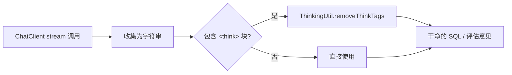

## 【学习目标】

- 定位并修复私有化接入的第一个协议级问题：HTTP 版本不兼容导致的 400 报错。
- 掌握 Qwen3 思考模式输出的两种处理方案及其权衡，能用文本后处理稳妥剥离 `<think>` 块。
- 理解小模型 + 评估循环场景下的超时根因，会按模型能力调整重试次数等关键参数。

## 【正文】

上一节已经把 Qwen3-4B 用 vLLM 启动，服务监听在 6006。这一课把 BI 报表问答系统接到该私有化端点上，过程中会连续遇到两个真实问题：协议版本不兼容的 400，以及思考模式输出的污染。两个问题都极具代表性，几乎是私有化接入的必经之路。

## 一、400 Bad Request：HTTP 协议版本不兼容

项目启动成功后访问 `/talk` 接口，验证它能否正常生成 SQL。

在浏览器里发起一个已经准备好的请求：计算 2025 年的销售总额，`user_id` 为 22。

这里会遇到一个坑，也是之前部署时踩过的：请求返回 `400 Bad Request`。回到 vLLM 的日志同样能看到对应的报错，说明这次对话请求被拒了。

根因是协议不兼容：vLLM 私有化部署的模型服务支持的是 HTTP 1.1，而当前 Spring AI 使用的 HTTP 协议高于 1.1，两端协议不匹配。解决办法是在代码里把 HTTP 协议版本显式改成 1.1。

400 的排查思路值得沉淀：请求打到了服务（不是连接拒绝），服务端日志有对应报错，说明问题在请求本身而非网络。两端日志一对，根因就落在协议协商上，客户端用了更高的协议版本，服务端不认识，直接拒绝。这类问题只靠改配置治不好，必须在客户端侧指定协议版本。

具体做法在文档中已经给出：创建一个配置类，定义对应的 bean，在返回时指定 `HttpClient` 的 version 为 HTTP 1.1。把这份配置复制到代码的 config 包下，新建类并粘贴，编译无报错后重启项目再测，看刚才的 400 是否消失。

如实说明：原稿此处只描述了配置类的写法（定义 bean、指定 `HttpClient` 的 version 为 HTTP 1.1），未附具体代码；不同版本的 Spring AI 定制 HTTP 客户端的入口略有差异，实际实现以所用版本的官方文档为准，不要照搬其他版本的示例。

重启完成后再次发起请求，这次返回 `200 OK`，代码侧也能看到模型已经给出返回。

```
Engine 000: Avg prompt throughput: 5.6 tokens/s, Avg generation throughput: 37.3 tokens/s
fix cache hit rate: 42.9%
```

这行 vLLM 日志是服务健康运行的佐证：prompt 吞吐 5.6 tokens/s、生成吞吐 37.3 tokens/s，还给出了缓存命中率。生成吞吐是本地推理最直观的性能指标，几十 tokens/s 的量级符合 4B 模型在 4090 上的预期，也解释了 12-4 里「Ollama 比在线 API 慢」的体感来源。

## 二、思考模式污染：`<think>` 块的处理

但返回内容里暴露出另一个问题：结果中带有明显的思考过程，也就是模型以思考模式输出。此前调用 Qwen3-Max 时并没有这段内容，业务上也不希望拿到它。

思考内容是模型推理过程的自然语言外显，直接混在正文里会把下游全链路带偏：评估节点要评估的是 SQL，思考段落会稀释评估重点；提取 JSON 的节点遇到思考包裹更是直接解析失败。所以「业务上不希望拿到」不是洁癖，是功能正确性问题。

处理方式有两条：一是改提示词、改代码；二是回到魔搭社区，文档里有「切换思考与非思考模式」一节，可以直接切换。文档同时还给出了 vLLM 的详细说明，点进去可以看到对应的启动命令：通过指定启动参数来使用特定的 chat template。该模板不会随模型一起下载下来，需要到 GitHub 上找到对应的模板，下载后放进模型目录，再用这条命令启动。这样启动的模型不具备思考能力，不会再返回 `<think>` 块，而是以非思考模式输出。

动手之前先补一段文档里的说明。为了 API 兼容性，当 `enable_thinking` 为 true 时，无论用户使用思考模式还是非思考模式，模型总会输出一个由 `<think>` 包裹的块；禁用思考能力时，该块的内容可能为空；而当该参数为 false 时，软开关失效。

由于当前并没有用前面提到的非思考模板启动，所以无论提示词怎么要求，输出里都会带 `<think>` 块，因此重点还是落在文本处理上。

这段话解释了一个常见困惑：为什么提示词里写了「不要输出思考过程」却不管用。软开关在模板层面就失效了，提示词属于模型输入侧的请求，压不住模板侧的输出结构。根治要走模板方案，缓解只能做文本后处理，本演示选后者，因为它不依赖外部模板文件，任何 OpenAI 兼容端点都能用。

最稳妥的做法是在生成 SQL 节点中对 `StreamPublisher` 的结果做处理。新增一个方法，因为属于通用能力，放到 util 包下比较合适：新建包并定义 `ThinkingUtil` 类，核心是用正则表达式把所有 `<think>` 包裹的内容替换为空，等价于把以 `<think>` 包裹的整段内容删掉。

随后在节点中调用：把 stream 转成字符串，拿到结果后调用该工具方法处理，`<think>` 包裹的部分会被完整剔除。

```java
public class GenSQLNode implements NodeAction {
    // ... 代码省略 ...
    String result = ThinkingUtil.removeThinkTags(str);
    return Man.get("genSQL", result);
}
```

如实说明：该代码块为原稿节选，`// ... 代码省略 ...` 之外的可见部分展示了关键调用：`ThinkingUtil.removeThinkTags(str)` 处理后再封装进 `Man.get("genSQL", result)`。把处理放在节点出口、util 独立成类，是为了让「剥离思考块」该通用能力被多个节点复用，而不是在每个节点里各写一遍正则。

同理，工作流中只有两个节点会与大模型交互，生成 SQL 节点和评估节点，评估节点也需要同样处理：先把结果转成字符串，调用工具方法拿到处理后的结果再返回。两个节点这样改完即可。

```java
public class EvaluateNode implements NodeAction {
    // ... 代码省略 ...
    .user(t -> t.text("需要评估的SQL：{genSQL}").param("user_query", genSQL))
    .stream(t -> t.text().content().toString());
```

如实说明：该代码块同样为原稿节选。可见部分对应 Spring AI `ChatClient` 的流式调用写法：`stream(...)` 收集流式片段再拼成完整字符串，随后即可交给 `ThinkingUtil` 处理。两个节点的差异只在提示词与后续处理，流式收集的写法完全一致，这也是把工具方法抽到 util 包的价值。



重启后再发起调用，从执行结果可以看到：生成的 SQL 是这样，评估结果是这样，流转到条件边时 `<think>` 块已经被删除，流程正常往下执行，输出中不再有 `<think>` 块。

## 三、评估失败与超时：小模型的现实边界

这次调用还顺带演示了评估失败的场景。失败原因是模型生成的 SQL 直接写了 `date_id = 2025` 再做 SUM，评估给出的意见是：语法虽然正确，但单引号使用不规范，用整数 2025 匹配不上，会导致类型不匹配；为正确传达「2025 年」的语义，建议改成某种写法。

该判断是正确的。到数据库里看日期维度的数据就会发现，`date_id` 里不会出现 2025 这样的值，都是 2025 年某月某日。换言之，这次评估失败的 SQL 确实有问题，模型给出的修改建议反而正确。

这一轮是评估节点价值的最佳演示：生成侧出了类型错误，评估侧准确识别并给出修改方向。11 章讲过的「评估-循环-微调」三件套，在这里完成了前两件的现场闭环。评估意见能被采纳，前提是它真的懂业务表结构，日期维度存的是完整日期而不是年份，这是领域知识，也是提示词里要交代清楚的。

由于反复评估失败又重试，流程继续执行时出现了读取超时的报错：执行时间过长，模型侧超时了。

这反映的是模型性能问题：这里用的是 4B 的模型，能力相对有限，重试次数一多，上下文就会变得很长，进而触发读取超时。

这里有两个叠加因素：其一，4B 模型生成质量有限，评估通过率低，重试次数被拉满；其二，每轮重试都把上一轮的 SQL 与评估意见追加进上下文，上下文越滚越长，单次推理耗时随之上升，最终撞上读取超时。超时不是偶发，是「弱模型 × 多次循环」的必然结果。

遇到这种情况可以按需调整：比如把循环次数降下来，当前设置的是五次，可以根据模型实际表现改成两次或三次，具体取决于所用模型的能力。

循环次数不是拍脑袋定的，要与模型能力匹配：强模型通过率高，循环是兜底；弱模型通过率低，循环只是拖延时间，不如快速失败让人工介入，或者换更大规格的模型。调参的依据应该是通过率统计，而不是惯例。

再补一个正确通过的示例：查询订单金额超过一万的大额订单，并连表显示客户名称和产品名称，`user_id` 传 33（浏览器里看到的是转义后的形式）。该请求生成的 SQL 已通过评估，状态为 pass。

到这里测试就完成了：用 vLLM 部署 Qwen 模型后，项目里直接连上该 vLLM 服务即可。

最后再强调 AutoDL 的差异：不同服务器的「自定义服务」形态并不一致。有的直接把 6006 端口暴露出来并给出公网地址；有的不暴露，只提供 SSH 密码。对于后者，可以在自己的 Linux 服务器上执行那条 SSH 命令，与 AutoDL 服务器建立 SSH 隧道，之后直接调用本地 Linux 服务器的 6006，流量就会抵达 AutoDL 上模型的 6006，从而完成调用。

至于 `api-key`，同样不需要真实值，但必须填写，随便写一个即可，OpenAI 协议里该属性不能省略。

至此，我们已经在 AutoDL 上完成了 Ollama 的私有化部署，以及用 vLLM 部署 Qwen 大模型。

## 【易错点 / 面试题】

1. **面试题：调用私有化模型返回 400，怎么排查？** 答：先看服务端日志有没有对应报错，有，说明请求到达了服务，问题在请求本身而非网络。本案例根因是 HTTP 协议版本不兼容：vLLM 支持 HTTP 1.1，客户端用了更高版本，需在配置类中显式指定 `HttpClient` 的 version 为 1.1。排查顺序：网络层 → 协议层 → 请求体 → 模型名。
2. **面试题：Qwen3 的思考输出为什么提示词压不住？** 答：`<think>` 块由 chat template 控制，`enable_thinking` 为 true 时模板总会输出该块，提示词属于输入侧，压不住输出结构。根治是用非思考模式的 chat template 启动，缓解是对输出做正则剥离，两者可按部署自由度选择。
3. **易错点：重试循环次数拍脑袋。** 弱模型通过率低，循环越多上下文越长、越容易超时。应按模型实际通过率把循环降到两三次，并给 LLM 调用配超时与降级，别让循环把请求拖死。

## 【小结】

本节修掉了私有化接入的两个典型问题：HTTP 协议版本不兼容（客户端显式降为 1.1）与思考模式输出污染（文本后处理或非思考模板），也看到了评估节点与循环机制在弱模型下的真实表现，评估价值依旧成立，但循环次数必须按模型能力调。到此，Ollama 与 vLLM 两条私有化部署路线全部走完。

配套工程 `980-demo` 把「弱依赖外部服务」的韧性做进了代码：`980-demo/src/main/java/com/carl/ai/transfer/extract/TransferOrderExtractor.java` 的 `extract` 方法用 resilience4j 的 `@CircuitBreaker` 包裹，超时或失败走 `extractFallback` 降级，对应本节「读取超时」场景的工程化答案；`980-demo/src/main/java/com/carl/ai/transfer/config/ChatModelConfig.java` 统一装配 OpenAI 兼容端点，`transfer.offline` 开关让整套链路在没有 GPU 的机器上也能用 `OfflineChatModel` 验证。生产环境接私有化模型时，超时、重试、熔断、降级四件套建议与 base-url 配置一起就位，而不是等超时发生了再补。

下一章进入简历包装：如何把这两套系统与私有化部署经验，讲成面试官认可的企业级项目。
