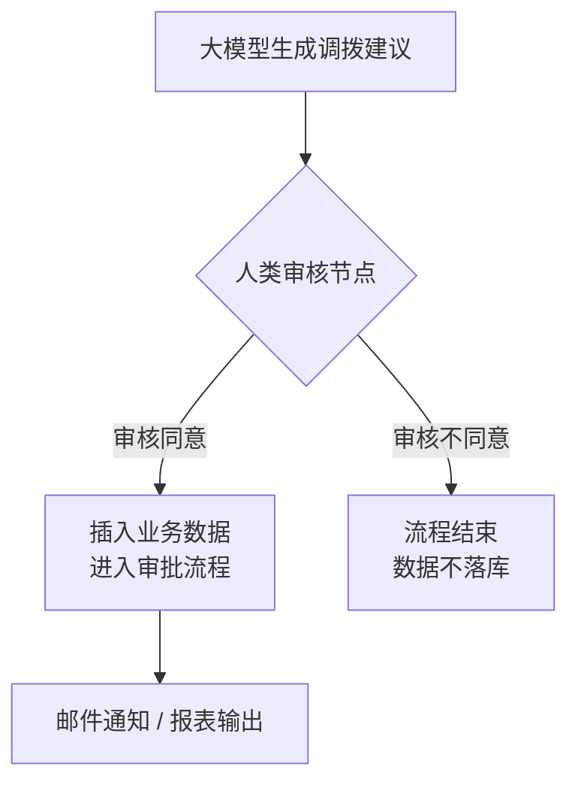
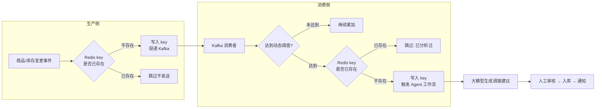

简历上写下「智能库存调拨优化系统」只是拿到了入场券，真正决定成败的是面试官追问时的回答质量。本节把面试官最可能抛出的六个问题逐一拆解：每个问题先给出回答框架，再给出可落地的细节，最后标注面试官通常会在哪一层继续深挖。建议每读完一个问题就合上文档自测一遍，能脱稿讲清楚，才算真正拥有了这段项目经历。

## 【学习目标】

- 掌握六个高频面试问题的回答框架，能按「结论先行 → 分层展开 → 细节兜底」的结构组织语言。
- 理解每个问题背后的考察点：架构选型、提示词工程、幻觉治理、状态持久化、高并发、可视化。
- 能把分散在前面章节的技术点（Kafka、Nacos、Redis、人机协同、PlantUML）串成一条完整的叙事线，并与 980-demo 工程模块互相印证。

## 【正文】

### 一、面试官的追问地图

面试官的问题看似发散，实际沿三条主线展开：**为什么选这条路**（架构选型）、**模型不听话怎么办**（提示词与幻觉）、**工程上扛不扛得住**（持久化、高并发、可视化）。提前把问题归类，回答时就不会漏维度。

| 编号 | 问题 | 考察维度 | 对应章节 |
|---|---|---|---|
| 问题一 | 已有 Dify/Coze，为什么重复造轮子 | 架构选型与定制化能力 | 第 2 章 |
| 问题二 | 大模型听不懂要求怎么办 | 提示词工程 | 5-7、5-8、10-9 |
| 问题三 | 幻觉污染业务数据怎么解决 | 输出治理与人机协同 | 第 6 章 |
| 问题四 | 宕机重启后对话丢失怎么处理 | 状态持久化 | 第 7 章 |
| 问题五 | 如何应对高并发 | 流量治理与幂等 | 第 8 章 |
| 问题六 | 工作流可视化如何实现 | 架构表达 | 7-4、7-5 |

其中问题五几乎必问：只要简历上出现「高并发」字样，面试官一定会追问「具体怎么做、怎么分析、指标怎么验证」。这一条要准备到能画图、能报数字、能讲权衡的深度。

### 二、问题一：已有 Dify / Coze，为什么还要重复造轮子

回答该问题要同时讲清两面：**为什么不用现成平台**，以及**为什么选自研路线**。只讲一面会被认为论证不完整。

先说 Dify 与 Coze 的短板。其一是可视化能力不足：平台提供的编排视图难以覆盖复杂业务逻辑的表达需求，节点多了以后维护和排障都受限制。其二是定制化程度不高：平台封装了大量既定流程，当业务需要精细的干预点（例如把人工审核插在模型生成与业务落库之间）时，平台给出的扩展位并不够用。此外，Dify 与 Coze 难以与公司既有业务做快速、简便的对接，账号体系、权限模型、部署规范都是平台自带的一套，融入存量系统需要额外改造。

再看自研路线的收益。选型落在 Spring AI Alibaba 上，理由有四：

1. **高度定制化**：节点即代码，任何干预点都可以自己定义，定制开发不受平台能力边界约束。
2. **问题易追踪定位**：全链路在自己代码里，断点、日志、链路追踪一应俱全；平台化方案出问题时往往要绕黑盒。
3. **灵活性好**：模型可换（OpenAI 兼容端点、通义、本地部署的大模型），提示词可调，流程可改。
4. **与公司传统业务自然融合**：Java 技术栈、Spring 生态、既有中间件（Redis、Kafka、Nacos）直接复用。

一个常见的追问是「低代码平台到底什么时候该用」。可把结论落在适用范围上：验证想法、内部小工具、非核心链路，用平台能显著提速；一旦涉及核心业务流程、需要深度定制与严格的数据治理，自研工作流是更稳妥的选择。

### 三、问题二：大模型仍然听不懂你的要求怎么办

该问题的标准答案不是「换更大的模型」，而是**提示词优化**。让模型读懂意图，本质上是在有限的上下文窗口内把任务描述、约束条件、输出格式表达得尽可能无歧义。课程里沉淀了多种可组合的技术：

| 技术 | 做法 | 适用场景 |
|---|---|---|
| 角色限定 | 在系统提示词中指定身份与职责边界 | 需要稳定专业口径的场景，如库存分析助手 |
| 少样本提示（few-shot） | 给出输入输出样例，让模型模仿格式与粒度 | 生成中文标头、固定结构的 JSON |
| 自动提示工程 | 借助模型自身迭代优化提示词 | 批量构造与筛选提示词的场景 |
| 输出格式约束 | 明确要求「只输出 JSON」并给出字段清单 | 下游需要程序解析的场景 |

课程中的实践路径是层层叠加的：先在 5-7 把意图表达清楚，再在 5-8 组合多种优化手段提升准确性，最后在 10-9 用「少样本」技巧解决中文标头的生成质量问题。面试中讲到这一层时，最好能给出一个具体例子：某次生成的标头词不达意，加入两个带标准答案的样例后，输出立即稳定，这比罗列技术名词有说服力得多。

需要向面试官传递的认知是：提示词优化是持续运营过程，不是一次性动作。每次模型升级、每次业务字段变更，都值得回归验证一轮。

### 四、问题三：幻觉污染业务数据，怎么解决

先明确概念。本系统中的「污染业务数据」有具体所指：模型产出的调拨数据若未经审核直接写入业务调拨表，后续会进入正常审批流程，错误数据由此渗入生产环境。因此幻觉治理在本项目里不是准确率问题，而是数据安全问题。

回答的第一步是摆正预期：**对于文本交互、文本生成类大模型，幻觉无法彻底消除，只能尽可能降低出现概率**。面试官听到这句会知道你没有被营销话术带偏。在此前提下，本系统布下两层防线：

1. **提示词优化（基础层）**：通过角色限定、字段约束、少样本等手段，从输入端降低模型胡编乱造的空间。这是所有手段里性价比最高的一层。
2. **人类反馈（兜底层）**：加入人类审核节点，对模型生成的数据做人工审核。审核者认可调拨意见，流程继续往后插入真正的业务数据；审批不同意，流程直接结束。

第二层防线同时是一道人机协同阀门，顺带减轻了调拨分析人员的工作强度，AI 时常能提供人工不易想到的调配思路，审核者站在「审」的视角反而获得了决策参考。

面试官可能的深挖：「审核节点会不会成为吞吐瓶颈」。可答的缓解方向包括：按金额或品类分级审核（高风险单必审、低风险单抽检）、审核界面预填模型置信度辅助决策。这些属于合理的工程推演，但要注意说明是设计层面的延伸思考。

### 五、问题四：宕机或重启后，对话丢失怎么处理

该问题考察的是对工作流状态生命周期的理解。Spring AI Alibaba 默认把对话存在内存中，而本项目的工作流会在人类审核节点处中断，等待管理员审核时才唤醒。若整个工作流的状态没有持久化，唤醒时就找不到对应的会话，流程自然无法继续。

解决方案是引入 Redis 的持久化机制：把整个工作流状态存入 Redis，借助 Redis 持久化完成工作流的重新激活。课程第 7 章围绕「检查点」展开，集成了 Redis Stack 并对 Graph 配置做了改造，使工作流状态可以落盘、可以恢复。

回答时可补一句验证方式：课程 7-3 对 Agent 工作流链路做了全链路测试，覆盖状态持久化与恢复路径。面试官若追问「为什么不用数据库」，可以谈取舍：检查点数据读写频繁、结构偏键值、生命周期与工作流实例绑定，Redis 的读写性能与 TTL 机制更贴合；对审计有强要求的场景再考虑异步归档到关系库。

### 六、问题五：如何应对高并发场景（重点）

这是本项目技术含量最高的一段，建议按「削峰 → 控频 → 去重」三层来讲，每一层都给出机制、配置位置和效果。

**第一层：Kafka 流量削峰。** 商品与库存的变更事件先进入消息队列，由消费者按自己的节奏处理，避免流量峰值直接打到 Agent 工作流上。课程 8-5 至 8-7 完成了消息中间件引入与生产消费全链路打通。

**第二层：Nacos 动态阈值控频。** 触发预测的条件是商品数量小于阈值（原设定为 20）。发现 20 不合适时，可以动态调整到 5，即库存降到 5 才触发预测。这里要主动点出这层设计的深层含义：**它相当于一个可以手动调节 Agent 调用频率的阀门**，注意调节的不是整条业务线的 QPS，而是触发 Agent 的频率。阈值调高（例如一下调到 50），调用变得稀疏，很长时间才触发一次；阈值调低，Agent 被频繁唤醒，模型费用与算力压力随之上升。

**第三层：Redis 唯一 key 幂等。** 同一商品（固定 ID）当天可能卖出多件，卖到第二件时达到分析阈值，就往 Redis 里写入一个 key；当它再卖出第三件时又达到阈值，Kafka 可能再次投递消息，消费者发现 key 已存在，即认定该商品已分析过，直接跳过。

课程里还埋了一个优化点：最初只在消费侧做幂等，事实上**发送侧同样可以用 Redis 唯一 key 做判断**，key 已存在，说明之前投递过且消费者已消费，这次就不再发送，从源头减少进入 Kafka 的消息量。

面试官深挖方向与应对：①「阈值存在哪里」，Nacos 配置中心，支持动态调整不重启；②「消息会不会丢」，8-8 讲解了保证消息不丢失的手段；③「消费积压怎么办」，8-9、8-10 讲解了两个方向的治理；④「重复消费」，8-11 落地了消费端幂等处理。这四个方向课程都有专门小节，答不出来会显得经历不完整。

### 七、问题六：工作流可视化如何实现

答案直接落在 PlantUML 上：7-5 集成了 PlantUML，可以把工作流的 graph 一键渲染成专业架构图。可视化的价值在沟通，让同事和领导不读代码就能看懂流程设计，评审、汇报、交接三件事都受益。7-4 还专门讨论了「如何更好地让用户或领导看到你的流程设计」，二者是同一问题的不同侧面。

### 八、把答案写回简历

面试攻略的最后一环是简历表达。每条经历都遵循「场景 + 动作 + 结果」的结构，并且为每个技术点准备一层可展开的细节。例如不要只写「使用 Kafka 应对高并发」，而应写成「设计发送侧/消费侧双重幂等与动态阈值控频机制，将 Agent 触发频率纳入可配置区间」。后者给了面试官明确的追问抓手，也证明你真做过。

## 【易错点 / 面试题】

1. **「为什么不直接用 Dify/Coze」只答平台缺点。** 正确结构是两面论证：平台差在哪（可视化不足、定制化程度不高、难与既有业务对接），自研好在哪（高度定制、问题易追踪、灵活性好、融合自然）。只抨击平台会显得片面。
2. **高并发问题只背名词。** 「Kafka 削峰 + Nacos 动态阈值 + Redis 幂等」三个词人人都会说，差异化在于讲清动态阈值本质是「Agent 触发频率的调节阀」，以及发送侧幂等这一优化点。可对照 980-demo 中的落库链路理解数据最终去向：`980-demo/src/main/java/com/carl/ai/transfer/service/TransferOrderServiceImpl.java` 展示了业务数据落库的标准写法（主单保存、回填 ID、子单批量入库、事务回滚）。
3. **幻觉问题承诺「彻底解决」。** 标准表述是「无法彻底消除，只能降低概率」，再给出提示词优化与人类审核两层防线，并说明审核节点同时是人机协同阀门。

## 【小结】

本节汇总了智能库存调拨优化系统的六大面试问题：架构选型、提示词优化、幻觉治理、状态持久化、高并发、可视化。其中高并发是重中之重，回答时要落到「Kafka 削峰、Nacos 动态阈值控频、Redis 发送侧与消费侧双重幂等」这套组合拳上，并预留消息不丢失、消费积压、重复消费三个延伸方向的答案。这些问题分散在第 2 章至第 8 章，细节可回到对应小节复习。下一章进入代码实战阶段，先认识编排引擎 LiteFlow，看看课程项目的工作流是如何从设计落到代码的。
