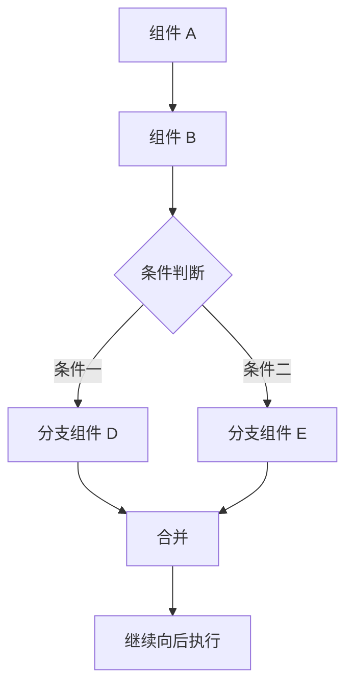

从本章开始进入代码实战阶段。动手之前先回答一个自然的疑问：我们的工作流是否也要像扣子那样，先创建一个工作流？本章给出选型答案，LiteFlow，一款轻量级的编排引擎，并把它解决的问题、设计原则、适用边界与项目特性讲透，为后续组件开发打好地基。

## 【学习目标】

- 说清 LiteFlow 解决什么问题：复杂核心业务逻辑的解耦与编排。
- 理解「编排式规则引擎」的定位：组件即节点，规则文件即流程。
- 明确 LiteFlow 的能力边界：适合复杂逻辑编排，不适合审批流。
- 记住选型 LiteFlow 的关键特性，并能在面试中对比其他流程方案。

## 【正文】

### 一、它解决什么问题：核心模块的维护僵局

每个公司的系统里总有一些承载核心业务逻辑的复杂模块，几乎每个需求都与它们相关。这类模块的业务逻辑冗长，内部混杂着逻辑运算、缓存操作、持久化操作、外部资源调取、内部其他系统的 RPC 调用。时间一长、项目几经人手，维护成本越来越高，典型症状有三个：

1. **硬编码的判断与分支条件越堆越多**：新需求来了就在原来的 if-else 上再挂一层，模块体积失控。
2. **复用率越来越低**：相似逻辑散落在不同分支里，无法被单独抽取复用。
3. **模块之间耦合度很高**：改一处业务要通读整个模块，「牵一发而动全身」。

如何打破僵局？LiteFlow 为解耦逻辑而生，为编排而生，关键词是**编排**。它的思路是把冗长的核心逻辑切成一个个独立的业务片段，每个片段封装成一个组件，再用规则文件把组件按顺序装配起来。改造之后，打造一个低耦合、灵活的系统会顺畅很多。

### 二、定位：编排式的规则引擎框架

LiteFlow 是一个强大的、现代化的规则引擎框架，融合了编排特性与规则引擎的全部特征。如果要新写或重构复杂的业务逻辑，用它最合适不过。

「编排」可以用一张图直观理解。下面这张图还原了官方文档给出的编排示例：A 执行完执行 B，B 判断走哪条分支，分支往下执行后遇到第二个判断节点，选择走上边一条还是下边一条，最后合并再继续往后走。

把每个节点拆出来作为一个组件，这条链路就是一份编排。它既可以作为工作流的编排，也可以作为规则引擎来用，同一套机制，两种使用姿势。对照扣子来理解会更亲切：做工作流编排时，每个节点都可以指定它去干什么，多个节点之间联动；换言之，面对非常复杂的业务逻辑，可以把它拆成多个独立组件，这些组件就相当于多个节点；节点经过装配、复用、变更与编排，就能实现一个简易的 AI Agent 应用。

两种编排形态的对照如下：

| 维度 | 扣子式可视化编排 | LiteFlow 规则文件编排 |
|---|---|---|
| 流程定义载体 | 平台上的图形化画布 | 规则文件（如 XML） |
| 节点形态 | 平台预置组件 | 自己编写的 Java 组件 |
| 定制深度 | 受平台能力约束 | 代码级任意定制 |
| 与存量系统融合 | 需绕平台体系对接 | 直接复用公司中间件与规范 |
| 数据流向 | 平台内部管理 | 自定义上下文，完全自主 |

LiteFlow 的设计基于**工作台模式**：围绕一定的执行顺序，为工作台上各自成立的点赋予职责。官方文档对此有展开，本章不深入，记住「组件在规则文件的驱动下按序协作」这一核心模型即可。

### 三、能力边界：它不适合做什么

选型不能只看优点，边界同样重要。LiteFlow **不适合角色任务之间的流转**，也就是审批流。审批流的典型诉求是任务在多人之间流转、待办、回退，这类场景一般用 Flowable 实现。

LiteFlow 适合的场景是拥有复杂逻辑的业务，比如价格计算、下单流程等。这类业务往往步骤繁多，完全可以按业务粒度拆成一个个组件，进行装配、复用和变更。借助 LiteFlow 可以得到灵活度高、扩展性强的系统，组件之间相互独立，避免「牵一发而动全身」的风险。

| 维度 | LiteFlow | 审批流（Flowable 类） |
|---|---|---|
| 核心模型 | 组件编排 + 规则引擎 | 角色任务流转 |
| 典型场景 | 价格计算、下单流程、数据加工链路 | 请假审批、工单流转 |
| 组织方式 | 规则文件串联组件 | 流程定义驱动任务节点 |
| 选型信号 | 步骤多、逻辑重、需复用 | 多角色、有待办与回退 |

一句话记忆：**逻辑复杂选 LiteFlow，人的流转选审批流框架。**

### 四、项目特性逐条解读

本节选 LiteFlow，重点在它的项目特性。下表把官方特性清单与工程意义一一对应：

| 特性 | 工程意义 |
|---|---|
| 规则轻量 | 基于规则文件编排流程，学习规则入门只需五分钟，一看就懂 |
| 支持任意编排 | 看规则文件就能知道工作流怎么走、逻辑怎么处理 |
| 支持持久化 | 编排规则可外部存储，不只能写在本地配置文件里 |
| JDK 8 到 17 均支持 | 版本兼容面广，本节课程项目刚好用 17，属于支持范围内；若用 21，可能就不支持了，升级前需核对官方支持矩阵 |
| 优雅的热刷新机制 | 无需重启即可实时刷新规则，体验类似 Nacos 这样的配置中心 |
| 全面支持 Spring Boot 2 和 3 | 存量项目与新建项目都能接入 |
| 支持脚本语言 | 简单逻辑可用脚本组件快速实现，不必每次都写 Java 类 |
| 组件重试、上下文隔离级别 | 稳定可靠、性能卓越，失败可重试，上下文互不污染 |
| 支持声明式组件 | 注解即可声明组件，减少样板代码 |

其中两项值得单独展开。**热刷新**对生产环境价值明显：规则调整后即时生效，不用重启应用，灰度与回滚都更快。**上下文隔离级别**则在并行分支场景下保证数据互不串扰，这是编排引擎区别于「一把梭串行调用」的关键能力。组件之间靠上下文对象传递数据，这是编排的隐性骨架，14-3 会专门讲解上下文的设计与使用。

**持久化**能力决定了规则可以存放在数据库或配置中心，而不是只能写在本地文件里，规则即流程定义，持久化之后才能做集中管理与动态下发。**脚本语言**支持则给了快速通道：简单的取值、拼装类逻辑用脚本组件即可表达，不必为几十行业务新建一个 Java 类；但要注意脚本不利于类型检查与调试，核心链路仍建议用 Java 组件承载。

### 五、落地情况与选型结论

判断一个框架是否值得投入，落地情况是重要参考。小米、哈啰、阿里、快手等大量公司都在使用 LiteFlow，社区活跃度与生产验证度都经过检验。从团队视角看，选它的核心理由是：非常轻量化、简单、容易上手，学习和开发成本都比较低，这意味着新人能快速贡献组件，也不必为核心链路的框架风险买单。

与前几章的方案对照着看：前面用 Spring AI Alibaba Graph 表达状态机与工作流，解决的是「AI 工作流如何建模」的问题；本章换用 LiteFlow 进入代码实战，解决的是「复杂业务逻辑如何用编排落地」的问题。两者思想同源，节点化、可编排、可复用，只是落地形态不同。

| 维度 | Spring AI Alibaba Graph | LiteFlow |
|---|---|---|
| 核心抽象 | 状态机节点与边 | 组件与规则文件 |
| AI 亲和度 | 原生面向 AI 工作流，状态即上下文 | 通用编排引擎，AI 能力靠组件封装 |
| 典型职责 | Agent 流程建模、条件路由 | 复杂业务逻辑装配与复用 |
| 课程位置 | 第 2 章至第 12 章的主线 | 第 14 章代码实战的落地形态 |

课程主项目采用 LiteFlow，后续章节的 AI Agent 组件（文生图、图片编辑）都会以 LiteFlow 组件的形式开发。理解这层分工有助于回答面试中的对比型问题：两条线不是互相替代，而是各管一段，建模用 Graph 的思路，落地用 LiteFlow 的机制。

## 【易错点 / 面试题】

1. **用 LiteFlow 做审批流。** 这是最常见的选型错误。审批流是「角色任务之间的流转」，应选 Flowable 类框架；LiteFlow 的定位是复杂逻辑的组件编排，如价格计算、下单流程。面试中可主动对比两者边界，体现选型思考。
2. **忽视 JDK 版本兼容。** LiteFlow 对 JDK 的支持范围是 8 到 17，课程项目基于 17；若团队升级到 21，需要先核对官方最新支持矩阵再决定是否跟进。框架升级与 JDK 升级要分开评估。
3. **把规则文件当普通配置随意改。** 规则文件就是流程定义，变更需走与代码变更同级的评审；好在有热刷新机制，生效快，但快不等于可以任性。

## 【小结】

本章回答了「进入代码实战后用什么编排」的问题：LiteFlow，一款为解耦逻辑而生的编排式规则引擎。要点有三：其一，它把复杂核心逻辑切成组件，用规则文件装配，对抗硬编码分支与高耦合；其二，它的边界是复杂逻辑编排而非审批流；其三，轻量规则、任意编排、持久化、热刷新、Spring Boot 2/3 支持、脚本语言、重试与上下文隔离、声明式组件等特性构成了选型理由，且已有大量公司生产落地。

需要注意的边界是：课程主项目基于 JDK 17 使用 LiteFlow，而课程配套的生产级工程 `980-demo` 采用另一套栈，Java 21 + Spring Boot 4.1.1 + Spring AI 2.0.1，其中 `980-demo/src/main/java/com/carl/ai/transfer/config/ChatModelConfig.java` 与 `OfflineChatModel.java` 示范了「default profile 离线 MockChatModel 可跑、prod profile 接真实模型」的多环境切换。选型时先核对框架的 JDK 支持矩阵，再决定升级节奏。下一节讲解 LiteFlow 的组件模型，正式开始编写工作流代码。
