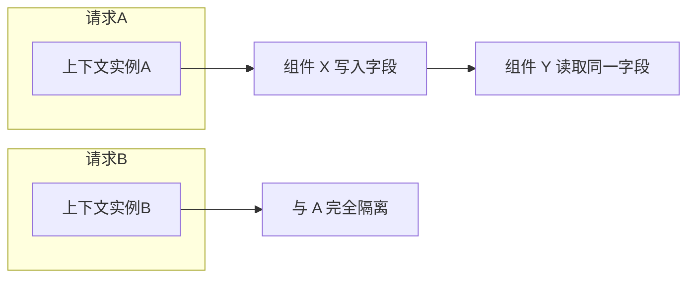

## 【学习目标】

- 理解数据上下文的定位：组件之间不传递参数，所有数据交互都经上下文完成
- 分清默认上下文与自定义上下文的优劣，掌握多上下文、别名上下文、初始化上下文三种进阶用法
- 牢记 `getContextBean`（取上下文对象）与 `getContextValue`（取上下文字段）的区别
- 知道流程入参 `getRequestData` 与上下文的隔离关系

## 【正文】

### 1. 为什么需要数据上下文

先看概念：执行器执行流程时会为每个请求分配数据上下文，**不同请求的数据上下文实例是完全隔离的**，上下文里存放着此请求所有的用户数据；不同的组件之间不传递参数，所有的数据交互都通过数据上下文来实现。

需要重点关注最后一句：没有传统意义上的入参和出参，所有东西都要放到数据上下文当中。组件不关心数据是谁提供的，也不关心自己产生的数据要给谁，拿来即用，用完再更新即可。

数据上下文在 LiteFlow 中非常重要的原因是：要做到可编排，就必须消除各个组件之间的差异性。如果每个组件都有自己的出参和入参且各不相同，就无法进行编排了。因此每个组件只需要从数据上下文中获取自己关心的数据，而不必关心数据是谁提供的；同样，每个组件也只需要把自己产生的结果数据放进数据上下文，不必关心这些数据给谁用。

有一个必须建立的认知：如果在上游节点修改了某个参数的值，该值对下游所有组件而言即已改变。一旦数据放入上下文，整条链路上的任何一个节点都能取到，后续所有节点看到的都是修改后的值。上下文是共享的可变状态，不是一次性的消息队列，这对理解后文「多上下文字段同名取错」非常关键。



### 2. 默认上下文 vs 自定义上下文

LiteFlow 提供了一个默认的数据上下文，内部用 Map 存储，可以通过 `set` 放入数据、`get` 取出数据。但在实际业务中不推荐使用，因为它存在弱类型问题，存取数据时需要做强制类型转换，官方建议自行实现数据上下文。

实现自定义数据上下文非常自由：可以用任意 bean 作为上下文传入，LiteFlow 对上下文 bean 没有任何要求。自定义的上下文实质上就是一个最简单的 POJO，因为是强类型的，可以紧贴业务自行定义，任何一个 bean 都能作为上下文。对照关系如下：

| 维度 | 默认上下文 | 自定义上下文 |
|---|---|---|
| 存储 | 内部 Map | 任意 POJO / bean |
| 类型 | 弱类型，存取需强转 | 强类型，编译期检查 |
| 适用 | 快速验证、脚本场景 | 生产业务（官方推荐） |
| 定义成本 | 零 | 一个 POJO 类 |

强类型上下文把「字段名拼错」这类错误从运行期提前到编译期，这与 Java 生态一贯的工程选择一致，用编译期约束换运行期安全。

### 3. 多上下文：按业务域拆分粒度

更强大的是它支持多上下文：执行器执行时可以传入多个上下文。如果确实需要拆分，可以让某些组件用一个上下文、另一些组件用另一个上下文，某一条支线用一个，另一条支线用另一个。只传一个上下文的话，里面可能会堆积非常多的字段，使用时不够清晰；定义多个上下文就能把粒度切得更细。

```java
LiteExecutor.execute("chain1", new OrderContext.class, new SignContext.class);
```

按业务域拆分上下文（如订单域、签署域），与 DDD 中按限界上下文拆分模型的思路同源：字段归属清晰，组件依赖的上下文越小，可测试性与可替换性越好。

### 4. 在组件中获取上下文

获取上下文时，直接调用 `this.getContextBean()` 并传入上下文的 Class，就能拿到对象，之后 get、set 都可以进行。此外还可以利用超类获取上下文、利用别名获取上下文，LiteFlow 在这方面的能力非常丰富。

```java
public class YourComp extends NodeComponent {
    @Override
    public void process() {
        OrderContext orderContext = this.getContext(OrderContext.class);
        SignContext signContext = this.getContext(SignContext.class);
    }
}
```

> 说明：以上代码按讲稿原样保留。课程同时指出获取上下文用 `getContextBean(Class)`；`this.getContext(Class)` 与之一致，读者以自己所用版本的 API 为准，关键是「传入 Class、取出强类型对象」这一模式。

### 5. 初始化上下文：省略流程入参

再看「用初始化的上下文来获取上下文」：可以先 new 出一个上下文，塞入需要使用的默认值，再把它传入执行器，这样相当于默认已经完成了流程入参，使用这种方式就完全可以不再传递流程入参。

```java
YourContext context = new YourContext();
LiteFlowResponse response = liteExecutor.execute("chain1", context);
```

这里说的流程入参，指执行器方法中单独传入的参数，它可以在流程启动之后传入初始化入参。但如果已在上下文中设置好，初始入参即可省略。

对于数据上下文而言，初始化动作由框架处理：执行第一个组件时，上下文对象中还没有用户数据。而流程入参需要通过 `this.getRequestData()` 获取，这部分数据不包含在上下文当中，如果传入了流程启动的初始化参数，需要用 `this.getRequestData()` 来取，它与上下文是隔离的；如果已经初始化好了上下文，就不需要再传。

一句话区分三条通道：

| 通道 | API | 用途 |
|---|---|---|
| 上下文对象 | `getContextBean(Class)` | 取整个强类型上下文 |
| 上下文字段 | `getContextValue("表达式")` | 取上下文里的某个属性 |
| 流程入参 | `getRequestData()` | 取启动流程时传入的独立入参 |

### 6. 给上下文设置别名：`@ContextBean`

LiteFlow 支持通过 `@ContextBean` 注解为上下文设置别名：定义 bean 时加上注解指定别名，执行时传入的仍是原始的 class，而在组件中获取时可直接使用该别名。

```java
@ContextBean("anyname")
public class YourContext {
    // ...
}
```

该特性在需要使用多上下文、且两个上下文是同一个类时尤其有用：用 class 的方式取有可能取错，别名方式很好地规避了这一点。

即使上下文没有声明该注解，也可以通过名字取到，此时的名字就是上下文的 class name，并且是首字母小写的。比如上下文是价格相关的上下文，通过首字母小写的形式同样可以取到。

### 7. 用表达式获取与设置上下文参数

**注意：上下文参数注入特性只用于声明式组件，继承式组件并不支持。** 示例采用方法级别声明，类级别声明同样可以使用此特性。由于本节尚未讲到声明式组件，这里暂时用不上，就不展开了。

「用表达式获取上下文参数」则对两类组件都适用：上下文参数可以直接获取到上下文里面的属性。例如定义了一个上下文，其中有个属性叫 `code`，获取上下文时能否直接拿到该属性？可以，通过 `getContextValue` 后面直接写上对应的属性名即可。如果只有一层就直接写属性名，如果嵌套了好几层，则可以用点操作符。

注意这里是 `getContextValue`。获取上下文对象时用的是 `getContextBean`，获取参数时用的是 `getContextValue`。这一点必须区分清楚，很多人写代码时不注意，容易搞混：**获取属性是 Value，获取 bean 是 Bean**。

还有一种特例需要注意：如果在多个上下文中存在同名字段。前面提到 LiteFlow 支持多上下文，执行器里可以传入多个上下文，假设这三个上下文中都有 `code`，`getContextValue("code")` 取出的到底是哪一个？LiteFlow 框架在这种情况下只会返回第一个匹配到的字段的值。如果需要精确指定某个 class 下的 `code`，就需要在表达式上加上上下文前缀。例如要取某个上下文的 `code`，由于默认别名是类名首字母小写，该前缀默认即上下文类名的首字母小写。当然该前缀可以改变，它受 `@ContextBean` 注解影响，可以显式更改 bean 的名称。如果使用了 `@ContextBean` 注解，就不能再用原来的类名前缀取值，而要用改过之后的名字；默认情况下则使用首字母小写的形式。

除了点操作符，它对常见的 List、Map、数组形式也有支持：`get(0)`、`get(key)`、数组第一个、List 第一个、Map 的某个 key，都可以通过表达式直接取到参数，非常强大。

表达式同样可以用于设置参数：取出上下文中的参数后，还能用表达式写回。例如先拿出 `name` 值，修改之后再塞回去，塞入的值是在前面加上 「hello」。示例代码中，先从上下文中拿到 `name` 值，再调用上下文的 `setDesc` 方法，把前面加上 hello 的结果塞回去。

```java
@Component("x")
public class NodeComponent {
    @Override
    public void process() {
        String name = this.getContextValue("name");
        this.setContextValue("setDesc", "hello, " + name);
    }
}
```

> 如实说明：该代码块按讲稿原样保留。类名与父类同名（`NodeComponent`）且未写 `extends NodeComponent`，无法通过编译，实际落地时应自定义类名并继承 `NodeComponent`，例如 `public class DescNode extends NodeComponent`。保留原貌是为了代码守恒，读者借鉴时以「取值 → 改值 → 通过方法表达式写回」这一用法为准。

同样地，存在多上下文时完全不用关心 `name` 来自哪个上下文、`setDesc` 是哪个上下文中的方法。值得注意的是 `this.setContextValue` 的定义支持多个参数，同时也可以用点操作符给更深层次的对象赋值。

```java
public void setContextValue(String methodExpress, Object... values) {
    // ...
}
```

`methodExpress` 是方法表达式（如 `setDesc`），`values` 为可变参数，一次调用可以给嵌套对象的多个字段赋值，例如 `setContextValue("member.setName", "Jack")` 这类写法。

总体来看，LiteFlow 的上下文既强大又简单：一个简单的上下文能衍生出这么多用法，使用起来既简单又灵活。从仓库的提交记录可以看到，上个月、三个月前乃至两三年前都有更新，维护相当活跃；另外它还支持脚本组件，脚本语言类型多达八种，能力很强。目前很多公司都已经开始使用它了。

下一节进入 EL 规则，规则会具体到语法，也包括编排，通过 EL 规则即可明白工作流或规则引擎如何执行。

## 【易错点 / 面试题】

1. **面试题**：`getContextBean` 和 `getContextValue` 的区别？前者取整个上下文 bean（传 Class，返回强类型对象），后者按表达式取上下文字段（传字段名，支持点操作符与集合下标）。混淆二者是 LiteFlow 新手最高频的错误。
2. **易错点**：多上下文字段同名时，`getContextValue("code")` 只返回第一个匹配到的值。精确取值需加上下文前缀（默认类名首字母小写，或用 `@ContextBean` 指定别名）；用了别名后就不能再用类名前缀。
3. **易错点**：框架不支持上下文 bean 和 class 混传，要么都传 bean，要么都传 class。混传会在启动或执行时报错，且报错信息不够直白，属于典型的「看文档才知道」的坑。

## 【小结】

数据上下文是 LiteFlow 组件之间唯一的数据通道：组件之间不直接传参，上游写入、下游读取，修改即对全链路生效；请求之间实例隔离，天然支撑并发。工程上的标准做法是自定义强类型 POJO 上下文，按业务域拆分为多上下文，用 `getContextBean` 取对象、`getContextValue` 取字段，启动入参走 `getRequestData`。

这与课程主线 Spring AI 状态机的全局状态思想完全一致，状态机各节点同样通过共享状态对象（OverallState）交换数据。在 `980-demo/src/main/java/com/carl/ai/transfer/agent/TransferAgent.java` 中，节点动作 `createTransferFromText` 上游写入的 `TransferOrderParam`（见 `980-demo/src/main/java/com/carl/ai/transfer/extract/TransferOrderExtractor.java` 的 `extract` 返回值）正是下游 `980-demo/src/main/java/com/carl/ai/transfer/service/TransferOrderServiceImpl.java` 入库的直接输入：上下文/状态承载数据，节点只关心自己那段逻辑。下一节进入 EL 编排语法，看规则如何把组件串成流程。
