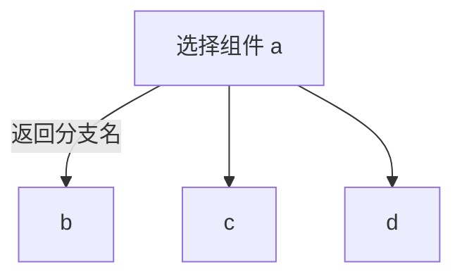
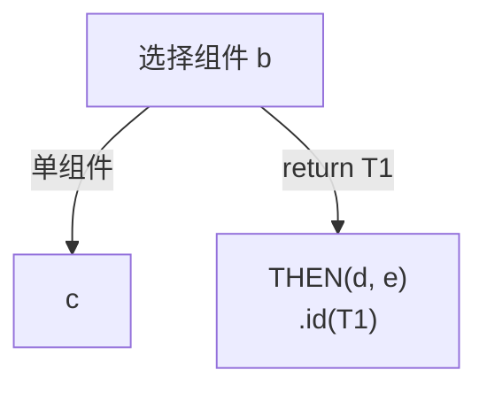
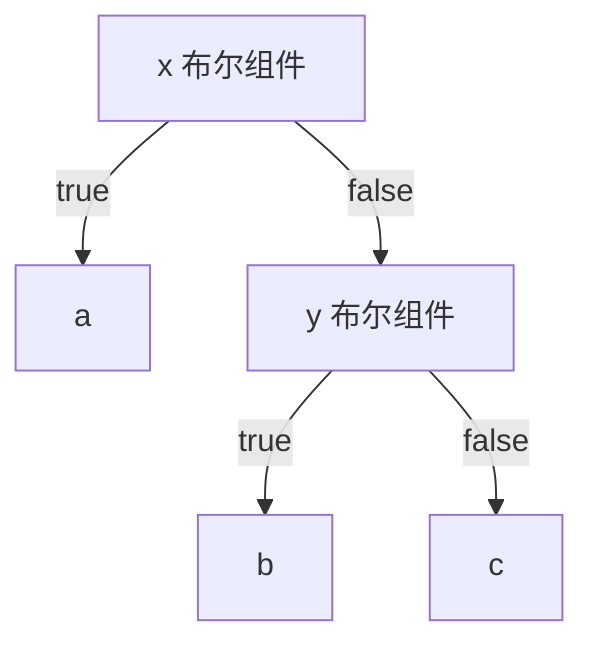

## 【学习目标】

- 掌握选择编排 `SWITCH ... TO` 与 `DEFAULT` 兜底，理解排他网关语义
- 掌握条件编排 `IF` / `ELIF` / `ELSE`，分清二元与三元表达式的差异
- 了解循环编排 `FOR` / `WHILE` / 迭代器循环与 `BREAK`
- 理解嵌套编排中 ID / Tag 语法如何定位分支

## 【正文】

本节来看选择编排、条件编排与循环编排。在 EL 规则中，只学习串行、并行、选择、条件这几种编排；子流程、异常表达式、与或非表达式、子变量、复杂编排例子、前置后置编排等属于相对高级、更加复杂的功能，有兴趣可自行查阅文档，官方文档写得非常详细，阅读体验也很好。受课程篇幅限制，这里只介绍几种常用、好理解，并且在项目实现中会用到的编排。

### 1. 选择编排：SWITCH ... TO

编写业务逻辑时经常会遇到选择性分支：如果返回结果是 1 则进入 A 流程，返回结果是 2 则进入 B 流程，返回结果是 3 则进入 C 流程。在某些流程定义中，这类节点也被定义为排他网关。写过 Flowable 这类审批流的话，对这些编排会非常熟悉。

通过 LiteFlow 的表达式实现这一点非常容易，只需要使用一个组合关键词 `SWITCH ... TO`。注意 `SWITCH` 必须大写，`TO` 大小写均可。

先看图示：A 组件类似于一个排他网关，也就是一个选择组件，通过 A 进行选择来决定执行 B、C 还是 D。`SWITCH` 后面跟的就是选择组件，`TO` 后面则是要选择执行的分支，整体含义就是通过 A 选择去执行 B、C 或 D。



选择组件支持若干关键字，其中有 `DEFAULT` 关键字，即 `SWITCH ... TO ... DEFAULT`，这有点类似于 if、else if 以及最后的 else：如果所有分支都匹配不上，就走默认分支。换句话说，如果都匹配不上，默认要走的就是 `DEFAULT` 指定的分支。以 `SWITCH(x).TO(a, b, c).DEFAULT(y)` 为例：x 为选择组件，经该组件选择执行 a、b、c 中的某一个分支，如果返回的都没有匹配上这三个分支，那就默认执行 y。

```java
<chain name="chain1">
    SWITCH(a), TO(b, c, d);
</chain>
```

> 如实说明：此代码块按讲稿原样保留。课程讲述时组合关键词写作 `SWITCH ... TO`（点号连接），而快照里写成了逗号形式 `SWITCH(a), TO(b, c, d)`； LiteFlow 官方 EL 语法为链式调用 `SWITCH(a).TO(b, c, d)`，两者表达的是同一意图。读者以自己版本的官方文档为准。

当然，`DEFAULT` 里面也可以是一个表达式。

选择组件还可以和串行、并行组合在一起进行编排。来看一个组合示例：最外面是一个串行，串行可以分为三个大块，先执行 A，再执行一个组件，最后执行 F。其中第二个组件又是一个并行组件，它有两个分支：一条为 B 分支，另一条内嵌一个选择组件，用于选择 D 和 E 这两个分支。理解起来并不困难，与图示完全一致。

### 2. 嵌套编排的 ID 语法与 Tag 语法

再来看选择组件中的 ID 语法，也就是在 `SWITCH` 中嵌套 `TO`、`THEN` 和 `WHEN` 的例子。如果阅读过选择组件那一节就会知道，LiteFlow 是通过选择组件的返回值来确定该选择什么的，前面看过的选择组件需要返回一个 String，也就是返回一个组件的名称，框架据此决定走哪个分支。

问题在于：如果 `SWITCH` 中嵌套了 `THEN`，选择组件如何决定执行该 `THEN`？答案与前面并行编排里的 `must` 是一样的：如果存在嵌套，就需要给它一个 ID，用 ID 来决定。

LiteFlow 规定每个表达式都可以有一个 ID 值，可以设置 ID 值来指定表达式的 ID，再在选择组件中返回该 ID 即可。

```java
public class MyComponent extends NodeSwitchComponent {
    @Override
    public String processSwitch() throws Exception {
        return "nodeId";
    }
}
```

具体来说，在 B 选择组件中要执行两个分支之一：一个是单组件 C，另一个是串行的 D 和 E。要选中后一嵌套串行编排，需通过其 ID 执行。为其设置 ID 为 `T1`，在 B 选择组件中直接 `return "T1"`，框架即知要走该嵌套分支了。

选择编排中还有 tag 语法，tag 语法与 ID 语法基本是一样的。如果要通过 tag 返回某个嵌套的编排，就 `return "tag:T1"`，其中 `tag` 可以省略，直接写成 `":T1"`。它的用法与 ID 几乎一模一样。



### 3. 条件编排：IF / ELIF / ELSE

LiteFlow 提供了条件编排的表达式组合 `IF ... ELSE`。条件编排是选择编排的一个变种：选择编排是根据逻辑去选择多个子项中的一个，而条件编排只有真和假两个子项，这在处理某些业务时非常有用。简单来说，条件编排就是编排语言中的 if/else，只不过在 LiteFlow 的 EL 语法中有一些不同的用法。

`IF` 和 `ELIF` 的第一个参数要求定义为布尔组件，关于如何定义请参考布尔组件那一节。布尔组件在 `return` 的时候返回的就是一个布尔值，即 `true` 或 `false`。

看一个示例：最外面是一个串行编排，其中有两个分支，一个分支是条件编排的结果，另一个分支是 B。流程开始时先通过条件编排来判断：如果为 `true` 就走 A。`IF` 的第二个参数就是条件为 `true` 时要执行的组件，其中 X 为条件节点，它和排他网关类似，是一个与选择组件长得差不多的东西。

为真的情况下执行链路是 X 到 A 到 B，为假的话就是 X 到 B。

`IF` 也有三元表达式：为 `true` 执行 A，为 `false` 执行 B，这与 Java 中的三元运算符是一个意思。

```java
<chain name="chain1">
    IF(x, a, b);
</chain>
```

再看 `ELSE` 表达式：`IF` 的二元表达式加上 `ELSE` 表达式就相当于三元表达式，为 `true` 走 A，否则（`false`）走 B，与三元表达式等价。

```java
<chain name="chain1">
    IF(x, a), ELSE(b);
</chain>
```

`ELIF` 关键词的用法其实和 Java 中的 `else if` 类似，也可以跟多个，与 `IF` 二元表达式的参数一样，一般最后还会跟一个 `ELSE`，用于多重条件的判断。

```java
<chain name="chain1">
    IF(x, a), ELIF(y, b), ELSE(c);
</chain>
```

看一个复杂编排的例子：首先在 X1 组件中进行判断，如果为 `true` 就执行 A；否则进入第二个条件组件，判断如果为 `true` 就执行 B；否则再进入下一个条件编排组件，为 `true` 执行 C，否则再进入下一个。道理是一样的，只不过写了很多层。实际业务中很少嵌套这么深，但要掌握用法，真遇到这么复杂的规则也能写出来。

```java
IF(x, a),
ELIF(y, b),
ELSE(c);
```

值得注意的是，只有 `IF` 的二元表达式后面才可以跟 `ELSE`，三元表达式后面不能跟 `ELSE`：如果三元表达式后面跟一个 `ELSE`，最后一个表达式会被 `ELSE` 表达式覆盖掉。

举例来说，原先使用三元表达式时，为 `true` 执行 A，否则执行 B；若其后再加一个 `ELSE`，即使 X1 返回 `false`，也不会去执行 B，而是继续进入下一个判断，如果为 `true` 就执行 C 了。虽然框架做了容错处理，但不推荐这样写，容易造成理解上的困惑。

另一点需要注意的是，`IF` 的三元表达式实际上已经能表达一切可能，有多重条件也可以不用 `ELSE`，全部用三元表达式嵌套来实现。对于嵌套不深、比较好理解的业务，`IF` 的三元表达式完全够用；如果嵌套比较深、逻辑也比较绕，则推荐使用 `IF` 的二元表达式加上 `ELSE` 来编排。不过官方并不推荐全部写成三元嵌套，多重嵌套理解起来比较吃力，因此尽量用 `ELSE` 来替代。当然，如果嵌套得非常深，无论用哪种写法都不会太好看。



### 4. 循环编排：FOR / WHILE / 迭代器 / BREAK

最后一种编排是循环编排。LiteFlow 支持循环编排，它对应到组件里的就是次数循环组件，也就是一个 `FOR` 循环。

循环编排分为 `FOR` 循环、`WHILE` 循环和迭代器循环，正好对应次数循环组件、布尔组件和迭代循环组件，可以理解为多合一的设计。

`FOR` 循环的含义是：循环执行几次，每次要干什么。例如把 A 和 B 这样的链路固定执行五次。如果在定义规则时不确定要执行几次、要在代码运行时才知道，也可以使用一个组件来确定执行几次，这样的组件参考次数循环组件即可。

`WHILE` 循环组件用于有条件的循环，其中 W 节点须为布尔组件，返回布尔值为 `true` 时继续循环，这对应的是布尔组件。

迭代器循环的逻辑与 Java 语法是类似的，可以按照 Java 语法的逻辑来理解：迭代循环中的 X 必须是一个迭代器循环组件，返回一个迭代器，然后固定执行 A 和 B 这样的链路。

这里只是定义，不涉及脚本。`BREAK` 与 Java 中的语法一样，表示直接跳出循环、退出循环。`BREAK` 关键字可以跟在 `FOR` 和 `WHILE` 后面，后面跟的 C 节点需要是一个布尔组件，返回布尔值为 `true` 时就退出循环。

`FOR` 循环固定按照组件返回的次数执行 A 和 B 这条链路，`WHILE` 循环则由 W 布尔组件控制。`BREAK` 关键字是在每次循环的末尾进行判断的。

```java
<chain name="chain1">
    FOR(F, DOC, THEN(a), b).BREAK();
</chain>
```

多层循环时，`BREAK` 与组件中提供的能力类似，可以获取当前层、前一层、前两层的下标，也就是 `getLoopIndex()`、`getPreLoopIndex()`、`getPreLoopIndex2()`，迭代器循环对象也是一样的处理方式。

```java
<chain name="chain1">
    FOR(F, DOC, THEN(a), b).BREAK();
</chain>
```

> 如实说明：以上两个 `FOR(...).BREAK()` 代码块在讲稿中重复出现两次，内容完全一致，按代码守恒原则两处均原样保留，未做去重。

四种编排与组件的对应关系：

| 编排 | 语法组合 | 组件基类 | 组件返回值 |
|---|---|---|---|
| 选择 | `SWITCH ... TO ... DEFAULT` | `NodeSwitchComponent` | String（分支名 / ID / Tag） |
| 条件 | `IF` / `ELIF` / `ELSE` | `NodeBooleanComponent` | boolean |
| 次数循环 | `FOR ... BREAK` | `NodeForComponent` | int |
| 迭代循环 | 迭代器 + `BREAK` | `NodeIteratorComponent` | Iterator |

到这里，EL 规则就介绍完了。通过这几节的学习，可能感觉原理层面讲得比较浅，但只要留下印象就可以了，后面会说明为什么这样安排，真正的编排将由前端 UI 生成，人工核对即可。

## 【易错点 / 面试题】

1. **面试题**：选择编排与条件编排的本质区别？选择编排（`SWITCH`）是多选一，分支数量不固定，靠选择组件返回目标名；条件编排（`IF`）只有真假两个子项，靠布尔组件返回 boolean。前者像 switch，后者像 if/else。
2. **易错点**：`IF` 三元表达式后面不能再跟 `ELSE`，后写的 `ELSE` 会覆盖三元表达式的 false 分支，框架虽容错但语义已变。多重条件一律用「二元 `IF` + `ELIF` + `ELSE`」书写，不要写三元嵌套。
3. **易错点**：`SWITCH` 中嵌套 `THEN` / `WHEN` 时，选择组件必须返回该嵌套表达式的 ID（如 `return "T1"`），或 Tag 形式（`return "tag:T1"` / `":T1"`）；返回组件名对嵌套结构无效，这是「选了却没反应」的常见原因。

## 【小结】

至此 EL 编排全家福齐备：串行（`THEN`/`SE`）、并行（`WHEN`/`PAR`）、选择（`SWITCH...TO...DEFAULT`）、条件（`IF`/`ELIF`/`ELSE`）、循环（`FOR`/`WHILE`/迭代器 + `BREAK`）。嵌套结构靠 ID / Tag 定位分支，复杂规则可层层组合，但可读性随嵌套深度快速下降，这也是后面前端可视化编排的价值：把「手写嵌套」变成「拖动生成 + 人工核对」。

课程主线的 AI 工作流用的不是 LiteFlow 而是 Spring AI 状态机，但编排思想完全同构：选择编排对应状态机的条件边（课程 11-7），串行对应节点顺序执行。在 `980-demo/src/main/java/com/carl/ai/transfer/agent/TransferAgent.java` 中，「自然语言 → 抽取 → 入库」即一条最小串行链；抽取环节的模型调用由 `980-demo/src/main/java/com/carl/ai/transfer/extract/TransferOrderExtractor.java` 的 `ChatClient` 完成，入库由 `980-demo/src/main/java/com/carl/ai/transfer/service/TransferOrderServiceImpl.java` 完成，链路清晰、节点可替换，与 EL 编排追求的目标一致。下一节讲组件参数绑定，让编排好的组件能从外部接收用户输入。
