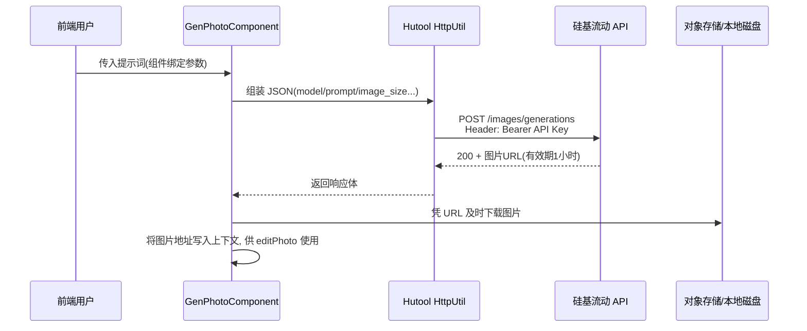

【学习目标】

- 完成硅基流动平台的注册、API Key 创建与项目配置接入，说清密钥管理的正确姿势。
- 读懂生图接口的请求结构：Header 认证、Body 必填与选填参数各自的语义及调优思路。
- 用 Hutool `HttpUtil` 打通「POST 请求生图接口 → 拿到图片 URL」的链路，为下一节组件落地做好准备。

【正文】

## 1. 注册硅基流动并创建 API Key

硅基流动是一个模型聚合平台，整合了大量大模型，全部可以通过 API 直接调用。课程选用它的原因是：注册即送额度、模型齐全、文档清晰，适合把「文生图」这条链路快速跑通。

接入分两步。

**第一步，注册与实名。** 注册完成后建议做实名认证，部分模型必须实名后才能使用。首次注册平台会默认赠送余额（大约 16 元），对课程中的基本使用来说，赠送额度完全够用；赠额消耗完之后再使用，才需要自行付费。

**第二步，创建密钥并配置到项目。** 登录后进入「API 密钥」页面，密钥信息自行填写，点击「新建密钥」，创建完成后把密钥复制下来。回到项目打开 YAML 文件，创建配置项 `siliconflow`，其下挂一个 `apiKey`，把密钥粘贴进去：

```yaml
spring:
  application:
    name: langchain-ai-helper
  servlet:
    encoding: UTF-8
    enabled: true
    force: true
logging:
  level:
    langchain: debug
litlifes:
  rule-source: classpath:flow.xml
# API Key
apikey: sk-thzg... (省略部分)
```

需要特别注意：一定要使用自己账号生成的 key。课程代码示例里的 key 在发布时会被删除，直接照搬代码中的 key 是无法调用成功的。

另外说明两处配置细节。其一，上面 YAML 中的 `litlifes` 是原稿笔误，正确拼写应为 `liteflow`，即上一节配置过的 `liteflow.rule-source`，此处按原稿如实保留、不代为修改。其二，把密钥直接写进配置文件只适合本地学习；工程化做法是让密钥走环境变量或配置中心，代码与配置分离。980-demo 就是按这种思路设计的：`980-demo/src/main/resources/application.yml` 用多 profile 管理模型端点与密钥，`default` profile 完全离线、不依赖任何真实密钥，`prod` profile 的敏感值则用 `${ENV}` 占位由运行环境注入。

## 2. 在模型广场挑选生图模型

登录后进入模型广场，平台提供了大量可直接通过 API 调用的模型，例如 `deepseek-ai/DeepSeek-R1`、`Qwen/Qwen-3B`、`THUDM/...`、`Wan-ai/...` 等。

本节的目标是文生图，打开筛选器可以看到很多筛选项，点「生图」就能看到快手提供的生图模型，而且是免费的。免费模型在准确度上可能略逊一筹，但胜在零成本，学习阶段用免费模型把链路跑通，是最务实的选择；等项目真正上线、对出图质量有要求时，再切换付费模型。

平台还支持在线体验。用与规则里一致的描述「生成一个中国古代刀客的照片」，回车之后，模型返回了一张真实的人物照片，效果是符合要求的。「先在线验证、再写代码」的习惯值得保留：在线体验能快速确认模型能力边界，避免写完代码才发现提示词与模型不匹配。

## 3. 阅读 API 文档：请求与参数

接下来看如何把模型整合进来。打开官方 API 文档（英文页面可以一键翻译成简体中文），核心接口是「创建图片生成请求」：为给定的提示创建图片，**响应中返回图片 URL，有效期为一个小时，请务必及时下载**。换言之，调用之后会生成一张图片并把图片 URL 返回，需要凭该 URL 自行下载，图片并不直接存在响应体里。

调用方式是标准的 HTTP POST。**Header** 必须传入认证信息，token 就是 API Key，通过 `Bearer` 传入；还可以传 `Content-Type` 指定内容类型。**Body** 参数如下：

| 参数 | 必填 | 默认值 / 范围 | 含义 |
|---|---|---|---|
| `model` | 是 | - | 模型名称 |
| `prompt` | 是 | - | 提示语，告诉模型要生成什么样的图片，传入的正是用户传过来的参数 |
| `image_size` | 是 | 默认 `1024x1024` | 生成图片的尺寸 |
| `batch_size` | 是 | 默认 1 | 生成图片的数量 |
| `num_inference_steps` | 是 | 默认 20，范围 1~100 | 推理步数，即让模型推理几步 |
| `guidance_scale` | 是 | 范围 0.1~20 | 控制生成图像与提示的匹配程度，类似大模型的 temperature |
| `seed` | 否 | - | 随机种子，设为固定值时生成的图片也比较固定 |
| `negative_prompt` | 否 | - | 反向提示，告诉模型不要做什么 |
| 图片 base64 | 否 | - | 上传图片做图生图，本节用不到（纯文生图场景） |

其中 `guidance_scale` 最值得展开：值越高，生成的图像越倾向于严格匹配提示；值越低，则有更多的创意和多样性。行为与文本大模型的 temperature 恰好互补，temperature 越高越发散，而 `guidance_scale` 越高越收敛。面试中如果被问到两个参数的区别，可以这样答：temperature 控制采样随机性，`guidance_scale` 控制对提示词的服从度，二者作用在不同环节，一个管「敢不敢想」，一个管「听不听话」。

官方文档给出的调用示例如下：

```python
curl -X POST https://api.siliconflow.cn/images/generations \
-H "Authorization: Bearer <your-api-key>" \
-H "Content-Type: application/json" \
-d '{
    "model": "Qwen/Qwen-3B",
    "prompt": "A beautiful woman holding a sword, in the style of ancient China",
    "negative_prompt": "",
    "guidance_scale": 7.5,
    "num_inference_steps": 20,
    "image_size": "1024x1024",
    "seed": 123
}'
```

## 4. 调用链路全景

把整条链路画出来，各角色的职责就清楚了：



关键风险点只有一个：URL 一小时过期。所以组件里拿到 URL 后的第一件事是下载落盘，而不是把 URL 直接透传给前端，等用户点开时链接可能早已失效。

## 5. 用 Hutool 发起 HTTP 调用

看完示例，本质就很清楚了：这就是发送一个 HTTP 的 POST 请求。Java 里怎么做？项目搭建阶段已经在 POM 里引入了 Hutool 工具包。打开 Hutool 官网可以看到，它提供了完整的 HTTP 请求能力：HTTP 请求、HTTP 工具、`HttpUtil` 等，各类 HTTP 场景都已封装好。因此这里直接使用 Hutool 的 HTTP 工具发起调用，请求生图接口生成图片。

用 Hutool 的话，核心代码非常简单：

```java
// 使用 HttpUtil 发送 POST 请求
String result = HttpUtil.post(url, json);
```

关于返回结果：状态码为 200 时会返回对应的响应体，其中通过 URL 给出一个链接，提示自行下载；文档中同样列出了各类错误码。具体的代码实现在下一节完成，本节先把接口的调用方式和参数含义摸清楚。

从生产角度补一句：`HttpUtil.post` 是同步阻塞调用，默认超时与重试策略都很基础。外部模型服务抖动是常态，生产代码必须显式设置超时，并用弹性组件包裹调用。980-demo 中对同类外部 LLM 调用的处理可作参照：`980-demo/src/main/java/com/carl/ai/transfer/extract/TransferOrderExtractor.java` 上的 `@CircuitBreaker(name = "transferLlm", fallbackMethod = "extractFallback")`，在模型服务不可用时走降级分支返回空参数，由上层决定业务处置，而不是让异常一路抛到接口层。

【易错点 / 面试题】

1. **图片 URL 有效期只有一小时**：拿到 URL 不立即下载，过期后拿不到图。这是文档里用加粗强调的约束，也是最容易被忽略的坑。
2. **不要把示例密钥写进提交的代码**：课程示例 key 会被删除，个人 key 不应进仓库；正确做法是环境变量 / 配置中心注入，与 980-demo 的 `${ENV}` 占位思路一致。
3. **`guidance_scale` 与 temperature 不要混为一谈**：前者控制对提示词的服从度（越高越严格匹配），后者控制采样随机性（越高越发散）。面试官追问「生图参数怎么调」时，先讲清这两个参数的职责，再谈具体取值。

【小结】

本节完成了文生图外部依赖的全部准备工作：注册硅基流动、创建并配置 API Key、在模型广场选定免费生图模型、读懂请求参数语义，并用 Hutool 打通了 HTTP 调用方式。下一节进入 `GenPhotoComponent` 的完整实现：构建请求 JSON、调用接口、下载图片、写入上下文，把「文字 → 图片」在 LiteFlow 节点里真正跑通。生产视角下，密钥外置、超时控制、熔断降级这三件事，在 980-demo 的 `ChatModelConfig` 与 `TransferOrderExtractor` 中都有对应落地，可作为编码参考。
