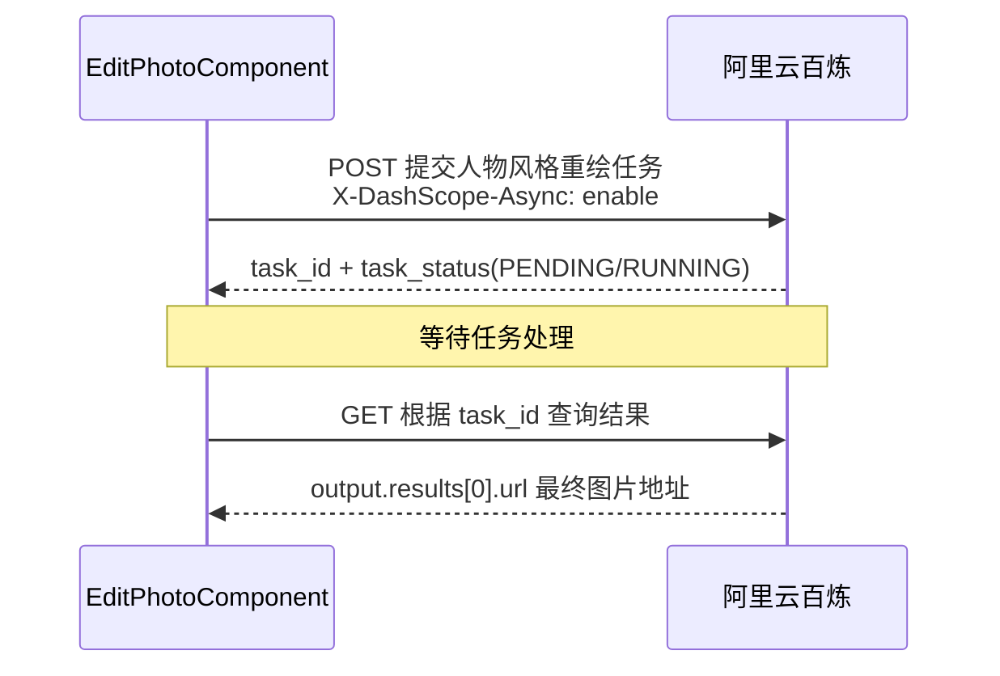

上一篇完成了文生图组件，按照流程编排的推进顺序，接下来需要接入一个图生图模型调用，对已生成的图片做风格改造。本节完成接口选型、契约分析与组件骨架：先删掉调试用的临时编排，恢复最初的编排规则，再新建 `editPhoto` 组件，把阿里云百炼的「人物风格重绘」API 接入链路。

## 【学习目标】

- 完成 `EditPhotoComponent` 骨架搭建，理解组件命名与 `flow.xml` 编排节点的对应关系。
- 读懂通义万相人物风格重绘 API 的请求契约：三个请求头、嵌套的 `input` 结构。
- 记住 `X-DashScope-Async` 强制异步的原因与两步调用的协作方式。
- 分清 `style_index` 是风格索引而非风格名称，理解 -1 自定义参考风格的路径。

## 【正文】

### 一、组件骨架

先把调试用的临时编排删掉，恢复最初的编排规则。新建一个名为 `editPhoto` 的组件，类名对应为 `EditPhotoComponent`，命名与 `flow.xml` 中的编排节点保持一致，编排里叫什么，组件就叫什么。

由于使用的同样是串行编排，该组件按普通组件实现即可：继承 `NodeComponent` 并重写其中的方法，同时补充注释「图片编辑组件」。

```java
package com.carl.langchainaihelper.liteflow;
import com.yomahub.liteflow.annotation.LiteFlowComponent;
@LiteFlowComponent("editPhoto")
public class EditPhotoComponent {
}
```

组件内部要做两件事。第一，调用图生图大模型，本节选用阿里的通义万相来完成图生图；第二，把调用结果放入上下文。调用图生图大模型时，流程与文生图调用一致，同样需要获取前端传过来的参数，也就是组件绑定参数。此外，第二步还要用到上一篇文生图塞入上下文的图片 url，组件会先把该 url 从上下文里取出来，再基于它对图片进行编辑。

### 二、模型选型：阿里云百炼与通义万相

打开浏览器访问阿里云官网，登录后进入大模型服务平台的百炼模型广场。首次进入会有引导流程，已有使用记录则前置配置通常已经就绪。

在平台上创建一个自己的 API Key，每个人最多可以创建十个。把该 Key 复制到项目配置文件中，与调用 SiliconFlow 的 API 时配置 apiKey 的方式完全一致，这里命名为阿里云 apiKey。

模型广场中可选的模型非常多，通义的 DeepSeek、百川、零一、源语智能、Meter 等都在其中，并且可以按模型类型和上下文长度做筛选。上下文越长，消耗的 Token 数量越多，后续产生的费用也越高，筛选时不光看能力，也要把成本纳入考量。

计费方面，首次使用阿里云百炼会在几个月内赠送模型免费调用次数：有效期内不超过调用次数就不产生费用；试用期内超出调用次数需要付费；试用期过期之后再使用同样需要付费。做技术验证时充分利用这段免费额度，可以零成本完成 PoC。

要做图片处理，模型类型筛选为「图片处理」，因为这里的诉求是对真实人物形象做风格转换。筛选结果中有五个图片处理类模型，包括 AIS11、AIS11 精修、图片分割和图像画面扩展等。阿里优先服务自身的淘宝业务，因此这类通义能力与电商有很强的关联性。将鼠标移到模型上即可看到它的详细说明。

其中「人物风格重绘」的说明是：可以将输入的人物图像进行多种风格化的重绘生成，使得新生成的图像在兼容原始人物项的同时，带来不同风格的观感效果。这正是本节要使用的 API。

查看详情可以看到计费信息：一张图片约花费一毛多钱，在有效期内可以免费使用 500 次，因此完全够用。

### 三、请求契约：三个头与嵌套 body

使用该 API 的前提是获取 API Key 并将其配置到环境变量，这一步已经完成，Key 已经写入 yml 文件。它支持通过 HTTP 调用，与上一个组件通过 HTTP 调用 SiliconFlow 接口的方式相同。

请求头方面有三项：

```http
Content-Type: application/json
Authorization: Bearer <your_api_key>
X-DashScope-Async: enable
```

其中 `X-DashScope-Async` 表示是否开启异步处理，取值 `enable`；文档要求必须开启异步处理，因此该头必须传，且必须开启。之所以强制异步，在于大模型处理图片耗时较长，平台希望调用方以异步方式处理，同步阻塞一个 HTTP 连接去等一张图的生成，对调用方和平台都是资源浪费。

请求体中，`model` 为必传项，指定调用的模型名称；`input` 也是必传项，其中又包含 `image_url`，即原始图片的 url。它支持多种图片格式，分辨率要求不低于 256×256、小于 5760×3240，本节调用传入的是 1024×1024，不会超限。

```json
{
  "image_url": "https://your-image-url.com/image.jpg",
  "style_index": 1,
  "style_ref_url": "https://your-style-url.com/style.jpg"
}
```

此外还有几项约束：图片大小不要超过 10 兆，url 地址不能含有中文字符。另一项约束来自 `style_index`：人物风格是必传项，需要传入索引值，-1、0、1、2、3、4、5、6、7、8、9 都在支持范围内。

| 约束项 | 要求 |
|---|---|
| 分辨率 | 不低于 256×256，小于 5760×3240 |
| 文件大小 | 不超过 10 兆 |
| url 字符 | 不能含有中文字符 |
| `style_index` | -1 至 9，必传 |
| `style_ref_url` | 仅 `style_index` 为 -1 时必传 |

### 四、style_index：索引而非名称

如果传入 -1，则需要自己上传参考风格：当平台预设的这 10 种风格都不符合要求、希望模型按照自定义风格生成时，就需要走「上传参考风格」这条路径，让模型参照上传的风格来生成。

本节直接使用预制风格，例如二次元、复古漫画、3D 卡通都可以，因此不需要上传参考风格。相应地，响应参数中可选的「参考风格 URL」也不需要传。

这里要修正一个前面埋下的小坑：回顾前面讲解流程编排时传入的风格值，当时是随手填的「卡通」，实际要传的是索引值，本质上相当于一个枚举值。如果要使用 3D 卡通，就应该传入 7，编排配置中也应写入 7。把风格名当值传进 `style_index` 是初学者最常踩的错，接口要的是整数索引，字符串会被拒或落到非预期风格上。

### 五、异步任务模型：两次调用

再看响应：成功响应会返回 `task_id` 和 `task_status`。

```json
{
  "output": {
    "task_id": "xxxxxx",
    "task_status": "PENDING"
  }
}
```

任务状态有五种取值：

| 状态 | 含义 |
|---|---|
| PENDING | 正在排队等待处理 |
| RUNNING | 处理中 |
| SUCCESS | 执行成功 |
| FAILED | 执行失败 |
| UNKNOWN | 任务不存在或状态未知 |

可以看到响应中并没有直接给出图片的 URL，因此还需要进行第二步调用：拿着第一步返回的 `task_id` 去调用「根据任务 ID 查询结果」接口。这是一个 GET 请求，把 `task_id` 拼接到请求路径后面，并在请求头中加上 `Authorization`，以 `Bearer` 加 API Key 的形式传入。步骤二的响应里，`output` 中会包含 `results`，`results` 中就有 `url`，同时还能看到任务的执行结果。

两次调用的协作关系如下：



这种「提交任务 → 轮询/查询结果」的模式在图片、视频类生成接口中非常普遍：生成耗时不可控，平台用异步任务解耦接收与处理。下一篇开始编码实现该组件，先构造请求体与请求头，再处理任务状态。

## 【易错点 / 面试题】

1. **不传 `X-DashScope-Async` 或传错值。** 文档强制要求异步处理，该头缺失会直接导致请求不符合契约。面试中可引申：读到「必须」字样的接口约束时，先用契约清单逐项核对再写码。
2. **把风格名传给 `style_index`。** 正确做法是传索引整数（3D 卡通对应 7）。凡是接口字段是枚举索引，都要在配置侧建常量或枚举，别把可读性放在类型正确性前面。
3. **以为一次调用就能拿到图片。** 人物风格重绘是异步任务：第一次只拿 `task_id`，第二次凭 `task_id` 查结果。设计组件时要为「提交 + 查询」两阶段留出结构，而不是把两步塞进一个方法里硬编码。

## 【小结】

本节完成了图片编辑组件的准备工作：新建 `EditPhotoComponent` 骨架，选定阿里云百炼「人物风格重绘」API（约一毛多一张、500 次免费额度够用），梳理了请求契约，三个请求头（含必须开启的 `X-DashScope-Async`）、`input` 内嵌 `image_url` 与 `style_index`、以及分辨率与大小约束；明确了 `style_index` 传索引值（3D 卡通为 7）而非风格名；并建立了异步任务模型的心智图：第一次提交拿 `task_id`，第二次凭 `task_id` 查 `results[0].url`。下一篇进入编码，用 Hutool 把该契约落成代码。

顺带留一个工程化伏笔：本节契约里的请求体与响应都是裸 JSON，演示项目图省事；生产做法是把它们收敛为实体对象。可对照 980-demo 中 `980-demo/src/main/java/com/carl/ai/transfer/extract/TransferOrderExtractor.java` 的写法，用 Spring AI 2.0.1 的 `chatClient.prompt().user(...).call().entity(TransferOrderParam.class)`（底层 `BeanOutputConverter`）把模型输出直接绑定到 POJO，字段名对齐即可，连手工 JSON 解析都省掉。
