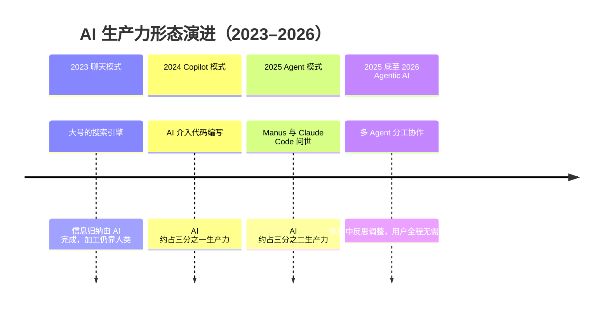

## 【学习目标】

- 梳理 2023 年至 2026 年 AI 生产力形态的四阶段演进，说清每个阶段人类与 AI 的角色分工与生产力占比变化；
- 理解 Agent 与 Agentic AI 的本质差异，建立「多 Agent 协同」与「自主决策」两大核心概念；
- 建立课程技术地图：JManus、AgentScope、Spring AI Alibaba 1.1、Nacos 3、A2A 协议、MCP、Agent Skills 各自的位置与职责。

## 【正文】

### 1. 先回答前提问题：学什么才不会被淘汰

AI 在当下及未来的占比持续提升，甚至逐渐成为每个人应当掌握的技能之一，这一点毋庸置疑。矛盾在于迭代速度：前两年频繁出现的提示词工程、个人知识库（RAG）、大模型本地部署以及微调，如今已很少被提及，部分能力直接被新产品取代。技术热点不断更替，学习者必然面对一个问题，投入精力掌握的技术，多久之后会过时？

判断标准不在技术是否「新」，而在是否处在 AI 发展趋势的核心。流于表面的新技术容易被取代；处在趋势核心的能力会随生态演进持续增值。本课程的判断是：以 Agent 作为生产执行者、以多 Agent 协作处理复杂任务、以自主决策驱动全流程，正是当前及未来一段时间 AI 发展的核心方向。要说明这一点，需要先把 AI 的发展脉络梳理一遍，才能把握技术趋势。

### 2. AI 生产力形态的四个阶段

按「人类与 AI 的角色占比」梳理，AI 的落地形态可以清晰地划分为四个阶段。

**2.1 聊天模式（2023）**

2023 年 OpenAI 推出 ChatGPT 之后，人工智能进入聊天模式：用户在对话框里输入问题，语言大模型理解用户的真实意图，反馈给用户所需要的信息。此时 AI 的定位接近「大号的搜索引擎」，信息归纳由 AI 完成，但人类真正要完成工作，仍得自己打开 Excel 或 PPT，把人工智能归纳出来的信息复制进去再加工。该阶段 AI 只占很少一部分，完成工作的生产力依然是人类自己。

**2.2 Copilot 模式（2024）**

2024 年，AI 的发展已经不只是提供文字信息，而是能够初步介入到人类的生产之中，落地最好的是 AI 编程。代表性产品是 GitHub Copilot：开发者通过它用对话的方式让 AI 辅助编写代码。局限在于 AI 只能控制某一部分的代码，项目整体的结构设计、文件的创建以及 Debug，都还需要人类的介入和调整。这一阶段 AI 只占三分之一的生产力，三分之二的任务完成仍需要人类手动工作。「副驾驶」的比喻很贴切：人工智能已经能够介入到人类的生产环节之中，但起到的只是辅助助手的作用，整个生产过程人类依然是主要操作者。

**2.3 Agent 模式（2025）**

2025 年出现了两件事，可以说完全颠覆了前面的两种模式。

第一件是出了一个叫 Manus 的软件，它通过人工智能从头到尾、全过程自动化地把人类交代的一件复杂项目完成，整个过程不需要人类介入。举个例子：用户让 Manus 把某个公司第三季度的商业信息呈现出来，Manus 会自动到相应的网站和网页去抓取这家公司的商业数据，筛选出第三季度的数据信息，然后写入到本地的一个 Excel 文档里进行数据分析，最后以图表的形式展现在用户面前，整个过程人类无需介入，全部由 Manus 操控。

第二件是出现了一个很火的 AI 编辑器，叫 Claude Code。它跟平常熟悉的传统 AI 编辑器不同，只有一个对话框，用户只需要在该对话框里输入他期望生成什么功能、或者生成什么项目，其余的代码编写、文件生成、项目架构都不需要关心，整个过程由 Claude Code 完成。该模式被称为 AI Agent 模式：在该模式下，整个生产过程人工智能占了三分之二的环节，人类只占三分之一。人类主要负责设定目标、给人工智能提供资源、提供指令设定规则，而整个生产过程的主要操作者是 Agent，也就是代理者。Agent 能够调用工具，能够通过语言大模型进行逻辑推理。这时候的 Agent 虽然只能够完成一些简单的、流程确定的任务，但它基本确立了 AI 发展的趋势基础，以 Agent 代替人类作为整个生产过程的操作者。所以 2025 年经常听到「Agent 元年」这一说法。

**2.4 Agentic AI 模式（2025 底至 2026）**

2025 年底，Agent 模式进一步进化，但「Agent 作为生产过程的操作者」这一定位没有改变，进化的是多个 Agent 的分工协作：对于一件复杂任务，它能够对任务进行拆分，然后把每个拆分的子任务交给一个拥有相应专业领域技能的 Agent 去完成；并且在完成任务的过程中，Agent 具备反思调整的思维过程，先执行一个步骤，再看目标是否达到想要的结果，如果目标不准确就调整该步骤，直到达到的目标跟预设目标一致。这便是当下（2026 年）被称为 Agentic AI 的模式。

四个阶段的演进关系如下图所示：

各阶段对比如下：

| 维度 | 聊天模式（2023） | Copilot 模式（2024） | Agent 模式（2025） | Agentic AI（2025 底–2026） |
|---|---|---|---|---|
| 代表产品 | ChatGPT 类对话产品 | GitHub Copilot | Manus、Claude Code | 多 Agent 协作系统 |
| 人类角色 | 信息加工者 | 主要操作者 | 定目标、给资源、设规则 | 定目标、验收结果 |
| AI 角色 | 信息归纳 | 辅助编写局部代码 | 生产过程主要操作者 | 任务拆分、分工协作、反思调整 |
| 生产力占比 | 人类为主 | AI 约 1/3 | AI 约 2/3 | 以多 Agent 协作为主 |
| 工具调用 | 无 | 限于代码场景 | 有 | 有（工具 + MCP + Skills） |

占比逐级抬升的背后，是模型能力与工具生态的成熟：Agent 之所以能成为操作者，靠的是「调用工具」与「逻辑推理」两样能力；而 Agentic AI 在此之上又补上了「分工」与「反思」，才把可靠度拉到能交付复杂任务的水准。

两个细节值得强调。其一，「Agent 元年」是能力就绪的标志，不是需求消失的标志，人类从操作者变成目标设定者与验收者，工作重心前移而非消失。其二，四个阶段不是替代关系而是叠加关系：今天的对话产品、编程助手与 Agent 系统仍在各自场景服役，判断一个项目的形态，看的是「人类与 AI 的角色占比」落在哪一档。

### 3. 从 Agent 到 Agentic AI：变的是什么，不变的是什么

从这条脉络可以推断出 AI 未来的发展趋势：以 Agent 作为核心，且该 Agent 不是单一的存在，而是多个 Agent 的分工协作，能够调用工具，能够借助语言大模型拥有自主决策的思维过程，能够拥有专业领域的知识系统，能够帮用户独立解决一个复杂的任务。

不变的是「Agent 作为执行者」的基本定位；变化的是能力的组织方式：从单兵作战进化为团队协作，从固定流程进化为「规划-执行-反思」的闭环。为什么复杂任务要靠多个 Agent 分工，而不是交给一个全能的 Agent？工程上有三个直接原因：

- **上下文长度有限**：单个 Agent 的系统提示词与工具描述随功能增加而膨胀，会挤占模型的有效推理空间；拆成多个 Agent 后，每个 Agent 只加载本职责需要的上下文；
- **专业分工提效**：路线规划、景点推荐、费用统筹各自需要不同的工具集与系统提示词，分开维护互不干扰，单点改动不影响全局；
- **故障隔离**：某个子 Agent 失败只需重试或降级该分支，不会阻塞整条链路。

课程把这两类能力归纳为两大核心：多 Agent 的协同，以及 Agent 的自主思考与自主执行。

**3.1 核心一：多 Agent 协同**

课程会介绍两种多 Agent 协同的设计思想：第一种是以 Graph 引擎作为核心的工作流编排的应用框架；另外一种是作为重点讲解的 Agent 自主代理的设计思想。对于这种设计思想，课程里会讲解两个以 Agentic 为核心的应用框架，一个是 JManus，它可以看作是一个 Java 版的 Manus；另外一个就是 AgentScope，该框架属于 Spring AI Alibaba 生态，是 Spring AI Alibaba 主推的框架。由于这两个框架都会涉及 Spring AI Alibaba，所以课程中也会讲解一些 Spring AI Alibaba 的基础性和其他课程的关键知识。

**3.2 核心二：Agent 自主思考与执行**

这部分同样可以分为两个方面。第一个是自主思考的逻辑，有一个思维框架叫 ReAct 思维框架，拥有了该思维框架，Agent 就能够自主地思考，这也是课程重点讲解的内容。ReAct 的循环形态是：先思考下一步做什么，再调用工具行动，依据观察（Observe）到的结果继续思考，直到目标达成，推理与行动交替，构成自主决策的最小闭环。

另外一个部分是 Agent 的任务：这里包括了工具的使用、MCP、Function Calling；另外，工具不只能被用来完成任务，而是能够依照一整套的专业流程去把工作完成，这就是现在最火的专业技能系统 Agent Skills。

**3.3 市场信号**

再看整个市场的预估：AI Agent 从 2026 年到 2029 年，市场规模是逐级递增的，并且现在已经有 75% 的企业在试点或者实行 AI Agent，让它介入到自身的生产环节之中。也有很多人提出，借助 AI Agent，一个人就能够拥有整个公司的数字员工。这与「Agent 作为执行者」的趋势互相印证。

对这组数字要有清醒的读法：75% 是「试点或实行」，不等于「全面投产」，从试点到生产之间隔着可靠性、成本、合规三道关，而这正是工程化要解决的问题。课程把大量篇幅放在工具挂载、注册发现、观测与 Token 成本上，用意正在此：让 Agent 从「演示能跑」走向「生产敢用」。

### 4. 课程主线与技术地图

课程主线围绕的就是 Agentic AI 模式，也就是自主型的 AI，以旅游规划作为背景，来讲解 Agentic AI 的两个核心。选旅游规划作为主线的理由是：它天然是复合任务，查景点、定路线、控预算，适合拆解为多个子 Agent 协同完成，也很贴近真实企业里多部门协作的形态。

课程配套的可运行工程 981-demo 用 AgentScope 复刻了课程架构，主要模块包括：

- `981-demo/src/main/java/com/travel/agent/agent/SupervisorAgent.java`：主管 Agent，负责发现团队成员、拆解任务、分发与汇总；
- `981-demo/src/main/java/com/travel/agent/agent/TeamMembers.java`：路线制定专员与景点推荐成员的注册；
- `981-demo/src/main/java/com/travel/agent/tool/RouteMakingTools.java`、`tool/AttractionTools.java`：地图与景点工具；
- `981-demo/src/main/java/com/travel/agent/a2a/AgentCard.java`、`a2a/A2aEndpointController.java`：A2A 智能体卡片与端点；
- `981-demo/src/main/java/com/travel/agent/config/AgentProperties.java`、`model/OfflineChatModel.java`：团队配置与离线模型。

课程技术栈地图如下：

| 技术 | 角色定位 | 课程位置 |
|---|---|---|
| JManus | Java 版 Manus，多智能体协作框架 | 第 8 章 |
| AgentScope | Spring AI Alibaba 生态的 Agent 框架（ReActAgent / Toolkit / @Tool / Msg） | 第 6、9 章 |
| Spring AI Alibaba 1.1 | Graph / StateGraph / NodeAction / A2A / MCP 注解 | 第 4、7 章 |
| Nacos 3 | 服务注册与发现，存放 Agent Card | 第 11 章 |
| A2A 协议 | 跨 Agent 通信标准 | 第 11 章 |
| MCP | 工具标准化（百度地图 MCP） | 第 4、11 章 |
| Agent Skills | 专业技能与工作流程封装 | 第 10、12 章 |

建议按这样的路径读完全课：第 1 章建立趋势判断（本节）；第 2、3 章补足大模型原理与「数据获取与整合」的困境，引出 Function Calling、MCP、Agent Skills 与 A2A 这些解法；第 4 章落地 Spring AI Alibaba 基础；第 5 章把旅游规划拆成复合任务；第 6 至 9 章分别深入 Spring AI / AgentScope / Graph / JManus 四类框架与工作流；第 10 至 12 章讲 SubAgent、Skills 与多 Agent 协同的工程化；第 13 章收在观测、Token 成本与课程总结。

两种设计思想如何取舍，也是课程会反复触及的问题，这里先建立直觉：流程确定、步骤可枚举的任务（例如固定的审批流），用 Graph 工作流编排更稳，每一步都在掌控中，出问题好定位；目标明确但路径需要临场判断的任务（例如「帮我规划一趟旅行」），更适合 Agent 自主代理，让主管按当时的信息决定拆分与分发。实际项目里两者常常混用：宏观流程用工作流固定，微观决策交给 Agent 自主。

981-demo 的运行方式也值得在此交代：default profile 下用离线规则模型驱动，不联网、不填任何 Key 就能跑通「主管 → 成员 → 工具」全链路；切换到 prod profile 并注入真实模型的 Key 后，同样的链路改由真实大模型决策。阅读各章节时，都可以在「离线跑通形态」与「真实模型决策」两个档位之间切换观察，先看结构，再看效果。

通过这门课程，你能够掌握 ReAct 自主决策模式，能够熟悉多智能体协同架构的设计，能够掌握 Agent Skills 的工程化封装，能够掌握热门技术栈的智能开发，能够提升复杂业务的协同分解力，也能够收获整套 AI 应用落地的方案。

## 【易错点 / 面试题】

1. **面试题：Agent 和 Chatbot 的本质区别是什么？**
   答：Chatbot 以「生成回复」为终点，人拿到信息后自己完成后续工作；Agent 以「完成任务」为终点，能自主规划步骤、调用工具、按反馈调整，人的角色从操作者退到目标设定者与验收者。判据有三点：是否具备工具调用能力、任务分解能力、反思调整闭环。三个都占，才是课程所说的 Agentic AI 形态。

2. **面试题：Agent 和 Agentic AI 的差异体现在哪？**
   答：Agent 模式是单个 Agent 借助工具与推理完成流程确定的任务；Agentic AI 强调多个 Agent 分工协作，并在执行中反思调整。一句话概括：从「单兵执行」进化为「团队协作 + 反思闭环」。答题时最好各举一个例子，前者如 Claude Code 单兵完成项目，后者如 Manus 拆出多个智能体分担购物全流程。

3. **易错点：把「Agent 元年」理解成 Agent 已经成熟。**
   2025 年的 Agent 只能够完成一些简单的、流程确定的任务；分水岭是 2025 年底出现的多 Agent 分工协作与反思调整能力。若面试中被追问演进史，按四阶段（聊天 → Copilot → Agent → Agentic AI）作答，并说清每阶段人类与 AI 的占比变化，比只背年份更有说服力。

4. **易错点：认为追新工具比学架构重要。**
   提示词工程、RAG 等热点降温说明：停留在工具表层的知识半衰期很短；任务分解、多 Agent 协同、自主决策这类架构性能力才是复利所在，也是本课程的主线。面试官追问「你最近在学什么」时，能讲清架构取舍的候选人，明显区别于只会罗列工具名的候选人。

## 【小结】

本节梳理了 AI 从 2023 年聊天模式到 2026 年 Agentic AI 的四阶段演进：AI 在生产中的占比从「少部分」到「三分之一」再到「三分之二」，最终进化为多 Agent 分工协作、带反思调整能力的 Agentic AI。课程正是围绕两大核心，多 Agent 协同与 Agent 自主思考执行，以旅游规划项目贯穿讲解，并配套可运行工程 981-demo。接下来是准备篇：1-2 安装 ApiFox、1-3 配置阿里大模型广场 API Key、1-4 申请百度地图 AK、1-5 安装 Nacos 3；1-6 进入框架篇，体验 JManus 的多 Agent 协作。建议学习全程带着一个问题：每个工具、每个框架，分别解决了多 Agent 协同或自主决策中的哪个环节。

阅读后续章节时，可以把本节的四阶段图当作对照坐标：每学一个框架、一个协议，都回到坐标上问一句，它属于「工具调用」「任务分解」「分工协作」还是「反思调整」中的哪一层？能在坐标上落位的知识，才真正属于你自己。

## 【配套工程落点】

`981-demo` 已随本课程入库：仓库内路径 `work/blog/courses/31.多Agent与SpringAI/981-demo`。JDK 21 + Maven 3.9+ 下 `mvn clean package -DskipTests` 构建，default 离线 profile 不联网即可跑通主管 → 成员 → 工具全链路（8080），39 例测试 `mvn -q clean verify` 验证；Nacos 发现与真实模型切 prod 见工程内 `DEPLOY.md`。
