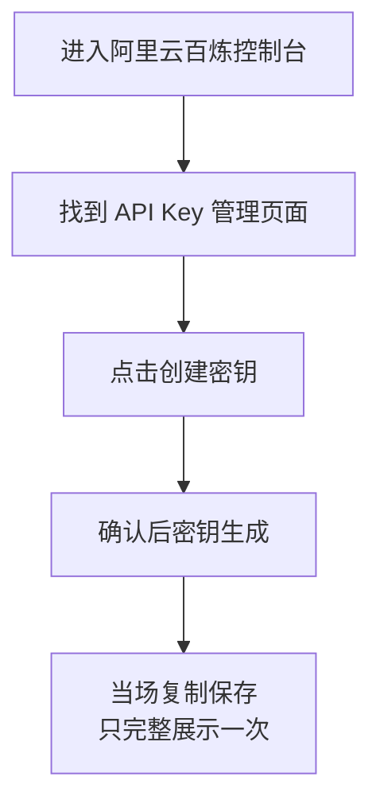

## 【学习目标】

- 理解「大模型广场」的定位：多供应商模型聚合到一个入口，一个 Key 调用全部；
- 说清阿里云百炼、百度千帆、火山方舟三大广场的收录规则与差异；
- 独立完成阿里云百炼 API Key 的申请，并理解课程选型阿里生态的原因。

## 【正文】

### 1. 大模型平台解决什么问题

先说明什么是大模型平台。目前市面上的大模型非常多：阿里提供的 Qwen 大模型、字节提供的豆包大模型、百度的文心一言大模型、当下很流行的 DeepSeek 大模型，以及此前的月之暗面 Kimi 大模型。按常规做法，想调用某个大模型的 API，就必须到该模型供应商的官方网站单独申请 API Key，拿到密钥之后才能调用它提供的接口。例如要用 DeepSeek，就得去 DeepSeek 官网的 API 开放平台申请密钥；换成月之暗面的 Kimi，又得再去月之暗面官网重新申请一次，逐个平台来回切换相当繁琐，密钥、文档、计费各成一摊，管理成本随接入的模型数量线性增长。更要紧的是，每家的接口规范与鉴权方式都有差异，代码里适配的痕迹会越积越多。

阿里云、百度、字节各自都建了「大模型广场」（也叫大模型平台），把各家供应商的大模型收录进去。只要在其中一家申请一个 API Key，就既能调用该平台自家的大模型，也能调用平台上收录的第三方模型。两种接入方式的差异，一张表就能看清：

| 维度 | 逐个官网申请 | 聚合平台（大模型广场） |
|---|---|---|
| 申请次数 | 每个模型供应商各一次 | 一次 |
| 鉴权方式 | 各家规范各异 | 统一 |
| 计费与账单 | 多家分别结算 | 汇总在一个账号 |
| 接口规范 | 各家各异，代码分别适配 | 统一规范，切换模型主要改模型名参数 |
| 管理成本 | 随接入模型数量线性增长 | 基本持平 |

对使用方来说，收益不止是少注册几次：鉴权方式统一了，用量与计费汇总在一个账号下，接入新模型往往只是改一个模型名参数的事。这也是本节要完成的第二项准备工作：申请阿里云大模型平台的 API Key。

### 2. 三大广场的收录规则

阿里云的大模型广场叫「阿里云百炼」。除了汇聚各类大模型，它还提供了各种 MCP 以及智能体供调用，MCP 是标准化的工具协议，智能体是封装好的应用，都能以调用的方式集成进自己的项目，课程后面的章节会用到 MCP。

进入模型广场可以看到，阿里云自家的通义千问各个版本都在列，DeepSeek 也在列，月之暗面的 Kimi 同样保持最新版本，最近一次更新在 7 月 16 日。版本保持新鲜这一点很重要：模型能力迭代很快，用旧版本意味着拿不到最新的推理与长上下文改进。

「保持最新版本」对课程还有一层现实意义：模型行为直接影响 Agent 的决策质量，同一个 Prompt，在不同版本模型上可能得到不同的工具调用序列。课程演示与工程测试尽量锁定明确版本，就是为了让结果可复现；换版本时预期随之变化，属于正常现象，排查这类「昨天还好好的」问题，先看模型版本有没有变。

收录并非没有边界，受商业竞争关系影响，平台不会收录直接竞品：

| 平台 | 自家模型 | 收录的第三方 | 不会收录 |
|---|---|---|---|
| 阿里云百炼 | 通义千问 Qwen 系列 | DeepSeek、Kimi | 文心一言、豆包 |
| 百度千帆 | 文心一言 | Kimi、DeepSeek V3 | Qwen、豆包 |
| 火山方舟（字节） | 豆包 | DeepSeek R1、Kimi | Qwen、文心一言 |

想调用文心一言，只能去百度自己的模型广场，也就是「百度千帆」。百度千帆除自家的文心一言之外，同样收录了 Kimi 以及 DeepSeek V3。反过来，百度的模型广场里也不会有阿里的 Qwen 和字节的豆包。字节的大模型广场叫「火山方舟」，其中除了自家的豆包，也收录了 DeepSeek R1 与 Kimi。三大广场的收录边界，基本由「谁和谁在竞争」决定。

对使用者的启示：选广场时先看目标模型在不在列，如果业务同时要用 Qwen 和文心一言，那就避不开两家平台、两套 Key，代码里的模型接入层要为这种分裂预留抽象。

收录规则背后还有一层平台策略值得理解：广场收录第三方模型，本质是用流量换生态，平台把开发者聚起来，第三方模型把开发者留住，自家模型则近水楼台。对使用方，这意味着「收录名单会变」：今天在列的模型，明天可能因商业关系调整。工程上的应对不是猜名单，而是把模型名做成配置（课程工程正是如此，`app.agent.model-name` 一项即可切换），名单变了改配置，不改代码。

### 3. 课程为什么选阿里云百炼

究竟该调用哪个大模型广场？这门课的整体项目基于 Spring AI Alibaba 开发，而 Spring AI Alibaba 属于阿里云生态，从模型接入（DashScope）到 MCP、A2A、Nacos 等能力，都在阿里生态内闭环。所以只能选择阿里云的大模型广场，也就是阿里云百炼。

申请入口：在阿里云百炼菜单栏的下方可以看到 API Key 的申请入口，点进去申请一个 API 密钥即可。后续课程中，凡是调用大模型进行项目开发的地方，都要依赖该密钥。课程 1-6 篇初始化 JManus 时，也要在模型选择处填入该 Key。

申请时留意页面上的账号要求：阿里云账号需要完成实名认证并开通百炼相关服务，否则看不到入口或无法调用。密钥生成后只完整展示一次，务必当场复制保存。

申请流程本身不复杂：进入阿里云百炼控制台后，找到 API Key 管理页面，点击创建密钥，确认后密钥即生成。真正容易出问题的是申请前的账号准备与申请后的保管：账号没就绪时看不到入口；密钥生成后只完整展示一次，当场没复制，之后在控制台只能看到部分位数，想用全量内容只能重新创建，这不是平台刁难，而是密钥类凭证的通用设计：可查不可见的片段展示，把「完整内容只给一次」做成默认，逼使用者在生成瞬间就进入保管流程。

### 4. Key 的使用与安全

API Key 是调用模型的身份凭证，工程上有一条纪律：Key 属于环境变量，不写进代码、不提交到仓库。原因很直接，代码仓库的传播面不可控，一旦推送出去，即使后续删除，历史记录里依然可查；而截图、日志、报错信息同样是常见的泄露渠道。

本地开发时，环境变量的注入方式因系统而异：Windows 可以在系统属性里配，也可以在命令行窗口临时设定；Linux 与 macOS 用 export 语句导出。CI 流水线里则由平台自带的密钥管理功能托管。方式多样，原则只有一条，Key 的明文只出现在运行环境里，不出现在代码、文档与截图里。团队协作时，把「Key 怎么配」写进项目 README 的独立一节，新人照着走，比在群里问高效得多。

课程配套工程 981-demo 正是这么设计的：真实模式的模型名配置在 `src/main/java/com/travel/agent/config/AgentProperties.java`（`app.agent.model-name`，课程示例值为 `dashscope:qwen-plus`），而 Key 通过环境变量注入（prod profile 读取 `DASHSCOPE_API_KEY`）；default profile 则使用 `src/main/java/com/travel/agent/model/OfflineChatModel.java` 离线规则模型跑通全链路，不联网、不填 Key。

配置项的分工也值得一看：`app.agent.model-mode` 决定用离线模型还是真实模型，`app.agent.model-name` 决定真实模式下调哪个模型，两者组合出四种常见状态，离线演示、真实模型、切换模型、灰度对比。把「模式」与「模型名」拆成两个配置项，而不是写死一个开关，好处是切换模型时不用动代码、不用重新构建，改配置重启即可。这是配置外部化最朴素的收益，课程工程把它落到了实处。

换言之：没有 Key 也能把「主管 Agent → 成员 Agent → 工具」的链路形态完整跑通，Key 只在需要真实模型推理时才必须。这种「离线优先、真实可切」的设计，好处是演示和测试不受网络与额度影响，换一台机器 Clone 下来就能跑；需要真实效果时，切到 prod profile 并注入环境变量即可，代码一行不用改。

工程里的 profile 机制值得多说两句：981-demo 的 `src/main/resources` 下除了默认的 `application.yml`，还有一份 `application-prod.yml`，后者放真实模型端点与密钥的占位。本地开发用 default（离线模式），上线时通过启动参数指定 prod profile，敏感值全部来自环境变量，同一份构建产物，靠配置区分环境，这是十二要素应用「配置与代码分离」的典型做法，也是面试里常考的工程素养点。

### 5. 额度与用量的工程习惯

Key 拿到手只是开始，用量管理才是长期功课。三个习惯建议现在就建立：

- **看曲线**：控制台里按 Key、按模型、按时间看用量，异常的尖峰往往意味着调用逻辑出了问题（例如循环里反复调模型），早发现早止损；
- **控并发**：批量任务不要瞬时打满，加并发上限与失败重试的退避间隔，被限流时的正确反应是放慢，而不是加快重试；
- **算成本**：模型计费按 token 走，输入输出都算钱。提示词不是写得越全越好，与任务无关的上下文每一轮都在付费；多 Agent 系统里调用层级越深，累计消耗越要盯紧。课程第 13 章会用专门的一节讲 Agent 追踪与 Token 消费分析，届时可以把控制台数据与工程内的埋点对照着看。

### 6. 常见坑

1. **账号未就绪**：申请 Key 前，阿里云账号需要完成实名认证并开通百炼相关服务，否则看不到入口或无法调用；
2. **Key 泄露**：Key 一旦进入 Git 历史或截图外发，就等于把账户额度拱手让人。正确做法是走环境变量；疑似泄露立即在控制台轮换，禁用旧 Key、生成新 Key；
3. **模型名写错**：百炼里不同模型有不同标识，代码里的模型名必须与控制台一致，课程配置中出现过的形式是 `dashscope:qwen-plus`（DashScope 接入 + 模型名），注意别漏前缀、别写错版本；
4. **额度与限流**：免费额度有用量与并发限制，批量调试时留意配额，避免演示到一半被限流打断；
5. **把广场当模型用**：百炼是入口不是模型本身，调用时仍要指定具体模型（Qwen、DeepSeek、Kimi 等），Key 只解决「你是谁」，不解决「调哪个模型」；
6. **多 Key 混用**：一个账号可以建多个 Key，团队里如果各建各的，用量会拆散在多个 Key 上难以统计；课程阶段一个 Key 足够，别给自己制造管理负担；
7. **把测试 Key 带上生产**：不同环境共用一个 Key，出问题时无法从用量曲线区分是哪里在调用。生产环境单独建 Key，既便于限额也便于轮换；
8. **忽略调用报错里的配额提示**：被限流时接口返回的报错信息里通常带额度或并发提示，先读报错再重试，盲目重试只会加重限流；
9. **网络代理干扰**：企业内网或代理环境下，调用百炼端点可能因代理配置失败，表现是「Key 没错但连不上」，先确认出网规则，再怀疑 Key；
10. **免费额度到期未察觉**：部分平台的试用额度有有效期，过期后调用直接失败。做长线演示前，先在控制台确认额度状态与有效期，别等到演示当天才发现调不动。

## 【易错点 / 面试题】

1. **面试题：为什么不直接去 DeepSeek 官网申请 Key，而选择阿里云百炼？**
   答：两层原因。一是工程栈：课程基于 Spring AI Alibaba 开发，该生态与阿里云百炼原生集成，模型接入最省事；二是能力面：百炼除模型外还提供 MCP 与智能体，后续章节的 MCP 工具、A2A 通信都在阿里生态内，选百炼能把技术栈收敛到一条主线上，不用在多套文档与鉴权方式间切换。

2. **面试题：API Key 泄露了应该怎么处理？**
   答：三步：立即在控制台禁用或删除泄露的 Key，阻断盗用；生成新 Key 并更新配置；把 Key 的存放方式改为环境变量或密钥管理服务，并检查代码仓库与 CI 配置里是否还有硬编码。事后复盘要把「Key 不进代码库」写进团队规范，泄露不可怕，反复泄露同一个渠道才致命。

3. **面试题：为什么工程上反对把 Key 硬编码进代码？**
   答：三个理由：代码仓库的传播面不可控，推送出去即泄露；不同环境需要不同 Key，硬编码会导致一套代码只能在一个环境跑；轮换 Key 时要改代码重新发布，响应速度慢。正确做法是配置与代码分离，Key 走环境变量或配置中心，代码只负责读取。

4. **易错点：认为一个 Key 只能调一个模型。**
   聚合平台的价值正在于「一个 Key、多模型」：申请百炼 Key 之后，Qwen、DeepSeek、Kimi 都可以切换调用，切换的只是模型名参数。这也是课程选聚合平台而不是逐家直连的原因之一。

5. **面试题：大模型广场这种模式，商业模式上靠什么成立？**
   答：平台赚的是流量与生态的钱：聚合把开发者吸引过来，第三方模型丰富平台能力、提高留存，最终通过模型调用、增值服务（MCP、智能体）与云资源消耗变现。对使用方，看懂这层逻辑就能理解两个现象，收录名单会随商业关系变动；平台总会力推自家模型。选型时把「模型能力」与「平台绑定程度」分开评估，被绑得太死后期迁移成本高。

## 【小结】

本节完成了第二项准备工作：理解大模型广场的聚合定位与三大平台的收录规则，并申请阿里云百炼 API Key。课程选型阿里生态的原因在于 Spring AI Alibaba；Key 的安全使用原则（环境变量注入、不落库）在配套工程 981-demo 的配置设计中有对应体现，default profile 离线跑通、prod profile 才注入真实 Key。准备篇的四项里，这项与后续章节的耦合最紧：从第 4 章接第一个模型开始，到第 11 章 A2A 通信里的每次远程调用，背后都是该 Key 在提供凭证。下一篇申请百度地图 API Key（AK），它是后续「百度地图 MCP」章节的直接输入。
