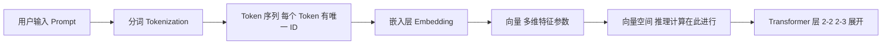

## 【学习目标】

- 复现两个「星巴克」问句，说清歧义消解为什么是语言模型的基本功
- 画出输入侧的两道工序：分词得到 Token、嵌入层完成向量化
- 解释向量化的两个理由：计算机只认数字，向量参数承载物体突出特征
- 说清向量空间在模型计算中的地位，以及 Token 与工程成本的关系

## 【正文】

### 1. 两个问句：歧义消解是基本功

问 DeepSeek 第一个问题：「我在一间咖啡馆里，想要杯星巴克，这里的星巴克指的是什么？」

「星巴克」三个字本身是有歧义的：可以指品牌，可以指咖啡馆，也可以指周边产品。但在该句子的场景里，它实际指的是一杯咖啡饮品。DeepSeek 的回答不仅推断出用户想要的是一杯特定的咖啡饮品，还进一步推断出是类似于星巴克那种咖啡饮品。第一个问题答对了。

再问第二个：「我看到很多人拿着星巴克感觉很好看，我也想要个星巴克。」

这里的星巴克显然不是一杯饮料，而是星巴克售卖的杯子。DeepSeek 第一句话就推断出用户想要的是星巴克的杯子，第二个问题也答对了。

三个字单独拿出来可以指代很多东西，模型却能根据这三个字在不同语义环境中推断出用户的真实意图。这是非常神奇的地方，也是本课要拆解的对象：机器并没有「理解」语言，它只是在做计算，问题在于，什么计算能让歧义消解发生。

两个问句的价值在于对照：第一句的歧义靠场景消解（在咖啡馆里），第二句的歧义靠搭配消解（拿着、好看）。模型两次都判断正确，说明它利用的不是词典里的固定释义，而是上下文给出的约束。这一点在后续所有章节反复回响，智能体之所以能「听懂」用户需求，依赖的正是同一种能力。

### 2. 三段式：输入、推理、输出

整个语言大模型可以分为三个部分：用户的输入（也就是 Prompt）、大模型的推理计算、大模型的输出。本节课先来看输入这一部分。

课程把输入侧单独展开，是因为后面所有计算的对象都由这两道工序定义：喂进模型的是 Token 与向量，算出来的才可能是语义。输入侧的表示质量，直接给推理计算设定了上限。

输入部分主要做了两件工作：分词和向量化。前者把句子切成模型认识的最小单位，后者把单位转成模型能计算的数字形式。两步走完，文字才真正进入模型。

| 工序 | 输入 | 输出 | 解决的问题 |
|---|---|---|---|
| 分词 | 连续的自然语言文本 | Token 序列，每个 Token 带唯一 ID | 把文本切成可编号的最小处理单位 |
| 向量化 | Token 序列 | 多维向量序列 | 把符号变成可计算的特征表示 |

### 3. 第一道工序：分词与 Token

分词就是把用户输入的句子按单词切割开来。以「在咖啡馆里想要杯星巴克」为例，就是把这句话里的每个单词连同标点符号一起切开。标点与普通单词一样被切成独立 Token，它承载语气、停顿与结构信息，并不是可以随手丢弃的杂音。

值得补充一点理解：英文有天然空格边界，中文没有，「按单词切开」依赖分词器对语言本身的判断，同一句话可能存在多种切法。这正是不同模型对同一段文本给出不同 Token 计数的根源之一。

切割后的每个单词有一个专有名词，叫做 Token。Token 是语言大模型处理的最小单位，并且每个 Token 都有唯一的 ID。

ID 的作用相当于查表钥匙：嵌入层为每个 Token ID 维护一组专属参数，Token 进入嵌入层时按 ID 取用对应参数，完成从符号到向量的查找。分词的切割方式因此直接决定了后面拿到什么样的参数组合，切得合理，语义单元完整；切得零碎，特征被稀释。

这里有一个容易被忽略的工程事实：Token 的编号不是世界标准，而是随分词器变化的。同一句话在不同模型里切出的 Token 数量不同，ID 也对不上，换模型时，历史对话的 Token 序列不能直接搬用。面试中被问「Token 是什么」，标准答法是三句话：最小处理单位、有唯一 ID、是计费与上下文长度的计量对象。

### 4. 第二道工序：嵌入层与向量化

Token 序列接下来会经过一层，该层称为嵌入层。Token 经过嵌入层之后就会被转换为向量，这就是语言大模型对用户输入做的第二件工作，向量化。

为什么要把 Token 或者说单词向量化？原因有两条。

第一，语言大模型本质上是计算机程序，计算机只认识 0 和 1 组成的数字，不认识文字，所以所有内容都必须转换成数字才能被处理。向量就是文字的数字形态。

第二，向量本身包含很多个参数，这些参数承载的是物体最突出的特征。以猫为例，语言大模型并不认识猫，但如果把猫转换成一个向量，向量里的参数都是这只猫的突出特征，灵活、吃老鼠、吃鱼，这些是猫区别于其他动物的特征。把这些特征转成数字放进向量的参数里，当语言大模型解析该向量时，解释出这些突出特征，就知道这是猫：原来吃鱼、吃老鼠、灵活娇小的是猫。狗也是同样的道理：狗的向量参数里装着忠诚、吃骨头、给主人看门这些特征，大模型解析之后就能认识到该向量指代的是狗，而不是猫。

第二条理由是向量化的真正价值所在：文字一旦变成携带特征的向量，「像不像」就变成了「近不近」，两个向量的参数越接近，指向的实体越相似。猫与狗的向量因特征不同而分开，咖啡与茶杯的向量因场景不同而关联。歧义消解的种子在此埋下：同一个「星巴克」，在不同上下文里会被邻近的不同向量拉向饮品或杯子的解释。

### 5. 向量空间：所有计算发生的地方

所有这些向量都存在于向量空间里。由于各自参数不同，每个向量在向量空间中都有唯一的一个点。语言大模型所有的推理和计算，都是在向量空间里面进行的。

世间所有的物体，无论是文字、声音还是图片，都能转换为向量，向量里的参数包含了对应物体的突出特征。特征越多，向量参数就越多，物体对大模型来说就越具体。

「唯一的点」还有两层含义值得展开。其一，位置唯一意味着可寻址，任意实体都有确定的向量表示，模型内部的查表、比对、聚合才有稳定对象；其二，点与点之间的距离可以度量，「像不像」从修辞变成了可计算比较的量，检索与推荐的底层操作都建立在这套距离语义上。输入侧交付出去的不只是一串数字，更是一张万物各就其位的地图。

把三道工序连起来：分词把句子变成 Token 序列，嵌入层把 Token 变成向量，向量落进向量空间，后续的 Transformer 层（2-2）与自注意力机制（2-3）全部在向量空间上做运算。输入侧的工序到此交付完毕，推理计算才真正开始。

### 6. 工程视角：Token 是计费单位，也是上限

从工程角度回看这两道工序，有三个直接后果：

其一，Token 是模型计费的最小单位。模型调用按输入输出的 Token 计费，Prompt 写得冗长就是在直接增加成本，13-3、13-4 两节用 Langfuse 做的 Token 消费分析，归因到的最小单位正是 Token。

其二，Token 是上下文窗口的计量单位。模型单次能看到的 Token 数量有上限，超出的部分要么被截断要么被摘要，长对话的工程化绕不开这一约束。

其三，输出侧的 Token 同样计费。回答越长、思考过程越展开（13-6 的深度思考模式），输出 Token 就越多。控成本因此有三处抓手：输入侧压缩 Prompt、输出侧按需开关思考（13-6）、全局侧用观测平台做归因（13-3、13-4）。

两道工序看似基础，却决定了后面所有章节的成本结构与容量边界。

## 【易错点 / 面试题】

1. **面试题：「Token 和字是一回事吗？」** 不是。Token 是分词后的最小处理单位，一个字可能被切成多个 Token，多个字也可能合成一个 Token；它同时是计费单位与上下文计量单位。回答时把「最小单位、唯一 ID、计费口径」三点说全。
2. **面试题：「为什么不把文字直接用编号表示，非要向量化？」** 编号只能区分彼此，不能表达关系；向量的参数承载突出特征，让「相似」变得可以计算。消歧义、做推荐、找近邻，全靠向量之间的距离，编号给不出这些。
3. **易错点：换模型时直接复用旧分词结果。** Token ID 随分词器而变，跨模型不通用。工程上要么按目标模型重新分词，要么只保存原始文本、在调用时现场编码。

## 【小结】

本节拆解了大模型输入侧的两道工序：分词把句子切成带唯一 ID 的 Token，嵌入层把 Token 转成携带突出特征的向量，所有向量落入向量空间，推理计算尽在其中。两个「星巴克」问句的答对并非偶然，歧义消解依赖的正是向量化带来的特征表示与空间距离。

输入侧的概念是后续章节的地基：2-2 的 Transformer 层、2-3 的自注意力机制都在向量空间上展开，而 Token 作为计费与上下文的计量单位，会一路影响到 13-3、13-4 的观测实践。想在本地无密钥验证链路、又不产生真实 Token 消耗，可参考 `981-demo/src/main/java/com/travel/agent/model/OfflineChatModel.java` 的离线规则模型设计。下一篇看 Transformer 层如何在这些向量上做信息整合。
