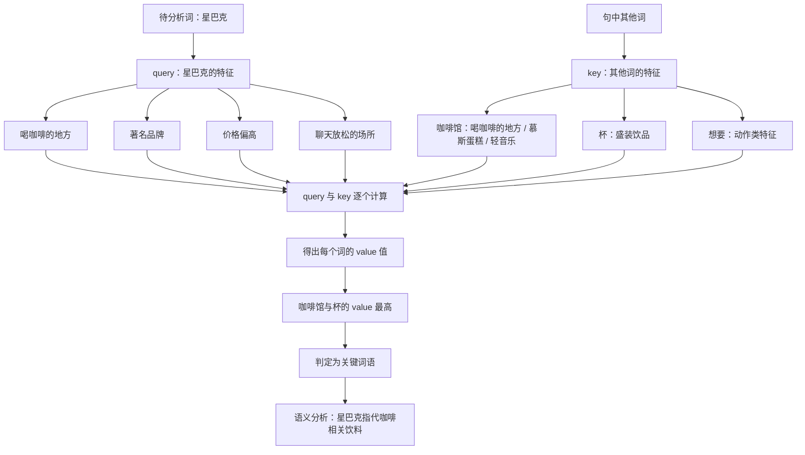

## 【学习目标】

- 说清自注意力机制要解决的问题：如何从句子中锁定关键词语。
- 掌握 query、key、value 三要素各自的含义与配合方式。
- 能复述「星巴克指代咖啡相关饮料」这一推断在 query / key / value 框架下的完整计算过程。

## 【正文】

### 一、承接上文：关键词语是如何找到的

上一节讲过，语言大模型通过 Transformer 层做语义分析。之所以需要语义分析，是因为用户往往不能把意图表达准确。仍以「在咖啡馆里想要杯星巴克」为例：这里的「星巴克」指代的是咖啡馆、是品牌，还是咖啡相关的饮料？

回顾上一节的处理链路：大模型先把用户输入按单词切割，标点包含在内；切割好的单词经过第一个 Transformer 层，相关文字被组装为专有名词，「咖啡馆」三个文字组装为单词「咖啡馆」；「想要」被组装为一个表示动作的词；「杯」被判定为量词而非名词。同样要注意，第一个 Transformer 层是简化说法，真实模型往往要经过三四个 Transformer 层才完成相关功能。

组装完成之后，单词再经过第二个 Transformer 层，大模型找到了句中的关键词语：「咖啡馆」与「杯」。借助这两个关键词语，推断出「星巴克」指代的不是咖啡馆这类场所，不是品牌，而是咖啡，或者说与咖啡相关的饮料。

### 二、复习：运算发生在向量空间

先把前面的知识巩固一遍：大模型的计算是数学计算，且基于向量而非单个数字。之所以基于向量，是因为向量可以包含很多个参数，每个参数指代对象的一个突出特征。

以猫为例，猫区别于其他动物的突出特征有：吃老鼠、夜间精神、喵喵叫。把这些特征作为参数放进指代猫的向量，大模型解析时依据这些突出特征，就能判断该向量指代的是猫而不是狗。这就是大模型用向量做计算的原理。

每个向量在向量空间中有唯一的点。「星巴克」的向量有唯一的点，「咖啡馆」的向量也有唯一的点。两个向量距离较近，是因为特征大量重叠，都是喝咖啡的地方；「巴黎」与「法国」近、与「中国」远，也是同一道理。这些是前面课程的内容。

再看本节例子的推断过程：句中两个关键词语「咖啡馆」与「杯」。向量空间中，离「咖啡馆」较近的物体有慕斯蛋糕、轻音乐、咖啡；离「杯」较近的物体有咖啡、汽水等喝的东西。与两个关键词语距离都近的物体，就是咖啡及咖啡相关饮料，而不是慕斯蛋糕。由此，大模型判定「星巴克」指代咖啡相关饮料。

这里的判断规则值得圈出：**同时靠近多个关键词语的物体，才被采纳为语义答案**。只靠近「咖啡馆」的慕斯蛋糕被排除，因为它不靠近「杯」；只靠近「杯」的白开水也被排除，因为它不靠近「咖啡馆」。语义推断因此不是「找一个最近的」，而是「找同时满足多个约束的」，这为自注意力机制为什么要逐词计算 value 埋下伏笔：只有量化了每个词的关键程度，才知道哪些词有资格充当约束。

### 三、核心算法：自注意力机制

语义分析的关键在于找到关键词语。问题在于：大模型如何找到「咖啡馆」与「杯」？这涉及大模型语义分析核心中的核心算法，自注意力机制。

对自注意力机制最朴素的理解是：它使大模型把更多注意力放到关键词语上，不去关注非关键词语。「想要」不是关键词语，与「想要」相关联的物体，大模型不会关心；注意力会被集中到「咖啡馆」与「杯」上。本节就来看自注意力机制如何把关键词语找出来。

这一算法涉及三把钥匙：

| 钥匙 | 名称 | 含义 | 在示例句中 |
|---|---|---|---|
| 第一把 | query | 要查询的词的特征 | 「星巴克」的特征 |
| 第二把 | key | 句中其他词的特征 | 「咖啡馆」「杯」「想要」的特征 |
| 第三把 | value | 计算得出的值 | 每个词对应一个 value |

三者的关系是：query 逐个与句中其他词语的特征（key）做计算，得出每个词的 value 值；value 值越高，该词成为关键词语的概率就越高。

### 四、逐步演算：三把钥匙如何找出关键词语

注意一个易被忽略的要点：query 并非单指「星巴克」一词，而是指该词的特征；对其他词同理，key 也是特征而非词本身。特征才能参与数学计算，这是上一节「向量化」的直接延续。

**第一步，确定 query。** 要查询的词语就是待做语义分析的「星巴克」。要分析的是它的特征：它是一个喝咖啡的地方；它是一个著名的品牌；它的价格偏高、性价比偏低；它是一个聊天放松的场所；甚至苹果电脑也是星巴克一个突出的特征。这些构成 query。

为什么 query 是「星巴克」？因为语义分析的目标就是判定它的指代，句中含义最含糊的是它，需要被解释的也是它。query 的选择由分析目标决定，而不是由句子结构决定。

**第二步，提取 key。** 除「星巴克」之外，句中其他词语的特征：「咖啡馆」同样是一个喝咖啡的地方，慕斯蛋糕、轻音乐也是它的特征；「想要」是一个动作类词语，具有与动作相关的特征；「杯」具有「盛装饮品」相关的特征。

**第三步，计算 value。** 「星巴克」的特征逐个与其他词语的特征做数学计算，每个词语算出一个 value 值。value 值越高，该词在解析「星巴克」语义时的关键程度越高。

为什么 value 高就意味着关键？回顾向量空间的逻辑：两个向量靠得近，说明特征重叠多。「星巴克」的特征与「咖啡馆」的特征在「喝咖啡的地方」上重叠，与「杯」的特征在「盛装咖啡饮品」上重叠，算出的 value 自然高；而「想要」的特征是动作类，与「星巴克」的各条特征都挨不上，value 自然低。value 值本质上是「特征重叠程度的量化读数」。

**第四步，判定结果。** 计算结果是：「咖啡馆」与「杯」两个词语的 value 值最高，在推断「星巴克」时被判定为关键词语。

还有一个细节值得说明：query 不止「星巴克」一个。句子里每个词都可以作为 query 做一次同样的扫描，「咖啡馆」作 query 时，它的关键邻居是「杯」和「咖啡相关」的词；「在」作 query 时，它的关键邻居是「咖啡馆」这类场所词。课程只完整演示「星巴克」这一次查询，因为语义分析的目标就是判定「星巴克」的指代；把每个词各扫一遍，全句的语义关系就被完整建立起来。

自注意力机制的全部作用，就是通过这套算法找到句中的关键词语，从而对用户意图做语义分析。它是 Transformer 层「第二个层职责」，锁定关键词语，的内部实现。

把三把钥匙的配合关系收束成一张表，便于复盘：

| 环节 | 输入 | 输出 | 在示例句中 |
|---|---|---|---|
| 取 query | 待分析的词 | 该词的特征向量 | 「星巴克」的特征 |
| 取 key | 句中其余词 | 各词的特征向量 | 「咖啡馆」「杯」「想要」的特征 |
| 算 value | 一组 query 与 key | 每个词的数值 | 「咖啡馆」「杯」高，「想要」低 |
| 定关键 | 全部 value | 关键词语集合 | 「咖啡馆」与「杯」 |

四步走完，「关键词语如何被找到」这一问题就有了完整答案：不是按位置、不是按词频，而是按 query 与 key 的特征计算出的 value 值。

### 五、一个思想实验：如果注意力平均分配

假设没有自注意力机制，句子里的每个词被同等对待，「想要」「在」这类词与「咖啡馆」「杯」权重相同，语义分析就会失去焦点：大量无关特征涌进来，「星巴克」的指代将在门店、品牌、杯子、饮料之间飘忽。自注意力机制的价值正是把有限的注意力预算集中到高 value 的词语上。这也解释了为什么「想要」不是关键词语，它的特征与「星巴克」的特征关联弱，算出的 value 值低，自然被边缘化。

## 【易错点 / 面试题】

1. **query、key、value 分别是什么？** query 是待分析词的特征，key 是句中其他词的特征，value 是二者计算后得出的数值，value 越高该词越关键。注意不要与数据库领域 key-value 存储混为一谈，这里的 key 是「特征」而不是「键名」。
2. **为什么计算的是「特征」而不是「词」？** 词本身没有运算意义，向量参数才可计算。query 与 key 都是特征向量，value 是对特征关联度的量化。面试官追问「自注意力在算什么」，答「算词与词之间特征层面的关联强度」即到位。
3. **「想要」为什么不是关键词语？** 它的特征是动作类的，与「星巴克」的特征关联弱，value 值低，因此被自注意力机制判定为非关键。关键词语不是按词的位置或词频选的，而是按 value 值选的。

## 【小结】

本节补齐了语义分析的最后一块拼图：Transformer 层锁定关键词语，靠的是自注意力机制；自注意力机制靠 query（待分析词的特征）、key（其他词的特征）、value（关联度数值）三把钥匙，逐个计算、按值判定，把注意力集中到关键词语上，进而完成意图推断。

这条「理解意图再行动」的思路在工程中有直接对应。981-demo 的主管 Agent（`981-demo/src/main/java/com/travel/agent/agent/SupervisorAgent.java`）在把用户需求分发给团队成员前，同样要先从需求描述中抓住关键信息，目的地、天数、预算、偏好，再决定调度哪个成员。这与自注意力机制「抓住关键词语、忽略无关词」是同一种思想在工程侧的落地：模型内部用 value 值衡量关键程度，工程上用 Prompt 与结构化字段承载关键信息。至于理解了意图之后输出如何生成，见下一节。
