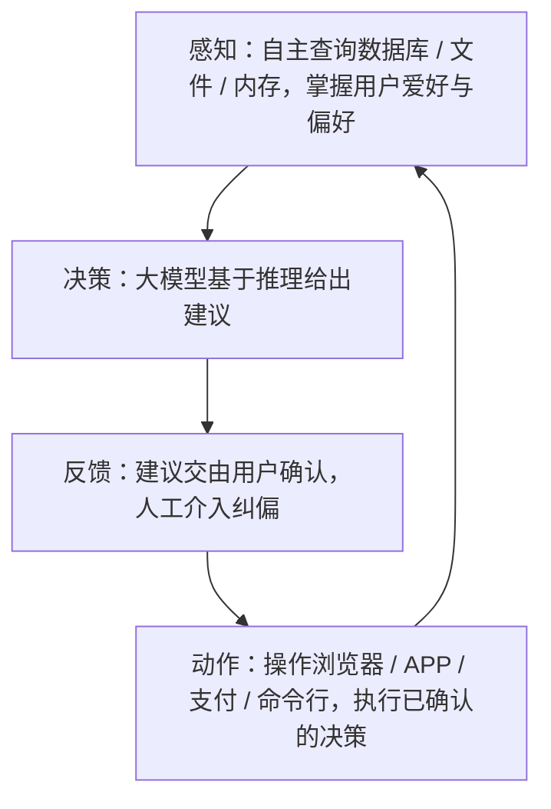

## 【学习目标】

- 说清大模型的能力边界：基于概率的预测，能理解语义但没有感官与手脚。
- 掌握人工智能的底层逻辑四要素：感知、决策、反馈、动作。
- 理解 AI Agent 的组合结构：大模型负责决策，感知与执行由 Agent 补全。

## 【正文】

### 一、回顾：大模型是概率预测器

用户向语言大模型提出需求，即平常所说的 Prompt。大模型能理解输入语义，推断出需求背后真实的意图；它不只给出正确答案，还能围绕需求延伸出其他解决方案。在用户看来，大模型不只是一台机器，更像一个知心伙伴：懂我的意思，为我排忧解难，还能设身处地站在我的立场上提供延伸方案。

「知心伙伴」的体验由两半拼成：前半是第 2 章讲透的语义理解，分词、向量化、Transformer 层逐层推理，把「字面意思」还原成「真实意图」；后半是本节要讲的能力边界，它懂你，却不知道你的购物车，也没有办法替你付款。

大模型经过海量数据训练，人类有史以来的知识被灌输其中，于是它上通天文、下懂地理。但要注意，既然它基于海量数据，它对用户疑问给出的答案，本质上是基于概率的预测。

以「1 加 1 等于几」为例：大量训练数据都在告诉它 1 加 1 等于 2、不会等于 3，于是有约 99% 的概率应该回答 2，除非遇到脑筋急转弯式的问题。在用户看来这很智能，拆开看，底层只是概率预测。这是前面课程的内容。

### 二、一次实测：让大模型帮忙购物

大模型是否已经完美到可以替代人类？用一个实际问题来检验。

给本机安装的豆包软件（非网页版，是安装在本机的大模型应用）发送这样一个需求：希望它理解我们是谁，知道我们的购物爱好，推断出为什么此时此刻需要帮忙购物；并且希望它自动在淘宝网或其他平台购物，按最低价格完成购买并付款，而不需要我们自己去打开淘宝 APP。我们和豆包此前一直在对话，它理应知道我们是谁。

这里的「理应知道」值得多想一层：对话历史里的只言片语，并不等于可查询的用户画像。模型能记住的，只是上下文窗口里的对话内容；它无法打开我们的订单记录、无法读取支付账号、无法登录购物平台。知道「我们聊过」和知道「我们是谁、买过什么」，是两回事，后者需要感知能力，恰是大模型缺失的部分。

豆包的回复是：需要我们提供购物的目的、在哪里购物、预算，以及什么时候付款。换言之，它需要我们给出购物清单，并对购物流程提出建议。

这样的人工智能，和想象中的人工智能有差距。

把期望与实测摆在一起，差距会更直观：

| 环节 | 期望中的智能 | 豆包的实际表现 |
|---|---|---|
| 了解用户 | 知道我们是谁、爱好是什么 | 未体现，仍需用户自述 |
| 推断动机 | 判断为什么此时需要帮忙购物 | 未做推断 |
| 列清单 | 自主给出购物清单 | 反过来索要购物清单 |
| 比价 | 自动到各平台对比最低价 | 未涉及 |
| 付款 | 自主完成支付 | 反过来询问何时付款 |

### 三、差距在哪

差距主要体现在两处。

第一，无法自主判断用户的购物偏好。按道理，它应该先根据我们平时的购物习惯和当前场景，推断出我们为什么提出购物需求、大概想买什么。

第二，无法对需求做步骤拆解。按道理，「帮我完成一次购物」应该被拆成几步：先确定要买哪些商品；再拿着购物清单到各平台比价，挑最低价；然后加购、付款。而现在的大模型只会反向提问，把步骤推回给用户。

真正的人工智能不只是能对话、能提供方案、能写歌画画做数据分析，而是：知道用户的爱好与购物偏好，自主、自动、主动地列好购物清单，交给用户确认；拿到确认后的清单，自动到各平台比价，拿到最低价，再自主完成付款。这才是人们对人工智能的期待。

### 四、人工智能的底层逻辑：感知、决策、反馈、动作

上述期待可以拆成四个环节，即人工智能的底层逻辑：

1. **感知**：自主知道用户的爱好，查数据库、查文件、查内存，掌握用户属性与偏好；
2. **决策**：根据爱好给出建议，由大模型的逻辑推理能力承担；
3. **反馈**：给出建议后询问用户是否这样做，让用户介入，判断决策是否正确；
4. **动作**：根据确认过的决策执行操作，操作浏览器、打开 APP、完成支付、调用命令。

放回复购场景里，四环各有清晰的样子：感知是查历史订单与收藏夹，知道用户常买什么品牌、什么价位；决策是由大模型综合「常用品牌 + 当前缺什么 + 哪家在促销」给出购物清单；反馈是把清单发给用户，问一句「买这些吗」；动作是确认后自动比价、加购、付款。四环扣得上，购物这件事才不需要用户一步步口头指挥。

四者形成闭环，才是一个活生生的人工智能，而不只是一台对话的机器。

### 五、大模型与 AI Agent 的分工

这就回答了「有大模型，为什么还要 AI Agent」之问。

大模型只承担了四环节中的「决策」，它擅长推理与知识存储，但缺少眼睛、耳朵、双手、双脚，无法感知外部世界，也无法执行动作。AI Agent 则补全了另外两环：

| 能力 | 大模型 | AI Agent | 实现方式 |
|---|---|---|---|
| 决策 | 有：优秀的逻辑推理能力 | 有：沿用大模型的推理 | 语言大模型 |
| 感知 | 无 | 有 | 自主查询数据库、文件、内存，获取用户属性与偏好 |
| 执行 | 无 | 有 | 自主操作浏览器、打开 APP、完成支付宝付款、调用命令 |

仍以购物为例：Agent 先感知，查数据库和文件，知道用户的购物爱好，不用用户开口说「我要买什么」；再决策，由大模型推断购物清单；然后反馈，把推断出的清单交给用户确认；最后动作，拿着确认后的清单到各购物网站比价，把最低价商品买下来。对照豆包的实测，差距正落在两端：豆包有「决策」却缺「感知」与「动作」，所以只能反问；Agent 四环齐全，才能把事办成。

三种数据源各有分工：数据库存结构化记录，历史订单、会员等级、常用地址；文件存文档类资料，偏好说明、收藏清单；内存存当前会话状态，这轮对话里刚确认的预算与时间。三者合起来，构成 Agent 对用户的「记忆」。感知的关键不在查得多，而在查得自主：不用用户开口，Agent 自己决定该查什么、何时查。

标题的比喻也由此落地：大模型像弹药库，知识储备深厚、推理能力过硬，但弹药自己不会开火；智能体像武器，把弹药装进瞄准（感知）、击发（决策）、校射（反馈）、再击发（动作）的完整机构，才形成战斗力。缺了弹药，武器是空壳；缺了武器，弹药只是库存。两者是能力与载体的关系，不是替代关系。

AI 智能体的概念到 2025 年 7 月已推出很久，但其底层逻辑可以归结为一句话：它是「感知-决策-反馈-动作」闭环的载体，而语言大模型只是该闭环中「决策」那一环的引擎。所以很多人说，AI 智能体才是人工智能的未来。

### 六、与本课程后续的衔接

本课程要构建的多 Agent 系统，正是把上述分工落到工程：

- **决策**：主管 Agent 负责理解需求、规划任务、分发给团队成员，对应 `981-demo/src/main/java/com/travel/agent/agent/SupervisorAgent.java`；
- **感知**：团队成员通过注册中心被主管发现，主管据此掌握「团队里有哪些能力可用」，对应 `981-demo/src/main/java/com/travel/agent/a2a/NacosAgentRegistry.java` 与 `InProcessAgentRegistry.java`；
- **执行**：工具与 MCP 服务是 Agent 的手脚，查景点、规划路线，对应 `981-demo/src/main/java/com/travel/agent/tool/RouteMakingTools.java`、`AttractionTools.java`；
- **协作**：多个成员共同完成一个复杂需求，成员清单见 `981-demo/src/main/java/com/travel/agent/agent/TeamMembers.java`。

大模型是弹药库，提供知识与推理的「弹药」；智能体是武器，把弹药装进能感知、能决策、能执行的作战体系。后续章节将逐一拆解该体系如何搭建。

课程地图也由此清晰：第 3 章讲清大模型的数据困境与工具的必要，第 4 章落到 Spring AI 的工程实现，第 9 至 13 章搭起完整的旅游规划多 Agent 团队。本节是「原理篇」到「工程篇」的转接头，从下一章起，视角从「模型如何思考」切换到「系统如何搭建」。

## 【易错点 / 面试题】

1. **有了大模型，为什么还要 AI Agent？** 大模型只承担「决策」，无法感知外部世界，也无法执行动作。购物案例中，它连用户爱好都判断不了，更无法比价付款。Agent 补上感知与执行，形成完整闭环。
2. **Agent 的「感知」具体指什么？** 指自主查询数据库、文件、内存，获取用户本身的属性与偏好信息，从而不必让用户手动告知「我需要购买什么物品」。
3. **「反馈」为什么是人工智能的一环？** 决策可能出错，执行不可逆（付款就是典型）。让用户在动作前介入确认，是闭环中控制风险的关键环节，也是本课程后续「人工介入修改计划」功能的出发点。

## 【小结】

本节用一个购物实测暴露了大模型的能力边界：它是概率预测器，能理解语义、能推理，但缺感知、缺执行，无法把目标拆成步骤并自主完成。人工智能的完整形态是「感知-决策-反馈-动作」闭环，大模型只占其中决策一环，AI Agent 则把四环拼齐。大模型是弹药库，智能体是武器，这就是本节标题的含义。

下一章开始回答工程问题：该「武器系统」如何一步步搭建，先从大模型的数据困境讲起。想看闭环的代码级实现，可直接对照 981-demo 的 `agent`、`a2a`、`tool` 三个包。
