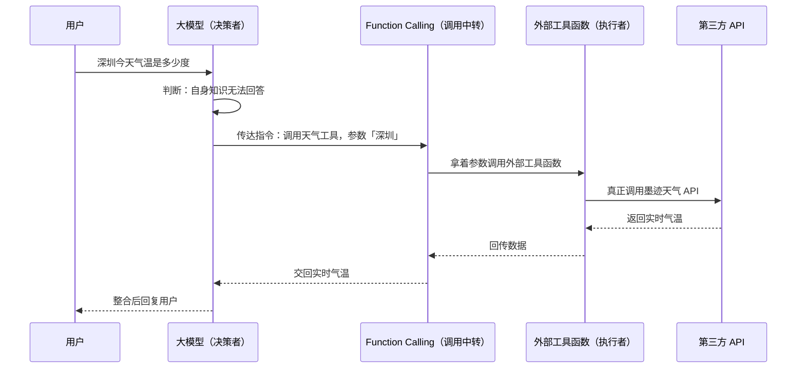

## 【学习目标】

- 回答两个问题：第三方应用的 API 究竟由谁调用？为什么不是大模型直接调用？
- 分清三个角色：大模型（决策者）、Function Calling（调用中转）、外部工具函数（真正的执行者）。
- 理解工具函数的来源：由开发人员编写，并手动投喂给大模型。
- 用「老板-前台-打印机」的比喻说清能力分工：模型的价值在理解与推理，不在执行。

## 【正文】

### 一、回顾：实时数据的获取链路

上一篇留了一个悬念：实时数据靠第三方应用的 API 获取，链路已经跑通，但中间的细节没有展开。

先把前两篇的结论复述扎实。大模型上通天文下懂地理，唯独答不上「深圳今天的气温是多少度」这类问题，它只存储过去的知识，对未来与实时变化的数据无从得知。要拿到实时数据，只能借助第三方应用的 API：问实时气温，走墨迹天气的 API；问实时股票，走同花顺这类应用提供的 API；问实时交通，走高德地图的 API。整条链路可以概括为：调用第三方 API → 取回实时数据 → 模型综合后回复用户。

一个自然的疑问随之产生：第三方应用提供了 API，究竟是谁调用了这些 API？凭上篇的流程，直觉答案是「大模型调的」。但上一篇埋了一个知识点，真正发起调用的执行者，是模型内部的 Function Calling。本节就把这层窗户纸捅破。

这层窗户纸值得捅破，因为它是面试的高频混淆区。「大模型调 API」是一句正确的废话，往下追问三层（谁判断、谁传参、谁执行），能答全的人并不多。把三个角色分清，后面理解 MCP 的客户端 / 服务端分工，会有天然的参照系。

### 二、第一个问题：API 是谁调用的？

大模型与第三方应用的 API 之间，还有另外一层调用逻辑。

模型接到「深圳今天的气温是多少度」这类需要实时数据的问题，先判断出自身存储的知识无法回答，却又不能直接对用户说「我不知道」；同时它知道外部有一个第三方应用叫墨迹天气，其 API 可以提供实时数据。于是模型向内部一个模块传达指令，该模块就叫 Function Calling。指令的内容是：外部有一个墨迹天气 API 调用工具，参数是「深圳」，你拿着这组参数去调用，把实时数据取回来。

Function Calling 拿到「深圳」这一地点参数，调用模型外部名为「墨迹天气 API 工具函数」的程序，由它完成对墨迹天气 API 的真正调用，取回深圳当天的气温。第一个问题的答案至此明确：**第三方应用的 API 由 Function Calling 调用**。

但这句话只说对了一半。Function Calling 并不是真正的调用者，它只是执行者，真正调用第三方 API 的业务逻辑，在模型外部的工具函数里。Function Calling 做的事，是拿着模型提供的参数（例如地点「深圳」、日期），去调用模型外部的工具函数，再由该工具函数完成对第三方 API 的调用。**真正的执行者是外部工具函数。**

三个角色的分工可以用一张表钉死：

| 角色 | 位置 | 职责 |
|---|---|---|
| 大模型 | 决策侧 | 判断需求是否需要外部数据，选定该用哪个工具，提供调用参数 |
| Function Calling | 模型内部 | 中转指令与参数，驱动外部工具函数执行 |
| 外部工具函数 | 模型外部 | 真正调用第三方 API，完成业务逻辑 |

这张表还解释了一个细节：为什么参数必须由模型提供、经 Function Calling 中转？因为模型是唯一理解用户语义的一方。用户说「深圳今天天气怎么样」，从中抽取「深圳」这一地点、补上「今天」这一时间口径，靠的是语义理解，这份工作只有模型干得了。Function Calling 与工具函数都不理解语义，它们只认参数。参数从模型出发，是能力使然，也是分工必然。

### 三、工具函数从哪来

墨迹天气 API 工具函数由开发人员编写。动因很直接：用户频繁询问实时气温，模型答不上，开发人员便在模型外部编写一个工具函数，封装对墨迹天气 API 的调用。调用所需的参数，时间、地点，由模型通过 Function Calling 传递给该函数，函数据此完成调用并取回数据。

需求当然不止气温。实时交通信息、实时股票信息同样有人问，于是开发人员继续编写高德地图 API 工具函数、同花顺 API 工具函数，等等。问题随之而来：这些工具函数都在模型外部，模型如何知道它们的存在？答案是开发人员手动将这些工具函数投喂给模型，模型才知道外部存在这批 API 调用工具，进而知道遇到对应需求时该调哪一个。

注意「手动投喂」这一特征，它是 Function Calling 方案与生俱来的属性，也是 3-5 篇与 MCP 对比时的关键差异点，MCP 靠客户端主动拉取服务端的工具列表，不靠投喂。

投喂的内容不是一段黑箱。课程第 4 章会看到，工具函数向模型暴露的最小信息集有三样：名称（模型按名调用）、描述（模型据此判断适用场景）、参数签名（模型据此填参）。Spring AI 中三者分别对应 `@Tool` 注解的 `name`、`description` 与 `@ToolParam`。信息集越完整，模型选工具的准确率越高，这也是「工具描述要当文档写」的原因。

### 四、第二个问题：为什么不直接调？

有疑问很正常：模型既然知道墨迹天气提供了 API，直接调不就行了，为什么要绕经 Function Calling 和外部工具函数，多走一圈？

答案藏在能力分工里。模型擅长的是理解用户的语义输入、进行逻辑推理，它知道用户需要实时数据，也知道外部众多工具函数中哪一个能满足需求：天气类需求对应天气 API 工具函数，交通类需求对应交通 API 工具函数，股票类需求对应股票 API 工具函数。而真正执行 API 调用，不是模型该做的事。

比喻能把这层分工讲透。模型像公司老板，老板要打印一份材料，不会自己坐到打印机前操作，他把文件交给前台，由前台操作打印机完成打印。前台是 Function Calling，拿着老板给的参数去操作；打印机是外部工具函数，负责真正干活的执行。老板的职责是找投资、定战略、带公司盈利；同理，公司投入巨额资源训练大模型，不是让它去写工具函数、操作打印机，而是让它理解用户需求、做语义分析与逻辑推理，这才是模型的价值所在。

把分工推演到工程上，还有一层现实意义：执行逻辑从模型一侧剥离后，工具函数可以独立编写、独立测试、独立复用；模型升级换代时，工具函数原样保留；工具函数修复接口变更时，模型毫发无伤。各司其职，才各得其便。

### 五、工程侧的对应

三层分工在 Spring AI 工程中有清晰对应：开发者用 `@Tool` 注解把工具方法（即外部工具函数）注册进 `ToolCallbackProvider`；模型每次决策若判定需要调用工具，便由框架的工具调用循环完成「执行调用-回传结果-继续推理」的闭环，2.0 起这轮循环由 `ToolCallingAdvisor` 在 Advisor 链中驱动。课程第 4 章会展开这部分代码，这里先建立概念映射即可。

这轮循环值得提前看一眼形态：模型先输出「我要调用哪个工具、参数是什么」，框架据此触发真正的函数执行，把返回值塞回上下文，模型再基于新上下文继续推理或给出终答。回望本节的三个角色，决策的是模型，触发执行的是框架的调用循环，干活的是工具函数，与工程实现的对应严丝合缝。981-demo 的离线模式用规则模型复刻了同构行为：第一轮调用自己的工具、第二轮汇总，行为形态与真实 ReAct 循环一致。

## 【易错点 / 面试题】

1. **第三方应用的 API 到底是谁调用的？** 完整答案分两半：调用由 Function Calling 发起，但 Function Calling 只是执行者；真正调用 API 的业务逻辑在模型外部的工具函数中，由开发人员编写。模型负责判断与选工具，Function Calling 负责传递参数，工具函数负责执行。只答一半算没学透。
2. **为什么不让大模型直接调 API？** 能力分工决定。模型的价值在语义理解与逻辑推理（判断该调哪个工具、填什么参数），执行调用不是它该做的事。类比即可说透：老板不操作打印机，前台才操作。
3. **模型怎么知道外部有哪些工具函数？** 开发人员手动投喂。这是 Function Calling 方案的鲜明特点，也将成为与 MCP 对比时的关键差异，MCP 靠客户端拉取服务端工具列表，模型按列表自主选用。
4. **追问：工具函数的参数从哪来？** 由模型通过 Function Calling 提供，如地点、日期。参数质量取决于模型对用户需求的理解，这也是工具方法的参数描述要写清晰的原因，描述越准，模型填参越稳。
5. **追问：为什么要绕这么远，不把 API 调用直接做进模型？** 一是能力边界，模型擅长推理不擅长执行；二是可维护性，外部接口变了只改工具函数，不动模型；三是可复用性，同一工具函数可服务多个模型。

## 【小结】

本节回答了两个问题。第一，第三方应用的 API 由模型内部的 Function Calling 调用，但 Function Calling 只是执行者，真正的执行者是模型外部、由开发人员编写的工具函数；模型负责判断需求、选择工具、提供参数。第二，大模型不直接调 API，是因为能力分工，模型的价值在理解与推理，不在执行，「老板-前台-打印机」的比喻即可说透。工具函数由开发人员编写并手动投喂给模型，这层「投喂」机制正是 Function Calling 方案的特点，也将成为与 MCP 对比的关键差异。

工程对应见 981-demo：`981-demo/src/main/java/com/travel/agent/tool/RouteMakingTools.java` 定义了 `map_geocode`、`map_directions`、`map_weather` 等工具方法，即「模型外部的工具函数」；`981-demo/src/main/java/com/travel/agent/agent/TeamMembers.java` 中通过 `Toolkit.registerTool(...)` 完成工具的注册与挂载，模型在 ReAct 循环中完成「选工具-传参-执行-汇总」的完整闭环，本节的三个角色分工，在这两个文件里各就各位。
