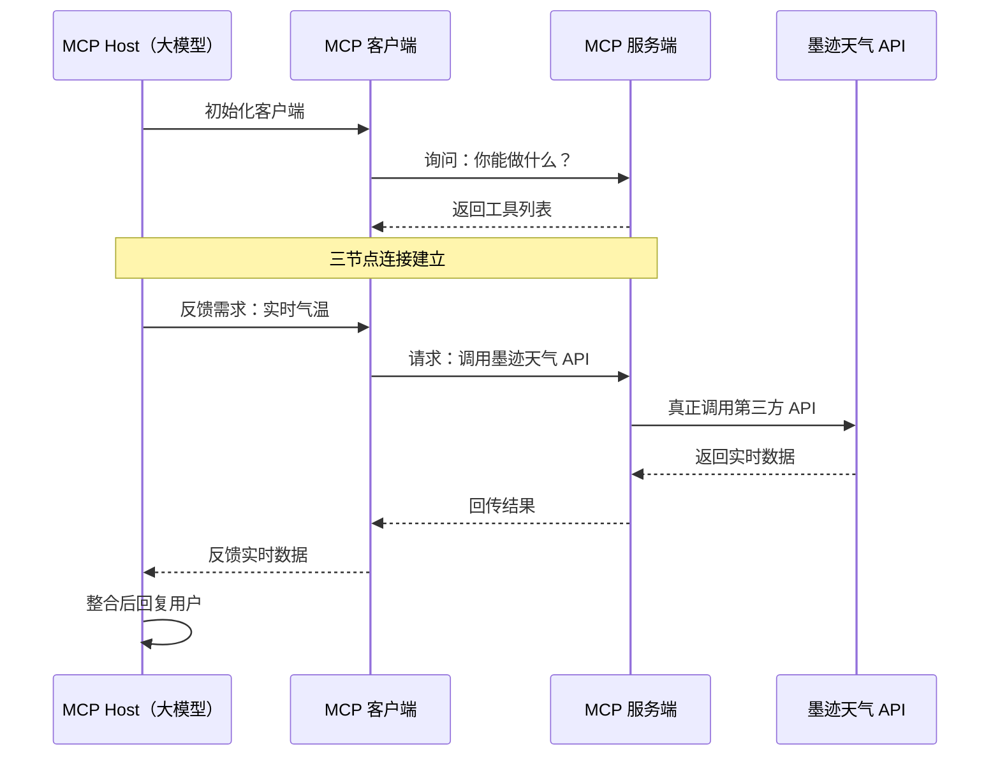

## 【学习目标】

- 回顾两个致命缺陷与 Function Calling 方案的分工逻辑。
- 说清 Function Calling 的两个缺点：单个跑腿小弟忙不过来；各家大模型的跑腿小弟互不通用。
- 掌握 MCP 协议的核心思想：全行业统一标准，共用同一个跑腿小弟。
- 理清 MCP 三节点（MCP Host、MCP 客户端、MCP 服务端）与工具列表机制，复述完整调用流程。

## 【正文】

### 一、两个缺陷，第一套方案

语言大模型无所不能、上通天文下晓地理，能把整本《红楼梦》放进自己的记忆空间，也就是向量空间，随时说出其中任何章节、任何场景、任何人物的一句话，也能专业地分析某个人物的性格特征。但它偏偏说不出当前深圳的气温是多少度：一个再聪明的人，也无法预知未来某个时刻的温度，除非有预知未来的能力。因此无法拥有实时变化的数据，是第一个缺陷。

第二个缺陷是无法拥有用户的私人数据。用户的私人数据存放在私人的文件与私人的数据库里，模型的记忆空间中没有这些数据，便无法据此做私人化的操作。例如用户想让模型根据公司数据制作销售报告，模型手里没有数据，功能就无从谈起。

解决方法看上去很简单：获取实时数据，调用外部 API 即可，调用墨迹天气的 API，就能拿到实时气温；获取私人数据，访问用户本地的私人文件或私人数据库即可。但模型更擅长的是语言分析与数学推理，写 API 调用函数、写文件访问函数、写数据库 CRUD，都不是它的强项。于是模型聘请了一个跑腿小弟，名叫 Function Calling，中文叫函数调用。

顺带回答一个可能的疑问：为什么不把外部数据直接训练进模型，一劳永逸？上一篇给过答案，训练解决「有没有对应向量」，实时数据的问题在于向量此刻还准不准，私有数据的问题在于数据根本进不了训练。调用时取数，是唯一同时绕开两个坑的路线。

这名跑腿小弟能力很强：能依据 API 文档写调用函数，只要模型持有墨迹天气最新的 API 文档，它就能写出对应的对接程序；能按操作系统写文件调用函数，针对 macOS 的写一套，针对 Windows 的写一套；能写数据库 CRUD 函数，本地数据库、云端数据库、MySQL、HubDub，样样拿得下。两个缺陷，一度看起来被这名全能小弟兜住了。

### 二、跑腿小弟的两个缺点

问题慢慢显露。

第一个缺点：跑腿小弟只有一个，需求却无穷无尽。B 用户想知道当前气温、股票分时图，C 用户想知道当前交通状况，后面还有 D 用户、E 用户……所有需求都涌向同一个 Function Calling，它忙不过来。

第二个缺点更致命：大模型厂商不止 OpenAI 一家，DeepSeek、豆包、阿里千问，足足几十家。各家都有自己的跑腿小弟 Function Calling，相互之间不通用，没有统一标准。对开发者来说这是灾难，同一套外部能力，换个模型就要重新对接一遍。

把这层灾难算成账更直观：假设市场上有 N 个大模型、M 类外部能力，Function Calling 方案下最坏需要 N × M 份对接工作，每家模型厂商为自己的用户重写一遍所有工具。MCP 的思路是把乘积压成加法：外部能力按标准协议封装一次（M 份），所有模型侧实现统一的客户端（1 份标准），总量从 N × M 降到 M + 1。标准化的价值，本质是把重复建设的乘积项消掉。

顺着第二个缺点往下想，有人提出一个设想：这么多家大模型，能否共同制定一个标准，去调用同一个跑腿小弟，由它替各家做事？这一设想就是 Function Calling 的进化版，**MCP 协议**。

### 三、MCP 协议的两个部分

MCP 协议分为两个部分：MCP 服务端与 MCP 客户端。

MCP 服务端持有一份工具列表，列明自己能做什么、不能做什么。例如某个 MCP 服务端只能调用墨迹天气的 API，不能访问 macOS 的文件，工具列表把能力边界写得清清楚楚。列表里有的，就是它能力所及；列表里没有的，它做不了。

MCP 客户端负责把工具列表拿过来。它想调用墨迹天气的 API，便访问 MCP 服务端询问「调用墨迹天气 API 你能做吗」；服务端查阅自己的工具列表，确认「上面有调用墨迹天气的 API，此事我能做」，客户端随即取得对应工具。模型则通过 MCP 客户端拿到访问墨迹天气 API 的工具，进而取得实时变化的气温。

工具列表的每一条目同样是一个最小信息集：工具名称、功能描述、参数说明。课程第 11 章「百度地图 MCP 提供的工具体系全景」会看到一批真实条目，`map_geocode`（地理编码）、`map_directions`（路线规划）、`map_weather`（天气查询）等，名称、描述、参数一应俱全。条目格式统一，客户端才能以同一套代码对接任意服务端，这正是「标准」二字的落地形态。

### 四、三节点与完整流程

MCP 协议涉及三个节点：除 MCP 服务端、MCP 客户端之外，还有 MCP Host，即不同的语言大模型。

整个流程分两段。第一段是建联，三节点建立通话：

1. MCP Host 初始化 MCP 客户端。
2. MCP 客户端向 MCP 服务端询问「你能够做什么」，把服务端的工具列表取过来。
3. 三个节点的连接就此建立。

第二段是调用，以 OpenAI 遇到「当前深圳气温是多少度」为例：

4. OpenAI 向 MCP 客户端反馈需求：能否提供实时的气温？
5. 客户端查阅工具列表，确认其中有访问墨迹天气 API 的工具，便向 MCP 服务端请求完成该任务。
6. MCP 服务端调用墨迹天气的 API，取得实时的天气数据。
7. 客户端拿到实时数据，反馈给 OpenAI，OpenAI 整合后回复用户。

全流程的关键点有两个。其一，模型（MCP Host）从不直接接触第三方 API，它只与客户端对话；其二，具体任务的业务逻辑全部落在 MCP 服务端完成，客户端负责中转，服务端负责执行。

三节点的分工与 3-3 篇的三个角色一一呼应：模型负责判断与决策；客户端负责中转调用；服务端负责执行。区别在于组织方式，Function Calling 方案中，工具函数由各家模型厂商自养、手动投喂；MCP 方案中，工具挂在服务端、按协议取用。同一套分工，两种组织形态，后者赢在标准。

### 五、标准化的价值

无论 OpenAI、DeepSeek 还是千问，只要遇到需要访问外部数据的场景，都走同一套流程：先请求 MCP 客户端，问它能否完成该功能；客户端手上已有服务端的工具列表，列表里列明的，服务端就能完成；客户端便向服务端转达任务，服务端执行具体逻辑。跑腿小弟从「各家自养、互不通用」变成「全行业统一标准、共用同一个」，这是 MCP 相对 Function Calling 的进化本质，下一篇用对照表逐条拆解。

### 六、981-demo 中的对应实现

课程第 11 章把这条链路落到了工程里。百度地图 MCP 服务端暴露的工具列表，`map_geocode`（地理编码）、`map_directions`（路线规划）、`map_weather`（天气查询），在 981-demo 中对应 `981-demo/src/main/java/com/travel/agent/tool/RouteMakingTools.java`：这些带 `@Tool` 注解的方法即「MCP 服务端工具列表」的条目，`RouteMakingTools.toolNames()` 暴露的清单正是工具列表机制的代码化呈现。真实环境下，这些工具由百度地图 MCP Server 提供，通过 `Toolkit.registerMcpClient(...)` 挂载到智能体；离线演示用本地桩返回同构数据，保证「工具挂载 → 工具调用 → 结果回传」的链路形态与生产一致。

## 【易错点 / 面试题】

1. **MCP 为什么能解决 Function Calling 的第二个缺点？** Function Calling 的跑腿小弟由各家大模型自养、互不通用；MCP 用全行业统一标准，让所有模型共用同一个跑腿小弟，开发者一次编写、处处可用，标准统一是根本解。
2. **MCP 的三个节点各是什么？** MCP Host 是语言大模型（决策侧）；MCP 客户端负责拉取工具列表、中转调用请求；MCP 服务端持有工具列表并执行具体业务逻辑。模型只与客户端对话，不直接接触第三方 API。
3. **追问：工具列表起什么作用？** 它是服务端能力的显式声明，客户端据此判断某任务能否完成。能力边界透明，是「按需取用」的前提，也是标准化的载体，列表格式统一，各家客户端才能通用。
4. **追问：MCP 服务端执行逻辑，与 Function Calling 方案中的工具函数是什么关系？** 分工一脉相承，模型负责判断与决策（该调哪个工具、传什么参数），执行落在外部。区别在标准化：Function Calling 的工具函数各家自写自喂，MCP 的工具挂在服务端、按协议取用。
5. **追问：为什么 MCP 是 Function Calling 的「进化版」而不是简单替代？** 进化在标准层。Function Calling 解决「模型能不能自主调外部」的问题，MCP 解决「外部能力如何被所有模型复用」的问题。前者是能力从无到有，后者是标准从乱到治。

## 【小结】

本节从两个缺陷出发，走完 Function Calling 方案的复盘与 MCP 的引出。Function Calling 这名跑腿小弟虽强，却有两个死穴：只有一个，忙不过来无穷需求；各家自养，互不通用、标准缺失。MCP 协议的对策是全行业统一标准、共用同一个跑腿小弟：MCP Host（大模型）决策、MCP 客户端中转、MCP 服务端执行，工具列表作为能力声明在三节点间流转，模型只与客户端对话，业务逻辑全部落在服务端。

下一篇把两个方案摆到一起逐条对比，看清 MCP 替代 Function Calling 的完整逻辑。工程侧的对应实现见 981-demo：`981-demo/src/main/java/com/travel/agent/tool/RouteMakingTools.java` 对应 MCP 服务端工具列表，`981-demo/src/main/java/com/travel/agent/tool/AttractionTools.java` 是另一个服务端工具集的示例，`981-demo/src/main/java/com/travel/agent/agent/TeamMembers.java` 则演示了工具如何挂载到智能体、如何被 ReAct 循环选用。
