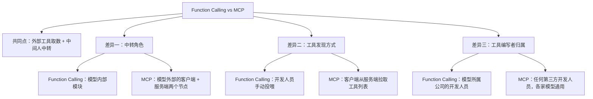
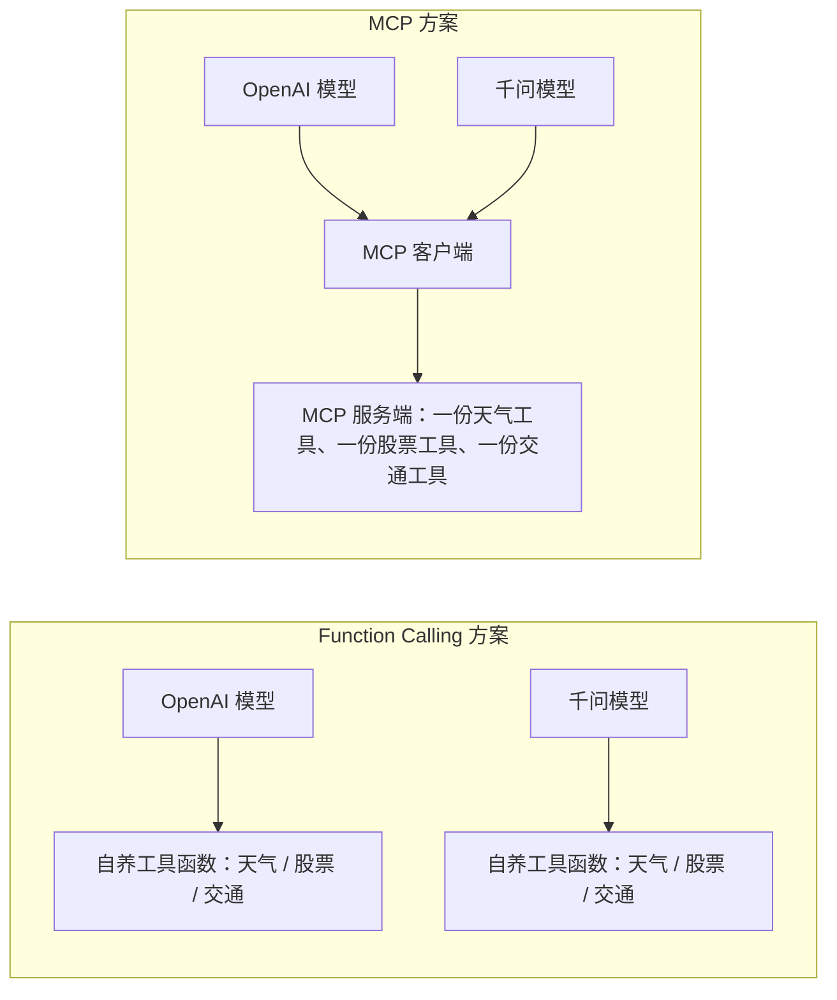

## 【学习目标】

- 回顾 MCP 三节点调用流程与 Function Calling 的调用流程。
- 说清两个方案的共同点：都靠模型外部的工具取数；都经中间人中转，模型不直接调工具。
- 逐条掌握三个不同点：中转角色、工具发现方式、工具编写者归属。
- 理解 MCP 能替代 Function Calling 的根本原因：统一标准，避免同一能力重复建设。

## 【正文】

### 一、两条流程回顾

大模型通过 MCP 上下文协议，能够连接自身以外的一切：连接数据库、操作浏览器、调用 API，两个缺陷，无法拥有实时变化的数据、无法拥有用户私人数据，由此补齐。

要实现 MCP 上下文协议，需要三个节点：大模型本身、MCP 服务端、MCP 客户端。MCP 服务端提供一系列工具；MCP 客户端从服务端把工具列表拿过来；大模型经由这张列表，就知道服务端能提供哪些工具服务，例如调用墨迹天气的 API、调用用户本地的文件。

工具调用的完整流程是：大模型对用户输入做语义分析，发现需要调用本地某个文件，自身又不能执行，便查工具列表，找到「调用用户本地电脑文件」的工具；随后向 MCP 客户端发出指令，附上要调用的文件名称；客户端把参数与所要调用的工具发给 MCP 服务端；服务端拿到参数与工具后执行，完成访问指定文件的需求。

Function Calling 的流程同样复习一遍：大模型内部有一个 Function Calling 模块；当它判断出用户需求涉及实时数据或私人数据时，便让 Function Calling 去请求模型外部的某个工具函数，通过该工具函数实现用户需求。

两条流程都已就位，本节把它们摆到一起逐条对比。先给一个总体观察：两条流程是同构的，都是「模型决策 → 中间人中转 → 外部工具执行」三级结构。同构意味着差异不在架构，而在架构之上的组织方式：中间人放在哪、工具怎么被发现、工具由谁编写。三个不同点，全部落在这三个问题上。

### 二、共同点：两个方案共享的底层设计

第一个共同点：都通过模型外部的工具，实现实时数据与私人数据的获取。MCP 方案里，外部工具放在 MCP 服务端，业务逻辑由服务端实现；Function Calling 方案里，外部工具是开发人员编写的工具函数。工具都在模型外面，模型都不直接拥有这些能力。

第二个共同点：模型都不直接调用工具，而是经一个「中间人」「小弟」中转。MCP 方案里，模型通过 MCP 客户端告知 MCP 服务端，由服务端调用工具；Function Calling 方案里，模型通过 Function Calling 这名小弟去调用外部工具函数。

底层设计如此一致，说明两条路线对「模型负责决策、外部负责执行」有共识，这正是 3-3 篇拆解过的能力分工。差异不在分工，而在分工的组织方式。

### 三、三个不同点

**第一个不同点：调用工具函数的小弟是谁。** Function Calling 方案里，这名小弟是 Function Calling，属于模型内部的一个模块；MCP 方案里，这名小弟是 MCP 客户端与 MCP 服务端，模型外部的两个节点。一个在内，一个在外，这是最表层的差异。

**第二个不同点：模型如何知道外部工具的存在。** Function Calling 方案里，外部工具函数由开发人员编写，再由开发人员手动投喂给大模型，模型才知道这些函数的存在。MCP 方案里，工具函数放在 MCP 服务端，MCP 客户端从服务端取得工具列表，模型通过与客户端交互，就知道服务端持有哪些工具函数。一个靠「喂」，一个靠「拉」，「拉」的好处是实时、透明、按需，「喂」的成本则随工具数量线性上升。

**第三个不同点：工具函数的编写者归属。** Function Calling 方案里，外部工具函数由该模型所属公司的开发人员编写，OpenAI 模型所持有的工具函数由 OpenAI 的开发人员编写，不可能由阿里千问的开发人员编写；反之亦然。MCP 方案里，工具函数不一定由模型所属公司的开发人员编写，第三方开发人员写的工具，OpenAI 能用，阿里千问能用，字节豆包也能用。

三点差异汇成一张对照表：

| 维度 | Function Calling | MCP |
|---|---|---|
| 中转角色 | Function Calling，模型内部模块 | MCP 客户端 + MCP 服务端，模型外部两个节点 |
| 工具发现方式 | 开发人员手动投喂工具函数 | 客户端从服务端拉取工具列表 |
| 工具编写者 | 模型所属公司的开发人员 | 任何第三方开发人员 |
| 标准化程度 | 各家自定，互不通用 | 全行业统一协议 |

### 四、替代的必然性

MCP 上下文协议之所以能够替代 Function Calling 方案，根本原因在标准化。以调用墨迹天气 API 为例：Function Calling 方案下，OpenAI 大模型有自己的调用工具函数，阿里千问也有自己的，同一能力、两份实现，标准不统一，开发者重复劳动；MCP 方案下，调用墨迹天气 API 的工具函数只有一个，不一定出自 OpenAI 的开发人员，也不一定出自阿里千问的开发人员，可能是任何第三方写的，但 OpenAI 能用、阿里千问能用、字节豆包也能用。

一个能力、一份实现、全行业复用，Function Calling 方案的两大缺点（单个跑腿小弟忙不过来、各家跑腿小弟不通用）由此被一并化解：服务端可以无限扩展，工具列表随取随用，模型侧零重复建设。这就是两个方案的两个共同点之外、三个不同点之上的结论：差异即差距，标准化即出路。

再补一个开发者视角的对比。接同一个墨迹天气能力：Function Calling 路线下，换一家模型就要确认该厂商的工具集里有没有天气工具、参数格式是否一致、没有就得自己写；MCP 路线下，只要该模型能当 MCP Host，同一个百度地图 MCP 服务端（或任何 MCP 服务端）挂上即用。课程第 11 章「路线制定专员 Agent 挂载百度地图 MCP」演示的正是这条路线，工具侧一次封装，Agent 侧即取即用。

## 【易错点 / 面试题】

1. **两个方案的共同点是什么？** 其一，都通过模型外部的工具获取实时数据与私人数据，MCP 的工具在服务端，Function Calling 的工具是开发人员编写的函数；其二，模型都不直接调工具，而是经中间人中转，MCP 经客户端告知服务端，Function Calling 经小弟通知外部函数。
2. **三个不同点怎么记？** 三问：小弟是谁（内部模块 vs 外部两节点）？工具怎么被发现（手动投喂 vs 拉取工具列表）？工具由谁写（模型厂商自研 vs 第三方通用）？第三点是本质，前两点是它的表现形式。
3. **追问：MCP 是 Function Calling 的升级版吗？** 是进化关系，不是非此即彼的替代。Function Calling 解决「模型有没有自主调外部能力」的问题；MCP 解决「外部能力如何被所有模型复用」的问题。一个从无到有，一个从乱到治。
4. **追问：实际工程中两者能并存吗？** 能。Spring AI 中 `@Tool` 注册本地工具（Function Calling 思路）与挂载 MCP 客户端工具（MCP 思路）可以同时存在。981-demo 正是两种思路的结合：`981-demo/src/main/java/com/travel/agent/tool/RouteMakingTools.java` 与 `AttractionTools.java` 用 `@Tool` 定义本地工具，其文档同时说明真实环境下对应工具可由百度地图 MCP Server 提供，本地桩与 MCP 服务端形态同构，可平滑切换。
5. **追问：为什么「手动投喂」是个问题？** 工具数量增长后，投喂成本线性上升；接口变更时投喂内容要同步更新；更关键的是各家投喂格式不统一，无法跨模型复用。MCP 的工具列表由服务端按协议维护，模型侧即取即用。

## 【小结】

本节把 Function Calling 与 MCP 摆在一起对比。共同点有两条：都靠模型外部的工具取实时数据与私人数据；都经中间人中转，模型不直接调工具，底层共识是「模型决策、外部执行」。不同点有三条：中转角色（模型内部模块 vs 模型外部的客户端 + 服务端）、工具发现方式（手动投喂 vs 拉取工具列表）、工具编写者归属（模型厂商自研 vs 第三方通用）。第三点是本质：Function Calling 下同一能力被各家重复建设，MCP 下一份实现、全行业复用，标准化正是 MCP 替代 Function Calling 的根本原因。

至此，第 3 章的前半段走完：从两个缺陷，到 Function Calling 的第一套方案，再到 MCP 的标准化升级，最后落到两者的逐条对比。下一篇起转入工程体验，Jmanus 如何配置 MCP 服务，把这套协议跑起来。工程对应可回看 981-demo 的 `tool` 包与 `agent` 包：`981-demo/src/main/java/com/travel/agent/tool/RouteMakingTools.java`、`981-demo/src/main/java/com/travel/agent/tool/AttractionTools.java`、`981-demo/src/main/java/com/travel/agent/agent/TeamMembers.java`，本地工具与 MCP 服务端工具的同构设计在其中一目了然。
