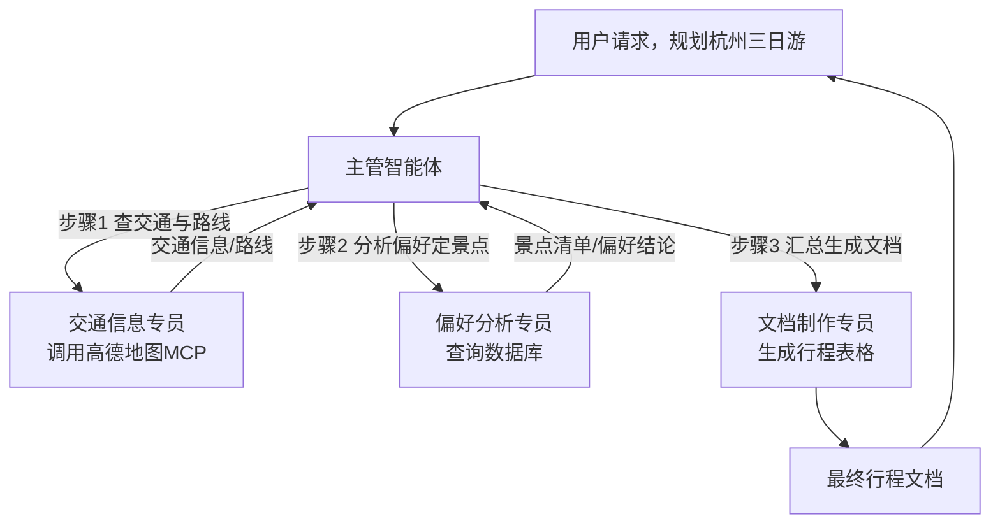

【学习目标】

1. 厘清 LLM、Agent、MCP 三者的依赖关系，理解「互相成就」的具体含义。
2. 掌握 Agent 的三大能力（推理、感知、行动），看清单 Agent 面对复杂任务时的效率瓶颈。
3. 理解多 Agent 协作的分工模型与 Supervisor-Worker 编排模式，能够复述旅游行程规划场景中的四方分工。

【正文】

## 一、为什么复杂活儿需要多个 Agent

前几篇反复强调：MCP 是工具，负责连接外部世界（天气、股票、地图）；Agent 是执行者，负责调用工具、感知用户、执行动作。在魔搭社区这类平台上，已经有大量现成的 MCP 服务器，调用第三方 MCP 工具的方式与调用普通 API 接口几乎没有区别。

到这里，一个自然的疑问是：既然 Agent 已经能推理、能感知、能调用 MCP 工具，为什么还需要多个 Agent？

答案在于任务的复杂度。以本课程的旅游行程规划为例，需求描述只有寥寥数字，真正落地时要拆出一连串子任务：

- 根据用户偏好确定路线与参观点；
- 根据路线预订酒店；
- 根据消费习惯选择交通工具（火车还是飞机）；
- 汇总信息生成文档，交给用户确认。

如果把这整条链路塞给单个 Agent，它既要查地图、又要读数据库、还要生成文档，每一步都要在提示词里反复权衡「现在该调用哪个工具」。效率低还是小事，更严重的是角色混杂导致提示词臃肿，输出质量随之下降，工具一多，模型在几十个候选里做选择的错误率上升；职责一杂，系统提示词不得不写成「既要又要还要」的长文，重点被稀释。

人类社会早就给出了答案：专业的人做专业的事。多个智能体分工协作，各自专注自己的领域，准确性和效率都能得到数量级的提升。

## 二、LLM、Agent、MCP：三者互相成就

先厘清三者的关系，再看多 Agent 架构，逻辑会顺很多。

| 角色 | 本质 | 缺失时的后果 |
|---|---|---|
| 语言大模型（LLM） | 超强推理引擎、知识库 | 没有 LLM，Agent 只是没有思想的自动化工具，无法理解用户真实意图 |
| Agent | 具备推理、感知、行动能力的执行者 | 没有 Agent，LLM 只是对话/聊天工具，形成不了生产力 |
| MCP | 连接第三方能力的标准化工具 | 没有 MCP，Agent 查不了地图、天气等外部信息 |

单独看每一环都有明显短板：

- LLM 只能给出答案，无法真正上手解决问题。查文档、写 PPT、汇总资料，这些「干活」的环节 LLM 一样都做不到。它给的是建议，不是结果。
- Agent 没有 LLM 就是一段自动化脚本，没有思想，不知道用户真正需要什么。脚本能按固定流程执行，却听不懂「随便逛逛」这种模糊意图。
- Agent 没有 MCP 就断了外部信息源，地图数据、天气数据、股票数据一概拿不到。巧妇难为无米之炊，推理再强也只能凭空猜测。

三者合在一起，才构成完整的生产力：LLM 是大脑，负责推理与意图识别；MCP 是手脚，负责连接外部世界；Agent 是躯干，把大脑的决策变成真实动作。任何一个缺位，生产力链条就断一环。

## 三、Agent 的三要素：推理、感知、行动

课程中提到 Agent「除了推理能力，还有感知能力和行动能力」，这里展开说明。

| 能力 | 说明 | 典型场景 |
|---|---|---|
| 推理能力 | 来自 LLM，理解用户意图、规划步骤 | 把「想去杭州玩三天」拆成查天气、查景点、定路线的子任务 |
| 感知能力 | 查询用户私人数据，了解过去与偏好 | 读数据库中的历史订单、读用户画像文档，判断用户喜欢人文景点还是自然风光 |
| 行动能力 | 代替用户执行操作 | 调用浏览器自动化、调用 API 接口下单，无需用户手动操作 |

三个能力对应三种「知道」：推理回答「用户想干什么」，感知回答「用户是谁、他喜欢什么」，行动回答「我能替用户做什么」。只具备推理能力的 LLM 是「顾问」，说得对但不动手；加上感知与行动的 Agent 才是「员工」，既能领会意图，又能交付结果。

这也解释了为什么课程把 MCP 挂在 Agent 而不是 LLM 上：MCP 工具是行动能力的延伸，它的调用决策来自推理与感知的合力，知道用户要什么（推理），知道用户处于什么上下文（感知），才知道此刻该调哪个工具（行动）。

## 四、行程规划中的四方分工

现在把「专业的人做专业的事」落到行程规划场景。课程设计了四个智能体，每个智能体只做自己最擅长的事：

| 智能体 | 专业能力 | 职责 |
|---|---|---|
| 交通信息专员（智能体一） | 调用 MCP 工具 | 调用高德地图 MCP 服务端，查询交通信息与路线规划 |
| 偏好分析专员（智能体二） | 数据库查询 + 偏好分析 | 根据用户偏好与消费习惯，设定参观景点、选择交通工具 |
| 文档制作专员（智能体三） | 文档制作 | 把路线规划与交通信息整理成表格，交给用户确认 |
| 主管（智能体四） | 任务统筹 | 把复杂任务切分为步骤，分派给专业智能体，汇总结果生成最终文档 |

注意这里的边界划分方式：每个智能体的提示词只描述自己职责范围内的事，不需要关心其他角色在做什么。这正是多 Agent 架构的核心收益，提示词解耦，单个智能体的上下文只装自己领域的知识，工具也只挂自己领域的那几个。对比单个 Agent 扛下全部职责的形态，上下文规模与决策难度都下降一个量级。

智能体之间的交互靠消息完成：主管把子任务描述发给对应专员，专员把执行结果回传主管。消息内容可以是自然语言，也可以是结构化数据，课程第 13 章会展示主管通过结构化输出规定子任务的返回格式，避免下游拿到无法解析的自由文本。

主管是整个流程的枢纽，工作模式可以概括为「拆解 → 分派 → 汇总」三步：

主管不亲自执行任何具体任务，只做决策：把用户请求拆成有序步骤，按步骤类型路由给对应智能体，等结果回来后决定下一步，最后汇总输出。若某一步的结果不满足要求（例如景点清单与预算冲突），主管可以把该步骤退回重做，或改派给其他智能体，这种「带反馈的分派」是单个 Agent 很难自然具备的机制。

这种「主管-工人」（Supervisor-Worker）模式是多 Agent 系统最常用的编排方式：工人是领域专家，主管是调度中心，职责边界清晰，各自可独立迭代。

## 五、为什么多智能体是明确的发展方向

课程做出判断：要成为真正的生产力，单靠 LLM 不行，单靠单个 Agent 不行，即便是「LLM + 单个 Agent + MCP 工具」的组合，面对真实世界的复杂任务依然不够。

原因在于，真实任务几乎都可以被拆解为多个简单任务，而每个简单任务都值得交给最专业的执行者。团队分工明确、各司其职，准确性与效率都能大幅提升。更深一层看，多 Agent 还与人类组织的演进同构：企业从不依赖一个「什么都懂的通才」，而是靠部门协作运转；智能体系统走向生产，也必然走同样的路。

时间线上看，这一判断正在被行业验证：2025 年以来，主流 Agent 框架都在往多智能体协作的方向演进，从框架设计上原生支持多 Agent 编排、智能体间通信（A2A 协议）等能力。本课程第 3-10 篇会展开讲解 A2A 协议，第 11 章会基于 A2A 把主管与团队成员注册到 Nacos，实现分布式协作。

【易错点 / 面试题】

1. **「有了 MCP，Agent 就能包打天下」，错在哪？** MCP 只解决「能力接入」问题，不解决「任务编排」问题。一个 Agent 挂载几十个 MCP 工具后，每次决策都要在几十个工具描述里做选择，上下文膨胀、选错工具的概率上升。多 Agent 分工的本质是给上下文做减法：每个智能体只挂载自己领域的少量工具，提示词更聚焦。面试中可顺势答出「Supervisor-Worker 模式按职责拆分会话与工具集」。
2. **Agent 的三大能力分别是什么？各自由谁提供？** 推理能力由 LLM 提供；感知能力通过查询用户数据（数据库、文档）实现；行动能力通过调用工具、API、浏览器自动化实现。面试中常追问「没有 LLM 的 Agent 是什么」，是自动化脚本，没有思想，听不懂模糊意图。
3. **主管智能体（Supervisor）的职责边界是什么？** 主管只负责拆解任务、分派步骤、汇总结果，不亲自执行具体业务。面试里可以结合 Supervisor-Worker 模式回答：工人（Worker）是领域专家，主管（Supervisor）是调度中心；主管的提示词里不应该出现「如何查地图」这类实现细节，只应该有「什么步骤交给谁」。若追问「步骤失败怎么办」，可答退回重做或改派其他成员。

【小结】

本节把视角从单个 Agent 拉到多 Agent 团队：

- LLM、Agent、MCP 三者互相成就，缺任何一环都形成不了生产力；
- Agent = 推理（LLM）+ 感知（查用户数据）+ 行动（调工具、执行操作）；
- 复杂任务的通用解法是拆分：专业的人做专业的事，行程规划被拆成交通信息、偏好分析、文档制作三个工人角色加一个主管；
- 主管-工人（Supervisor-Worker）模式通过「拆解 → 分派 → 汇总」编排整个流程，成员间以消息交互，主管可按反馈调整分派。

这些设计在本课程的 981-demo 工程中都有对应实现：`981-demo/src/main/java/com/travel/agent/agent/TeamMembers.java` 定义了 `ROUTE_MAKING_AGENT`（路线规划专员）与 `ATTRACTION_AGENT`（景点推荐专员）两个 ReActAgent，分别通过 `Toolkit.registerTool` 挂载 `RouteMakingTools`（百度地图 MCP 风格工具）与 `AttractionTools`；`981-demo/src/main/java/com/travel/agent/agent/SupervisorAgent.java` 中的 `TravelManagerAgent` 正是「主管」角色，通过 `ask_route_making_agent` 与 `ask_attraction_agent` 按关键词把子任务路由给对应成员并汇总结果；`981-demo/src/main/java/com/travel/agent/config/AgentProperties.java` 中的 `app.agent.discovery` 配置项则控制团队成员走进程内注册（in-process）还是 Nacos 注册发现。下一篇（3-10）将走进 A2A 协议，看智能体之间如何互相发现、互相调用。
