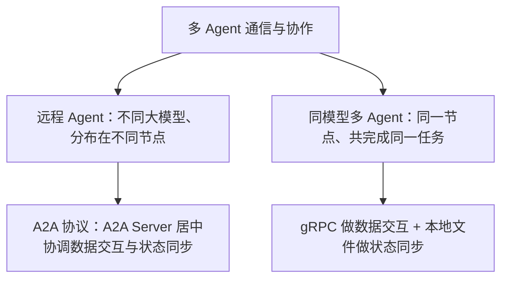
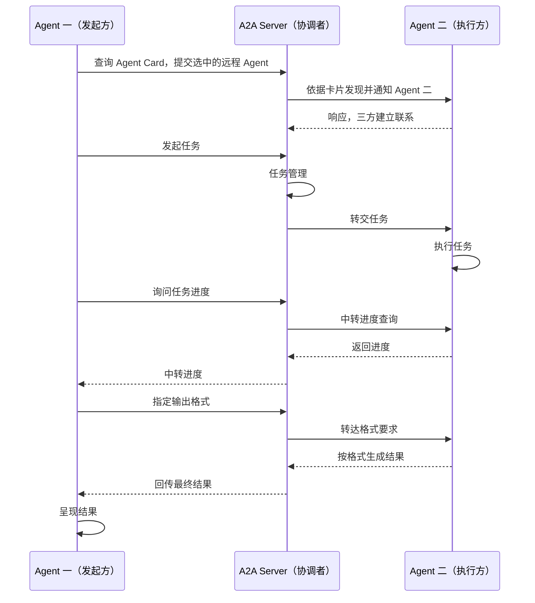

## 【学习目标】

- 说清多 Agent 场景要解决的两个问题：通信与协作（含状态同步）。
- 掌握 A2A 协议的定位：面向远程 Agent 通信，由 A2A Server 担任协调者。
- 复述 A2A 任务协作的完整步骤：发现 → 建联 → 下发 → 执行 → 进度 → 格式约束 → 回传。
- 区分 A2A 与 MCP 的分工：A2A 连 Agent，MCP 连工具。

## 【正文】

### 一、从「缺手缺脚」到「成群作战」

回顾前面课程：大模型无法对复杂需求做目标拆解，也无法自主思考决策。用户说「帮我买商品」，它只会反问想买什么、去哪买，而不会把需求拆成三步，先确定购物清单，再比价挑最低，最后加购付款；更不会根据用户的购物习惯和当前场景，推断用户为什么想买东西、大概想买什么。

不是大模型不懂拆解、不懂思考，而是它缺少眼睛、耳朵、双手、双脚。它像只剩下一个脑袋的人：知道该怎么做，却无法行动，只能靠用户一轮一轮对话，把它知道的东西挤出来。

这时候就需要 Agent。Agent 就像完整的人，大模型是它的脑袋。眼睛和耳朵让它感知外部事物：观察用户的购物偏好，据此推断购物清单，并把清单拿给用户确认；用户确认后，它拿着清单到各购物网站比价，把最低价商品买下来，这就是动作，是它的双手双脚，用来操作外部世界。单靠语言大模型完成不了人工智能：大模型擅长推理与知识存储，而解决实际生活中的复杂需求，需要具备感官和四肢的 Agent。

人工智能里不可能只有一个 Agent，必然有多个 Agent。多个 Agent 之间如何通信？如何协作？这是本节的主题。

### 二、A2A 协议是什么

谷歌针对智能体之间的通信提出了 A2A 通信协议，A2A 中的 A 即 Agent。

对 A2A 协议，了解即可。它不同于前面学过的 MCP 协议，MCP 的生态现在越来越好：支付宝推出了 MCP 工具，大模型调用支付宝的 MCP 即可完成付款；百度地图等也推出了 MCP 工具，智能体调用百度地图 MCP 即可查询路况、制定路线。A2A 通信协议目前的生态还不如 MCP，因此掌握其思想与流程即可。

| 维度 | MCP | A2A |
|---|---|---|
| 连接对象 | 模型 / 智能体 ↔ 工具 | 智能体 ↔ 智能体 |
| 典型生态 | 支付宝、百度地图等 MCP 工具 | 尚处早期 |
| 课程定位 | 工具标准化，重点掌握 | 跨 Agent 通信，了解即可 |

### 三、哪些 Agent 之间需要 A2A

先理清一个概念：多个 Agent 分两类。

一类是**远程 Agent，属于不同的大模型**。通常一个 Agent 只挂一个大模型，就像人只有一个大脑，不可能有两个。某个 Agent 用了 Qwen，就不可能同时用 OpenAI。两个使用不同大模型的 Agent，属于远程 Agent。

另一类是**同一大模型下的多个 Agent，共同完成同一个任务**。例如「帮用户购物」这一需求，可能产生多个 Agent 协同完成，它们同属一个大模型。

A2A 协议既可以用于远程 Agent 之间的通信，也可以用于同一大模型内部多个 Agent 之间的通信，但**主要面向远程 Agent**。原因在于：A2A 需要一个协调者。

### 四、为什么需要协调者

Agent 之间的交互有两个要求：一是数据交互，二是协作，有条不紊的协同，这涉及状态同步。A2A 协议第一个要明确的事实就是：它有一个协调者，即 A2A 服务端（A2A Server），负责协调多个 Agent 之间的数据交互与状态同步。

远程 Agent 分布在不同的节点：某个 Agent 在深圳的节点，另一个在上海的节点，它们之间的通信就要依靠 A2A 协议完成数据交互与状态同步。

而对于同一大模型下、解决同一需求的多个 Agent，通信与状态同步不必使用 A2A。因为它们处于同一节点，数据交互可以基于 gRPC；状态同步可以用本地文件。没必要为此动用重型的 A2A 协议。这正是 A2A 主要面向远程 Agent 通信的原因。

### 五、A2A 任务协作的完整步骤

两个 Agent 之间需要一个协调者，即 A2A Server。整个流程分八步：

1. **查询卡片**：远程 Agent 一需要知道有哪些 Agent 能协助它工作，于是查询 Agent 卡片（Agent Card）。
2. **抽取与提交**：从卡片中抽取一个合适的远程 Agent，交给 A2A Server。
3. **发现与通知**：A2A Server 依据这张卡片发现 Agent 二，并通知 Agent 二，远程有一个 Agent 一，有任务想请你完成。Agent 一、A2A Server、Agent 二由此建立联系。
4. **任务下发**：Agent 一发起任务。注意，任务不是直接发给 Agent 二，而是发给 A2A Server。
5. **任务管理与转交**：A2A Server 进行任务管理，再把任务转交给 Agent 二。
6. **执行与进度询问**：Agent 二执行任务；执行过程中，Agent 一不断询问任务进度，同样不是直接问 Agent 二，而是通过 A2A Server 中转。
7. **输出格式约束**：Agent 一是「甲方」，要指定输出格式，也通过 A2A Server 转达：必须按这种格式输出。Agent 二据此调整输出格式。
8. **结果回传与呈现**：Agent 二按格式生成最终结果，发给 A2A Server，Server 再发给 Agent 一，Agent 一拿到结果后呈现出来。

全流程的关键点是：Agent 一与 Agent 二**从不直接通信**，一切交互，任务、进度、格式要求、结果，都经由 A2A Server 中转。协调者因此同时承担三件事：数据中转、任务管理、状态同步。

### 六、981-demo 中的对应实现

课程第 11 章把这条链路落到了工程里，981-demo 的 `a2a` 包即是本节协议的代码级复刻：

| 协议概念 | 981-demo 模块 | 职责 |
|---|---|---|
| Agent Card | `981-demo/src/main/java/com/travel/agent/a2a/AgentCard.java` | 成员的能力名片：名称、描述、服务基址 |
| 注册与发现（本地） | `981-demo/src/main/java/com/travel/agent/a2a/InProcessAgentRegistry.java` | 进程内维护成员卡片，供查询 |
| 注册与发现（Nacos） | `981-demo/src/main/java/com/travel/agent/a2a/NacosAgentRegistry.java` | 对应课程 11-2：成员注册到 Nacos，主管据此发现 |
| 调用通道抽象 | `981-demo/src/main/java/com/travel/agent/a2a/AgentTransport.java` | 主管不关心成员在进程内还是远程，只按卡片调用 |
| 进程内通道 | `981-demo/src/main/java/com/travel/agent/a2a/InProcessAgentTransport.java` | 同节点共模型的本地调用 |
| HTTP 远程通道 | `981-demo/src/main/java/com/travel/agent/a2a/A2aHttpAgentTransport.java` | 跨节点远程调用，复刻「任务经协调者中转」 |
| 服务端端点 | `981-demo/src/main/java/com/travel/agent/a2a/A2aEndpointController.java` | A2A Server 侧的 HTTP 入口，接收并转交任务 |

这里有一个工程上的重要设计：`AgentTransport` 接口把「本地成员」与「远程成员」统一成同一种调用方式。主管 Agent 面对进程内成员用 `InProcessAgentTransport`，面对远程成员用 `A2aHttpAgentTransport`，调用代码完全一致，这正是 A2A 协议要达成的效果：通信细节对调用方透明。离线环境下，两个实现都可用固定数据跑通调度链路，无需真实远程节点。

## 【易错点 / 面试题】

1. **A2A 和 MCP 有什么区别？** MCP 连接模型与工具，生态成熟（支付宝、百度地图）；A2A 连接智能体与智能体，面向跨 Agent 协作，生态尚早期。一个补「手脚」，一个补「同事」。
2. **同一大模型下的多个 Agent，为什么不用 A2A？** 它们在同一节点，数据交互用 gRPC、状态同步用本地文件即可；A2A 的重在于跨节点的协调者机制，为同节点场景付出这份重量不划算。A2A 主要面向远程 Agent。
3. **A2A 交互中，Agent 一和 Agent 二直接通信吗？** 不。任务、进度询问、输出格式、结果回传，全部经 A2A Server 中转。协调者承担数据中转、任务管理、状态同步三项职责。
4. **Agent Card 起什么作用？** 它是 Agent 的能力名片，声明名称、描述、服务基址。Agent 一先查卡片、按卡片挑出合适的远程 Agent，A2A Server 再依据卡片发现对应 Agent，卡片是「发现」环节的载体。

## 【小结】

本节把多 Agent 协作的协议层讲清楚了：多个 Agent 之间既要通信也要协作（含状态同步），远程 Agent 跨节点分布，需要 A2A Server 居中协调；任务从发起、转交、执行、进度询问到结果回传，全程由协调者中转，Agent 之间从不直连。同一节点下的多 Agent 则用更轻的 gRPC 加本地文件解决，不必动用 A2A。A2A 与 MCP 分工明确：MCP 连工具，A2A 连 Agent。

对应的代码级实现见 981-demo 的 `a2a` 包：`AgentCard.java`（卡片）、`InProcessAgentRegistry.java` 与 `NacosAgentRegistry.java`（注册发现）、`AgentTransport.java` 及其两个实现（调用通道对主管透明）、`A2aEndpointController.java`（服务端入口）。把 `InProcessAgentTransport` 换成 `A2aHttpAgentTransport`，本地调度即刻变为跨进程远程调度，协议的价值正在于这种透明切换。
