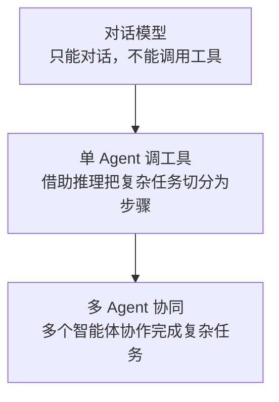

## 【学习目标】

- 理清多 Agent 框架的演进脉络：对话模型 → 单 Agent 调工具 → 多 Agent 协同。
- 认识国外主流框架：AutoGen（多 Agent 协作 + 人工干预）、CrewAI（无人工干预、仿团队模式）、LangChain（Python、模块化、自由度高、有学习门槛）。
- 认识国内主流框架：JManus（课程主线，Java 栈，参照 Manus 核心思想）、JoyAgent（京东，Spring Boot，工具原子化）、muAgent（蚂蚁，知识图谱增强决策）。
- 建立选型视角：从人工干预、协作模式、语言生态、部署方式四个维度比较框架。

## 【正文】

### 一、从单打独斗到成群作战

回顾课程主线：语言大模型推理能力超强，但不能作为生产力调用工具；智能体借助模型的推理能力把复杂任务切分为步骤来解决，并通过 MCP 调用外部工具、真正执行，才是生产力。上一篇（3-9）进一步指出：复杂问题需要多个步骤，单靠一个智能体，效率低下，于是有了多个智能体的协作。

这轮演进有现实原型。公司里单靠一个人单打独斗，效率提不上去；专业的事交给专业的人，才是合理的社会分工模式。人工智能的发展走着同一条路：从语言大模型的对话模型，到单个智能体能够调用工具、实际应用工具，再到多个智能体协同操作。当下推出的 AI 框架，几乎都在强调多智能体能力，课程主要讲解的 Manus 系多智能体框架如此，Python 生态中广为人知的 LangChain、LangGraph 同样具备多智能体能力。

本节把国外与国内主流的多智能体开发框架过一遍，建立选型的坐标系。

### 二、国外主流框架

**AutoGen（微软）**。突出特点是多 Agent 的协作能力，并且能够对多 Agent 的协作过程进行人工干预。允许人在关键节点介入把关，是它区别于同类的底色，自主协作与人工可控兼得。

**CrewAI**。相对 AutoGen 有两个优势：第一，不需要人工干预；第二，智能体之间的协同合作完全仿照人类团队的模式。回想团队里如何合作：先有一个主管，把任务拆开，将每一部分交给专业或合适的人员；主管协调并监管整个任务的完成流程；执行过程中出现冲突或争议，主管便组织相关队员讨论，总之要找到解决方法，必要时投票得出最优方案。

CrewAI 把这套模式搬到了智能体世界，结构特征有三：每个智能体都有自己的专业角色；有一个统筹型的主管角色智能体，负责任务分发与争议组织；整个解决过程由智能体之间通过通信协同完成，出现争议则讨论、投票。全流程自主协作，人不介入。

**LangChain**。基于 Python 的智能体框架，许多公司基于它做自定义开发。它与 Spring AI 一样，给开发者很大的自由度，不像 Dify、N8n 那类拖拉拽框架；自主性高，且能够本地部署；除开发单个智能体，也能开发多个智能体。优势在模块化与代码级自定义；缺点是有学习门槛，且部署等参数需要手动配置。

这里插一句两类框架的形态对比，帮初学者建立坐标系：

| 维度 | 代码框架（LangChain / JManus / Spring AI） | 拖拉拽框架（Dify / N8n） |
|---|---|---|
| 灵活性 | 高：逻辑全由代码表达 | 低：受平台组件边界约束 |
| 学习成本 | 有门槛，需懂代码 | 低，可视化编排 |
| 部署 | 可本地部署 | 依赖平台环境 |
| 定制深度 | 任意定制 | 平台未封装的诉求难实现 |

两类框架没有高下之分，只有场景之别：验证想法、快速搭原型，拖拉拽更快；追求定制深度与工程可控，代码框架是正路。本课程选 JManus，走的是后一条路。

三者并列成表：

| 框架 | 出品方 | 语言生态 | 人工干预 | 突出特点 |
|---|---|---|---|---|
| AutoGen | 微软 | Python | 支持 | 多 Agent 协作，协作过程可人工干预 |
| CrewAI | 开源社区 | Python | 不需要 | 仿人类团队：主管 + 专业角色，争议讨论投票 |
| LangChain | LangChain | Python | 视用法而定 | 模块化、自由度高、可本地部署；有学习门槛、参数需手配 |

### 三、国内主流框架

**JManus（课程主线）**。课程采用的项目框架就叫 JManus，这里的 J 表示基于 Java 开发语言。JManus 基于 OpenManus 开发，OpenManus 又基于 Manus 开发，核心思想参照 Manus。

Manus 最突出的地方，是把简单需求切割成多个步骤、交给不同智能体自动完成。以旅行计划为例：先了解用户的喜好与偏好，确定想去哪些景点、哪些景点符合计划；计划确定后，到地图服务查询路线；路线确定后，购买车票、定日期，还要查询当时的天气。看上去一个简单需求，实则涉及好几个复杂步骤。Manus 的价值，正是自动完成这层拆解与分派。

**JoyAgent（京东）**。针对多智能体协作的开发框架，基于 Spring Boot 开发。优势有三：工具原子化、可以本地部署、部分模块能够复用。

**muAgent（蚂蚁集团）**。多智能体协作框架，特点有两个：基于知识图谱；通过知识图谱加语言大模型，增强 Agent 决策的支持力度。

这两个框架较新（2025 年 10 月前后推出），课程作为视野拓展提及，有兴趣可自行了解。

注意国内三个框架的语言栈分布：JManus 基于 Java，JoyAgent 基于 Spring Boot（同为 Java 栈），muAgent 课程未强调语言栈。对 Java 工程师而言，前两者与 Spring AI 生态的衔接成本最低，课程第 4 章引入的 Spring AI Alibaba、第 6 章的 AgentScope，都是这条栈上的组件。选框架不仅是选功能，也是选生态位。

### 四、六框架总览

| 框架 | 出品方 | 语言 / 生态 | 人工干预 | 协作模式 | 突出特点 |
|---|---|---|---|---|---|
| AutoGen | 微软 | Python | 支持 | 多 Agent 协作 | 协作过程可人工干预 |
| CrewAI | 开源社区 | Python | 不需要 | 主管 + 专业角色 | 仿人类团队模式，争议讨论、投票 |
| LangChain | LangChain | Python | 视用法而定 | 单 / 多 Agent | 模块化、自由度高、可本地部署；有学习门槛 |
| JManus | 开源社区 | Java（基于 OpenManus） | 视用法而定 | 多 Agent 拆解分派 | 课程主线，核心思想参照 Manus |
| JoyAgent | 京东 | Java / Spring Boot | 视用法而定 | 多 Agent 协作 | 工具原子化、可本地部署、模块可复用 |
| muAgent | 蚂蚁集团 | - | 视用法而定 | 多 Agent 协作 | 知识图谱 + 大模型增强决策 |

### 五、选型的四个提问

框架选型不必纠结「哪个最强」，问四个问题即可：

1. **要不要人工干预？** 需要人把关关键节点的场景，AutoGen 的支持干预是卖点；追求全流程自主，CrewAI 的路子更彻底。
2. **协作模式是什么形态？** 团队制（主管 + 专业角色 + 争议投票）选 CrewAI 这类；任务拆解分派式，Manus 系框架更直接。
3. **语言生态是否匹配团队栈？** Python 团队在 LangChain / AutoGen / CrewAI 里选；Java 团队的自然落点是 JManus 与 Spring AI 生态。
4. **部署与复用诉求？** 要本地部署、模块复用，JoyAgent 的工具原子化值得研究；要知识增强决策，muAgent 的知识图谱路线是对路。

课程主线选 JManus，理由正是第三、第四条：Java 栈 + Manus 式任务拆解，与 Spring AI 工程生态天然衔接。981-demo 即这一选择的工程化延续，`981-demo/src/main/java/com/travel/agent/agent/SupervisorAgent.java` 承担主管的分发与汇总，`981-demo/src/main/java/com/travel/agent/agent/TeamMembers.java` 定义各司其职的团队成员，多 Agent 骨架在 Java 栈上完整落地。

## 【易错点 / 面试题】

1. **AutoGen 与 CrewAI 的核心差异？** 人工干预。AutoGen 支持对多 Agent 协作过程进行人工干预，CrewAI 不需要，全流程由智能体自主协作完成。
2. **CrewAI 的协作模式有什么特点？** 仿人类团队：主管拆分任务、分派给专业角色、协调监管全流程；出现争议时组织相关队员讨论，投票得出最优方案。每个智能体有专业角色，另有统筹型主管角色。
3. **LangChain 的优缺点？** 优点：模块化、代码级自定义、自主性高、可本地部署、单 Agent 与多 Agent 都支持；缺点：有学习门槛，部署等参数需手动配置。它与 Dify / N8n 的本质区别在自由度，后者拖拉拽，前者纯代码。
4. **追问：JManus 与 Manus、OpenManus 的关系？** JManus 基于 OpenManus 开发，OpenManus 基于 Manus 开发；JManus 的 J 指 Java 开发语言，核心思想参照 Manus。
5. **追问：JoyAgent 与 muAgent 的特点？** JoyAgent（京东，基于 Spring Boot）：工具原子化、可本地部署、模块可复用；muAgent（蚂蚁）：基于知识图谱，并通过知识图谱 + 大模型增强 Agent 决策支持。
6. **追问：Java 团队做多 Agent，选型思路是什么？** 优先 JManus（Manus 式拆解 + Java 栈）与 Spring AI 生态（工具挂载、MCP、A2A 均有对应能力），本节表格的语言生态一列即是筛选起点。

## 【小结】

本节沿「对话模型 → 单 Agent → 多 Agent」的演进脉络，盘点国内外主流多智能体框架：国外 AutoGen（协作可人工干预）、CrewAI（无需干预、仿团队模式、争议投票）、LangChain（Python、模块化、自由度高、有门槛）；国内 JManus（课程主线，Java 栈，参照 Manus 核心思想）、JoyAgent（京东，Spring Boot，工具原子化）、muAgent（蚂蚁，知识图谱增强决策）。选型归结为四个提问：人工干预、协作模式、语言生态、部署复用。

下一篇进入本节的第二个重点，多 Agent 的核心执行流程：单个智能体的五步循环如何运转，多个智能体如何编排成团队，通信与中间结果存储两个关键问题如何解。对应的工程实现见 981-demo：`981-demo/src/main/java/com/travel/agent/agent/SupervisorAgent.java`（主管：拆解、分发、汇总）与 `981-demo/src/main/java/com/travel/agent/agent/TeamMembers.java`（团队成员：路线制定专员、景点推荐 SubAgent）。
