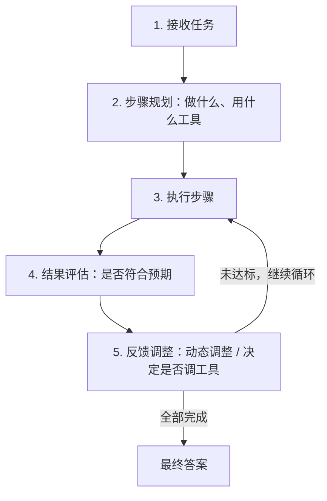
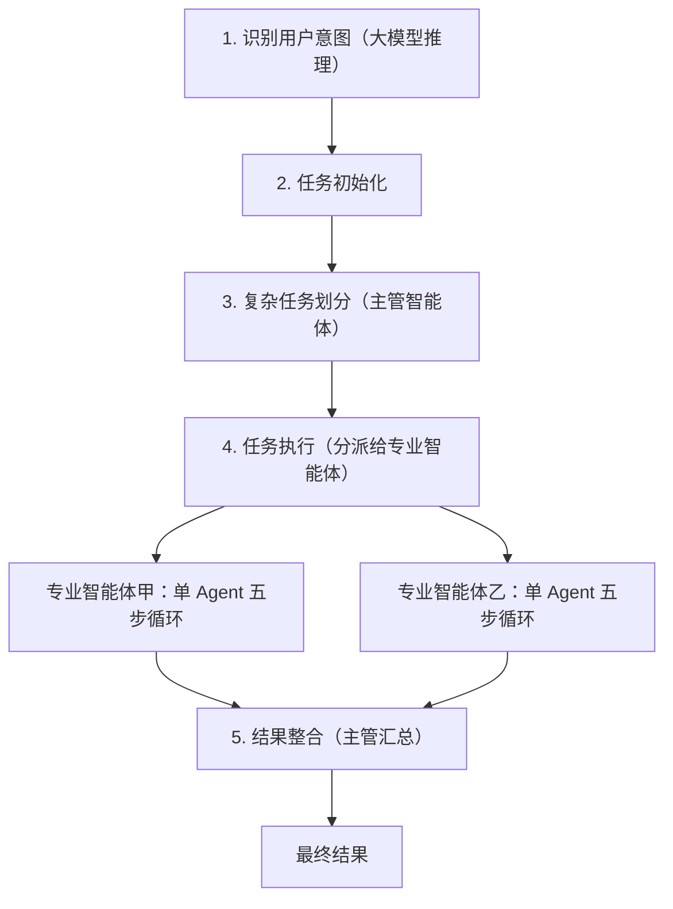
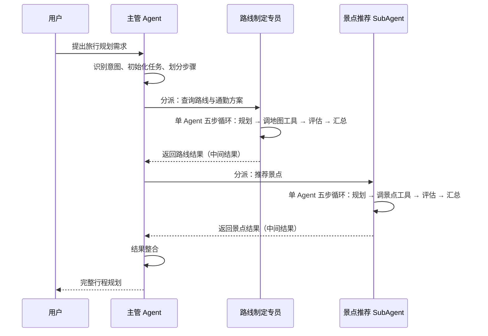

## 【学习目标】

- 复述单 Agent 的五步执行流程，并指出其中「执行-评估-反馈调整」构成循环。
- 掌握多 Agent 团队的核心执行流程五步：意图识别 → 任务初始化 → 任务划分 → 任务执行 → 结果整合。
- 说清多 Agent 的两个关键问题：智能体之间的通信、中间结果的存储。
- 把流程映射到 981-demo 模块，理解「大骨架套小骨架」的嵌套结构。

## 【正文】

### 一、单 Agent 的执行流程：五步，内含一个循环

任何智能体团队都由多个单个智能体组成。要看懂团队，先看懂个体。

单个智能体的执行流程分五步：

1. **接收任务**。
2. **步骤规划**：不是马上执行，先规划第一步做什么、第二步做什么、第三步做什么，需要用到哪些工具。
3. **执行步骤**：按设定好的步骤一步一步执行。
4. **结果评估**：每执行完一个步骤，都对该步骤的结果进行评估，并反馈给智能体，判断结果是否符合预期；不符合预期则进行调整，并决定是否调用工具。
5. **反馈调整**：依据评估结果，决定后续步骤是否动态调整。整个流程走完后，得到最终答案。

五步之中，第三步（步骤执行）、第四步（结果评估）、第五步（反馈调整）构成一个循环，每执行一个步骤，都会进入这轮三步循环，评估不达标便调整后重来。这正是 ReAct 范式的形态：推理（Think）→ 行动（Act，调工具执行）→ 观察（Observe，结果反馈），循环推进，直到收敛出最终答案。

ReAct 这一名词值得记牢，它是课程反复出现的主线词，第 1 章介绍的 AgentScope 即「具备 ReAct 核心能力」的框架，第 6 章会基于它构建搭载工具的 ReAct Agent。把单 Agent 的五步与 ReAct 的三环对应起来：步骤规划是 Think，执行与调工具是 Act，评估与反馈是 Observe。名词不同，说的是同一件事。

### 二、多 Agent 团队的核心执行流程：五步

多 Agent 团队真正的难点，不在于单个智能体如何完成任务，而在于多个智能体如何组合起来、协同合作。团队的核心执行流程同样分五步：

1. **识别用户意图**：基于大模型的推理能力，弄清用户到底要什么。
2. **任务初始化**：把识别出的意图落成可执行的任务定义。
3. **复杂任务划分**：由主管角色的智能体执行，把复杂需求的执行流程拆解为几个简单需求，并排定先后顺序，先做哪个，后做哪个。
4. **任务执行**：主管把切分好的任务分配给相应的专业智能体；各专业智能体根据自己那一份任务，按前述单 Agent 的五步流程各自完成。
5. **结果整合**：主管对各单个智能体生成的结果进行整合，得到最终结果。

### 三、两个关键问题

流程骨架清晰了，真正的工程量在骨架之外。多个智能体各自完成任务之后，有两个问题必须解决。

**问题一：智能体之间的通信。** 智能体不可能各自隔离、自说自话，团队协作必须交换信息；出现冲突时，可能需要由主管智能体组织相关智能体投票，解决争议。信息如何交互，是第一个要处理的问题。

**问题二：中间结果的存储。** 每个智能体完成之后，结果存放在哪里？最终主管要整合各智能体的产出，这些中间产物必须有统一的存放位置。结果存放在哪里，是第二个要处理的问题。

存储问题还可以再拆一层：中间结果不仅是「存」，还包括「取」与「传」，成员完成后结果往哪写，主管整合时从哪读，成员之间需要彼此产出时如何转交。981-demo 中这层以最直接的形态呈现：成员工具方法返回结构化字符串，主管在下一轮决策中读取这些返回值并汇总，调用链即数据链。生产环境中存储介质可以是内存、文件或消息队列，课程第 11 章会结合 A2A 协议展开更完整的形态。

主流多智能体框架都为此配备了专门模块，翻开前面盘点过的框架，通信机制与中间结果存储模块是标配。这两个问题解决得好坏，直接决定多 Agent 团队的上限。

### 四、JManus 的执行流程与 981-demo 映射

课程主线 JManus 的执行流程遵循同一骨架：整个多智能体的大骨架是意图识别、任务初始化、任务划分、结果整合；执行任务时，每个智能体内部又跑着单 Agent 的小骨架，即前述五步循环。大骨架套小骨架，是课程后续章节（第 11 章旅游规划团队）的详解对象。

这层嵌套在 981-demo 中有清晰对应：

| 流程环节 | 981-demo 模块 | 职责 |
|---|---|---|
| 意图识别与任务分发 | `981-demo/src/main/java/com/travel/agent/agent/SupervisorAgent.java` | 主管 Agent：解析需求关键词，把子任务分发给合适的团队成员 |
| 任务执行（成员） | `981-demo/src/main/java/com/travel/agent/agent/TeamMembers.java` | 路线制定专员、景点推荐 SubAgent，各自挂载工具完成子任务 |
| 通信与发现 | `981-demo/src/main/java/com/travel/agent/a2a/AgentCard.java`、`981-demo/src/main/java/com/travel/agent/a2a/InProcessAgentRegistry.java` | Agent Card 能力名片 + 注册表，对应「通信」问题 |
| 中间结果与汇总 | `SupervisorAgent` 的第二轮决策逻辑 | 成员结果返回后由主管汇总，对应「中间结果整合」 |

主管的分发逻辑在 `SupervisorAgent.java` 中一目了然：涉及路线、交通、通勤的子任务交给 `ask_route_making_agent`，涉及景点、游玩的交给 `ask_attraction_agent`；两类信息都需要的，先后调用再汇总。这正是「复杂任务划分 → 分派 → 结果整合」三步的代码化。

### 五、一次完整调用的时序

把两条流程合起来，一次「帮我规划杭州一日游」的调用是这样推进的：

注意时序图中两个「单 Agent 五步循环」：团队的五步流程是骨架，成员内部的五步循环是血肉，骨架管分工，循环管执行，中间结果沿调用链逐级回传，最终在主管处汇成完整结果。

## 【易错点 / 面试题】

1. **单 Agent 执行流程五步？** 接收任务 → 步骤规划 → 执行步骤 → 结果评估 → 反馈调整。其中执行、评估、反馈调整三步构成循环，每执行一个步骤都会进入这轮循环。
2. **多 Agent 核心执行流程五步？** 识别用户意图 → 任务初始化 → 复杂任务划分 → 任务执行 → 结果整合。其中任务划分由主管角色的智能体执行。
3. **多 Agent 的两个关键问题？** 通信（智能体之间如何交互信息，冲突时如何组织投票）与中间结果存储（各智能体的产出存放在哪里，供主管整合）。主流框架都有对应模块。
4. **追问：为什么任务划分必须由主管做？** 主管角色负责统筹：把复杂需求切分为简单需求、排定先后、分派给专业智能体。专业的事交给专业的 Agent，与团队分工同理。
5. **追问：ReAct 体现在流程的哪里？** 单 Agent 的「执行-评估-反馈调整」循环即 ReAct：推理（规划与评估）→ 行动（调工具执行）→ 观察（结果反馈）。多 Agent 的五步是编排层，ReAct 循环是执行层，两层嵌套。
6. **追问：中间结果存在哪里，有几种常见做法？** 课程主线按 JManus 的骨架理解：各智能体的产出沿调用链回传，由主管统一整合；工程上对应 981-demo 中 `SupervisorAgent` 拿到的成员返回结果。存储形态（内存、文件、消息队列）随框架而异，主流框架均有专门模块应对。

## 【小结】

本节讲清了两层流程。单 Agent 的五步：接收任务 → 步骤规划 → 执行步骤 → 结果评估 → 反馈调整，其中执行、评估、反馈调整构成循环，即 ReAct 的执行层。多 Agent 团队的五步：识别用户意图 → 任务初始化 → 复杂任务划分 → 任务执行 → 结果整合，主管角色负责划分与分派，专业智能体按单 Agent 流程各自干活。两层流程之外，两个关键问题，通信与中间结果存储，是主流框架标配模块，也是团队协作的真正工程量所在。

下一篇起进入第 11 章：旅游规划团队如何按这套骨架搭起来，主管如何调度远程成员。工程对应见 981-demo：`981-demo/src/main/java/com/travel/agent/agent/SupervisorAgent.java`（意图识别、分发、汇总）、`981-demo/src/main/java/com/travel/agent/agent/TeamMembers.java`（团队成员与单 Agent 循环）、`981-demo/src/main/java/com/travel/agent/a2a/AgentCard.java` 与 `InProcessAgentRegistry.java`（通信与发现）。
