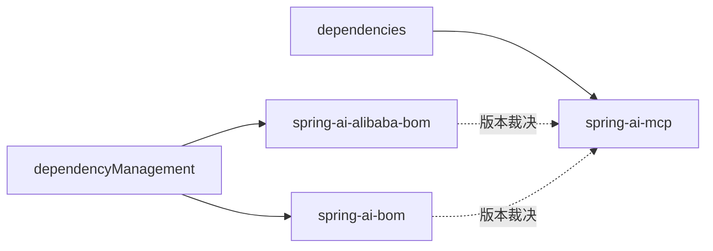

【学习目标】

- 弄清 BOM（Bill of Materials）在 Maven 多模块工程中的职责与边界
- 说清 MCP 底层依赖为何从 `org.springframework.ai` 导入，而非 `com.alibaba.cloud.ai`
- 独立配齐「`spring-ai-alibaba-bom` + `spring-ai-bom` + `spring-ai-mcp`」三级依赖，并用 Maven 面板核验最终版本

【正文】

## 1. 先把版本号收上来：BOM 是什么

Spring AI Alibaba 的引入方式与普通依赖不同：工程里只需导入它的 BOM，也就是坐标后缀为 `-bom` 的依赖包。BOM 自身不提供任何可编译的类，它是一份「版本清单」，凡是在 BOM 中登记过的组件，后续在 `dependencies` 里引用时一律省略 `version`，版本由 BOM 统一裁决。

这样做的好处在多模块工程里尤其明显：根模块管住版本，子模块只管使用，同一个组件不会在不同模块里出现两个版本。Spring AI Alibaba 与 Spring AI 的组件之间存在大量依赖传递，版本一旦错位，运行期就会抛出 `NoSuchMethodError`、`ClassNotFoundException` 之类的兼容性问题，BOM 正是用来消灭这类问题的机制。

需要特别注意：BOM 必须写在 `dependencyManagement` 标签内，且 `type` 为 `pom`、`scope` 为 `import`。放进普通 `dependencies` 不会生效，`import` 这种 scope 只在 `dependencyManagement` 的上下文里才被 Maven 识别。这是初学者最常踩的坑之一。

顺带厘清一对容易混淆的概念：`dependencyManagement` 只做版本裁决，本身不引入任何依赖；`dependencies` 才真正把组件引入工程。子模块引用一个已被 BOM 登记过的组件时，仍然要写在 `dependencies` 里，只是省略 version。「管理」与「引入」分离，正是 Maven 依赖体系的设计精髓。

```xml
        <dependencyManagement>
            <dependencies>
                <dependency>
                    <groupId>com.alibaba.cloud.ai</groupId>
                    <artifactId>spring-ai-alibaba-bom</artifactId>
                    <version>${spring-ai-alibaba.version}</version>
                    <type>pom</type>
                    <scope>import</scope>
                </dependency>
            </dependencies>
        </dependencyManagement>
```

以上代码块引入 Spring AI Alibaba 的版本管理。`version` 位没有写死字符串，而是引用 `${spring-ai-alibaba.version}` 属性，好处是升级时只需改 `properties` 一处。不这么写会怎样：若多个 BOM 各写一个固定版本，未来对齐 Spring AI 版本时需要全文搜索替换，漏改任何一处都会引入难以定位的依赖冲突。工程实践中，「版本号只在一处出现」与「常量只定义一次」是同一条纪律。

## 2. MCP 依赖的真实坐标：以文档和中央仓库为准

引入 MCP 依赖时，一个自然的猜测是「Spring AI Alibaba 的坐标加 `-mcp` 后缀」。事实并非如此，正确做法是查官方文档。打开 Spring AI Alibaba 官网，版本号选 1.0.0.2（即本项目所用版本），再看使用教程。MCP 的中文名称是模型上下文协议，本质上是一套协议，对应依赖自然也未必挂在 Alibaba 的坐标下。

文档中给出的 MCP 依赖包名为 `spring-ai-mcp`，但文档里的 groupId 已经过时。把 `spring-ai-mcp` 复制到 Maven 中央仓库检索，可以看到它真正的归属是 `org.springframework.ai`，即 Spring Framework 的 Group ID。因此导入时直接使用 `org.springframework.ai`，不必沿用文档里的旧坐标。

再从依赖包的说明确认它的定位（英文介绍可借助翻译工具阅读）：`spring-ai-mcp` 提供函数调用能力，函数调用正是前面课程讲过的 MCP 核心功能之一；同时它为 MCP 客户端与 MCP 服务端都提供了一层符合 Spring 设计风格的抽象。换句话说，它是 MCP 客户端与服务端的底层框架，无论做客户端还是做服务端都必须引入。

「提供函数调用能力」这句话值得展开。大模型本身只会输出文本，调用外部工具依赖函数调用机制：模型按约定输出「调哪个函数、传什么参数」，框架负责解析并真正执行。MCP 把函数调用的两端标准化了，工具描述与调用协议都走统一规范，因此该底层包既是 MCP 的地基，也是函数调用能力在 Spring 侧的落点。后面创建 MCP 工具时用到的 `@Tool` 注解，就出自这里引入的依赖。

```xml
        <dependency>
            <groupId>org.springframework.ai</groupId>
            <artifactId>spring-ai-mcp</artifactId>
            <version>${spring-ai.version}</version>
        </dependency>
```

以上代码块把 MCP 底层依赖放进了 `dependencies`。groupId 使用 `org.springframework.ai`，与文档里的旧坐标不同，以中央仓库的实际归属为准；version 先留出属性引用，下一步再用 BOM 接管。不核对中央仓库会怎样：文档滞后是开源项目的常态，直接照抄旧坐标可能导入一个不存在或已迁移的依赖，在 IDEA 里表现为红色标线与 `Dependency not found` 报错，新手极易在此卡住半小时。

## 3. 给 Spring AI 也套上 BOM

`spring-ai-alibaba` 能用 BOM 管版本，`org.springframework.ai` 下的组件同样可以。做法是把 `spring-ai-alibaba-bom` 复制一份，删掉 `-alibaba` 后缀，改成 `spring-ai-bom`，放进 `dependencyManagement`。

Spring AI 的版本号这样确认：找到 `spring-ai-core`（Spring AI 的核心包），可以看到提示它已迁移至 `spring-ai-client-chat`；继续点进去，最新版本为 1.0.0。据此在 `properties` 中登记版本变量：

```xml
        <!-- 最低版本必须是 > 1.0.0-m6 ，因为从1.0.0-m6开始才集成MCP -->
        <spring-ai.version>1.0.0</spring-ai.version>
```

以上代码块登记 Spring AI 版本变量。注释里「> 1.0.0-m6」是一条硬约束：MCP 能力从 1.0.0-m6 才开始集成进 Spring AI，版本过低会缺少 `org.springframework.ai.tool.annotation.Tool` 这批 MCP 注解，后面创建 MCP 工具时无从下手。一条注释挡住一个深夜 bug，值得写。

「`spring-ai-core` 已迁移至 `spring-ai-client-chat`」这行提示还有一层教学价值：构件改名与迁移在活跃的开源项目里是常态，判断依赖归属不能凭记忆，只能到中央仓库查看当前坐标。把「先查证、再引入」当作固定动作，版本升级时就不会被过期信息带偏。

至此，根模块的版本管理形成「两个 BOM」的格局，与一个底层依赖包配合：

| 坐标 | 角色 | 管理范围 |
|---|---|---|
| `com.alibaba.cloud.ai:spring-ai-alibaba-bom` | Alibaba 栈版本管理 | Spring AI Alibaba 全家桶 |
| `org.springframework.ai:spring-ai-bom` | Spring AI 版本管理 | Spring AI 官方组件（含 MCP） |
| `org.springframework.ai:spring-ai-mcp` | MCP 底层框架 | MCP 客户端 / 服务端抽象与函数调用 |

BOM 接管版本后，`spring-ai-mcp` 的 `version` 即可删除，由 `${spring-ai.version}` 属性或 BOM 统一提供。点击导入按钮，若无报错，打开 Maven 窗口（View → Tool Windows → Maven），在项目节点的 Dependencies 下确认 `spring-ai-mcp` 已在列，且版本号为 1.0.0。这一步目测核验不要省，它是「配置是否真正生效」的唯一证据，胜过十次凭空猜测。



最后补几行注释说明分工：`spring-ai-mcp` 属于 MCP 的底层依赖包；`spring-ai-bom` 负责 Spring AI 的版本管理；`spring-ai-alibaba-bom` 负责 Spring AI Alibaba 的版本管理。通过这两个 BOM，工程同时拿到了 Spring AI Alibaba 基础包与 MCP 基础包，后续课程引入 MCP 客户端、MCP 服务端等组件时，都不必再为版本号操心。

【易错点 / 面试题】

1. **BOM 放错位置。** BOM 必须放在 `dependencyManagement` 里并声明 `type=pom`、`scope=import`；放进 `dependencies` 不会做版本管理。面试官常问「BOM 和普通依赖的区别」，答题要点：BOM 不参与编译与传递，只提供版本裁决，因此工程里看不到它的 jar，却能感受到它的存在。
2. **照抄文档的旧坐标。** MCP 依赖的正确 groupId 是 `org.springframework.ai`，不是 `com.alibaba.cloud.ai`。工程习惯上应以 Maven 中央仓库的实际坐标为准，官方文档只用来确认「需要哪些组件」。
3. **版本变量与 BOM 双轨失控。** 一旦引入 `spring-ai-bom`，`org.springframework.ai` 下的依赖都不再需要写版本号；此时若个别依赖仍手写版本，会覆盖 BOM 的裁决，形成隐患。统一收口的代价只是升级时多改一处，收益是版本可预期、冲突可追溯。

【小结】

本节课配好了 MCP 开发的依赖地基：两个 BOM 分别管理 Spring AI Alibaba 与 Spring AI 的版本，`spring-ai-mcp` 提供 MCP 客户端与服务端的底层抽象。下一篇 4-3 进入 MCP 协议本身，讲清它「能连接万物」的原因，通信的分层设计；再往后 4-5 会在 MCP Server 模块中真正创建工具。生产工程中，版本集中登记的实践可直接参考 `981-demo/pom.xml`：它在 `<properties>` 中集中登记 `agentscope.version` 等版本变量，各依赖一律引用变量而不写死字符串；模型与注册中心等环境相关配置则外置到 `981-demo/src/main/java/com/travel/agent/config/AgentProperties.java` 对应的 `application.yml` 中，不同环境只切 profile，不在代码里写死坐标与版本。
