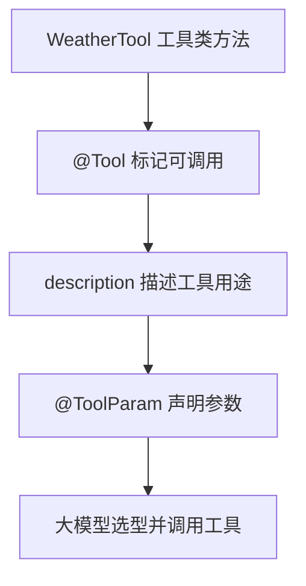

【学习目标】

- 在 Maven 多模块工程中新建 MCP Server 模块，并理清父子模块关系
- 用 `@Tool` 与 `@ToolParam` 两个注解完成工具的定义、描述与参数声明
- 说清「大模型如何知道有哪些工具、每个工具干什么、该传什么参数」这三步闭环

【正文】

## 1. 依赖回顾：MCP 底层框架来自 Spring AI

前面的课程引入了 MCP 依赖，有一个必须牢记的要点：MCP 依赖从 Spring AI 的依赖包引入，坐标是 `org.springframework.ai`，而不是通过 Spring AI Alibaba 的依赖包引入。这里引入的 `spring-ai-mcp` 属于 MCP 的底层框架，后面的课程还会引入 MCP 的其他依赖包（客户端、服务端等）。

底层框架四个字意味着它只提供机制，不提供业务：客户端抽象、服务端抽象、函数调用能力都在这一层，具体工具要开发者自己定义。先把这层关系立住，后面每引入一个新 MCP 依赖，都能准确回答它补的是哪一块拼图。

```xml
    <dependency>
        <groupId>org.springframework.ai</groupId>
        <artifactId>spring-ai-mcp</artifactId>
    </dependency>
```

以上代码块不写 `version`，因为根模块已通过 `spring-ai-bom` 接管了 `org.springframework.ai` 下所有组件的版本。依赖管理收口到 BOM 之后，子模块的坐标只剩 groupId 与 artifactId 两行，可读性显著提升。

## 2. 搭建 MCP Server 模块

前面的课程已经说明：MCP 包含客户端与服务端，工具的使用是在 MCP 服务端定义的。因此这里先建立 MCP 服务端模块，后续再建立客户端模块。

操作步骤：在项目上右键，New → Module，在同一项目内新建一个 Maven 模块，命名为 MCP Server。需要注意 Parent 一栏，父模块就是当前项目（DemoMCP），其余选项保持默认，点击 Create。创建完成后，根模块的 Maven 配置文件中会自动出现 `module` 标签，把子模块纳入聚合；点开 MCP Server 模块，可以看到它有自己的 Maven 配置文件，此时尚未引入任何依赖，暂时保持原状即可。

这种「一个父工程 + 多个 Maven 模块」的结构是 Java 工程的标准形态：父工程管版本与聚合，子工程管各自职责。MCP Server 与后面的 MCP Client 拆成两个模块，边界清晰，也便于分别打包部署，服务端要随工具提供方上线，客户端要随模型应用上线，两者发布节奏不同，拆开才能各自演进。模块化的代价只是多一个目录，收益是依赖隔离与独立构建，这笔账永远划算。

## 3. 定义工具类：两个包 + 一个天气工具

在 MCP Server 模块中建立两个 Package：一个叫 `mcp.server`，另一个叫 `tools`。工具的业务逻辑定义都放在 `tools` 包内，按职责分包是工程习惯：`tools` 放大模型可见的工具，其余包放服务端基础设施，日后工具增多时按包一眼定位。接着建立类 `WeatherTool`，专门用于天气工具的业务逻辑定义，其中定义两个工具：查询城市的气温、查询城市的紫外线。

这里要先回答两个问题。第一，大模型如何知道这两个工具的存在？第二，大模型如何知道该调用哪一个工具？答案来自 Spring AI 提供的注解体系。

## 4. 注解三件套：@Tool、description、@ToolParam

**`@Tool` 的作用一：标记可调用。** 并非类中每个方法都能被大模型使用，只有被 `@Tool` 注解修饰的方法，才等于告诉大模型「你可以调用该方法」；未被注解的方法，大模型不会调用。这是一道白名单闸门，方法再多也只暴露被点名的那几个。

**`@Tool` 的作用二：描述用途。** `@Tool` 有一个重要参数 `description`，用来解释该方法起什么作用，例如「获取指定城市的温度」。该属性非常重要，必须编写，大模型正是根据 description 的描述，判断何时以及如何使用该工具。description 写得含糊，大模型就会在错误的时机调错工具，这是工具调用失败最常见的原因。

**`@ToolParam` 的作用：声明参数。** 以获取城市温度的方法为例，需要传入城市名称。大模型并不知道要传什么，因此还要给参数加上 `@ToolParam` 注解，告诉大模型该方法需要传入哪些参数。

三步闭环走完，大模型的调用决策就完整了：



| 步骤 | 手段 | 回答的问题 |
|---|---|---|
| 1 | `@Tool` 注解标记方法 | 有哪些工具可用 |
| 2 | `@Tool(description = ...)` | 每个工具用于什么场景 |
| 3 | `@ToolParam` 标注参数 | 调用时要传哪些参数 |

至于方法内部如何实现，大模型不参与，它只负责选对工具、填对参数。

description 的书写质量直接决定调用准确率，值得单独强调。大模型选型时看到的不是方法名，而是 description 文本；方法名写得再规范，描述敷衍也白搭。对比两种写法：「查询天气」只说了动作，没说输入输出；「获取指定城市的实时温度，入参为城市名称」把用途、输入、产出一次讲清。后者才是合格的 description。

```java
    import org.springframework.ai.tool.annotation.Tool;

    /**
     * author: Imooc
     * description: 天气工具的业务逻辑定义
     * date: 2025
     */
    public class WeathTool {

        @Tool(description = "获取指定城市的温度")
        public String getTemperature(@ToolParam String cityName) {
            return cityName + "温度值：";
        }

        @Tool(description = "获取指定城市的紫外线值")
        public String getUltraviolet(@ToolParam String cityName) {
            return cityName + "紫外线值：";
        }
    }
```

以上代码块按讲稿原样保留，有三处需要如实说明：其一，类名为 `WeathTool`，正文口述中已察觉拼写问题并指出「应该是 `WeatherTool`」，此处保留讲稿原貌，实际编写时以 `WeatherTool` 为准；其二，代码未展示 `@Component` 注解（正文说明需要把该类注册为 Bean）与 `@ToolParam` 的 import，`@ToolParam` 与 `@Tool` 同属 `org.springframework.ai.tool.annotation` 包，实际编码时需一并导入；其三，两个方法的返回值只是占位字符串，真实业务中应调用第三方天气预报 API，此处先行占位是为了把「工具定义」这条主线讲清楚。

先占位、后补实现，是工具开发的常见节奏：先把「大模型能正确选中并调用工具」的链路跑通，再替换真实业务，每步只面对一个问题。

【易错点 / 面试题】

1. **面试官问：大模型怎么知道该调用哪个工具？** 答题三步：`@Tool` 声明工具存在，`description` 说明工具用途，`@ToolParam` 声明入参；大模型据此完成选型与填参。只答「加了注解就行」而不提 description 的决策作用，深度不够。
2. **易错点：以为 public 方法都能被调用。** 只有被 `@Tool` 修饰的方法才会进入工具清单，这是一个白名单机制。把私有辅助方法误当成工具暴露，会造成工具列表污染。
3. **易错点：description 留空或写得敷衍。** description 是大模型选型的唯一依据，必须准确描述用途与场景；写「查询天气」还是「获取指定城市的实时温度，入参为城市名称」，直接影响调用准确率。方法名再规范也救不了敷衍的描述，模型看到的只有文本。

【小结】

本节课完成了第一个 MCP 工具的定义：新建 MCP Server 模块并理清父子工程关系，在 `tools` 包中用 `@Tool` 标记可调用方法、用 `description` 描述用途、用 `@ToolParam` 声明参数，三步闭环让大模型能正确选中并调用工具。下一篇 4-6 解决下一个问题：把定义好的工具写进工具清单（`ToolCallbackProvider`），让 MCP 客户端能拉到这张清单。工程侧，`981-demo/src/main/java/com/travel/agent/tool/RouteMakingTools.java` 与 `981-demo/src/main/java/com/travel/agent/tool/AttractionTools.java` 正是这一模式的完整体现：每个工具都带 name 与 description，参数逐个用 `@ToolParam` 声明语义，离线桩返回统一格式的 JSON，可对照阅读。
