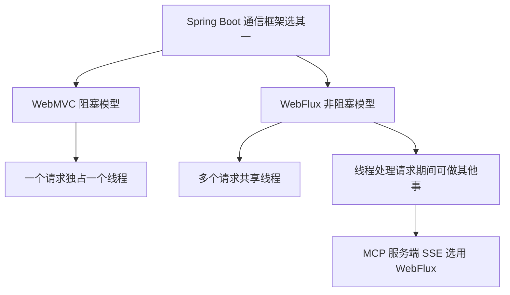

【学习目标】

- 说清 MCP 服务端实现 SSE 通信的两条路线：STDIO 与 SSE，及各自适用场景
- 解释 `spring-ai-starter-mcp-server-webflux` 依赖的构成与引入前提
- 讲透 WebFlux 与 WebMVC 的异同，以及 MCP 服务端为何选 WebFlux

【正文】

## 1. 回顾：三块拼图

前面的课程已经攒下三块拼图：第一块是 `@Tool` 注解，用于注明一个方法是 MCP 工具；第二块是 `ToolCallbackProvider` 对象，把 MCP 工具写入其中，可以看作一张 MCP 工具清单；第三块是 MCP 协议的三个节点，MCP Host（大模型端）、MCP 客户端、MCP 服务端，它们之间的通信基于 SSE，一种实时且单向的传输机制。

上节课的注册代码形态如下：

```java
    @Bean
    public ToolCallbackProvider toolList(WeatherTool weatherTool) {
        // MethodToolCallbackProvider是实现了ToolCallbackProvider接口
        // MethodToolCallbackProvider通过Builder模式生成实例
        // Java对象实例生成的方式:
        // 1. New
        // 2. Builder模式
    }
```

以上代码块按讲稿原样保留，需要如实说明：这是提纲式片段，方法体尚未给出实现，仅以注释罗列要点（`MethodToolCallbackProvider` 实现 `ToolCallbackProvider` 接口、通过 Builder 模式生成实例、Java 对象生成的两种方式）。真实写法是把注释中的要点落成代码：`return MethodToolCallbackProvider.builder().toolObjects(weatherTool).build();`。保留注释提纲的价值在于把上节课的三个结论钉在代码旁边。

本节来看最后一块拼图：MCP 服务端如何实现 SSE 实时通信。学习方式是看官方文档。打开 Spring AI Alibaba 官方文档，点击「最佳实践」，找到 MCP 一栏中的 MCP 服务端页面。

## 2. 两条路线：STDIO 与 SSE

文档给出两种实现 MCP 服务端通信的方式。

第一种是 STDIO，即标准输入输出，本质是进程间通信，用于节点处于同一台机器的场景。前面的课程提到过：MCP Host 与 MCP 客户端有可能在同一台机器上，此时两个节点之间的通信就走 STDIO。

第二种就是上节课讲过的 SSE，实时且单向的通信机制。把文档页面往下拉，可以看到基于 SSE 的 MCP 服务端通信实现说明，它需要添加一个依赖。

## 3. 引入依赖：spring-ai-starter-mcp-server-webflux

把文档中的依赖复制到 MCP Server 子模块。先看它的 Group ID：属于 Spring AI，而非 Spring AI Alibaba。要引入该依赖，前提是把 Spring AI 的 BOM（统一依赖版本管理文件）导入进来，前面的课程已在根模块的 Maven 配置文件中，于 `dependencyManagement` 处完成导入。因此 `spring-ai-starter-mcp-server-webflux` 可以被正常识别，在 IDEA 中能跳转到对应的依赖文档，这就证明依赖引入成功。这是验证 BOM 是否生效的又一个日常场景。

```xml
    <dependency>
        <groupId>org.springframework.ai</groupId>
        <artifactId>spring-ai-starter-mcp-server-webflux</artifactId>
    </dependency>
```

以上代码块不写 `version`，版本由根模块的 `spring-ai-bom` 统一提供。starter 类依赖的坐标规律值得记下：`spring-ai-starter-*` 是一键引入某个能力全家桶的入口，版本继续交给 BOM。

接下来看该依赖导入了哪些文件。打开 Maven 窗口，点开 MCP Server 子模块的 Dependencies，可以看到两项：其一是刚引入的 `spring-ai-starter-mcp-server-webflux`，即实现 SSE 的依赖；其二是 `spring-ai-mcp`，前面的课程导入的 MCP 基础模块，放在根模块的配置文件中，无论做 MCP 客户端还是服务端，都必须引入该基础模块。

重点看刚导入的 starter：打开它，可以看到引入了 Spring Boot，以及 Spring Boot WebFlux 框架。由此产生两个疑问：第一，该依赖主要用来实现 MCP 服务端的 SSE 协议，为什么跟 Spring Boot 有关系？第二，WebFlux 是一个什么样的框架？

第一个疑问的答案是：它实现 SSE 协议是基于 Spring Boot 的。starter 带来了 Spring Boot，MCP 服务端的 SSE 能力就构建在 Spring Boot 的通信体系之上。第二个疑问引出了本节的主角，WebFlux 框架。

## 4. WebFlux 与 WebMVC：一对必修课

做过后端开发的人对 WebFlux 不会陌生：它是 Spring Boot 的通信框架之一。打开 `spring-ai-starter-mcp-server-webflux` 的依赖树，除了 Spring Boot，还有 Spring Boot WebFlux；正因如此，实现 MCP 服务端 SSE 协议的依赖名后面带了 WebFlux。

在讲解 WebFlux 之前，先看它的对照物。把依赖坐标复制一份，把横杠后的框架名从 WebFlux 改成 WebMVC，即 `spring-ai-starter-mcp-server-webmvc`，该依赖同样存在，Group ID 同属 Spring AI。换言之，WebMVC 与 WebFlux 都能实现 MCP 服务端的 SSE 协议。为何选 WebFlux 而不选 WebMVC？这就要对比两个框架，它是 Spring Boot 的基础知识点。

WebFlux 与 WebMVC 是 Spring 的核心通信框架。用 Spring Boot 搭建 HTTP 服务器，本质就是引入二者之一；经过自动装配，Spring Boot 会自动配置 WebFlux 或 WebMVC。注意：这两个框架不能同时存在。

先看相同点：WebFlux 与 WebMVC 都支持 SSE 协议，因此用哪个都能实现 SSE。支持协议不是差异点，差异在线程模型。

再看不同点，共两条。第一，WebMVC 基于阻塞模型处理请求：一个请求单独分配一个线程来处理，十万个请求就需要十万个线程；WebFlux 基于非阻塞模型：同样会给请求分配线程，但不是一个请求独占一个线程，而是多个请求共享线程，十万个请求可以由一个线程处理。第二，WebMVC 的线程在处理请求期间不能做任何其他事情；WebFlux 的线程在处理请求期间还能做其他事情。

| 对比项 | WebMVC | WebFlux |
|---|---|---|
| 请求模型 | 阻塞 | 非阻塞 |
| 线程分配 | 一个请求一个线程 | 多个请求共享线程 |
| 线程在请求期间 | 不能做其他事 | 能做其他事 |
| 是否支持 SSE | 支持 | 支持 |
| 能否共存 | 不能同时存在 | 不能同时存在 |

以上对照表归纳了两个框架的异同。注意最后两行：SSE 支持能力相同，且二者互斥，这是最容易被忽略的两点。



从表中可以直接得出结论：WebFlux 在性能上优于 WebMVC。MCP 服务端要面对长连接、流式推送、高并发访问，十万级请求若每个都占一个线程，线程上下文切换与内存占用都会成为瓶颈；非阻塞模型下少量线程即可承载大量长连接，线程不会被慢速的客户端「卡住」。因此实现 MCP 服务端的 SSE 协议采用 WebFlux，而不采用 WebMVC，WebMVC 依赖可以直接注释掉，只保留 WebFlux 依赖。

至此结论清晰：实现 MCP 服务端的 SSE 协议采用 WebFlux，而不采用 WebMVC，WebMVC 依赖可以直接注释掉，只保留 WebFlux 依赖；篇首那张提纲式注册代码，也随之获得完整的运行底座。

【易错点 / 面试题】

1. **面试官问：WebMVC 和 WebFlux 的区别？** 答题两条：线程模型不同，WebMVC 一个请求一个线程、阻塞；WebFlux 多个请求共享线程、非阻塞，线程处理期间还能做别的事。能补一句「两者不能同时存在，且都支持 SSE」就显得功底扎实。
2. **面试官问：为什么 MCP 服务端用 WebFlux？** 因为 MCP 服务端基于 SSE 做实时、单向、长连接的通信，非阻塞模型能以更少的线程承载更多长连接，性能优于阻塞模型。
3. **易错点：以为差异在「是否支持 SSE」。** 两者都支持 SSE，这是相同点；差异在线程模型。答错相同点与差异点，比答不全更伤。

【小结】

本节课完成了 MCP 服务端通信的最后一块拼图：MCP 服务端有两种通信实现，同机场景走 STDIO，跨机实时通信走 SSE；后者通过 `spring-ai-starter-mcp-server-webflux` 引入，其底层基于 Spring Boot 的 WebFlux 通信框架；WebFlux 与 WebMVC 同为核心通信框架且都支持 SSE，但 WebFlux 的非阻塞模型（多请求共享线程、线程处理期间可做别的事）在性能上占优，因此 MCP 服务端选 WebFlux，WebMVC 依赖注释掉。到此，MCP 服务端「工具定义（4-5）→ 清单注册（4-6）→ SSE 通信（4-7）」三段闭环已经打通，后续章节将进入客户端一侧。工程侧，`981-demo/src/main/java/com/travel/agent/web/TravelController.java` 以 `POST /api/travel/plan` 暴露用户交互入口，正是「页面前端与大模型端」这一段链路的落点，与本节所讲的通信分层互为表里；`981-demo/pom.xml` 中各依赖的版本登记方式，也与前两篇的 BOM 纪律一脉相承，可对照阅读。
