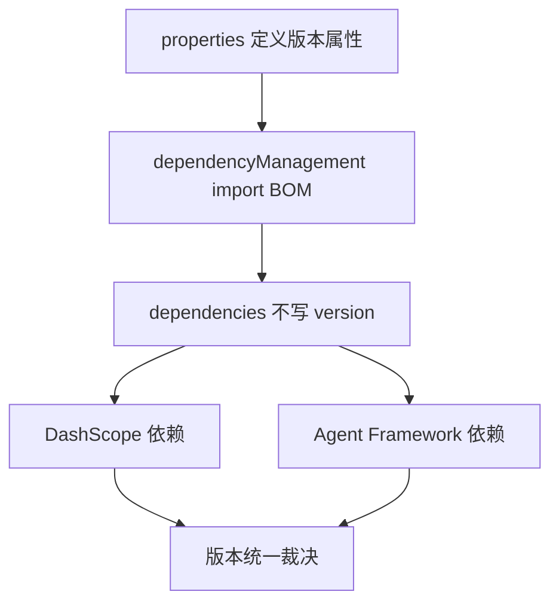

【学习目标】

1. 说清 Spring AI Alibaba 1.0 / 1.1 与 Spring AI 2.0-M1 的版本关系，以及课程技术路线的选择依据。
2. 掌握 1.1 快速开始的两个核心依赖：DashScope 与 Agent Framework，理解各自职责。
3. 验证 1.1 同样支持以 BOM 方式统一管理依赖版本，并理解其生效原理。
4. 面试中能回答「为什么用 BOM 管理依赖」「RC 版本能否用于生产」。

【正文】

## 一、版本背景与课程路线

课程录制期间，Spring AI Alibaba 发布了 1.1 正式版，此前课程基于 1.0 正式版。既然 1.1 正式版已发布，课程直接切换到 1.1。

同期 Spring AI 本身已放出 2.0 的 M1 版本。所谓 M1 即里程碑版本（Milestone）：框架在正式版之前按 M1、M2 的节奏发布里程碑版本，后续 2.0 正式版都从该里程碑演进，API 形态在里程碑阶段已基本定型。与此同时，Spring AI 1.1 正式版也已发布。

据此课程把技术路线定为：立足 1.0 打基础 → 学习 1.1 正式版 → 跟随 2.0 演进。这样安排的好处是避开已被淘汰的 API，所学知识在一两年内不会过时。对学习者而言，跟随版本线还有一层价值：里程碑版本公开了框架的演进方向，提前了解 2.0 的形态，框架正式升级时可以快速迁移，而不是在旧 API 被弃用后才被动应对。

三个版本在课程中的分工：

| 版本 | 定位 | 课程中的用法 |
|---|---|---|
| Spring AI Alibaba 1.0 | 课程前半程的基础版本 | 前面章节的 MCP 项目基于此版本 |
| Spring AI Alibaba 1.1 | 当前正式版，智能体开发为重点 | 本课起新项目切换到此版本 |
| Spring AI 2.0-M1 | 里程碑版本，预告 2.0 走向 | 仅作技术前瞻，不进入编码 |

## 二、1.1 文档的三个核心方向

打开 Spring AI Alibaba 1.1 文档，界面较 1.0 已有改版。顶部三个标签即 1.1 正式版的核心方向：

| 标签 | 含义 | 与本课的关系 |
|---|---|---|
| 上下文工程 | 提示词、记忆、工具结果的上下文组织 | Agent 决策质量的底座 |
| 多智能体协同协作 | 多 Agent 分工、通信、调度 | 本课程主线（旅行规划 Agent 团队） |
| 复杂工作流 | 多步骤、带分支的流程编排 | 复合任务拆解（第 5 章） |

第一个标签「上下文工程」回答的是「给模型什么信息」：智能体的每一次决策都依赖提示词、历史记忆与工具返回结果的组织方式，上下文质量直接决定决策质量。第二个标签「多智能体协同协作」回答的是「谁来做」：多个智能体分工、通信、调度，本课程的旅行规划团队正是此形态。第三个标签「复杂工作流」回答的是「按什么顺序做」：多步骤、带分支的流程编排，对应第 5 章的复合任务拆解。

课程项目与 Spring AI Alibaba 的发展方向一致，重点发展智能体、尤其是多智能体协作。技术选型跟上框架演进的主干道，是课程项目具备竞争力的原因之一。

## 三、快速开始：前置条件与两个依赖

1.1 快速开始的前置条件与 1.0 相比没有变化：JDK 17+、Maven 3.8+，另外需要填写 DashScope（阿里云百炼）的 API Key，该密钥在第 1 章的阿里大模型广场配置环节已经准备好。

依赖导入上，1.1 文档只列出两个依赖包，且未提及 BOM 方式。

第一个是 DashScope 依赖（阿里云百炼），与 1.0 的导入完全一致。只有导入它才能调用语言大模型，DeepSeek、通义千问等模型都经由 DashScope 接入。阿里云百炼是阿里巴巴的大模型平台，控制台集成了包括 Qwen、DeepSeek 在内的众多模型；API Key 的获取与配置已在第 1 章完成，此处只需在 Maven 依赖层面接入。换言之，DashScope 依赖是模型调用的通道，没有它，智能体再完善也只是空壳。

第二个是 1.1 新增的 Agent Framework：

```xml
<!-- Spring AI Alibaba Agent Framework -->
<dependency>
    <groupId>com.alibaba.cloud.ai</groupId>
    <artifactId>spring-ai-alibaba-agent-framework</artifactId>
    <version>1.1.0-RC2</version>
</dependency>
```

从名称即可看出它是一个智能体框架，这说明 Spring AI Alibaba 1.1 把智能体开发作为重点：自 1.1 起，智能体是主要操作者，无论是调用工具（含 MCP 工具）还是与大模型交互，都经由智能体完成。此前开发者需要自行组织「提示词 → 工具调用 → 结果回传」的循环，1.1 把这一层收进框架，开发者只写业务提示词与工具。因此只需导入 Agent Framework 这一个依赖包，工具调用与大模型交互的一系列操作就具备了载体。

文档片段中显式写了 `1.1.0-RC2` 版本号；而在实际项目里版本号可以省略，前提是用 BOM 统一管理，这正是本节要验证的内容。

## 四、验证 1.1 的 BOM 导入方式

问题：1.1 能否像 1.0 那样，用 BOM 做版本统一管理，使后续导入的 DashScope 等依赖无需逐一指定版本？

先回顾 1.0 的做法作对照：BOM 放在 `dependencyManagement` 标签里，之后导入任何 Spring AI Alibaba 相关依赖都不写版本号，所有依赖的版本由 BOM 统一指定。

验证分两步。第一步查 GitHub：Spring AI Alibaba 的 releases 栏最新版为 1.1.0-RC2（RC 版之后即正式版）；源码仓库中存在 `spring-ai-alibaba-bom` 目录，且发布时间与 1.1 版本同步（约两周前）。据此推断 1.1 同样支持 BOM 方式。

第二步动手实验：新建使用 1.1 的 MCP 项目，在 properties 标签中指定 `spring-ai-alibaba-bom` 的版本为 1.1.0-RC2，在 `dependencyManagement` 中导入该 BOM，再在 `dependencies` 中导入 Agent Framework 且不写版本号。导入后查看依赖，Agent Framework 解析出的版本正是 1.1.0-RC2，BOM 管理生效。

结论：Spring AI Alibaba 1.1 与 1.0 一样，可以用 BOM 方式统一管理依赖版本。

BOM 生效的原理：Maven 解析依赖时，`dependencyManagement` 中以 import 方式引入的 BOM，会将其声明的所有构件版本注入当前项目的依赖管理表；`dependencies` 中未写版本的依赖项，按 `groupId:artifactId` 到表中查找并继承版本。这解决的是传递依赖版本漂移问题，不指定版本时，Maven 按「就近原则」选取传递依赖版本，不同依赖路径可能选中不同版本，引发难以排查的兼容性问题；BOM 把版本决策集中到一处，团队升级时只改 BOM 版本一处即可，避免多模块版本漂移。两处写法配合使用：properties 中定义版本属性，`dependencyManagement` 中 import BOM 时引用该属性，`dependencies` 中只写 `groupId` 与 `artifactId`。这样版本号在整个项目里只出现一次，升级时改动点唯一。



## 五、1.0 与 1.1 依赖导入对照

| 维度 | 1.0 | 1.1 |
|---|---|---|
| BOM 支持 | 支持（`spring-ai-alibaba-bom`） | 同样支持（1.1.0-RC2） |
| 文档推荐方式 | BOM + 按需引入 | 仅列两个依赖，未提 BOM |
| 大模型接入 | DashScope 依赖 | DashScope 依赖（不变） |
| 新增依赖 | - | Agent Framework |
| 前置条件 | JDK 17+ / Maven 3.8+ | 相同 |

选择建议：新项目按文档快速开始（两个依赖）即可起步；一旦模块超过一个、或需要统一传递依赖版本，就应切换到 BOM 方式。两种方式并不冲突，BOM 管版本，依赖按需引入。

【易错点 / 面试题】

1. **文档没写 BOM 不等于不支持**：1.1 快速开始只列了两个依赖，容易误以为取消了 BOM。实测 GitHub 源码中存在 `spring-ai-alibaba-bom` 且版本与 1.1 同步，实验证实依赖版本可被 BOM 接管。工程习惯上仍推荐 BOM 方式，理由是多模块版本统一；文档从简是出于快速上手考虑，两者不矛盾。
2. **import 方式必须正确**：BOM 要放在 `dependencyManagement` 中并以 import 方式导入，误写成普通依赖会导致版本管理不生效，子依赖回到各自默认版本。验证方法是导入后查看依赖树中目标构件的解析版本。
3. **RC 版本的使用边界**：本课因录制时点使用 1.1.0-RC2，正式项目应切换到正式版。面试被问「RC 版能否上生产」，标准回答是功能趋于稳定但仍有变更风险，生产环境等待 GA；若必须提前使用，应在测试环境充分验证并锁定版本。

【小结】

本节确认了 Spring AI Alibaba 1.1 的版本图景：智能体成为一等公民，Agent Framework 是新版本的核心增量；依赖管理上 1.1 延续了 1.0 的 BOM 机制，文档未写明但实验可证。工程侧对应实践可参考 `981-demo/src/main/java/com/travel/agent/config/AgentProperties.java`：真实模式通过 `model-name: dashscope:qwen-plus` 指定模型，由 DashScope 扩展完成接入；离线模式用规则模型兜底，两种模式经 `model-mode` 一键切换。技术前瞻：Spring AI 主线的 2.1/3.0 规划引入 Message Parts 模型与渐进披露机制，并把 Skills、子 Agent 编排纳入 Spring AI Agents 方向；课程采用的 Agent Framework + BOM 治理思路，与这一演进同向，掌握依赖治理与智能体一等公民的设计，框架升级时迁移成本最低。接下来第 5 章进入多智能体设计，先看旅行规划这类复合任务如何拆解。
