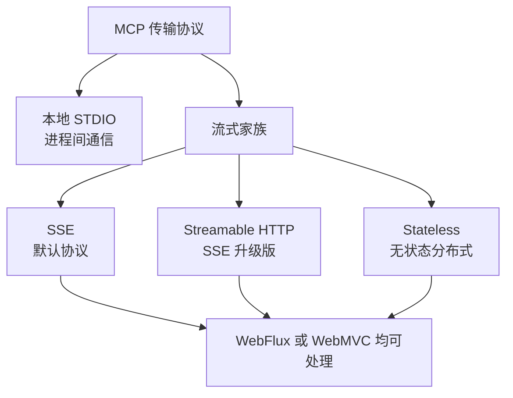

【学习目标】

1. 对比 Spring AI Alibaba 1.0 与 1.1 在 MCP 支持上的差异，理解「底层依赖内置化」的演进。
2. 掌握 MCP 服务端的依赖形态与四种传输协议（STDIO、SSE、Streamable HTTP、Stateless）。
3. 能够在配置文件中声明 MCP 通信协议，并理解 Spring AI 与 Spring AI Alibaba 版本号命名差异。

【正文】

## 一、1.0 到 1.1：MCP 底层依赖的「内置化」

在前面的工程搭建课中，Spring AI Alibaba 1.0 整合 MCP 的方式是：额外导入一个 MCP 底层依赖 `spring-ai-mcp`，它属于 Spring AI 包，导入后才会带出 MCP SDK，彼时 MCP SDK 版本号为 0.10。

Spring AI Alibaba 1.1 改变了这一形态：基于 1.1 版创建的项目只需要导入 Spring AI Alibaba 1.1 的 BOM（放在 `dependencyManagement`），再在 `dependencies` 中导入 Agent Framework 一个依赖即可，打开该依赖的依赖树可以看到，MCP SDK 已经包含在内，版本号为 0.14。换句话说，MCP 的底层依赖被直接整合进了 Spring AI Alibaba 1.1 自身，不需要任何额外导入。

| 对比项 | Spring AI Alibaba 1.0 | Spring AI Alibaba 1.1 |
|---|---|---|
| MCP 底层依赖 | 需额外导入 `spring-ai-mcp` | 已内置，无需导入 |
| MCP SDK 版本 | 0.10 | 0.14 |
| 最小依赖集合 | BOM + `spring-ai-mcp` + Agent Framework | BOM + Agent Framework |
| 版本声明位置 | `dependencyManagement` | `dependencyManagement` |

在 IDE 的 Maven 面板中展开 1.1 项目的 Dependencies，可以直观验证：只导入了 Agent Framework 一个业务依赖，其依赖树中包含 MCP SDK 0.14。

这一变化的实质是「框架自己把底座焊死」：1.0 时代 MCP 是可选外挂，用不用自己决定；1.1 起 MCP 成为 Agent Framework 的默认组成部分，省一层导入，也少一个「忘了导依赖」的故障点。

## 二、MCP 服务端与客户端：依赖形态不变

MCP 分为服务端（Server）与客户端（Client）。1.1 中 MCP 服务端的依赖与 1.0 相比没有变化，仍然基于 Spring Boot 的 WebFlux 框架来接收 SSE 协议的流式数据。

MCP 服务端相关依赖如下：

```xml
        <!-- 基于SpringBoot的Webflux框架实现MCP服务端的SSE协议 -->
        <dependency>
            <groupId>org.springframework.ai</groupId>
            <artifactId>spring-ai-starter-mcp-server-webflux</artifactId>
        </dependency>

        <!-- spring-ai-starter-mcp-server-webmvc 是同样能够实现MCP服务端的SSE协议 -->
        <dependency>
            <groupId>org.springframework.ai</groupId>
            <artifactId>spring-ai-starter-mcp-server-webmvc</artifactId>
        </dependency>
```

这里有两件事需要注意：

1. `spring-ai-starter-mcp-server-webflux` 与 `spring-ai-starter-mcp-server-webmvc` 二选一即可：两者都能实现 MCP 服务端的 SSE 协议，前者基于响应式的 WebFlux，后者基于 Servlet 的 WebMVC。课程推荐 WebFlux。
2. WebFlux 属于 Spring AI 包（`org.springframework.ai`），需要导入 Spring AI 的 BOM 做版本管理，与 1.0 时代的做法相同：

```xml
        <!-- SpringAi 的版本管理 -->
        <dependency>
            <groupId>org.springframework.ai</groupId>
            <artifactId>spring-ai-bom</artifactId>
            <version>${spring-ai.version}</version>
            <type>pom</type>
            <scope>import</scope>
        </dependency>
```

两个 starter 的取舍可以回顾第 4-7 篇的结论：WebFlux 与 WebMVC 都支持 SSE，但 WebMVC 的线程在处理请求期间不能做其他事情，而 WebFlux 的线程在处理期间仍可执行别的任务；MCP 服务端要长时间维持流式连接，用 WebFlux 更合适。因此 WebMVC 依赖在课程项目中被注释掉，只保留 WebFlux。

版本号命名有一个容易混淆的细节：Spring AI 的版本号写作 `1.1.0`，而 Spring AI Alibaba 的版本号写作 `1.1.0.0`，两者段数不同，不要混用。原稿视频转写在此处有一段无法辨认的音频碎片（原样转写为「Hangang RCR」），疑为某个版本后缀或仓库名的误识别，此处如实说明，实际版本号请以 Maven 中央仓库与官方文档为准。

## 三、四种传输协议全景

MCP 协议规定服务端与客户端之间的通信方式。1.1 的官方文档在「生态集成 → MCP」下，把 MCP 服务端支持的传输机制分为四种：

| 传输方式 | 类型 | 适用场景 | 说明 |
|---|---|---|---|
| STDIO | 进程间通信 | 服务端与客户端同机 | 标准输入输出直连，适合本地工具 |
| SSE | 流式，默认 | 服务端向客户端推送 | 服务端单点推送，客户端不能打断（不同于 WebSocket 的双工交互） |
| Streamable HTTP | 流式 | SSE 的升级版 | 在 SSE 基础上改进的流式传输 |
| Stateless | 流式、无状态 | 微服务/分布式 | 不保存会话状态，适合横向扩展 |



其中 SSE、Streamable HTTP、Stateless 三种都是流式协议，都可以用 WebFlux 框架处理，也可以用 WebMVC 框架处理，这正是第二节中两个 starter 依赖可以任选的技术前提。

四种协议的差异可以放在两个维度上看：是否同机、是否有状态。STDIO 要求服务端与客户端跑在同一台机器，通过标准输入输出通信，最适合本地命令行工具；其余三种走网络，其中 SSE 是默认协议，服务端单向推送、客户端不能打断，实现最简单；Streamable HTTP 是 SSE 的升级版，保留了流式能力，通信模型更贴近常规 HTTP；Stateless 在流式基础上进一步去掉会话状态，多实例部署时请求可以落到任意节点，适合微服务与分布式场景。

## 四、在配置文件中声明通信协议

1.1 新增了 Streamable HTTP 与 Stateless 两种通信方式，使用时需要在配置文件中声明。课程演示采用 Streamable HTTP（SSE 的升级版），配置骨架如下：

```yaml
        # application.yml 中的 MCP 服务配置示例
        spring:
          ai:
            mcp:
              server:
                enabled: true
                # 其他配置项...
```

结合原稿正文的说明：如果要使用 Streamable HTTP，需在 `spring.ai.mcp.server` 下指明 Streamable 协议；如果使用 Stateless，需指明无状态协议；SSE 是默认协议，什么都不写即为 SSE。

配置项与传输协议的对应关系：

| 目标协议 | `spring.ai.mcp.server` 下的声明 | 备注 |
|---|---|---|
| SSE | 无需声明 | 默认值 |
| Streamable HTTP | 指明 Streamable 协议 | 课程演示采用 |
| Stateless | 指明无状态协议 | 面向分布式部署 |

这行配置是服务端行为的开关：协议声明错了，客户端按 SSE 连接就会失败，报错通常指向连接初始化超时，排错时先核对两端协议是否一致。

## 五、演进脉络与选型建议

把两次演进放在一起看，主线是「集成度不断提升」：

| 维度 | 1.0 | 1.1 |
|---|---|---|
| MCP 依赖形态 | 外置底层依赖 | 内置 |
| MCP SDK | 0.10 | 0.14 |
| 传输协议 | STDIO + SSE | STDIO + SSE + Streamable HTTP + Stateless |
| 服务端框架 | WebFlux（推荐） | WebFlux（推荐），WebMVC 可选 |

选型上，本地调试与轻量工具场景用 STDIO 即可；需要远程调用的 MCP 服务默认走 SSE；云原生、多实例部署优先评估 Stateless；新项目可以直接采用 Streamable HTTP。

【易错点 / 面试题】

1. **Spring AI Alibaba 1.0 与 1.1 整合 MCP 的最大差异是什么？** 1.0 需要额外导入 `spring-ai-mcp` 底层依赖（MCP SDK 0.10）；1.1 把 MCP 底层依赖内置进框架，只需导入 BOM 与 Agent Framework，MCP SDK 即升级为 0.14。回答时点明「依赖形态」与「SDK 版本」两个变化即可。
2. **MCP 的四种传输方式分别是什么？各自适用什么场景？** STDIO 用于本机进程间通信；SSE 是默认的流式推送协议；Streamable HTTP 是 SSE 的升级版；Stateless 是无状态流式协议，适用于微服务与分布式场景。高频追问「SSE 与 WebSocket 区别」：SSE 只支持服务端向客户端单向推送，WebSocket 是全双工。
3. **为什么 SSE、Streamable HTTP、Stateless 都能用 WebFlux 处理？** 三者都属于流式传输协议，WebFlux 作为响应式框架天然适合承载流式数据的接收与发送；WebMVC 同样可以处理，课程中推荐 WebFlux，原因是长连接期间 WebMVC 的线程会被请求占满，无法执行其他任务。

【小结】

本节梳理了 Spring AI Alibaba 1.1 对 MCP 的支持形态：

- MCP 底层依赖从 1.0 的外置 `spring-ai-mcp`（SDK 0.10）演进为 1.1 的内置能力（SDK 0.14），最小依赖集合只剩 BOM + Agent Framework；
- MCP 服务端仍基于 WebFlux 处理 SSE 流式数据，WebMVC 可作为替代，两者依赖来自 Spring AI 包，需 Spring AI BOM 管理版本；
- 传输协议从 STDIO + SSE 两种扩展为四种，新增 Streamable HTTP（SSE 升级版）与 Stateless（无状态，面向分布式）；
- 配置文件 `spring.ai.mcp.server` 下声明协议类型，缺省为 SSE。

在本课程的 981-demo 工程中，MCP 风格的「工具」以 `@Tool` 注解直接落在智能体内：`981-demo/src/main/java/com/travel/agent/tool/RouteMakingTools.java` 通过 `@Tool` 挂载 `map_geocode`、`map_directions`、`map_weather` 三个工具，离线模式返回固定坐标桩数据，等价于复刻百度地图 MCP 的核心工具面；`981-demo/src/main/java/com/travel/agent/tool/AttractionTools.java` 提供 `search_attractions`。这与独立部署的 MCP 服务端是两种组织方式：前者把工具注册进智能体 Toolkit（`TeamMembers.java` 中 `Toolkit.registerTool`），后者以独立服务形态暴露工具，选型时可根据工具复用范围决定：工具只服务单个智能体，内置即可；工具要被多个智能体或多个应用共享，独立 MCP 服务端更合适。
