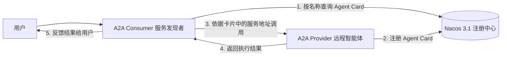

## 【学习目标】

- 说清 A2A（Agent2Agent）协议要解决的三个问题：如何发现对方、如何描述能力、是否必须跨模型。
- 记住 Spring AI Alibaba 1.1 中 A2A 的三个核心组件及其分工：A2A Provider、注册中心、A2A Consumer。
- 理解「智能体卡片（Agent Card）」在整套机制中的枢纽地位，以及它为什么必须依赖 Nacos 3.1。
- 为后续搭建 A2A Provider / Consumer 双模块联调环境划清工程边界。

## 【正文】

### 1. A2A 协议回顾：跨智能体通信的「标准普通话」

A2A（Agent2Agent）协议由 Google 提出，用于不同大模型的智能体之间互相通信。在前述章节中已经明确过定位：A2A 是智能体与智能体之间的水平通信协议，MCP 是智能体与工具之间的垂直上下文协议。两者面向的对象不同，解决的问题不同，在 Spring AI Alibaba 1.1 中都有对应实现。

一次完整的 A2A 交互通常是这样推进的：

1. 智能体 A 缺少某方面能力，无法独立满足用户需求；
2. 智能体 A 知道远方的智能体 B 具备该能力，于是向 B 发出请求；
3. 智能体 B 处理完成后，把结果回传给智能体 A；
4. 智能体 A 再把结果反馈给用户。

这套流程要真正跑通，必须先回答三个问题。这三个问题恰好对应 A2A 架构的三块拼图：

| 问题 | 具体含义 | A2A 的答案 |
|---|---|---|
| 如何发现对方 | 智能体 A 怎么知道远方存在一个能帮忙的智能体 B | 注册中心（Registry） |
| 如何描述能力 | 注册中心里智能体众多，A 凭什么挑中 B 而不是别人 | Agent Card（智能体卡片） |
| 是否必须跨模型 | 同一模型的分布式智能体之间能不能互通 | 能，协议与模型解耦 |

第一个问题的答案是注册中心。智能体 A 通过中间节点得知智能体 B 的存在，也得知 B 拥有哪些能力。没有注册中心，A 就只能靠硬编码地址，这在智能体数量动态变化的分布式环境里不可维护。

第二个问题的答案是智能体卡片。注册中心里可能存放着大量智能体，每个智能体的能力不同，A 需要一种机器可读的描述来判断「哪一个刚好能解决我现在遇到的问题」。智能体卡片把名称、技能、擅长任务等信息固化成对象模型，正是为此而生。

第三个问题的答案是：A2A 只约束通信格式，不约束底层模型。Spring AI Alibaba 1.1 提供的 A2A API 既可用于不同大语言模型的 Agent 通信，也可用于同一大语言模型、但位于不同节点（分布式）的 Agent 通信。分布式的智能体按同一个标准协议通信即可，至于它们底层是否同为一个语言大模型，并不重要。这一点常被面试官拿来追问，值得留意。

### 2. Spring AI Alibaba 1.1 的 A2A 实现：三个核心组件

在 Spring AI Alibaba 1.1 中，A2A 的实现位于 Agent Framework 的「高级功能 → 分布式智能体 → A2A 协议」文档路径下。其核心组件共三个：

1. **A2A Provider（服务提供者）**：真正执行业务的远程智能体。课程中它是一个 ReactAgent 框架的智能体，拥有工具、记忆与推理能力，由它去实际完成用户交代的任务。
2. **注册中心**：Spring AI Alibaba 1.1 支持阿里的 Nacos 作为注册中心，且版本要求 3.1。注册中心存放各远程智能体的 Agent Card，是服务注册与服务发现的枢纽。
3. **A2A Consumer（服务发现者）**：从注册中心发现远程智能体并调用它，课程中的载体是 `A2aRemoteAgent` 对象。它本身不执行业务，只负责发现与调度。

用注册中心的概念可以把整个流程串起来：智能体 B（Provider）先把自己注册进注册中心，声明自己是服务提供者；智能体 A（Consumer）在注册中心里发现智能体 B 的存在，得知 B 的能力，随后与 B 通信，让 B 帮忙解决问题。服务注册、服务发现两块能力合起来，就构成了 A2A 的最小闭环。



上图展示了三组件的协作顺序：Provider 先把卡片写进注册中心；Consumer 按名称从注册中心取出卡片，再按卡片里记录的服务地址调用远程智能体；结果沿原路返回给用户。

### 3. 与微服务注册中心的类比

Nacos 之于 A2A，正如 Nacos 之于微服务。微服务体系里，服务实例启动时向 Nacos 注册 IP 与端口，消费方按服务名拉取实例列表并负载均衡调用；A2A 体系里，Provider 把 Agent Card 注册进 Nacos，Consumer 按智能体名称解析出卡片，再按卡片里的地址调用。差别只在于注册内容：微服务注册的是「实例地址」，A2A 注册的是「能力名片」。理解这一点，就能明白为什么 Nacos 3.1 是关键版本，低版本的 Nacos 没有 Agent 模型，存不下智能体卡片这种结构。

### 4. 工程结构：两个模块、两个端口

搭建 A2A 联调环境需要建立两个模块：

- **a2a-provider**：A2A 服务提供者模块，端口号 8081；
- **a2a-consumer**：A2A 服务消费者模块，端口号 8082。

两个模块要在同一台机器上同时启动，端口必须不同。Provider 负责创建远程智能体，并把 Agent Card 写进 Nacos；Consumer 负责从 Nacos 发现远程智能体并调用。后续两篇（4-13、4-14）分别落地这两半。

### 5. 依赖导入：BOM 管理 Agent Framework

与 MCP 的导入方式一致，A2A 依赖同样采用 BOM 版本管理。以 BOM 方式导入 Spring AI Alibaba 1.1 后，引入 Agent Framework 依赖包无需指定版本：

```xml
        <dependency>
            <groupId>com.alibaba.cloud.ai</groupId>
            <artifactId>spring-ai-alibaba-agent-framework</artifactId>
        </dependency>
```

原稿对 A2A 定位与组件划分的总结如下，可作速记卡使用：

```java
        /*
        * Google 提出的 A2A协议 用于不同大语言模型的Agent 之间进行通信
        * SpringAi alibaba 1.1 提供了实现A2A协议的Api
        * 这里的A2A协议除了用于不同模型的Agent 之间进行通信,
        * 也能用于同一个大语言模型, 但位于不同节点(分布式)的Agent 之间的通信
        * 有3个核心组件
        * A2A Provider (服务提供)
        * 注册中心 ( 阿里的Nacos 3.1 ) (服务注册 )
        * A2A Consumer ( 服务发现 )
        */
```

这里有一个容易忽略的细节：Agent Framework 与 A2A 专用的 Nacos 注册中心构件都在 Spring AI Alibaba 的 BOM 管辖范围内，导入时不必写版本号；而 DashScope（阿里大模型平台）不在 BOM 内，必须显式声明版本。1.0 与 1.1 在这点上的差异，将在 4-13 详细说明。

## 【易错点 / 面试题】

**面试题 1：A2A 与 MCP 的区别是什么？**
A2A 是 Agent 与 Agent 之间的水平通信协议，解决「智能体互相发现、互相调用」；MCP 是 Agent 与工具之间的垂直协议，解决「工具描述与调用的标准化」。可以补充：A2A 由 Google 提出，MCP 由 Anthropic 提出；Spring AI Alibaba 1.1 对两者均有实现，A2A 侧走 Nacos 注册中心，MCP 侧走注解式开发。

**面试题 2：A2A 的三个核心组件是什么？**
A2A Provider（服务提供）、注册中心（服务注册）、A2A Consumer（服务发现）。两个加分项：注册中心在 1.1 中特指 Nacos 3.1，因为智能体卡片模型从该版本开始被支持；Provider 侧真正干活的是 ReactAgent，Consumer 侧的 `A2aRemoteAgent` 只做发现与调度，不执行业务。

**面试题 3：A2A 只能用于不同模型的智能体吗？**
不是。分布式节点上的同模型智能体同样适用 A2A，协议约束的是通信格式，与底层模型解耦。

**易错点 1：端口冲突。** Provider 与 Consumer 同机运行时端口必须不同（如 8081 / 8082），否则后启动的模块会因端口占用直接失败，联调时很容易误以为是代码问题。

**易错点 2：注册中心版本。** Nacos 必须是 3.1。低版本没有 Agent 模型，无法存放智能体卡片，Provider 启动后注册会静默失败或报错，Consumer 侧则永远发现不了远程智能体。

## 【小结】

本节建立了 A2A 的全局视图：Provider 注册卡片、Consumer 发现并调用、注册中心居中存储智能体卡片，三个问题（发现、描述、跨模型）分别由三块拼图回答。接下来 4-12 先插入 MCP 注解开发的讲解，4-13、4-14 再分别落地 A2A 的服务注册与服务发现，4-15 深入智能体卡片 AgentCard 的字段与配置。

对应工程 `981-demo` 中，这套三组件架构有离线可跑的最小实现：注册中心角色对应 `981-demo/src/main/java/com/travel/agent/a2a/InProcessAgentRegistry.java`（按名称解析成员通道）与 `981-demo/src/main/java/com/travel/agent/a2a/NacosAgentRegistry.java`（Nacos 形态，二者解析语义一致）；智能体名片对应 `981-demo/src/main/java/com/travel/agent/a2a/AgentCard.java`（name / description / baseUrl 最小集）；调用通道抽象为 `981-demo/src/main/java/com/travel/agent/a2a/AgentTransport.java`，进程内实现为 `InProcessAgentTransport.java`，跨容器 HTTP 实现为 `A2aHttpAgentTransport.java`。Provider 与 Consumer 的解耦方式与课程双模块划分完全一致，读者可对照阅读。
