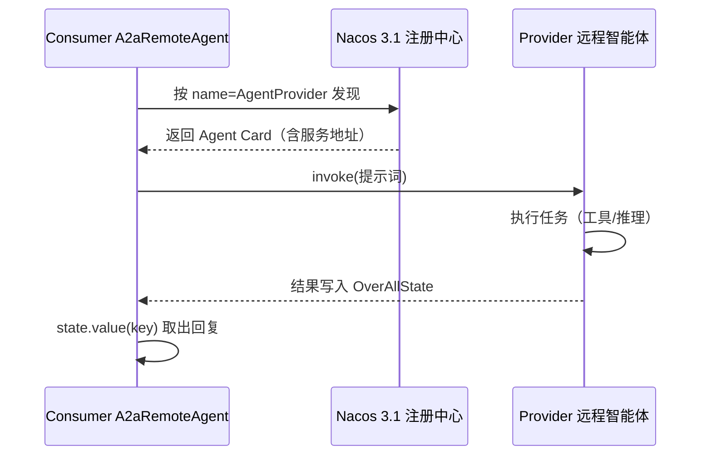

## 【学习目标】

- 完成 A2A Consumer 模块的搭建，理解它与 Provider 模块的依赖同源性。
- 分清 `A2aRemoteAgent` 与 `ReactAgent` 的职责边界：一个专管发现与调度，一个专管执行业务。
- 掌握 `A2aRemoteAgent.builder().name(...).build()` 的创建方式与注册中心地址配置。
- 理解 `OverAllState` 状态对象：KeyValue 结构、在节点间流动、承载远程执行结果。

## 【正文】

### 1. 回顾：三组件与 Consumer 的位置

A2A 通信协议主要用于不同节点之间的智能体通信的统一协议。无论智能体基于不同的语言大模型，还是处于不同节点，都能基于统一的 A2A 协议通信。Spring AI Alibaba 1.1 封装了 A2A 的 API，其中三个核心组件：远程智能体的提供者（Provider）、远程智能体的消费者（Consumer）、注册中心。

两个智能体处于不同节点，如何知道对方存在并正确调用？答案是通过注册中心。Spring AI Alibaba 1.1 建议使用阿里的 Nacos 作为注册中心，版本 3.1，因为 Nacos 3.1 支持智能体 Agent 的模型，可以把智能体模型存入注册中心。借助注册中心的服务提供与服务发现，两个智能体互相发现对方，并通过注册中心存储的智能体模型判断哪一个才是完成任务的目标。

上一篇（4-13）已完成 Provider 侧：创建 `AgentProvider` 智能体（ReactAgent 框架，课程核心，能执行工具、有记忆、感知环境，且能自主规划步骤、自主决策工具选择），并把智能体写进注册中心。本节来做服务发现者，即如何从注册中心发现远程智能体，工作在 A2A 智能体发现者模块中。

Consumer 模块引入的依赖与 Provider 模块完全相同，无需任何改动，主要是两个：Spring AI Alibaba 1.1 的 Agent Framework，以及 A2A 专用的 Nacos 依赖。

### 2. 为什么 Consumer 侧不用 ReactAgent

Consumer 侧要创建的智能体，并非用于执行业务，执行业务的是远程智能体。此处创建的 Agent 只做两件事：发现相应的远程 Agent，并把该 Agent 获取过来。注册中心里可能有多个远程 Agent，必须能定位到需要的那一个，因此它不能用 ReactAgent 框架的 Agent，而要用 Spring AI Alibaba 1.1 针对 A2A 协议封装的 `A2aRemoteAgent` 对象，它能方便地从注册中心里获取远程 Agent。

这一区分是面试高频点：**ReactAgent 是「干活的」，A2aRemoteAgent 是「找人的」**。把 Consumer 侧写成 ReactAgent，等于让一个不需要推理的调度器背上了整套工具与记忆的包袱，方向就错了。

`A2aRemoteAgent` 同样通过 builder 生成实例，代码量只有几行：

```java
    @Service
    public class AgentConsumerServ {
        // 发现远程的A2A Agent
        public void getAgentProvider() {
            // 这里创建的Agent，并不用于执行业务的。
            // 执行业务的是远程的Agent，
            // 用于发现相应的远程的Agent，并获取这个远程Agent
            // ***************
            // 获取远程Agent
            A2aRemoteAgent agentProvider = A2aRemoteAgent.builder()
                .name("AgentProvider")
                .build();

            // 运行远程的Agent
            Optional<OverAllState> res = agentProvider.invoke("提示词");

            // OverALLState属于工作流的状态对象
            // 工作流每个节点的执行结果，多会更新到OverAllState对象里
            // OverALLState对象，在工作流的所有节点进行流动
            // 这样，工作流上一个节点，就可以把执行结果，传递到下一个节点
            res.flatMap(state -> state.value(key: "key"));
        }
    }
```

需要如实说明：以上是讲稿板书代码，最后一行 `state.value(key: "key")` 中的 `key:` 是伪代码标记，并非合法 Java 语法，实际应写作 `state.value("key")`，可结合后续章节的完整写法理解。

流程拆解：先给获取到的远程 Agent 一个 name（`AgentProvider`，与 Provider 侧智能体名称一致）；注册中心地址写在配置文件中，无需硬编码；通过 `invoke` 方法运行远程 Agent，传入提示词，即要让远程 Agent 做什么；`invoke` 会抛异常，方法签名上声明即可；返回值是 `Optional<OverAllState>`。

### 3. 注册中心地址配置

远程 Agent 从哪里获取？从注册中心获取，所以必须知道注册中心的地址。地址在 resources 下的 application.yml 中配置，无需硬编码在代码里。写上这么一段配置：指明其为 A2A 协议，配置中心是 Nacos，给出 Nacos 的地址；主要是必须注明 discovery 开关，将其开启。就这么几行配置，`A2aRemoteAgent` 对象就能到该地址的注册中心中，把远程 Agent 获取过来。

配置要点有两个：一是 Nacos 地址必须与 Provider 侧注册所用的地址一致（本地联调时均为 `127.0.0.1:8848`）；二是 discovery 必须开启（enabled: true），漏掉它，A2aRemoteAgent 不会去注册中心做发现，调用时表现为「找不到远程 Agent」。课程原稿此处未给出配置代码块，实际键名以 Spring AI Alibaba 1.1 文档与 Provider 侧配置（4-13）为准。

### 4. OverAllState：远程结果的载体

`invoke` 返回 `Optional<OverAllState>`，需要理解该泛型。`OverAllState` 是工作流里的状态对象：工作流每个节点的执行结果都会更新到该对象里，它在所有节点之间流动，从而把上一个节点的执行结果传递给下一个节点。后续章节会重点讲解，此处只需知道：A2A 协议中，远程智能体执行完任务后，把结果写入 `OverAllState`。

`OverAllState` 是 KeyValue 格式的：一个 `OverAllState` 对象里存了很多 Key 与对应的 Value。要取出需要的值，必须传入 Key。代码中 `state.value("key")` 就是按 Key 取值，取出的 Value 通常是 String 类型，做一次强制转换即可。这里的「回复」就是从 `OverAllState` 中按 Key 取出的远程执行结果。



## 【易错点 / 面试题】

**面试题 1：Consumer 侧的 Agent 用 ReactAgent 还是 A2aRemoteAgent？**
用 `A2aRemoteAgent`。Consumer 侧的 Agent 不执行业务，只负责发现并获取远程 Agent；执行业务的是 Provider 侧的 ReactAgent。两者分工不同，混用会导致架构方向错误。

**面试题 2：`OverAllState` 是什么？**
工作流的状态对象，KeyValue 结构，在所有节点间流动，负责把上游节点的执行结果传递给下游节点。A2A 中远程智能体的执行结果就写在它里面，取值必须传 Key。

**面试题 3：Consumer 侧必须配置什么？**
注册中心地址（Nacos server-addr）与 discovery 开关（enabled: true）。漏掉 discovery，A2aRemoteAgent 无法从注册中心获取远程 Agent。

**易错点 1：name 写错。** `A2aRemoteAgent.builder().name(...)` 的 name 必须与 Provider 侧智能体名称一致，写错会找不到目标或找到错误的智能体。

**易错点 2：返回值当普通对象用。** `invoke` 返回 `Optional<OverAllState>`，必须先判空（ifPresent / flatMap）再取 Key，直接 get 有空指针风险。

**易错点 3：板书伪代码照抄。** `state.value(key: "key")` 不是合法 Java，`key:` 应删除。

## 【小结】

本节完成 A2A 的「下半场」：Consumer 侧用 `A2aRemoteAgent` 从 Nacos 3.1 发现远程智能体，`invoke` 发起调用，结果落在 `OverAllState` 中按 Key 取出。到这里，「Provider 注册卡片 - Consumer 发现调用」的闭环已经打通，但还有一个关键问题没有回答：注册中心里卡片众多，Consumer 究竟按什么精确锁定目标卡片？答案在下一篇 4-15 的 AgentCard 元数据中。

对应工程 `981-demo` 中，服务发现职责由 `981-demo/src/main/java/com/travel/agent/a2a/InProcessAgentRegistry.java` 承担（`resolve(name)` 按名称解析成员通道，对应课程「从注册中心发现远程 Agent」），生产形态平替为 `981-demo/src/main/java/com/travel/agent/a2a/NacosAgentRegistry.java`；成员的能力描述由 `981-demo/src/main/java/com/travel/agent/a2a/A2aEndpointController.java` 暴露的 `GET /a2a/{agent}/.well-known/agent.json` 端点提供，与 A2A 规范的能力发现路径一致；远程调用通道为 `981-demo/src/main/java/com/travel/agent/a2a/A2aHttpAgentTransport.java`（`/.well-known/agent.json` 取卡片 + JSON-RPC `message/send` 提交任务）。主管 Agent 侧只依赖 `AgentTransport` 抽象（`981-demo/src/main/java/com/travel/agent/a2a/AgentTransport.java`），不关心成员在进程内还是远程，与课程「Consumer 只负责发现与调度」的分层一致。
