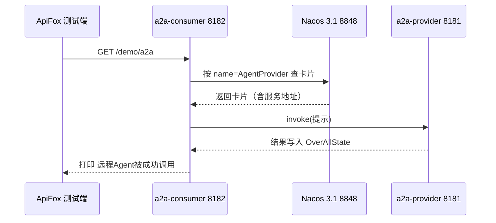

## 【学习目标】

- 跑通 A2A 全链路联调：Nacos 启动 → Provider 注册卡片 → Consumer 发现调用。
- 掌握 Nacos 3.1 控制台的登录方式与 agent 列表的查看方法。
- 记住 A2aRemoteAgent 的三个必填项（description / instruction / shareState）及其报错现象。
- 掌握 IDEA 中双模块同窗运行的配置方法（允许多实例）。

## 【正文】

### 1. 启动 Nacos 3.1

前述课程已完成基于 Spring AI Alibaba 1.1 的 A2A 服务提供者与服务消费者两个模块的搭建，本节进入运行验证。

第一步是启动 Nacos。第一章已演示过通过 Docker 启动 Nacos，复制该命令即可启动。启动日志打印出 Nacos Started successfully，即证明 Nacos 启动成功。

登录控制台通过 8088 端口，用户名与密码均默认为 nacos。首次输入时会先报一个错误，忽略后再次输入即可进入 Nacos 3.1 的控制页面。

从控制台可以看到，Nacos 3.1 支持 MCP 管理，也支持 agent 管理，这正是前述章节强调的能力：Nacos 3.1 支持智能体卡片格式的存储。点击 agent 管理，可以看到 agent 列表，初始为空。该列表就是存储智能体卡片模型的地方，Nacos 通过此模型通知远程智能体执行消费者提交的任务。

### 2. 启动 Provider：智能体卡片自动注册

第二步，运行服务提供者模块（a2a-provider），验证远程智能体能否自动把智能体卡片写入 Nacos 注册中心。

启动前有两处要处理。其一，Provider 侧的智能体由 `ReactAgent.builder()` 创建，其中 tool 方法里的工具配置先注释掉（后续课程详细讲解）；model 方法用于指定远程智能体基于的语言大模型（DeepSeek 或 Qwen），本次只验证卡片注册，暂时不管模型选择。model 需要的参数是 `ChatModel` 对象，它不需要 new，而是以参数形式注入：ChatModel 是一个 bean，Spring 容器启动时已注入，方法参数直接取用即可。

```java
        return ReactAgent.builder()
            .name("AgentProvider")
            .description("")
            .model("") // model 需要的参数是 ChatModel
            .tool(weatherTool) // 先注释Agent工具配置，在后面课程会详细讲述
            .build();
```

其二，根 Maven 配置文件里必须添加 spring-boot-starter-web，否则服务起不来。版本号方面，Spring AI Alibaba 自身对应的 Spring Boot 版本是 3.4.8（其 Nacos 依赖对应 3.4.8），spring-boot-starter-web 可引 3.4.8 或 3.5，问题不大，但一定要引入。

启动完成后，日志会提示智能体卡片已自动注册到 Nacos，这就证明卡片已注入注册中心。智能体卡片的属性（名称、版本号、描述）在 application.yml 中通过 card 配置：

```yaml
        server:
          addr: 127.0.0.1:8848
        username: nacos
        password: nacos
        registry:
          enabled: true
        discovery:
          enabled: true
        server:
          version: 1.0.0
        card:
          name: AgentProvider
          description: "imooc智能体"
          version: "1.0.0"
```

需要如实说明：以上是讲稿板书配置，文件中出现了两个同名 `server:` 键（分别承载 addr 与 version），YAML 中同名键会被后者覆盖，实际编写时应合并到同一层级下，避免键名冲突。

回到 Nacos 控制台，刷新 agent 列表，即可看到远程智能体的卡片已写入。点击详情，可以看到：描述信息与卡片配置中的 description 一致（imooc智能体）；名称为 AgentProvider；版本号 1.0.0；还有一项服务地址，它表明远程智能体的请求地址，Nacos 通过卡片里的服务地址请求远程智能体，让它执行消费者要求的任务。再次强调：卡片名称必须与智能体名称一致。至此，服务提供者侧验证完成。

### 3. 启动 Consumer：按 name 调用远程智能体

第三步，通过服务发现模块（a2a-consumer）找到远程智能体：把智能体卡片的 name 属性传到注册中心，注册中心据此找到对应卡片，再按卡片中的服务地址调用远程智能体执行任务。

调用入口是一个 Controller：创建 Controller 包，写一个接口，之后在 ApiFox 中调用该接口触发服务发现。

```java
        @GetMapping("/demo/a2a")
        public void getRemoteAgent() throws GraphRunnerException {
            serv.getAgentProvider();
        }
```

接口内部调用服务类的方法，服务类中创建 `A2aRemoteAgent` 对象，注意它并非 ReactAgent 架构的执行业务的智能体，只是负责发现并获取远程智能体的对象。

Consumer 侧构建 A2aRemoteAgent 时，除 name 之外还有几项配置：name 对应要查找的远程智能体卡片名称，配置错误会找到其他卡片或找不到卡片；instruction 是给智能体的指令；agentCardProvider 通过 @Autowired 注入；description 描述远程智能体；shareState 控制状态共享。

```java
        // 获取远程Agent
        A2aRemoteAgent agentProvider = A2aRemoteAgent.builder()
            .name("AgentProvider") // 必须要填
            .description("")
            .instruction("bbbb") // 远程智能体的卡片（远程Agent的元数据，名片）
            .agentCardProvider(agentCardProvider)
            .shareState(true)
            .build();
        // 运行远程的Agent
        Optional<OverAllState> res = agentProvider.invoke("提示");
        res.ifPresent(state -> {
            System.out.println("远程Agent被成功");
        });
        // 获取远程Agent执行完成任务之后的结果（从OverAllState对象里获取）
        res.flatMap(state -> state.value("key"))
            .map(v -> (String) v);
```

远程智能体执行完任务后，结果写入 `OverAllState` 状态对象，它是 KeyValue 结构，通过对应 Key 取出 Value。本节课只验证远程智能体能否被成功调用，因此把结果解析部分注释掉，只打印一句话：只要「远程 Agent 被成功调用」被打印出来，就证明远程 Agent 已通过传递过去的卡片 name 被成功定位并调用。

### 4. 三个必填报错：description / instruction / shareState

在 ApiFox 中创建调用接口并发送，第一次运行会报错：description 必须提供。在 service 创建 A2aRemoteAgent 实例时，description 是必填配置，给一个描述即可。

补齐后继续报第二类错误：instruction 也必须填写，这是给智能体的指令。

补齐后报第三类错误：shareState 必须设置为 true。

三项补齐后重新启动，再次发送请求，执行完成无任何报错，控制台打印出「远程 Agent 被成功调用」，因为远程 Agent 并未设置任何动作，本次只验证它是否被调用，返回信息证明调用链路完整走通。



### 5. IDEA 双模块同窗运行

Provider 与 Consumer 两个模块要在同一个 IDEA 窗口中同时运行。操作方式：在模块启动类上右键，Modify 启动配置，把启动类添加进启动配置，点击 OK；随后在 Run 菜单选择运行配置，可以看到两个启动项。接着在两个配置上都勾选「允许多个实例运行」，在 Modify Option 下拉菜单的第一项，勾选后 Apply。

两个实例同时运行，注意端口必须不同：服务发现者（Consumer）端口 8182，服务提供者（Provider）端口 8181。同机运行时端口冲突是最常见的启动失败原因。

## 【易错点 / 面试题】

**面试题 1：A2aRemoteAgent 与 ReactAgent 的区别？**
A2aRemoteAgent 只负责从注册中心发现并获取远程智能体，不执行业务；ReactAgent 是真正干活的智能体（工具、记忆、推理、自主规划与决策）。Consumer 侧用前者，Provider 侧用后者。

**面试题 2：远程智能体的结果放在哪里？怎么取？**
放在 `OverAllState` 状态对象里（KeyValue 结构，在工作流节点间流动）。取值必须传 Key：`res.flatMap(state -> state.value("key")).map(v -> (String) v)`，取出的 Value 通常是 String。

**面试题 3：Nacos 3.1 相对低版本的关键能力？**
支持智能体 Agent 模型，能存储智能体卡片；控制台提供 agent 管理与 MCP 管理入口。低版本没有 Agent 模型，A2A 注册无从谈起。

**易错点 1：三个必填项漏配。** description、instruction、shareState（true）依次报错，属于构建期校验，补齐即可，不要误以为是框架缺陷。

**易错点 2：name 写错。** A2aRemoteAgent 的 name 必须与 Provider 智能体及卡片配置一致，写错会命中其他卡片或找不到卡片。

**易错点 3：根 pom 漏引 spring-boot-starter-web。** Provider 起不来，与 A2A 无关，是 Web 环境缺失。

**易错点 4：同窗运行端口冲突。** Consumer 8182 与 Provider 8181 必须不同；只勾选了一个模块的多实例选项，会导致第二个模块无法启动。

## 【小结】

本节完成了 A2A 协议的端到端验证：Nacos 3.1 启动并登录控制台，Provider 启动后智能体卡片自动写入 agent 列表，Consumer 通过 `A2aRemoteAgent` 按 name 命中卡片并调用远程智能体，日志打印「远程 Agent 被成功调用」。至此，A2A 三组件（Provider / 注册中心 / Consumer）从概念到联调全部闭环。后续章节将回到 ReactAgent 的自主规划与决策细节，并展开 Skills、MCP 工具挂载等能力。

对应工程 `981-demo` 中，联调形态有完整的离线映射：Provider 侧暴露 `981-demo/src/main/java/com/travel/agent/a2a/A2aEndpointController.java`，`GET /a2a/{agent}/.well-known/agent.json` 提供卡片（能力发现），`POST /a2a/{agent}` 以 JSON-RPC `message/send` 接收任务，对应课程「Nacos 按卡片服务地址调用远程智能体」；Consumer 侧调用通道为 `981-demo/src/main/java/com/travel/agent/a2a/A2aHttpAgentTransport.java`；注册与发现在默认 profile 下由 `981-demo/src/main/java/com/travel/agent/a2a/InProcessAgentRegistry.java` 承担，切 `app.agent.discovery=nacos` 后与课程 Nacos 形态一致（见 `981-demo/src/main/java/com/travel/agent/config/NacosBootstrap.java` 与 `NacosAgentRegistry.java`，地址配置在 `981-demo/src/main/java/com/travel/agent/config/AgentProperties.java`）。工程默认离线桩模型，无需 Key 与 Nacos 即可跑通「注册 → 发现 → 调用」全链路，适合作为联调前的回归基线。
