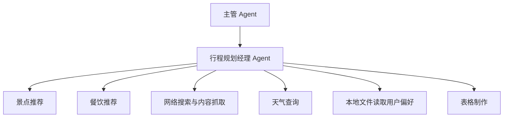

【学习目标】

1. 理解从「路线制定」到「行程规划」的能力跃迁：第二名成员的设计动机。
2. 掌握行程规划经理的角色定义五要素。
3. 掌握其五项能力清单及每项能力解决的问题。
4. 面试中能回答「如何为多 Agent 团队设计成员的角色与能力」。

【正文】

## 一、回顾：复合需求的再切分

旅行规划看上去简单，实则能划分出多个复合需求。以「十一国庆，从深圳到清远自驾游三天，不想旅程安排太满」为例：

- 交通维度：景点之间的交通，以及住宿和景点之间的行程；
- 费用维度：住宿与餐饮费用，重点是能否拿到优惠券，使总体费用降低；
- 行程维度：行程安排与景点推荐，需根据用户偏好与当时天气决定，大风大雨的天气就不适合爬山或漂流。

天气对景点取舍的硬约束，是行程维度区别于路线维度的关键：路线制定只关心「怎么走」，行程规划要决定「去哪、为什么去」。前者输出路线数据，后者输出决策与理由。

针对每一个复合需求，都可以提供一个专门的智能体去解决。路线维度已由路线制定专员（5-2）覆盖，本节处理行程维度。路线维度与行程维度的产出在流程上衔接：行程规划经理先确定玩什么，路线制定专员再据此规划怎么走。顺序不能颠倒，没有候选景点就规划路线，等于让路径优化问题没有输入。

## 二、第二名成员：行程规划经理

第一个被设计的成员是路线规划智能体（5-2），其定义包含两方面：角色定位（专门负责路线规划）与能力清单（地点搜索、经纬度坐标转换、路线规划、距离计算、地图可视化展示）。

第二个成员解决景点推荐，但定位不止于景点推荐，因此命名为行程规划经理 Agent。其角色定义回答五个问题：

1. **根据目的地**给出一系列行程安排，输入是目的地；
2. **包含景点推荐**，且推荐依据是用户爱好、偏好与天气状况；
3. **给出推荐理由**，为什么要推荐该景点，让用户可判断、可调整；
4. **提供景点图片**，供用户直观参考；
5. **制定详细行程安排**，把推荐落成可执行的日程。

角色定义的本质是回答「该智能体是谁、为谁服务、产出什么」：行程规划经理面向用户，输入目的地与偏好，产出带理由、带图片、带日程的完整行程。五要素中，「理由」与「图片」常被初学者忽略，但它们决定了产出的可信度与可用性，没有理由，用户无法校验推荐是否合理；没有图片，用户难以建立直观预期。五要素还可作为验收清单：规划结果若缺少理由或图片，即可判定产出不合格。把角色定义写成可检验的条款，是团队协作中对齐预期的关键。

生产经验：把「推荐理由」作为产出强制项，能显著降低用户返工率。没有理由的推荐，用户只能凭直觉接受或全盘否定；有理由，用户才能精准指出「我不喜欢人文类」之类偏好，智能体据此二次收敛。这在生产里等价于把「可解释性」前置成接口契约，而非事后解释。课程把理由列为五要素之一，正是把这一工程经验固化进角色定义，验收时不只看「推荐了什么」，更看「为什么推荐」，不合格就可直接打回重规划。

## 三、五项能力清单

围绕角色定义，行程规划经理需要五项能力：

| # | 能力 | 解决的问题 | 对应角色定义要素 |
|---|---|---|---|
| 1 | 景点信息网络搜索 | 获取景点基础资料 | 景点推荐 |
| 2 | 抓取景点评价、评论、网络文本与图片 | 为推荐理由提供素材，图片供用户参考 | 推荐理由、景点图片 |
| 3 | 天气查询 | 天气状况参与景点取舍 | 天气驱动的推荐 |
| 4 | 查询用户本地信息（本地文件操作） | 读取用户偏好，实现个性化推荐 | 根据用户偏好推荐 |
| 5 | 表格制作 | 列出详细行程安排 | 详细行程 |

逐项说明：

**网络搜索与内容抓取**是推荐理由的来源。只给景点名单不说理由，用户无法判断是否适合自己；抓取评价与评论才能给出「为什么推荐它」。注意这里抓取的对象分两类：文本（评价、评论）服务于理由，图片服务于参考，两者用途不同但同属内容抓取。

**天气查询**把外部状态引入决策。天气是动态输入，行程规划经理必须在每次规划时实时查询，而非依赖缓存结论，上周的天气预报对本次出行没有参考价值。

**本地文件操作**用于读取用户偏好。用户画像、历史旅行记录存放在本地文件中，智能体读取后转化为推荐权重，这是「个性化」的技术落地方式：偏好不必每次问用户，从本地资料中读取即可。课程后续章节（12 系列）对 Skills 的装载会进一步展开这类本地知识的组织方式。

**表格制作**把行程固化为结构化文档。详细行程安排天然是表格形态（日期、时段、景点、事项），表格制作能力使输出可直接展示与保存。课程 12-3 专门讲解了表格制作 Skills，说明此能力在工程实现上由 Skill 承载。五项能力中，第 4 项（本地文件操作）最容易被忽视，却是个性化的技术基础；每一项能力都能在课程后续篇章找到落点，说明设计不是凭空的。

## 四、与路线制定专员的边界

两名成员的分工：

| 维度 | 路线制定专员 | 行程规划经理 |
|---|---|---|
| 核心问题 | 怎么走 | 去哪、为何去 |
| 输入 | 起终点坐标 | 目的地、偏好、天气 |
| 输出 | 路线方案与可视化 | 景点推荐、理由、图片、详细行程 |
| 典型能力 | 地图类工具（地理编码、路线规划） | 搜索、抓取、本地文件、表格制作 |

边界划分的依据是「决策类型」而非「数据来源」：路线制定处理空间决策（路径），行程规划处理偏好决策（选择）。两者通过接口衔接，行程规划经理产出候选景点清单，路线制定专员据此规划串联路线。

行程规划经理适用于两个需求点：景点推荐，以及餐饮推荐（有什么餐厅可去）。后者是延伸而非兼职，餐厅推荐的逻辑与景点推荐同构：按偏好加外部信息筛选候选、给出理由。把餐饮纳入该成员职责，可避免再设一名逻辑重复的成员。边界也不是绝对的：路线制定专员的 `map_weather` 工具同样返回天气数据，区别在于使用目的，行程规划经理解释天气后决定「去不去」，路线制定专员拿到的是既定终点的通行方案。数据可以共享，决策各归其位。

生产经验：把用户偏好存放在本地文件并由智能体读取，是个性化落地的轻量方案，但生产环境必须警惕权限与隐私边界，本地文件读取能力等同于赋予智能体访问宿主机文件系统的权限，必须通过路径白名单、只读挂载与审计日志约束其范围，避免越权读取凭据或无关文件。课程用本地文件承载偏好是教学取舍；真实产品中更常见的是把画像存进受控的向量库或用户服务，由工具经鉴权接口读取。能力越接近「系统权限」，越要早做隔离，这点在多 Agent 团队里尤其关键，任意一名成员越权，都可能拖垮整个团队的信任底座。

工程中该成员对应 `981-demo/src/main/java/com/travel/agent/agent/TeamMembers.java` 的 `attractionAgent`（课程 12-5「景点推荐 SubAgent 执行景点推荐任务」），工具箱为 `981-demo/src/main/java/com/travel/agent/tool/AttractionTools.java`，其中 `search_attractions` 按城市与偏好检索景点并返回候选列表与票价合计，复刻「按偏好推荐」的最小链路。

## 五、成员在团队中的位置

【易错点 / 面试题】

1. **把行程规划经理窄化成「景点推荐 Agent」**：命名与职责范围不匹配会造成后续扩展困难，餐饮推荐、行程表都落在该成员职责内。命名应反映职责边界，而非首个用例。
2. **推荐不给理由**：缺少理由的推荐用户无法验证，也无法纠偏；推荐理由同时是 Agent 决策过程的对外呈现，抓取评价信息正是为此服务。工程上还应注意抓取内容的时效性与来源标注，避免用过时信息支撑结论；理由中最好能体现信息来源，便于用户判断可信度。
3. **面试题：为什么把天气查询放在行程规划经理而不是路线制定专员？** 天气影响的是「去不去」（景点取舍），属于行程决策；路线制定关心「怎么走」。能力归属按决策归属划分，而非按数据来源划分。同类问题如「优惠监控为什么归费用统筹管家」，监控服务的是费用决策，不是路线决策。

【小结】

本节设计第二名成员：行程规划经理。角色定义五要素（目的地输入、偏好与天气驱动、推荐理由、景点图片、详细行程）对应五项能力（网络搜索与抓取、天气查询、本地文件读取、表格制作、偏好推荐）。该成员覆盖景点推荐与餐饮推荐两个需求点。工程对应 `981-demo/src/main/java/com/travel/agent/agent/TeamMembers.java` 的 `attractionAgent` 与 `981-demo/src/main/java/com/travel/agent/tool/AttractionTools.java`。技术前瞻：行程规划经理的五项能力中，表格制作、本地文件读取等由课程第 12 章的 Agent Skills 承载，实现「专业知识 + 工作流」的可插拔装载；Skills 的渐进式加载让这名成员在轻量请求下不必加载全部能力。把能力沉淀为可装载的 Skill，是多 Agent 系统从「写死工具集」走向「按需装配」的关键一步。下一篇设计第三名成员：费用统筹管家 Agent。
