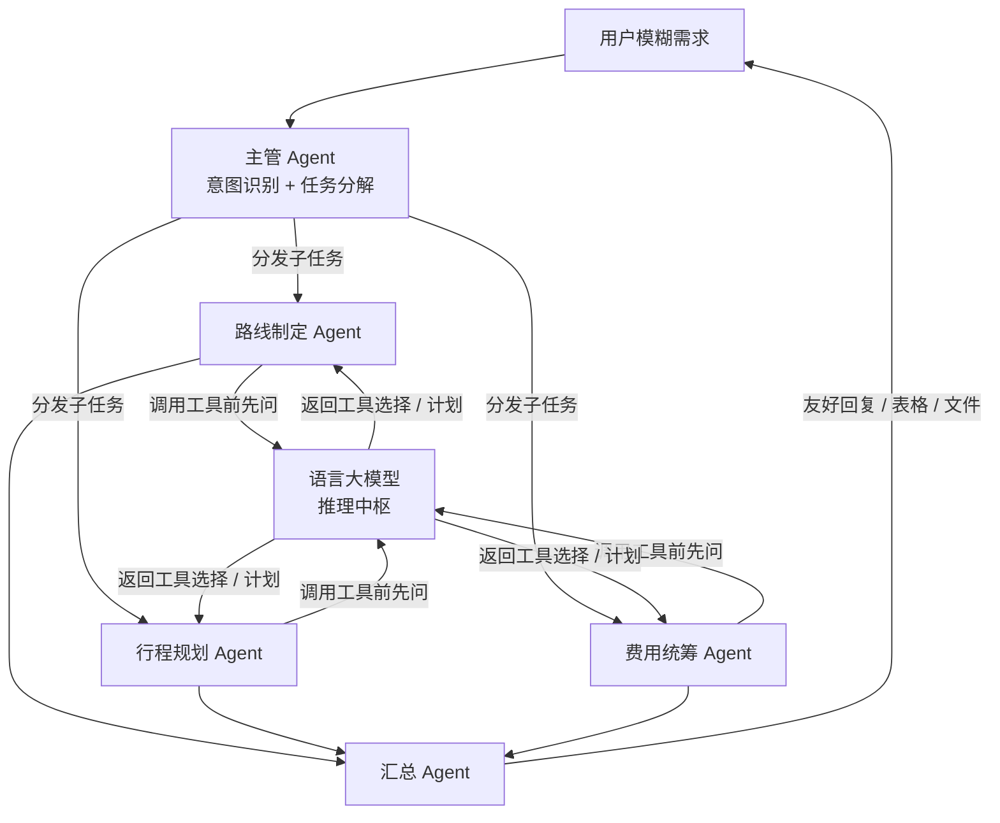

## 【学习目标】

- 理解一个看似简单的复合任务（如旅行规划）如何被拆解为多个子需求，并由不同智能体分工承担。
- 掌握主管-成员（Supervisor-Member）多智能体范式：主管负责意图识别与任务分发，成员各自持有专用工具。
- 说清「语言大模型」与「智能体（Agent）」的分工边界：大模型是推理中枢，智能体具备感知、计划、记忆、执行四类能力。

## 【正文】

旅行规划乍看是一个单一需求，落地时却是一组复合任务。以一次城市周边游为例，至少可以拆出三层子需求：

- **交通与地理层**：景点之间的路线规划、景点筛选（什么样的景点符合用户偏好）、景点之间的最优路线，以及住宿、餐饮与景点之间的相对位置关系。住宿餐饮通常安排在景点附近，但过近则价格偏高，过远则通勤耗时，二者都需要结合景点坐标权衡。
- **费用层**：交通与门票通常是相对固定的支出，真正产生浮动的是住宿与餐饮；因此需要在美团等平台上检索折扣，对总费用做动态测算。
- **行程编排层**：把前面两层的结果综合成「第几天去哪、看什么」的日程，并依据用户偏好和旅行期间的天气筛选景点、抓取图文介绍供用户挑选。

单靠一个智能体难以同时把这三层都做精。更稳妥的做法是「分而治之」：每一个子需求分配给一个擅长该领域的智能体，由它们各自调用专用工具完成。

### 一、一支五人小队：主管 + 四类成员

把上面这套拆解落成工程，团队由五个智能体组成：

| 角色 | 名称 | 职责 | 持有的典型工具 |
|---|---|---|---|
| 主管 | 规划智能体 / Supervisor | 意图识别、任务分解、按能力分发子任务 | 无专用业务工具，只做编排 |
| 成员 | 路线制定智能体 | 景点间路线、餐饮住宿与景点的路线规划 | 地点搜索工具、路线工具（经纬度转换 + 最优距离计算 + 地图展示） |
| 成员 | 行程规划智能体 | 日程编排、依据偏好与天气筛景点、抓取图文 | 检索工具、图文抓取工具 |
| 成员 | 费用统筹智能体 | 输出费用明细表、监控折扣 | 计算工具、文本工具（制表 + 落盘）、编程工具（脚本监控优惠券） |
| 汇总 | 整合 / 汇总智能体 | 把成员结果统一整理成表格、回复或文件 | 文本工具、文件工具 |

其中主管与汇总两个角色是「通用件」，任何复合任务都会需要「把需求拆开」和「把结果收拢」这两步，所以它们天然存在；其余三类成员则随任务领域不同而替换。

在 AgentScope 中，这套结构对应**主管-成员范式**：主管即 `SupervisorAgent`，成员是 `TeamMembers` 中各自独立的 `ReActAgent`。每个成员智能体内部跑的是 ReAct 循环（Think → Act → Observe），它把子任务与「我有哪些工具可用」的描述交给语言大模型，由模型决策本次该调用哪一个工具，再执行并观察返回，如此往复直到子任务完成。AgentScope 用 `Toolkit` 聚合工具、用 `@Tool` 注解声明单个能力，用 `Msg` / `TextBlock` 承载模型与 Agent 之间的对话消息。

### 二、底层逻辑：大模型是中枢，Agent 是四肢

把协作关系继续往下挖，真正的执行链路是这样的：

1. 用户提出一个模糊需求，语言大模型先对其真实意图做分析，并判断能否拆成若干简单子需求。
2. 大模型已知「系统里有哪些智能体、各自有什么能力」，据此制定一份分发计划，回传给主管智能体。
3. 主管按这份计划，把子任务派给最匹配的成员 Agent。
4. 成员 Agent 在执行某一步时，往往要判断「这一步该用哪个工具」，于是再次向大模型请求决策；大模型经过逻辑分析，返回应选的工具。
5. 成员 Agent 拿到决策后，真正去调用工具、取得结果，再进入下一步，直到子任务结束。
6. 所有成员的结果汇聚到汇总 Agent，由它整合为一份友好回复（表格 / 文件 / 自然语言）。

可以看到，整条链路的中枢始终是**语言大模型的逻辑分析**；Agent 并不是单纯的执行中介，它至少补齐了模型不具备的四项能力：

- **感知能力**：主动搜索用户周边信息（天气、坐标、POI），把上下文补回给大模型，辅助其正确决策。
- **计划能力**：把大模型返回的整体计划落地为「派给哪个成员」的具体动作。
- **记忆能力**：大模型每轮只返回一个计划清单，而「当前执行到第几步」必须由 Agent 在本地维护，否则无法续跑。
- **执行能力**：真正去调用工具、拿到外部数据，这是 Agent 与纯对话模型最根本的区别。

**为什么这么设计，不这么写会怎样**：如果让一个大模型一口气把路线、费用、行程全算完，模型既要在内部做长链推理，又要在同一上下文里反复切换工具，极易出现遗漏子项、工具选错、上下文溢出。拆成主管 + 成员后，每个 Agent 只盯自己的一小块领域，工具面更窄、提示更聚焦，错误率与 token 消耗都更可控。生产经验上，这正是多 Agent 系统相对「单 Agent 塞满工具」的优势，**把复杂度从「模型的注意力」转移到「工程的编排结构」上**。

## 【易错点 / 面试题】

1. **面试官常问：主管 Agent 和成员 Agent 的职责边界是什么？**
   答：主管只做「意图识别 + 任务分解 + 按能力分发」，本身不持有业务工具；成员各自持有专用 `Toolkit` 并跑 ReAct 循环完成子任务。混淆二者会导致主管膨胀、成员空转。在 AgentScope 里分别对应 `SupervisorAgent` 与 `TeamMembers` 中的 `ReActAgent`。
2. **为什么 Agent 需要本地记忆，而不能全交给大模型？**
   大模型每轮返回的是「计划清单」而非「执行进度」，跨步骤的进度（已做 / 待做）必须 Agent 自己维护，否则一轮对话结束后状态丢失、无法续跑。对应 AgentScope 中由 Agent 侧维护的对话与步骤状态。
3. **多 Agent 相比「单 Agent + 一堆工具」好在哪？**
   工具面收窄、提示聚焦，降低模型选错工具与上下文溢出的概率；同时便于按领域替换成员、独立扩缩容。

## 【小结】

本节建立了「主管-成员」多智能体的协作骨架：大模型做推理中枢，Agent 补齐感知、计划、记忆、执行四维能力，五人小队把复合任务拆解为可并行执行的子任务。下一篇（5-6）将聚焦这支团队真正调用的外部能力，百度地图 MCP 提供的工具体系，看看路线、天气、POI 这些能力是如何被标准化封装、再挂到成员 Agent 上的。完整离线可跑示例见 `981-demo/src/main/java/com/travel/agent/agent/SupervisorAgent.java` 与 `981-demo/src/main/java/com/travel/agent/agent/TeamMembers.java`；需要跨进程调用远程成员时，可进一步参考 `981-demo` 中以 `A2aAgent` 风格离线复刻的调度形态。
