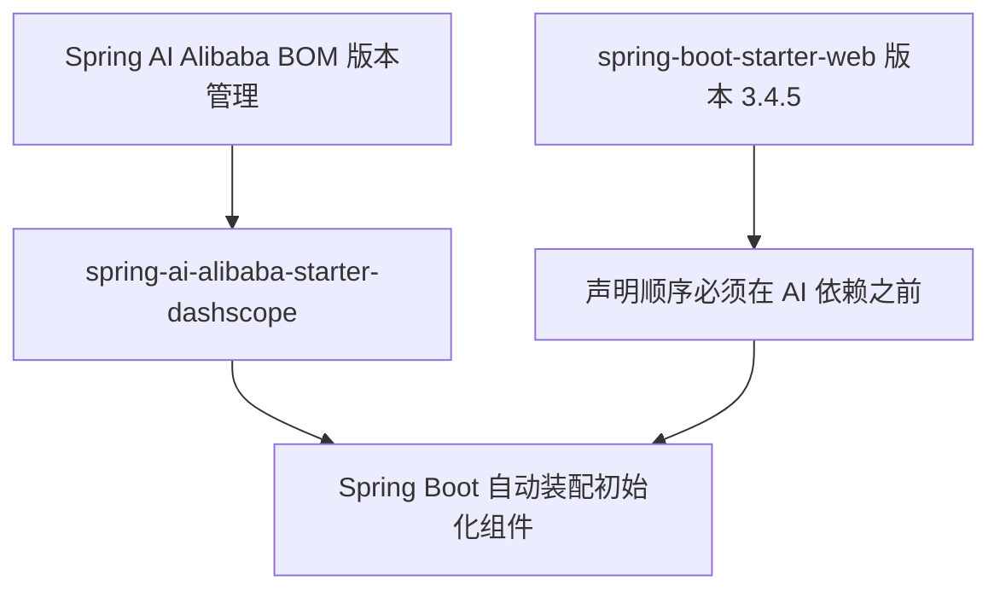

## 【学习目标】

- 掌握 Spring AI Alibaba 与 Spring Boot 整合的正确依赖：用 `spring-ai-alibaba-starter-dashscope`，而非过时的 `spring-ai-alibaba-starter`。
- 踩平两个真实坑：必须引入 `spring-boot-starter-web`，且它的声明顺序要在 AI 依赖之前。
- 理解「以文档版本为准」的原则：框架崭新，依赖版本必须和文档示例严格对应。

## 【正文】

前面课程已经引入了 Spring AI Alibaba 的**版本管理（BOM）**依赖。Spring AI Alibaba 是和大模型交互的开发框架，而任何 Spring AI 应用都跑在 Spring Boot 之上。本节要解决的就是这两者的整合，让 Spring AI Alibaba 的核心组件通过 Spring Boot 的**自动装配**机制完成初始化。

学习这种崭新框架，唯一权威来源是它的官方文档，而且看文档必须**盯紧版本号**，保证文档示例与你实际使用的版本一致，否则极易踩坑。

### 一、选对整合依赖

文档的「快速开始」里演示了整合方式。需要特别警惕一个过时依赖：`spring-ai-alibaba-starter`。在 Maven 中央仓库查它的描述，版本只到 `1.0.0-M6.1`（最后更新 2025-03-10）就停更了，而本项目用的是 `1.0.0.2`，显然不能拿它来整合。

回到对应 `1.0.0.2` 版本的文档，进入「聊天机器人」示例，给出的才是正确依赖：

```xml
        <dependency>
            <groupId>com.alibaba.cloud.ai</groupId>
            <artifactId>spring-ai-alibaba-starter-dashscope</artifactId>
        </dependency>
```

把它放进 `dependencies`，**不用写版本号**，因为前面已经引入 Spring AI Alibaba 的 BOM 做版本管理，这里会自动锁定到 `1.0.0.2`。导入后从 Maven 窗口确认，依赖确实以 `1.0.0.2` 进场。

**为什么不用 `spring-ai-alibaba-starter`**：它是 M6.1 时代的老整合包，早已停更，和 `1.0.0.2` 不兼容；强行使用会导致自动装配类缺失或版本冲突。工程上「依赖版本和框架版本对齐」是铁律，跨版本混用是新框架最常见的坑。

### 二、写出启动类

`spring-ai-alibaba-starter-dashscope` 之所以能整合 Spring Boot，是因为它内部已经依赖了 `spring-boot-starter`，并把 Spring Boot 版本锁定在 `3.4.5`。照文档写一个最简启动类：

```java
        @SpringBootApplication
        public class SpringApplication {
            public static void main(String[] args) {
                SpringApplication.run(SpringApplication.class, args);
            }
        }
```

包名取 `demo.springai`，类名为 `SpringAIApplication`（此处示例沿用 `SpringApplication` 命名以贴近原文档）。直接启动，立刻报错，而且该报错文档里**只字未提**。

### 三、两个必须踩平的坑

**坑一：缺 `spring-boot-starter-web`。**
文档说「引入上述依赖即可整合」，但实际启动报的是日志相关错误。解决办法是补一个 Web 起步依赖。注意版本必须和 AI 依赖内部锁定的 Spring Boot 一致，即 `3.4.5`，把它抽成 `properties` 里的变量 `springboot.version`，统一管理：

```xml
<dependency>
    <groupId>org.springframework.boot</groupId>
    <artifactId>spring-boot-starter-web</artifactId>
    <version>${springboot.version}</version>
</dependency>
```

**坑二：声明顺序必须在 AI 依赖之前。**
加上 Web 依赖后再次启动，日志依赖错误看似还在。真正原因是**顺序错了**，`spring-boot-starter-web` 必须写在 `spring-ai-alibaba-starter-dashscope` **前面**才能正确解析日志相关的传递依赖。调整顺序、重新导入运行，日志错误消失；此时只剩「缺 API Key」的提示（说明 Spring Boot 已正常启动），放大日志可见 8080 端口已打开。

**为什么顺序这么敏感**：Spring Boot 的依赖仲裁与日志门面（SLF4J + Logback）的传递关系对顺序敏感，老整合包在 M6.1 之后调整过依赖结构，文档示例没同步更新这一细节。生产经验是，**新框架的「文档最小可运行示例」往往滞后于真实依赖图，遇到启动期 ClassNotFound / 日志绑定错误，先怀疑依赖顺序与版本对齐，而不是怀疑自己的代码**。



## 【易错点 / 面试题】

1. **面试官常问：Spring AI Alibaba 整合 Spring Boot，为什么不能只用 `spring-ai-alibaba-starter`？**
   答：该 starter 停更于 `1.0.0-M6.1`，与课程使用的 `1.0.0.2` 不兼容；正确整合包是 `spring-ai-alibaba-starter-dashscope`，它内部已带 `spring-boot-starter` 并锁定 Boot 3.4.5。
2. **两个启动期报错的根因分别是什么？**
   第一是缺 `spring-boot-starter-web` 导致 Web/日志基础设施不全；第二是 Web 依赖声明顺序在 AI 依赖之后，日志门面传递解析异常。二者顺序调整 + 补 Web 依赖即可解决。
3. **为什么 Web 依赖的版本要统一成变量？**
   因为 AI 依赖内部锁定的 Spring Boot 是 3.4.5，Web 依赖若不显式对齐，可能出现 Boot 版本不一致引发的仲裁冲突。

## 【小结】

整合 Spring AI Alibaba 的正确姿势是：用 `spring-ai-alibaba-starter-dashscope`（版本由 BOM 锁定），补 `spring-boot-starter-web`（版本变量统一为 3.4.5），且 Web 依赖声明在 AI 依赖之前。这两个坑本质是「新框架文档滞后于真实依赖图」，记住即可少走弯路。注意：981-demo 是以 AgentScope 栈离线复刻同类多 Agent 能力的，而本节讲的是 Spring AI 栈的整合路径，二者框架不同不可混用；下一节（6-3）将用 `ChatModel` 真正发出第一次大模型对话。
