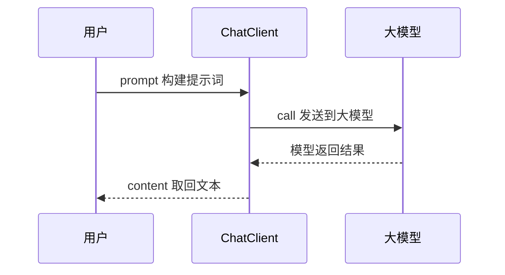

## 【学习目标】

- 区分 `ChatModel` 与 `ChatClient` 的获取方式：`ChatModel` 走构造注入，`ChatClient` 走 `builder().build()`。
- 理解 Builder 模式相对 `new` + setter 的三大优势：避免繁琐赋值、线程安全、避免默认值 `null`。
- 掌握 `ChatClient` 的链式调用：`prompt()` → `call()` → `content()` 一气呵成完成对话。

## 【正文】

上一节用 `ChatModel` 完成了首次对话。回顾那条链路：用户请求先包成 `UserMessage`，再包成 `Prompt`，然后交给 `ChatModel.call(prompt)`，最后从 `ChatResponse` 里抠出文本。`UserMessage` 和 `Prompt` 要自己 `new`，而 `ChatModel` 是通过构造方法注入的，之所以能注入，正因为在依赖里引入了下方整合包：

```xml
        <dependency>
            <groupId>com.alibaba.cloud.ai</groupId>
            <artifactId>spring-ai-alibaba-starter-dashscope</artifactId>
            <version>1.0.0.2</version>
        </dependency>
```

### 一、为什么 `ChatClient` 不走构造注入

有人会疑惑：`ChatModel` 不是在成员变量里用 `@Autowired` / `@Resource` 注入吗，为什么课程里它是写在构造方法参数里的？这是 Spring Boot 注入的基础知识，除了字段注入，更推荐的是**构造方法参数注入**，把它赋值给 `final` 成员变量，这正是上节的做法。

而该整合包通过自动装配生成**两个**对象：一个是 `ChatModel`，另一个就是本节的 `ChatClient`。`ChatModel` 用构造注入，但 `ChatClient` 不是，它要先调用静态 `builder()` 方法，再调 `build()` 拿到实例。这牵出 Java 里一个常见的基础模式：**Builder 模式**。

```java
        this.chatClient = chatClient.build();
        // 或者带配置的构建方式
        this.chatClient = chatClient.defaultSystem().defaultAdvisors().build();
```

### 二、为什么用 Builder 而不是 `new` + setter

开源框架里越来越多对象不用 `new`，而是 `builder()` → `build()` 两步创建。`ChatClient` 的 `builder` 本身是个内部类。相比 `new` 之后逐个 `setXxx`，Builder 模式恰好规避了三个痛点：

1. **属性多则赋值繁琐**：一个 `User` 对象若有生日、年龄、学历、健康、性别等一堆属性，用 `setAge()`、`setBirthday()` 逐个设置，代码又丑又啰嗦；Builder 把这些收进一条流畅的方法链。
2. **`set` 在并发下状态不一致**：线程 A 调 `setAge`、线程 B 调 `setBirthday`，若没有线程保护，两个属性可能都没更新到新值。Builder 先攒齐配置再一次性 `build()` 出**不可变对象**（属性全是 `final`），不会被其他线程篡改，这是它与 `new` 最根本的区别。
3. **默认值不会是 `null`**：`new` 出来的对象若某些属性没设，默认就是 `null`，后续业务极易 NPE；Builder 通常给每个属性提供合理默认值。

**为什么 `build()` 之后属性不可改**：`build()` 产出的是不可变对象，所有配置必须在 `build()` 之前通过 `defaultSystem()`、`defaultAdvisors()` 等方法设好；一旦 `build()`，再想改只能重新 `builder()`。这也提示我们：即便用了 Builder，高并发下若共享同一个「正在构建」的 builder 实例，仍然可能出现值未更新的问题，builder 本身是构建期工具，构建出的客户端才该被共享。

### 三、用 `ChatClient` 链式对话

`ChatClient` 同样可以作为成员变量，但它由 `builder().build()` 创建。有了它，对话可以浓缩成一行链式调用：先 `prompt()` 构建提示词，再 `call()` 发往大模型，最后 `content()` 取回文本，`content()` 直接返回 `String`，比 `ChatModel` 那套 `getResult().getOutput().getText()` 简洁得多。



```java
        @GetMapping("/simple/chat")
        public String simpleChatByChatClient() {
            // 构建prompt -> 发送到大模型 -> 获取大模型返回
            String message = "在咖啡馆里，想要杯星巴克";
            // 链式调用
            return this
                .chatClient
                .prompt() // 构建prompt
                .call()   // 发送到大模型
                .content(); // 获取返回内容
        }
```

`prompt()` 既可以直接吃字符串，也可以吃一个完整的 `Prompt` 对象；这里用字符串最省事。启动 Spring Boot，用 Apifox 调该接口，大模型同样能正确返回结果。

**为什么 `ChatClient` 比 `ChatModel` 更适合写业务**：`ChatClient` 把「建提示词、发请求、取结果」收敛成一条可读的链式调用，还内建了 `defaultSystem()`（系统提示）、`defaultAdvisors()`（顾问链，如记忆、日志、RAG）等扩展点；而 `ChatModel` 更偏底层、更接近一次裸调用。生产里多数对话入口直接用 `ChatClient`，把横切能力（记忆、安全、可观测）挂进 Advisor 链即可，这正是 Spring AI 2.x 把工具循环、结构化输出重试等都收敛到 Advisor 的设计初衷。

## 【易错点 / 面试题】

1. **面试官常问：`ChatModel` 和 `ChatClient` 获取方式有何不同？**
   答：`ChatModel` 由自动装配生成、经构造方法注入；`ChatClient` 由 `ChatClient.builder().build()` 构建，属性在 `build()` 前设好、`build()` 后不可变。
2. **Builder 模式相对 `new` + setter 的三个优势？**
   避免多属性繁琐赋值、构建出的对象不可变因而线程安全、`null` 默认值问题被消除。
3. **`content()` 和 `ChatModel` 取文本的方式有何区别？**
   `ChatClient.content()` 直接返回 `String`；`ChatModel` 需 `getResult().getOutput().getText()` 且要判空，前者更简洁。

## 【小结】

本节厘清了 `ChatClient` 的获取与用法：它和 `ChatModel` 同源自动装配，但走 Builder 模式构建不可变实例，并以 `prompt()` → `call()` → `content()` 的链式调用极大简化对话代码。Builder 模式解决的是「多属性繁琐、并发状态不一致、默认值 `null`」三类 `new` 的痛点。需要说明：981-demo 是以 AgentScope 栈离线复刻同类能力的，本节是 Spring AI 栈的 `ChatClient` 讲解，框架不同不可混用；技术前瞻上，Spring AI 2.x 把工具循环、记忆、RAG 等都统一进 Advisor 链，后续 2.1 / 3.0 还计划引入 Message Parts 与「Spring AI Agents」方向，与课程前半段的多 Agent + Skills 主线一脉相承。第 6 章的 `ChatClient` / `ChatModel` 两大交互窗口就此讲完，后续章节将回到 AgentScope 栈，看主管如何调度远程成员、挂载 MCP 工具。
