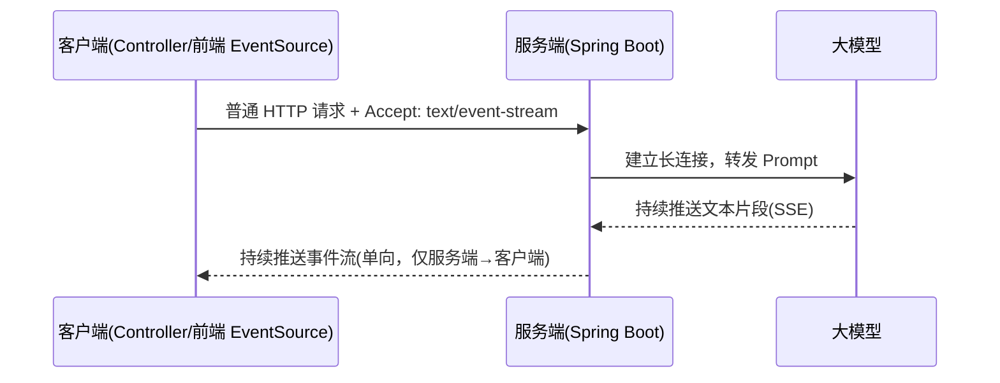

## 【学习目标】

- 弄清 `ChatClient` 与 `ChatModel` 的封装关系，明确日常对话统一基于 `ChatClient`。
- 掌握 SSE（Server-Sent Events）长连接与单向通信的原理，理解「逐字输出」是后端协议能力而非前端把戏。
- 用 `ChatClient.stream()` 把一次性返回切换为 `Flux<String>` 流式返回，并正确设置 `MediaType.TEXT_EVENT_STREAM_VALUE`。

## 【正文】

### 一、ChatClient 与 ChatModel 的关系

前面分别用 `ChatModel` 和 `ChatClient` 与大模型对话。两者并非并列关系：`ChatClient` 底层就是对 `ChatModel` 的封装。进入 `ChatClient` 的 `create` 方法即可看到，它接收的入参正是 `ChatModel`，因此 `ChatClient` 是构建在 `ChatModel` 之上的高层门面。

使用 `ChatClient` 的优势在于链式调用：不再需要单独 `new Prompt`、单独 `new UserMessage`、单独取回 `ChatResponse`，一条链就能完成「构建 Prompt → 发送 → 取文本」。

```java
        String res = "";
        String message = "在咖啡馆里，想要杯星巴克";
        res = this.chatClient
            .prompt(message) // 构建prompt
            .call()         // 发送到大模型
            .content();     // 获取大模型文本返回
        return res;
```

**为什么这么写**：`ChatClient` 把「拼 Prompt、发请求、解析响应」三步收敛成一条 `prompt().call().content()` 链，代码可读性高、出错点少。生产项目里几乎都从 `ChatClient` 入手，把 `ChatModel` 当作注入进来的「大脑」即可。

**不这么写会怎样**：若直接操作 `ChatModel`，每次都要手工构造 `UserMessage`、调用 `call(Message)`、再从 `ChatResponse` 里 `getResult().getOutput().getText()` 取值，样板代码多、容易漏字段。在需要拼接系统提示词、记忆、工具的多轮场景里，裸 `ChatModel` 的可维护性明显不如 `ChatClient`。

### 二、为什么要流式响应

无论 `ChatModel` 还是 `ChatClient`，通过 Apifox 调接口时，大模型默认是「一次性返回」。当答案很长（如一份旅游行程、一段代码），客户端要等全部生成完才拿到结果，首字延迟（TTFT）很高，体验像「卡住」。

而网页端看到的「打字机」效果，本质是后端能力：大模型边生成边推送片段。`Spring AI` 将该能力封装为 `stream()`，底层依赖 SSE 协议。

### 三、SSE 协议原理

SSE 是 MCP 那一章已经出现过的协议，MCP 客户端与服务端正是基于 SSE 做流式互动。它的两个核心特征必须记牢：

1. **基于 HTTP 长连接**：服务端不是应答完就断开，而是保持连接持续推送。
2. **单向通信**：连接建立后，客户端只负责收，服务端只负责推，客户端不能经此通道再发消息。

SSE 通道的建立过程如下：



客户端如何告诉服务端「我要的是 SSE 长连接而非普通响应」？在请求头带 `text/event-stream`。Spring Boot 侧通过 `MediaType.TEXT_EVENT_STREAM_VALUE` 声明返回类型即可。

### 四、用 ChatClient.stream() 实现流式

先写一个「看起来对、其实没流式」的接口，它仍用 `call().content()`，声明了 `Flux<String>` 却返回 `String res`：

```java
        @GetMapping("/simple/stream")
        public Flux<String> streamChat() {
            String res = "";
            // 构建prompt -> 发送到大模型 -> 获取大模型返回
            // 用户输入
            String message = "在咖啡馆里，想要杯星巴克";
            // 链式调用
            res = this.chatClient
                .prompt(message) // 构建prompt
                .call()         // 发送到大模型
                .content();     // 获取大模型文本返回
            return res;
        }
```

**为什么这么写是错的**：`call()` 是一次性阻塞返回，`content()` 拿到的是完整 `String`。即使方法签名写成 `Flux<String>`，内部仍一次性取完才返回，SSE 通道里只会收到「一个完整报文」，看不到逐字推送。

正确做法是把 `call()` 换成 `stream()`，让 `content()` 直接返回响应式流 `Flux<String>`，并将该 `Flux` 作为方法返回值原样返回：

```java
        @GetMapping("/simple/stream", produces = MediaType.TEXT_EVENT_STREAM_VALUE)
        public Flux<String> streamChat() {
            // ...
        }
```

**为什么必须加 `produces = TEXT_EVENT_STREAM_VALUE`**：这是 SSE 的「握手信号」。缺少它，客户端（如 Apifox、浏览器 `EventSource`）会按普通 HTTP 一次性收尾，逐字效果消失；加上它，框架才会以 `text/event-stream` 编码分块推送，前端 `EventSource.onmessage` 才能逐段触发。

**生产经验**：`Flux` 来自 Reactor，天然支持背压（back-pressure），消费者处理慢时上游自动降速，避免把连接或内存打爆。实战中要给 `stream()` 链路配超时与熔断（如 resilience4j 的 `TimeLimiter`），否则某个大模型响应挂起会长期占用连接；前端也要处理 `onerror` 自动重连，因为 SSE 连接可能因网络闪断关闭。

启动 Spring Boot、用 Apifox 请求 `/simple/stream`，即可看到返回值不再是整段一次性到达，而是像打印机一样逐字流式返回。

## 【易错点 / 面试题】

1. **SSE 与 WebSocket 有什么区别？**
   SSE 是单向（服务端→客户端）、基于 HTTP、自动重连，适合「服务端推送进度/文本」；WebSocket 是全双工、需独立协议握手，适合聊天等双向实时。面试常问「为什么流式输出用 SSE 不用 WebSocket」，因为大模型输出本就是单向推送，SSE 更轻、更契合 HTTP 生态。

2. **为什么流式接口返回 `Flux<String>` 而不是 `List<String>`？**
   `List` 要等全部元素就绪才能返回，违背「边生成边推」；`Flux` 是响应式流，元素逐个发射，配合 SSE 实现首字即显、背压可控。

3. **方法声明了 `Flux<String>` 却用 `call().content()` 返回 `String`，会流式吗？**
   不会。必须是 `stream().content()` 拿到 `Flux` 并直接返回，且 `@GetMapping` 要带 `produces = TEXT_EVENT_STREAM_VALUE`，二者缺一不可。

## 【小结】

本章打通了「从 `ChatModel` 到 `ChatClient` 再到 `stream()` 流式」这条主线，SSE 长连接 + 单向通信是后续所有 Agent 实时输出的底层通道。下一章（6-6）进入 SpringAI Alibaba 1.1 的 `ReactAgent` 时代，其流式输出同样是 `Flux`（泛型为 `NodeOutput`），与本章 `Flux<String>` 同源。完整离线可跑示例见 `981-demo/src/main/java/com/travel/agent/agent/SupervisorAgent.java`，该 demo 以 AgentScope 栈复刻了同类「主管调度成员、结果流式回传」的形态，与本章 Spring AI 的 `Flux` 流式机制一脉相承（注意：981-demo 是 AgentScope 工程，并非 Spring AI 工程）。
