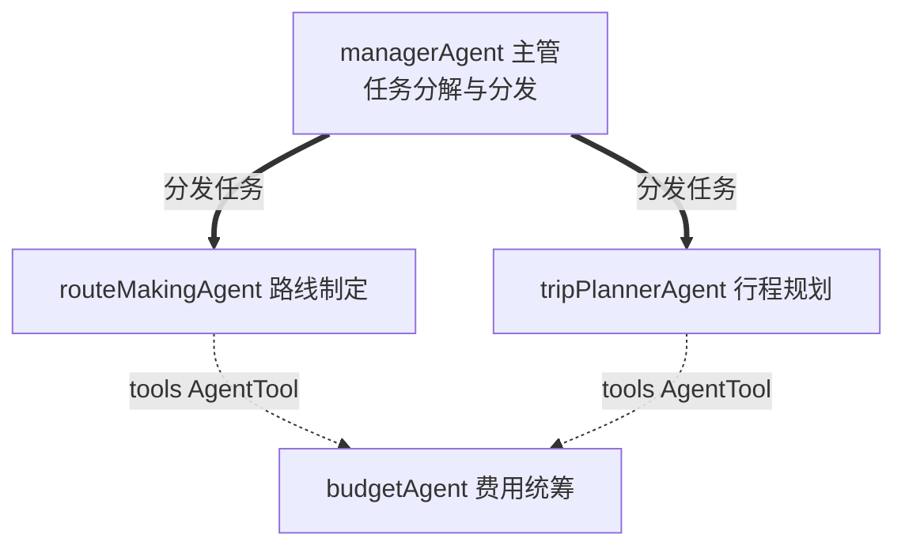

## 【学习目标】

- 掌握单个 `ReactAgent` 的完整配置项：`name / model / tools / hooks / systemPrompt / saver`，理解 `hooks` 对应 RAG 感知。
- 用 `ReactAgent.builder()` 创建旅游规划的四成员团队：路线制定、行程规划、费用统筹、主管。
- 理解 `description` 对大模型调度的决定性作用，以及用 `AgentTool.getFunctionToolCallback` 把一个 Agent 作为工具嵌入另一个 Agent。

## 【正文】

### 一、单个 ReactAgent 的配置全貌

上一节创建了最简单的 `ReactAgent`。回顾其全部配置能力：大脑 `model`（语言大模型，负责推理）、手脚 `tools`（调工具）、眼睛耳朵 `hooks`（RAG 知识感知）、系统提示 `systemPrompt`、记忆 `saver`（多轮一致性）。这些 builder 方法共同组装出一个 ReAct 范式的智能体，具备规划与自主决策能力，是 Agentic AI 的基本单元。

```java
    ReactAgent agent = ReactAgent.builder()
        .name("weather_agent")           // Agent的名称（必需）
        .model(chatModel)                // Agent的大脑（语言大模型）
        .tools(weatherTool)              // Agent的手脚（调用工具）
        .hooks()                         // Agent的眼睛和耳朵（RAG）
        .systemPrompt("You are a helpful assistant") // 系统提示词
        .saver(new MemorySaver())        // Agent的记忆（多轮对话）
        .build();
```

**为什么 `name` 必填**：它是 Agent 的唯一 ID，团队调度、工具嵌入、日志追踪都靠它寻址，缺失无法被引用。

**为什么 `hooks` 代表 RAG**：`hooks` 让 Agent 在执行前/后挂载外部知识钩子（如向量检索结果注入），相当于给 Agent 装「眼睛耳朵」去感知私有知识库，是 RAG 在 Agent 层的落点。

### 二、组建旅游规划四成员团队

旅游规划的业务背景已经定下四个角色：路线制定专员、行程规划经理、费用统筹管家、以及负责任务分解与分发的主管。用 1.1 把它们建出来。先建三个业务 Agent 与一个主管：

```java
    // 路线制定agent
    ReactAgent routeMakingAgent = ReactAgent.builder()
        .name("routeMakingAgent")
        .description("你是负责制定旅游出行路线")
        .tools()
        .build();

    // 行程规划agent
    ReactAgent tripPlannerAgent = ReactAgent.builder()
        .name("tripPlannerAgent")
        .description("你是负责规划旅游行程")
        .tools()
        .build();

    // 费用统筹agent
    ReactAgent budgetAgent = ReactAgent.builder()
        .name("budgetAgent")
        .description("你是负责统筹旅游费用")
        .tools()
        .build();

    // 主管agent
    ReactAgent managerAgent = ReactAgent.builder()
        .name("managerAgent")
        .description("你是主管，负责协调所有子agent")
        .tools()
        .build();
```

**`description` 为什么至关重要**：真正的逻辑判断在语言大模型手里。大模型靠 `description` 判断「这个 Agent 能干什么、能力边界在哪」，财务 Agent 不会被派去写代码。调度时「什么任务分给谁」，完全由大模型读 `description` 推理决定。生产里 `description` 写得模糊，会导致任务错派、循环空转，是 Agent 团队最常见的一类隐性 Bug。

**为什么这里 `tools()` 先留空**：本节的重心是「组队」而非「挂工具」，留空不影响团队结构搭建；真实项目里每个成员会挂自己的工具（如路线 Agent 挂地图 MCP、费用 Agent 挂报价 API）。

### 三、把一个 Agent 作为工具嵌入另一个 Agent

三个业务 Agent 的合作逻辑：路线制定、行程规划在执行时都会涉及费用计算，因此把「费用统筹 Agent」作为工具嵌入前两者，需要时直接调用它算账，而非各自重写算账逻辑。

```java
    // 将一个添加工具
    .tools(AgentTool.getFunctionToolCallback(budgetAgent))
```

`AgentTool.getFunctionToolCallback` 返回 `ToolCallback` 对象，正好能塞进 `tools(...)` 参数。把 `budgetAgent` 传入，就完成了「Agent 即工具」的嵌入：路线制定 Agent 在业务执行中遇到费用计算，会自动调用费用统筹 Agent。

**为什么用 `AgentTool` 而非普通 `FunctionToolCallback`**：普通工具是「一个函数」，而这里要复用一整个 Agent（它本身有推理、记忆、可能再挂工具）。`AgentTool` 把子 Agent 包装成可被父 Agent 调用的工具，实现「Agent 嵌套 Agent」的层级协作，这正是 Supervisor/Worker 范式的雏形。

**生产经验**：嵌入式子 Agent 要避免「双向互相嵌入」（A 嵌 B、B 又嵌 A），否则会陷入无限递归调用。一般单向：基层成员嵌入公共能力 Agent（如费用、检索），主管不嵌入成员、只负责路由分发。

团队结构可归纳如下：



## 【易错点 / 面试题】

1. **Agent 的 `description` 写错会有什么后果？**
   大模型靠它做任务-角色匹配。描述不准会导致任务错派、重复派或无人认领，表现为「明明有对应 Agent 却没被调用」或「调了不该调的 Agent」。面试常追问「如何让多 Agent 调度稳定」，答案之一就是把 `description` 写精确、可区分。

2. **AgentTool 与普通 ToolCallback 的区别？**
   普通 `ToolCallback` 封装单个函数；`AgentTool.getFunctionToolCallback` 把一整个 `ReactAgent` 包装成工具，实现 Agent 间嵌套调用，是 Supervisor-Worker 协作的关键手段。

3. **为什么费用 Agent 被嵌入而不是独立调用？**
   路线、行程都依赖费用计算，嵌入后两处复用同一逻辑，避免重复实现、保证算账口径一致；主管分发时也更聚焦「业务路由」而非细节核算。

## 【小结】

本章用 `ReactAgent.builder()` 搭出四成员团队，并用 `AgentTool` 把费用统筹 Agent 作为工具嵌入路线/行程 Agent，迈出「Agent 协同」第一步。下一章（6-8）将补齐协同的另外两层逻辑：用 `ParallelAgent` 让路线与行程并行、用 `LlmRoutingAgent` 让主管动态路由、用 `SequentialAgent` 把整条流程串起来。完整离线可跑示例见 `981-demo/src/main/java/com/travel/agent/agent/TeamMembers.java`，该 demo 以 AgentScope 栈复刻了同类「主管 + 路线/行程/费用成员」团队，与本章 `ReactAgent` 组队范式同源（注意：981-demo 是 AgentScope 工程，并非 Spring AI 工程）。
