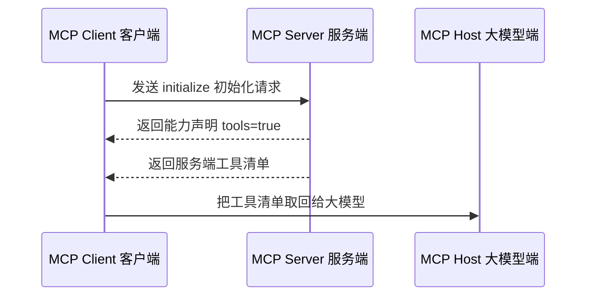

【学习目标】
- 厘清 MCP 协议的三方角色（Host / Client / Server）及其协作时序。
- 在 Spring AI Alibaba 工程中独立引齐 MCP Client 依赖，让客户端通过 SSE 连上自定义 MCP 服务端。
- 通过启动日志验证客户端与服务端的握手（initialize），建立「服务端工具清单 → 客户端 → 大模型」的通路。
- 规避两个真实工程坑：客户端依赖被 webflux 起步包重复传递引入、文档配置缺失的 enabled 总开关。

【正文】

前文基于 Spring AI Alibaba 编写了 MCP 服务端（Demo-MCP 工程），定义了 SSE 地址并在 JManus 中导入。该服务端用 `@Tool` 注解声明两个工具，获取指定城市温度、获取指定城市紫外线值，并通过 `MethodToolCallbackProvider` 把它们登记进服务端工具清单。

```java
        @Tool(description = "获取指定城市的温度")
        public String getTemperature(@ToolParam String cityName) {
            return cityName + "温度值：";
        }

        @Tool(description = "获取指定城市的紫外线值")
        public String getUltraviolet(@ToolParam String cityName) {
            return cityName + "紫外线值：";
        }
```

**为什么这么写**：`@Tool` 是 Spring AI 把普通 Java 方法暴露为模型可调用工具的标准注解；`@ToolParam` 标注的入参进入工具 schema，模型据此决定填参。`MethodToolCallbackProvider` 负责把方法扫描、封装成 `ToolCallback` 集合并注册到服务端清单。若不走这套封装、手搓 JSON schema，则失去编译期类型安全，方法签名一改就要同步改 schema，极易脱节。

### 一、重启服务端，确认工具已注册

启动服务端后，日志显示 Netty 在 8081 端口启动，并打出工具清单数量为 2：

```
        Netty started on port 8081 (http)
        Started WeatherMCPApplication in 3.185 seconds
```

**为什么是 Netty 而非 Tomcat**：MCP 服务端的 SSE 通信由 `spring-ai-starter-mcp-server-webflux` 提供，底层是响应式 WebFlux，容器故为 Netty 而非 Spring MVC 默认的 Tomcat。SSE 是长连接、服务端主动推送，响应式线程模型在此比每连接一线程的 Tomcat 更省资源。端口固定 8081，后文客户端连接地址须与之对应。

### 二、MCP 的三方角色与连接目标

按 MCP 协议，一次完整工具调用链路涉及三个节点：

- **MCP Host**：大模型所在端，消费工具的一方；
- **MCP Client**：负责与服务端建立并保持连接、拉取工具清单的客户端；
- **MCP Server**：承载真实工具实现、等待被调用的服务端。

服务端已就绪，本节目标是让客户端启动并连上服务端，从而把工具清单取回给大模型，大模型只有拿到清单，才知道外界有哪些能力可用。

客户端写在独立工程 Demo-SpringAI 中，与服务端是两个进程。回到服务端复习依赖：无论客户端还是服务端，都须引入 MCP 底层依赖 `spring-ai-mcp`；该依赖属于 Spring AI 核心包（非 Alibaba 包），因此要在 `dependencyManagement` 的 BOM 中引入 Spring AI 版本管理。客户端同样引底层依赖，再引 SSE 客户端起步包。

```xml
        <!-- MCP的底层依赖 -->
        <dependency>
            <groupId>org.springframework.ai</groupId>
            <artifactId>spring-ai-mcp</artifactId>
        </dependency>

        <!-- 基于SpringBoot 的Webflux -->
        <dependency>
            <groupId>org.springframework.ai</groupId>
            <artifactId>spring-ai-starter-mcp-client</artifactId>
        </dependency>
```

**依赖去重的生产经验**：文档提到的 `spring-ai-starter-mcp-client` 单独依赖其实不必再引。在 Maven 依赖树中，该包依赖项已呈灰色（标注重复导入），说明 `spring-ai-starter-mcp-client-webflux` 已传递引入它。客户端与服务端对称，服务端引 `…-server-webflux`，客户端引 `…-client-webflux`，二者都基于 WebFlux 实现 SSE。重复声明只会让依赖树变脏，排查冲突时更难读。

### 三、写入客户端配置

把文档里的 MCP 客户端配置写入 `application.yml`：

```yaml
        # MCP服务器名称
        name: imooc-weather-mcp-server
        version: 0.0.1
        type: SYNC

        # MCP 客户端
        mcp:
          client:
            sse:
              connections:
                url: http://localhost:8081
```

**配置要点**：`url` 必须指向服务端端口 8081；`connections` 下的键（此处 `imooc-weather-mcp-server`）即服务端名称，必须与服务端 `name` 完全一致，客户端靠它定位连到哪个服务端。`type: SYNC` 表示客户端以同步阻塞方式调用工具。

大模型配置同样写在 `application.yml`：

```yaml
        # 阿里百炼大模型服务平台 API-Key申请文档
        # https://help.aliyun.com/zh/model-studio/get-api-key
        api-key: chat
        options:
          model: deepseek-r1 # 指定DeepSeek的模型名称
```

**文档没写但必须补的坑**：仅上述配置不够，还需补齐 `enabled: true` 之类的总开关（原文强调此配置文档未提及、自行踩坑补齐）。MCP 客户端若未显式开启，地址写对也不建立连接。

### 四、启动客户端，验证握手

启动客户端（Demo-SpringAI 启动类），它基于 Tomcat 在 8080 端口，与服务端 Netty/8081 成两个独立进程：

```
        ServerCapabilities[completions=true, prompts=true, resources=true, tools=true]
        Started SpringAiApplication in 4.481 seconds
```

**如何证明握手成功**：客户端日志出现从服务端返回的 capabilities 信息，含 server 名称、版本及 `tools=true` 等能力标记；服务端日志同步出现「收到客户端初始化（initialize）请求」。双向日志印证握手完成：客户端已拿到服务端能力声明与工具清单。若只见客户端启动、却无 initialize 交互日志，优先排查 `enabled` 开关与 `url` 端口。



【易错点/面试题】
1. **面试问：MCP 的 Host、Client、Server 各司何职？** 答：Server 实现工具能力，Client 维护连接与工具清单拉取，Host（大模型端）消费工具。客户端与服务端是独立进程、靠 SSE 长连接通信，区别于同进程内 `@Tool` 直接注册。
2. **坑：客户端依赖重复声明。** `…-client-webflux` 已传递引入 `…-client`，再手写一次只是噪音；排查冲突先 `mvn dependency:tree` 看灰项。
3. **坑：文档配置漏 enabled。** 地址/名称都对却连不上，八成是客户端总开关未开，或 `connections` 键名与服务端 `name` 不一致。

【小结】
本节打通了 MCP 客户端→服务端的 SSE 握手，工具清单已回到客户端，下一篇即可交给大模型调用。生产上 MCP 让外部能力以标准化协议接入，是多 Agent 统一工具底座的前提。本课程的 981-demo 以 AgentScope 离线桩复刻「百度地图 MCP 工具挂载」形态，路径见 `981-demo/src/main/java/com/travel/agent/tool/RouteMakingTools.java` 与 `981-demo/src/main/java/com/travel/agent/tool/AttractionTools.java`。技术前瞻：Spring AI 2.1 起将 MCP 2026-07 规范纳入核心，并引入 Message Parts 与渐进披露（`ToolSearchToolCallingAdvisor`），让工具集过大时按需检索而非全量注入。
