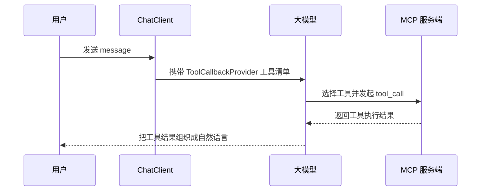

【学习目标】
- 理解「客户端拿到工具清单」与「大模型知道工具清单」是两件事，掌握用 `defaultToolCallbacks` 把 `ToolCallbackProvider` 注入 `ChatClient`。
- 通过 `/mcp/weather/` 接口，验证大模型先列出、再实际调用本地 MCP 工具（查温度/紫外线）。
- 规避 `@RequestParam` 漏写 `value` 导致参数名错配的坑。
- 建立「工具清单经 Advisor 链注入」的心智模型，为后续工具循环（ReAct）打底。

【正文】

上篇已让 MCP 客户端通过 SSE 连上服务端（Netty/8081），客户端日志显示它收到了服务端的名称、版本与能力声明；服务端日志也记录了「收到客户端 initialize 请求」。至此客户端与服务端建立了通信连接。

但本节要解决更关键的一步：**让大模型去调用**服务端的工具。注意，调用方不是 MCP 客户端，而是大模型。大模型必须知道服务端有哪些工具、并知道如何驱动服务端去执行对应工具。

### 一、先确认服务端工具已注册

服务端基于 Netty，日志 `WithGipster Tools` 表明两个天气工具已注册进工具清单。客户端基于 Tomcat（与服务端不同），其日志显示收到了服务端名称与版本。双向日志印证连接已建立，这是上篇内容，本节在其之上推进。

### 二、写一个对话接口，把 MCP 工具交给大模型

前文已写过基于 `ChatClient` 的对话接口，分一次性返回与 SSE 流式两种。本节同样写一个接口，不过互动目标是调用本地自定义 MCP 服务端的工具。

```java
        @GetMapping("/mcp/weather/")
        String generation(@RequestParam defaultValue = "你有什么工具") String message) {
            return this.chatClient
                .prompt(message)
                .call()
                .content();
        }
```

**为什么这么写**：prompt 不应写死在代码里，而应由接口参数动态传入，故用 `@RequestParam` 接收。给定默认值 `"你有什么工具"`，用于先验证大模型是否拿到了 MCP 工具清单。若大模型能列出本地 MCP 的两个工具，即证明远程模型与本地服务端已建立通信、模型可驱动服务端工具。注意所用远程模型为 DeepSeek R1。

客户端 `application.yml` 中需配置 MCP 服务端连接：

```yaml
        spring:
          ai:
            dashscope:
              chat:
                options:
                  model: deepseek-r1 # 指定DeepSeek的模型名称
            mcp:
              client:
                sse:
                  connections:
                    # MCP 服务端的名称
                    imooc-weather-mcp-server:
                      url: http://localhost:8081
```

**配置要点**：`connections` 下的键 `imooc-weather-mcp-server` 必须与服务端 `name` 一致；`url` 指向 8081。记得填自己的 API Key。用 ApiFox 调该接口，因代码给了默认 prompt，可不填 query 参数直接发送。

**坑：@RequestParam 漏写 value**。初版发送报错，原因是 `@RequestParam` 漏了 `value`，其 `value` 应为 `message`（即 query 参数名）。补齐后发送成功。

### 三、关键认知：清单在手 ≠ 模型知清单

发送后大模型答非所问，并未列出「获取温度/紫外线」两个工具。问题不在连接，而在**接口中没有一句代码把工具清单交给大模型**。客户端虽持有服务端工具清单，但并未把它传递给模型，模型自然无从知晓。

解决途径：在 `ChatClient` 构建处注入工具清单。`ChatClient` 用 builder 构建，可在创建时按需设置属性，无需逐一对所有属性赋值。回顾服务端，工具写进一张清单对象 `ToolCallbackProvider`。客户端要让模型交互时带上该清单，对应方法不是 `defaultTools`，而是 `defaultToolCallbacks`（存在两个重载，选接收 `ToolCallbackProvider` 的重载）。

```java
        @Bean
        ToolCallbackProvider toolList(WeatherTool weatherTool) {
            return MethodToolCallbackProvider.builder()
                .toolObjects(weatherTool)
                .build();
        }
```

**为什么是 defaultToolCallbacks 而非 defaultTools**：`defaultTools` 通常接收就地定义的 `ToolCallback`，而此处要注入的是「从 MCP 服务端回拉的一整张清单」，即 `ToolCallbackProvider`。把它传入 `defaultToolCallbacks`，`ChatClient` 便会在每次请求里携带该清单，模型据此选择工具。`ToolCallbackProvider` 与 `ChatClient` 一样可在构造方法注入。

注入后重启，再次问「你有什么工具」，大模型正确列出两个工具，证明模型已持有本地 MCP 工具清单，并可与客户端、服务端三方通信。

### 四、让模型真正调用工具

把 `@Tool` 方法改为返回真实语义（温度赋固定值便于观察模型是否填空）：

```java
        @Tool(description = "获取指定城市当前时间的温度")
        public String getTemperature(@ToolParam String cityName) {
            return cityName + "温度值是30度";
        }

        @Tool(description = "获取指定城市的紫外线值")
        public String getUltraviolet(@ToolParam String cityName) {
            return cityName + "紫外线值是5";
        }
```

问「深圳现在的气温是多少度」，prompt 经 query 参数 `message` 动态发送。模型回答「深圳现在的温度是 30 度」，把「深圳」填入 `cityName` 变量、温度 30 度为固定值，证明模型确实调用了「获取指定城市当前时间的温度」工具，而非凭空作答。

**为什么这步重要**：清单注入只是「模型知道有什么」；模型真正发起 `tool_call`、把用户实体（深圳）填入工具入参、再把工具结果组织成自然语言，才是 ReAct 工具循环的雏形。Spring AI 2.0 起，该「选工具→执行→回收结果→再思考」的循环由 `ToolCallingAdvisor` 在 Advisor 链中统一驱动。



【易错点/面试题】
1. **面试问：为什么客户端连上服务端后，模型仍答非所问？** 答：连接只解决「清单回拉」，还需把 `ToolCallbackProvider` 经 `defaultToolCallbacks` 注入 `ChatClient`，模型才会携带工具清单推理；二者是独立步骤。
2. **坑：@RequestParam 漏 value。** 未显式 `value = "message"` 时，Spring 按参数名解析，变量名被混淆（如编译未保留）就会 400；显式声明最稳。
3. **defaultTools 与 defaultToolCallbacks 区别？** 前者收单体 `ToolCallback`，后者收整张 `ToolCallbackProvider`（含 MCP 回拉清单）；MCP 场景用后者。

【小结】
本节完成「模型列出并调用本地 MCP 工具」的闭环，核心是 `defaultToolCallbacks` 注入 `ToolCallbackProvider`。这奠定了多 Agent 调用标准化工具底座的能力。本课程的 981-demo 以 AgentScope 离线桩复刻「百度地图 MCP 工具挂载」形态，路径见 `981-demo/src/main/java/com/travel/agent/tool/RouteMakingTools.java` 与 `981-demo/src/main/java/com/travel/agent/tool/AttractionTools.java`。技术前瞻：Spring AI 2.0 用 `ToolCallingAdvisor` 统一工具循环，2.1 进一步以 `ToolSearchToolCallingAdvisor` 做渐进式工具披露，工具集庞大时按需检索以省 token。
