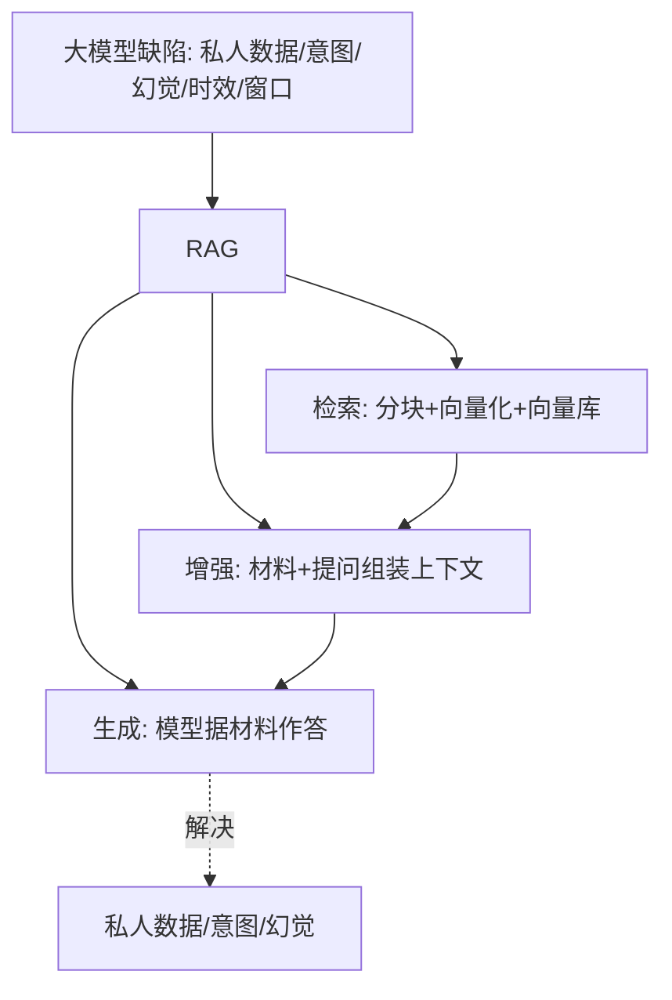

【学习目标】
- 厘清 RAG 要弥补的大模型五大缺陷（数据时效性、意图挖掘、幻觉、私人数据、上下文窗口）。
- 拆解 RAG 三模块（检索 / 增强 / 生成）各自职责，及它实际解决了哪些缺陷。
- 结合 2026 年模型能力演进，判断哪些缺陷已被模型自身补齐、哪些仍在。
- 建立「RAG 是检索外挂而非终态」的判断框架，理解本课程为何不把 RAG 作为主线。

【正文】

本课程不把 RAG（检索增强生成，也常被称作「私人知识库」）作为主线演示。23、24 年 RAG 很热，优化层出不穷，从传统 RAG 到多模态检索 RAG。但随着模型能力演进，RAG 的定位是否尴尬？要回答它，先看清 RAG 究竟弥补了模型的哪些缺陷。

### 一、RAG 出现前，大模型的五大缺陷

2022 年 GPT 走红后，模型暴露几个明显短板：

1. **数据非最新**：2023 年时模型检索不到最新数据，信息有延后。
2. **意图挖掘弱**：问「如何优化跨境支付到账时间」，模型从时间、安全、政策多角度泛泛而谈，却没抓住「缩短到账时间」这一真实意图，给了一堆无关信息。
3. **幻觉（一本正经胡说八道）**：概率模型按训练分布逐字生成，不保证所说为真。
4. **私人数据缺失**：模型只见过公开数据，拿不到公司内部商业数据，想借模型分析自有数据却用不上。
5. **上下文窗口有限**：基于注意力机制训练，窗口无限增大则计算量随窗口倍增，故当时对装载信息量设限。

### 二、RAG 的三模块与对症解法

RAG 由三个模块构成「检索增强生成」：

- **检索模块**：把私人数据（Excel / Word / 图像）分块、向量化后存入向量数据库，再凭算法从库中精准定位相关知识。
- **增强模块**：把检索到的知识与用户提问组装成模型可理解的上下文，发给模型做逻辑分析，模型只需「从这份材料里分析」，不必另检索。
- **生成模块**：模型基于给定材料组织语言、反馈答案。

一句话概括 RAG：**数据从我自有向量库取出，模型只管分析，不必另查。**

它对症解决了三类缺陷：
- **私人数据**：模型本无私有数据，RAG 提供之，故又称「个人知识库」。
- **用户意图**：模型不必深挖意图，RAG 直接给定「材料 + 问题」，模型按给定材料分析即可。
- **幻觉**：模型依概率生成、不知所言真假；RAG 限定了答案来源（「据这份材料组织语言」），且 RAG 自身可核对回答是否偏离材料。

下图为 RAG 三模块与大模型缺陷的对应关系（归纳自本节）：

### 三、2026 年，哪些缺陷已被模型自身补齐

- **数据时效性**：在豆包 / DeepSeek / 千问处问「现在天气多少」，模型能给出实时温度，该缺陷已不存在。
- **意图挖掘**：本课程首章示例，「咖啡店要杯星巴克」，模型能判断用户要的是「类似星巴克的咖啡饮料」而非品牌本身，说明参数规模增大后意图挖掘已非短板。
- **幻觉与私人数据**：幻觉仍在；私人数据用户也不可能提交给云端模型。

### 四、RAG 会被取代吗

AI 发展一日千里，RAG 作为「补充模型缺陷的检索外挂」，其地位可能因模型变强而下降，甚至不再需要这层中介，何况 RAG 自身也有缺陷（分块质量、向量检索精度、链路长易放大错误）。但私人数据与异构数据是模型短期替代不了的（见下篇）。

**名词对照（Spring AI）**：RAG 在 Spring AI 中的标准实现是 `VectorStore` + `Embedding`（向量化）+ `QuestionAnswerAdvisor`（把检索片段注入 prompt 做增强）。理解本节三模块，即理解 `QuestionAnswerAdvisor` 内部「检索→组装→生成」的等价结构。

【易错点/面试题】
1. **面试问：RAG 解决了大模型哪些缺陷，又解决不了哪些？** 答：解决私人数据、用户意图（给定材料即无需深挖）、幻觉（限源）；解决不了实时性（已被模型补齐）、长窗口（被长上下文补齐），而私人数据/异构数据恰是模型永远替代不了 RAG 的地方。
2. **RAG 三模块各自产出什么？** 检索产出「相关片段」，增强产出「材料+提问的上下文」，生成产出「基于材料的答案」。
3. **为何说 RAG 又称私人知识库？** 因其把企业私有数据向量化入库，让模型能分析自身原本拿不到的资料。

【小结】
RAG 本质是弥补模型缺陷的检索外挂，随模型变强部分价值被内化，但私人数据/异构数据场景仍是它的护城河。需强调：本课程的 981-demo 聚焦多 Agent 协同与 MCP 工具挂载，**并未实现 RAG**，不应假称其具备向量检索能力。技术前瞻：Spring AI 2.0 仍把 `VectorStore`/`QuestionAnswerAdvisor` 作为重要组件并对向量索引做了优化，RAG 在生产知识库问答中仍是稳妥选型。
