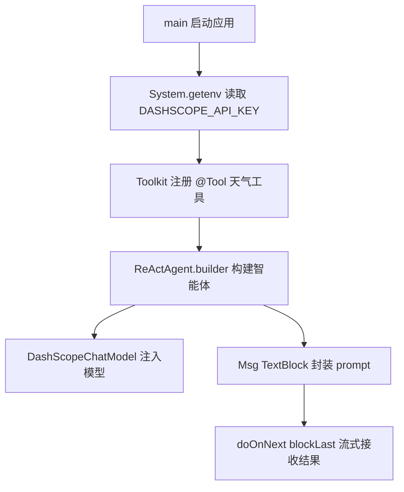

【学习目标】
- 在纯 Java（无 Spring Boot）工程中引入 AgentScope 1.0.7，处理依赖冲突与 JSON 版本统一。
- 以 `main` 应用（非 Web 接口）启动 ReActAgent，并通过环境变量注入 DashScope API Key。
- 用 `Toolkit` + `@Tool` 挂载天气工具，用 `Msg`/`TextBlock` 封装 prompt，以流式 `doOnNext`/`blockLast` 接收结果。
- 验证 Agent 确实调用了自定义工具，建立 AgentScope 与 Spring AI Alibaba 1.1 ReAct 心智的一致性。

【正文】

前文引入 AgentScope，一个完全基于 Spring AI Alibaba 1.1 的多智能体框架。它创建 ReAct 智能体的方式与 Spring AI Alibaba 1.1 一致，但对智能体创建与多智能体协同封装更好、提供了便捷模块，故后续以 AgentScope 完全替代 1.1。

### 一、引入依赖与处理冲突

本课程 AgentScope 版本 1.0.7（已知最新 1.0.8，仍以 1.0.7 开发）。核心依赖如下，需排除其自带的 `jackson-databind` 以避免版本冲突：

```xml
        <dependency>
            <groupId>io.agentscope</groupId>
            <artifactId>AgentScope</artifactId>
            <version>${AgentScope.version}</version>
            <exclusions>
                <exclusion>
                    <groupId>com.fasterxml.jackson.core</groupId>
                    <artifactId>jackson-databind</artifactId>
                </exclusion>
            </exclusions>
        </dependency>
```

**为什么排除 jackson-databind**：AgentScope 自带 JSON 依赖会与项目中其它 Jackson 版本冲突，运行时报错；排除后重新统一引入一个 JSON 版本，整个项目 Jackson 版本一致。第二点还需引入 SLF4J 实现（Logback）。第三点即上述 jackson 冲突处理，共三处依赖事项。

**生产经验**：框架自带传递依赖的版本往往与团队主版本不一致，遇到 `NoSuchMethodError`/`ClassNotFoundException` 先查 `mvn dependency:tree`，用 `<exclusions>` 把冲突传递依赖剔除、再显式引所需版本，比改全局版本更可控。

### 二、以 main 应用启动，而非 Web 接口

Spring AI Alibaba 1.1 通过接口（Controller）运行智能体；AgentScope 未引入 Spring Boot，故以 Application（Java 应用、`main` 方法）启动，不写 Controller。

API Key 处理也不同：1.1 把 Key 写在 `application.yml`（Spring Boot 配置）；AgentScope 无 Spring Boot，故把 Key 放到环境变量 `DASHSCOPE_API_KEY`，用 `System.getenv` 读取，创建 `ReActAgent` 时传入。

```java
        public class HelloAgent {
            public static void main(String[] args) {
                // 获取环境变量
                String apiKey = System.getenv(name: "DASHSCOPE_API_KEY");
                if (apiKey == null || apiKey.isEmpty()) {
                    System.err.println("环境变量 DASHSCOPE_API_KEY 未设置");
                    System.exit(status: 1);
                } else {
                    System.out.println(apiKey);
                }

                // 创建工具包并注册工具
                Toolkit toolkit = new Toolkit();
                toolkit.registerTool(new WeatherTool());

                // 构建并启动 ReActAgent
                ReActAgent agent = ReActAgent.builder()
                    .name("HelloAgent")
                    .description("AgentScope ReActAgent Hello World")
                    .model(DashScopeChatModel.builder()
                        .apiKey(apiKey)
                    )
                    .build();
            }
        }
```

**为什么用 builder**：DashScope 模型经 builder 创建，可选 Qwen3 并开启思考模式（先注释），结果以流式返回。AgentScope 用 `Toolkit` 把 `@Tool` 标注的方法注册进自己的工具包，与 Spring AI 中 `@Tool` 注册 `ToolCallback` 思路一致，只是封装对象不同。

**生产经验**：Key 走环境变量而非硬编码/配置文件，避免密钥入库、便于多环境切换（dev/prod）。无 Key 时 `System.exit(1)` 快速失败，比带着空 Key 跑到调用时才 401 更易排查。

### 三、用 Msg/TextBlock 封装 prompt，流式接收

系统提示词给 Agent 定义角色（查天气、且必须用提供的工具）。prompt 经 `Msg` 的 builder 封装；除 List 多段方式外，也可用 `text` 简单方法。本节用可发多段 prompt 的 List 形式：

```java
        Msg.builder()
            .role(MsgRole.USER)
            .content(List.of(
                TextBlock.builder()
                    .text("说一下深圳的天气")
                    .build()
            ))
            .build()
            .doOnNext(msg -> System.out.println(msg.getMessage()))
            .blockLast();
```

**为什么用 Msg/TextBlock**：AgentScope 以 `Msg` 统一消息结构，`TextBlock` 承载文本块，多块可组合多模态内容，这是 Spring AI `Message`/`Content` 的对应物。流式响应下，`doOnNext` 逐句接收并打印智能体输出；`getMessage()` 取到 `Msg` 对象，再经 `getTextContent` 提取文字。

**为什么必须 blockLast**：主程序是 `main`，若不阻塞，主线程会在结果收完前结束。`.blockLast()` 阻塞直到响应完全接收，确保进程不提前退出。

### 四、验证工具被调用

工具类以 `@Tool` 标注，定义返回固定值以便验证：

```java
        @Tool(name = "get_weather", description = "查询天气")
        public class WeatherTool {
            public String getWeather() {
                return "深圳天气24度";
            }
        }
```

运行后 Agent 无报错，调用了天气工具并返回「深圳天气24度」，该值即自定义工具反馈，证明 prompt 中「必须用提供的天气工具」的指令生效，Agent 确走了工具调用分支而非凭空作答。



【易错点/面试题】
1. **面试问：AgentScope 与 Spring AI Alibaba 1.1 创建 ReAct Agent 有何异同？** 答：底层一致（均 ReAct + `@Tool`）；差异在封装，AgentScope 用 `Toolkit`/`Msg`/`ReActAgent.builder`、以 main 应用启动、Key 走环境变量；1.1 走 `ChatClient` + `ToolCallback`、以 Web 接口启动、Key 走 `application.yml`。
2. **坑：框架自带 Jackson 冲突。** 用 `<exclusions>` 剔除 AgentScope 自带 `jackson-databind`，显式统一版本。
3. **为何流式接收要 blockLast？** 答：main 线程需阻塞至响应收完，否则进程提前退出丢结果。

【小结】
本节在纯 Java 工程跑通 AgentScope ReActAgent，验证了 `@Tool` 工具挂载与流式结果回收，为后续多 Agent 协同打底。本课程的 981-demo 即以 AgentScope 栈复刻该类 ReAct 多 Agent 形态，路径见 `981-demo/src/main/java/com/travel/agent/agent/SupervisorAgent.java` 与 `981-demo/src/main/java/com/travel/agent/agent/TeamMembers.java`。技术前瞻：Spring AI 2.0 以 `ToolCallingAdvisor` 统一驱动工具循环，思路与 AgentScope 的 ReAct 工具分支一致，迁移时可平滑对应。
