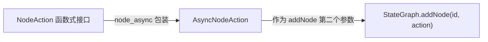

## 【学习目标】
学完本节，你将能够：
- 说清 `addNode` 真正需要的参数是什么，以及 `NodeAction` 与 `AsyncNodeAction` 的关系；
- 用 `AsyncNodeAction.node_async(NodeAction)` 把一个同步节点动作包装成异步节点；
- 把节点逻辑写成独立的 `NodeAction` 实现类，而非堆在 Lambda 里，保持可维护性。

## 【正文】
上节课我们得到了 `StateGraph` 蓝图，它创建时需传入三个参数：名称、全局状态工厂（`OverAllStateFactory`）、以及一个 JSON 序列化框架。JSON 框架在 `StateGraph` 内部已自动创建（默认 Gson），因此无需手动传入。本节聚焦「如何往蓝图里加节点」。

### 回顾 OverAllStateFactory 的 Lambda 写法
工厂本身是个函数式接口，用 Lambda 即可快速产出：

```java
    OverallStateFactory overAllStateFactory = () -> {
        // 创建全局状态
        OverallState overAllState = new OverallState();
        // 全局状态OverallState以Key-Value的形式存放上下文数据
        // KeyStrategy不只是指代Key所对应的Value，还包括Value的更新策略：
        // 1. AppendStrategy：在旧值的基础上追加新值
        // 2. ReplaceStrategy：将新值覆盖旧值
    };
```

传统实现接口要写实现类，但函数式接口允许用 Lambda 直接写内部类，省去样板代码。其唯一方法 `create()` 返回 `OverAllState`。

### addNode 的方法迷宫：其实只要认准一个重载
`StateGraph.addNode` 有多个重载。逐个点进源码会发现：它们本质是**嵌套调用**，参数最「原始」的重载接收 `String id` + `Node` 对象；更上层的重载把 `Node` 包成了 `AsyncNodeAction`；再上层又把 `AsyncNodeAction` 包成了 `NodeAction`。翻到最上层，结论清晰：**我们直接调用 `addNode(String id, AsyncNodeAction action)` 这一个重载即可**。节点与节点间连线（`addEdge`）后续再补。

`AsyncNodeAction` 本身是个函数式接口，且只声明了一个已实现的静态方法 `node_async`，可直接调用：

```java
    @FunctionalInterface
    public interface AsyncNodeAction extends Function<OverallState, CompletableFuture<Map<String, Object>>> {
        CompletableFuture<Map<String, Object>> apply(OverallState t);
    }
```

```java
    static AsyncNodeAction node_async(NodeAction syncAction) {
        return (t) -> {
            CompletableFuture<Map<String, Object>> result = new CompletableFuture<>();
            try {
                result.complete(syncAction.apply(t));
            } catch (Exception var4) {
                result.completeExceptionally(var4);
            }
            return result;
        };
    }
```

**为什么设计成这种「嵌套包装」**：同步的 `NodeAction` 只管「吃进 `OverAllState`、吐出 `Map`「，是纯业务逻辑；而 `AsyncNodeAction` 把它包进 `CompletableFuture`，让节点在响应式/异步线程里执行，避免某个慢节点阻塞整条图。源码用 `node_async` 做了异常兜底（捕获后 `completeExceptionally`），保证单个节点抛错不会让整张图静默卡死。节点与异步包装的关系如下：



### 把节点写成独立类，而不是 Lambda
`node_async` 入参是 `NodeAction`，同样是个函数式接口，当然可以用 Lambda 实现。但若一张图要加很多节点，把所有 Lambda 塞进同一个方法会非常混乱。更稳妥的做法是：在 `node` 包下为每个节点建一个独立类，实现 `NodeAction`，重写唯一的 `apply` 方法。第一个节点取名 `Node1`：

```java
    public class Key1 implements NodeAction {
        @Override
        public Map<String, Object> apply(OverallState t) throws Exception {
            return null;
        }
    }
```

`apply(OverallState t)` 的参数就是全局状态实例：通过 `t.value("key1")` 即可按 key 取出上游写入的值，加工后再放回一个 `Map<String, Object>` 返回。原示例中 `Key1` 仅取了 `key1` 的值、未做加工就原样返回，先把骨架跑通。

**为什么独立成类更好**：生产环境里每个节点往往要调用 `ChatClient`、查库、调 MCP 工具，逻辑远超几行。独立类让单个节点可单测、可复用，也契合单一职责。Lambda 适合一次性小逻辑，复杂节点务必落类。

复制 `Node1` 得到 `Node2` 后，用 `addNode` 注册两个节点：

```java
    // 添加节点
    stateGraph.addNode("id", AsyncNodeAction.node_async(new Key1()));
    // 添加节点间的箭头连线
    eGraph.addEdge();
```

**为什么 `addNode` 第一个参数是 id、第二个是 `AsyncNodeAction`**：id 用于后续 `addEdge` 按名字把节点连起来，必须全局唯一；第二个参数则是「节点行为本身」。这里示例把连线占位写成了 `eGraph.addEdge()`（仅示意），真正的连线写法在下一篇展开。

## 【易错点 / 面试题】
1. **`NodeAction` 和 `AsyncNodeAction` 什么关系？** `NodeAction` 是同步节点动作（输入 `OverAllState`、输出 `Map`）；`AsyncNodeAction` 用 `CompletableFuture` 把它包成异步。通过 `AsyncNodeAction.node_async(nodeAction)` 把前者转成后者，再传给 `addNode`。
2. **节点 `apply` 返回的 `Map` 有什么用？** 它会被合并回全局状态 `OverAllState`，作为本节点对共享状态的写入。返回空 `Map` 等于「本节点不写状态」，仅读取。
3. **节点里抛出异常会怎样？** `node_async` 已捕获异常并 `completeExceptionally`，因此单节点出错不会让整图静默挂死；但生产上仍应在节点内做业务级兜底（重试/降级），避免错误状态向下游传播。

## 【小结】
本节厘清了 `addNode` 的「重载迷宫」，实际只需认准 `addNode(String id, AsyncNodeAction)`，并用 `AsyncNodeAction.node_async(NodeAction)` 把同步节点包成异步；同时建议把节点写成独立 `NodeAction` 类以利维护。蓝图有了、节点有了，下一篇就用 `Edge` 把 `START → node1 → node2 → END` 的流转顺序定下来。

> 技术前瞻：Spring AI 2.1 的渐进披露（如 `ToolSearchToolCallingAdvisor`）可让节点按需检索工具，未来 Graph 节点内挂载工具会更轻量；但 `NodeAction` 作为「执行单元」的核心契约保持稳定。

完整离线可跑的多 Agent 编排示例见 `981-demo/src/main/java/com/travel/agent/agent/SupervisorAgent.java`（以 AgentScope ReAct 离线复刻『主管调度成员』形态，非 Spring AI Graph 工程）。
