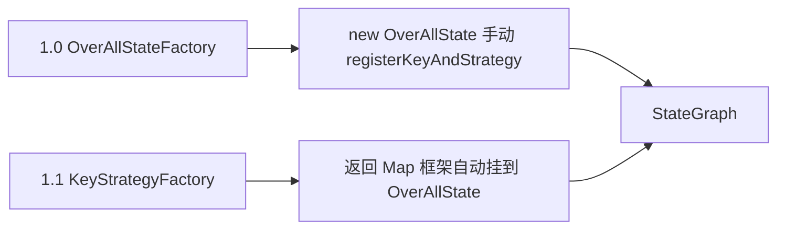

## 【学习目标】

- 掌握 Spring AI Alibaba 1.0 → 1.1 在 Graph 状态策略上的核心变更：`OverAllStateFactory` 被 `KeyStrategyFactory` 取代。
- 理解 1.1 状态下「免手动注册全局状态」的简化逻辑，以及它带来的可维护性收益。
- 明确 1.1 中 `StateGraph` 构造方法的参数契约：最少 1 个（合并策略必填），最多 3 个。

## 【正文】

把前面基于 1.0 的 Graph 工作流项目平移到 1.1 时，第一件事是换依赖。1.1 不再使用 Agent Framework 模块，而是改用 Graph 引擎核心包。它以 BOM 方式统一纳管版本，所以这里显式写出的 `1.1.0.RC2` 实际由 BOM 接管，无需逐个手动对齐：

```xml
        <dependency>
            <groupId>com.alibaba.cloud</groupId>
            <artifactId>spring-ai-alibaba-graph-core</artifactId>
            <version>1.1.0.RC2</version>
        </dependency>
```

### 状态策略对象换了，但状态本身的形态没换

为什么这么写：整个工作流是靠 `State` 在节点之间传递数据的，上游节点把结果写进状态，下游节点从状态里读出来。所谓「状态策略」，就是规定每个 key 在被多次写入时，是「覆盖」还是「追加」。在 1.0 里，该策略由 `OverAllStateFactory` 承载；在 1.1 里，承载对象换成了 `KeyStrategyFactory`。

下面是 1.0 的写法：先 `new OverAllState()`，再用 `registerKeyAndStrategy` 把「key → 策略」的 Map 手动注册进全局状态：

```java
        KeyStrategyFactory overAllStateFactory = () -> {
            OverAllState overAllState = new OverAllState();
            Map<String, KeyStrategy> map = new HashMap<>();
            map.put("key1", new AppendStrategy());
            map.put("key2", new ReplaceStrategy());
            overAllState.registerKeyAndStrategy(map);
            return overAllState;
        };
```

不这么写会怎样：如果你把 1.0 的这段代码直接拷进 1.1，编译期就会报错，`OverAllStateFactory` 已不存在，`OverAllState.registerKeyAndStrategy` 也不再是你手动去调的入口。本质差异在于：状态本身仍是「Key 为 String、Value 为 `KeyStrategy`」的键值结构，每个 key 可独立设置 `AppendStrategy`（追加）或 `ReplaceStrategy`（覆盖），这一点 1.0 与 1.1 完全一致；变的是「谁来持有并注册这份策略」。



### 1.1 的关键简化：自动注册

在 1.1 中，`KeyStrategyFactory` 返回的是那份 Map 本身，框架会在内部自动把合并策略挂到全局状态 `OverAllState` 上，开发者不再需要手动 `registerKeyAndStrategy`。所以你只要把 Map 直接返回即可。随后将该 factory 作为第二个参数传入 `StateGraph`：

```java
        StateGraph stateGraph = new StateGraph(
            "parallel",
            keyStrategyFactory);
```

### `StateGraph` 构造方法的参数契约

- **最少 1 个参数**：必须是状态合并策略（因为状态贯穿整条工作流，每个节点完成后都要决定「覆盖结果」还是「追加结果」，这是必填项）。
- **最多 3 个参数**：依次是工作流名称、`KeyStrategyFactory` 合并策略、状态序列化器（默认 Gson，自动创建，无需传入）。
- 名称参数放在第一位是可读性的提升，但唯一不可省略的是中间该合并策略。

最终在 Spring Bean 里，用注释把两个版本的差异并排写清楚，最直观：

```java
        @Bean(name="parallelGraph")
        public StateGraph parallelGraph() throws GraphStateException {
            // **************
            // SpringAi Alibaba 1.0,
            // 通过 OverAllStateFactory 设置状态(State)合并策略
            // 设置完成后，要手动将合并策略注册到全局状态 OverAllState中
            // **************
            // **************
            // SpringAi Alibaba 1.1
            // 通过 KeyStrategyFactory 设置状态(State)合并策略
            // 设置完成后，无需手动将合并策略注册到全局状态 OverAllState中
            // **************
            return new StateGraph("parallel", keyStrategyFactory);
        }
```

【生产经验】升级到 1.1 后，状态策略的「自动注册」消除了 1.0 里最容易遗漏的一步手动装配。这也意味着：凡是依赖「手动注册时机」做初始化副作用的老代码，迁移时要重新审视，1.1 不再给你该注入点。

## 【易错点 / 面试题】

1. **问：`OverAllStateFactory` 和 `KeyStrategyFactory` 的区别？**
   答：前者是 1.0 的状态策略持有/注册对象，需手动把策略注册进 `OverAllState`；后者是 1.1 的等价对象，内部自动完成注册，调用方只返回 Map 即可。

2. **问：`StateGraph` 最少要传几个参数？**
   答：最少 1 个，且必须是状态合并策略；名称和序列化器都可省略（序列化器默认 Gson）。

3. **陷阱**：把 1.0 的 `registerKeyAndStrategy` 写法原封不动搬到 1.1，会直接编译失败，应先删掉手动注册那一行，改为直接返回 Map。

## 【小结】

Spring AI Alibaba 1.1 用 `KeyStrategyFactory` 取代 `OverAllStateFactory`，并把「合并策略注册到全局状态」这一步改为自动化，显著降低了样板代码、提升了可维护性。迁移时只需保留「key → `KeyStrategy`」的 Map、去掉手动注册、再把 factory 喂给 `StateGraph` 即可。这里的「主管-成员」式多 Agent 编排思想，与完整可跑的离线示例同源：见 `981-demo/src/main/java/com/travel/agent/agent/SupervisorAgent.java`（该工程以 AgentScope ReAct 离线复刻「主管调度成员」形态，非 Spring AI Graph 工程）。后续章节会基于这套 1.1 状态模型，真正落地一个旅游规划工作流。
