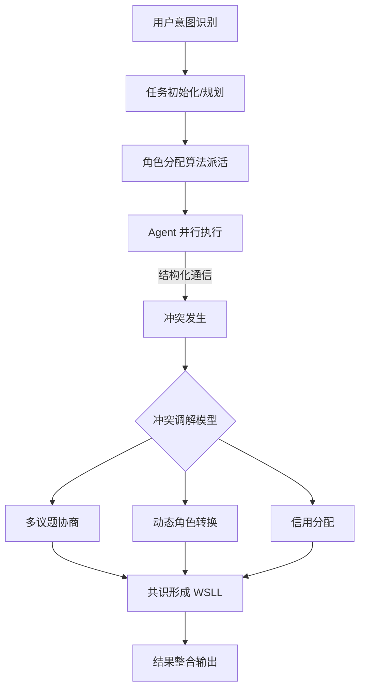

## 【学习目标】

- 能解释主管 Agent 用的 「角色分配算法」 是如何按能力匹配任务的。
- 能说清单 Agent 之间协同的两大支柱：结构化通信与冲突调解。
- 能讲清冲突调解模型里的多议题协商、动态角色转换、信用分配与共识形成四块。

## 【正文】

### 一、角色分配：主管怎么派活

上节课留下两个全局类（`Env` / `Action`），本课进入第三块核心，协同。主管把任务派给谁，不是随机的，而是基于**角色分配算法**：主管先掌握每个 Agent 的角色与擅长领域，再把任务中与角色、能力匹配的部分分派出去。

- 技术研究员擅长编程工具（调用 API），适合对接接口类子任务；
- 研究分析师擅长 Excel 等文件工具，适合数据处理类子任务；

匹配的本质是 「需求能力向量 × 角色能力向量」 的相似度排序。若算法只看任务名、不看角色工具清单，就会出现 「让分析师去调 API」 的错配，后续只能靠冲突调解兜底，代价很高。所以角色分配质量直接决定框架效率上限。

### 二、协同的两大支柱

多个 Agent 合作，必须解决两件事：

**1. 信息如何交互（结构化通信）**
同模型框架不适用 A2A，而是采用进程内结构化通信，例如 RPC、WebSocket 这类方式。其优势是实现简单、延迟低、上下文共享方便；代价是强耦合，所有 Agent 须在同一运行时。若未来要跨服务扩展，再考虑 A2A / MCP 这类标准协议做解耦。

**2. 冲突如何调解**
只要多 Agent 并行，冲突不可避免。冲突调解模块通常包含四块内容：

- **多议题协商**：冲突往往不止一个，可并行处理多个议题，对应 「多议题协商网络模型」，让相互独立的冲突各自收敛、互不阻塞。
- **动态角色转换**：当 Agent A 与 Agent B 在某处冲突，主管会把二者拉进一个临时 「协调群」，它们暂时抛开原角色，转为 「辩论者 A / 辩论者 B」（正方、反方），专就争议点交锋。冲突结束再恢复原角色。这种转换让 「执行者」 临时成为 「论证者」，避免角色固化导致的僵局。
- **信用分配**：冲突要按原则裁决。若 Agent A 历史信用分高（经验更丰富、方案更可信），主管就采信 A 的策略。信用分相当于对 Agent 历史表现的加权背书。
- **共识形成**：冲突不能无限持续，最终须收敛。核心算法是 **WSLL（Weighted Social Learning Logic，加权社会学习逻辑）**，它综合各 Agent 的论证强度与信用权重，给出被多数接受的方案。

### 三、为什么需要 「调解模型」 而不是 「谁声大听谁」

把冲突调解抽象成模型，价值在于可替换子策略：多议题协商、动态角色、信用分配都能独立调参。例如高并发场景可放宽 「并行协商」 的粒度，信用敏感场景可上调信用分权重。若把调解写成硬编码 if-else，任何策略微调都需改主流程。抽象成子模型后，主流程只负责 「触发调解 → 拿回共识」，稳定性更好。

### 四、完整流程串联

把前两块串起来：用户意图识别 → 任务初始化 → 任务规划 → 进入任务执行阶段（按角色分配算法派活，由结构化通信 + 冲突调解 + 共识形成支撑）→ 结果整合。

## 【易错点 / 面试题】

1. **问：同模型多 Agent 用 RPC/WebSocket 通信，和 A2A 区别在哪？**
   答：RPC/WebSocket 是进程内轻量结构化通信，共享上下文、低延迟但强耦合；A2A 是跨进程、跨大模型的标准协议，适合服务化解耦。选型看是否需要跨运行时扩展。

2. **问：冲突调解里 「动态角色转换」 解决什么问题？**
   答：原角色固化会让争议双方各执原职责不放。临时转为辩论者角色，使协商聚焦 「方案优劣」 而非 「岗位职责」，更易收敛。

3. **问：WSLL 凭什么决定采纳谁的方案？**
   答：它按各 Agent 的论证强度与历史信用权重加权综合，信用高、论证强的方案得分更高，从而自动形成共识，避免人工仲裁。

## 【小结】

角色分配决定 「派发是否合理」，冲突调解决定 「撞车了怎么办」。二者共同把上一章的 `RoleContext`（执行态）变成了协调依据：信用分来自历史上下文，动态角色靠临时改写上下文里的角色字段。下一章的 SOP 标准流程，则是给这套协同再套一层 「全局时间线」，让谁先谁后、谁等谁一目了然。完整可跑的多 Agent 编排示例见 `981-demo/src/main/java/com/travel/agent/agent/SupervisorAgent.java`（以 AgentScope 离线桩复刻 「主管调度成员」 范式，与本章 Manus/JManus 多 Agent 思路同源，但栈不同）。技术前瞻：Spring AI Agents 方向中的 「子 Agent 协商」 与本章冲突调解模型思路一致，可关注其把协商协议框架化的进展。
