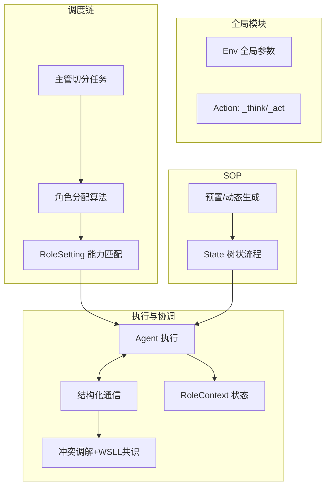

## 【学习目标】

- 能解释为什么多 Agent 框架在 「分派」 之外还需要 SOP（标准流程）做全局统筹。
- 能描述 SOP 的树状结构，以及 `State` 状态节点如何指定某个 Agent 的位置与步骤。
- 能对比 SOP 的两种生成方式：主管预置 vs 大模型动态生成。

## 【正文】

### 一、为什么分派完还不够，还要 SOP

前三块（全局模块、角色分工、通信与冲突）解决的是 「谁会什么、怎么说话、撞车了怎么办」。但它们都没有回答一个更上层的问题：**时间线**。

任务切分后，子任务之间的执行次序是乱的：谁先做、谁最后做、哪些可以并行、谁做完要回过头去给谁加工？如果没有统筹，各 Agent 各自为政，整体计划就会失序。正如一个团队需要 「老大」 排期，某队员某时间点交活后，若有空闲要去协助另一人；或一人要连做两件事，且两件事间有时差，需先完成任务一，等队友完成自己的部分后再基于其结果继续加工任务一。

SOP（Standard Operating Procedure，标准流程）模块正是这套全局排期。它让分散的单 Agent 真正 「协同」，而非 「各做各的」。

### 二、SOP 的结构：状态节点组成的树

SOP 可抽象为一个 `SOP` 类，内部核心是 **`State` 类（状态节点）**。整张 SOP 是一棵**树状流程图**：每个 Agent 在树中的位置、要做什么、步骤是什么，都由对应的 `State` 节点描述。

- 节点记录：归属哪个 Agent、该节点包含哪些步骤、依赖哪些前置节点。
- 树的边：表达先后与汇聚关系（某节点完成才能激活下游节点）。

把 SOP 建成树而非线性列表，是因为真实任务常有分支与汇聚：并行子任务在后段合并、条件分支选择不同执行路径。线性列表无法表达 「多入多出的汇聚」，树/有向图才够用。

### 三、SOP 的两种生成方式

1. **主管预置（静态）**：统筹 Agent 在任务开始前就把整张 SOP 规划好，类似传统工作流引擎的 BPMN 流程定义。优点是可控、可审计；缺点是应对突发变化不够灵活。
2. **大模型动态生成（动态）**：SOP 不一次性定死，而是根据每个 Agent 的完成情况和实时需求，由大模型动态决定下一个节点含哪些步骤、由谁完成。这把 「计划」 本身变成了可演进的对象，对应 ReAct 里 「规划-执行-反思」 的反思环节。

生产里常见混合：先用预置 SOP 框定主干，再在关键节点允许动态分支。这样既防跑偏，又保留对不确定性的适应力。

### 四、五模块全貌回顾

把前四章串成完整框架：

1. **全局模块**：全局参数 + `Action` 动作类（含 `_think` / `_act`）。
2. **任务切分**：主管按角色分配算法，把需求分成简单任务并匹配派发。
3. **角色模块**：`RoleSetting`（静态能力）+ `RoleContext`（动态执行态）。
4. **通信与冲突模块**：结构化通信 + 冲突调解模型（多议题协商 / 动态角色 / 信用分配）+ 共识形成（WSLL）。
5. **SOP 模块**：`State` 节点组成树状流程，预置或动态生成。

## 【易错点 / 面试题】

1. **问：角色分配算法已经派活了，为什么还要 SOP？**
   答：角色分配解决 「谁做」，SOP 解决 「什么时候做、谁等谁、谁回灌谁」。缺 SOP，任务能派出去却串不成有序整体，常见表现为互相等待死锁或结果无人整合。

2. **问：SOP 用树而不用链表，必要性在哪？**
   答：真实任务存在并行与汇聚。链表只能表达单一先后，无法表达 「多子任务完成后合并」 或多入边节点，树/图才能正确建模汇聚与分支。

3. **问：动态生成 SOP 的风险是什么？**
   答：计划可被模型随时改写，可控性与可审计性下降，易偏离主干。面试可答 「混合策略」：预置主干 + 关键节点动态分支来平衡稳定与灵活。

## 【小结】

SOP 是给多 Agent 框架加上 「全局时间线」 的第五块拼图，它把 `RoleSetting`（谁）与 `RoleContext`（做到哪）绑定到具体 `State` 节点（何时、何序），让前四块真正运转成有序整体。到本章为止，通用多 Agent 设计思路（角色 / 冲突 / SOP）已完整，下一章起我们以业界参考架构 Manus 看这些思路如何落地。完整可跑的多 Agent 编排示例见 `981-demo/src/main/java/com/travel/agent/agent/SupervisorAgent.java`（以 AgentScope 离线桩复刻 「主管调度成员」 范式，与本章 Manus/JManus 多 Agent 思路同源，但栈不同）。技术前瞻：Spring AI Alibaba 的 Graph 模块用 StateGraph 表达类似 SOP 的节点编排，方向与本章 `State` 树一致，可对照理解。
