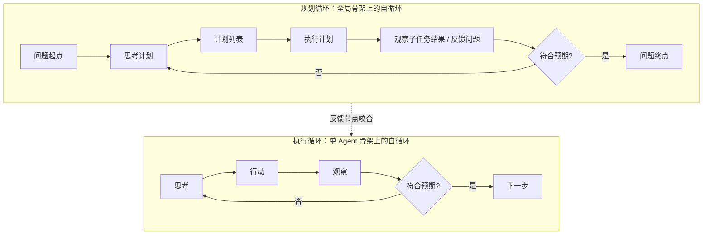

## 【学习目标】

- 能讲清 Manus 两个核心元件（任务规划器 / 任务执行调度器）各自的职责，以及调度器「分发、协调、汇总」三件事。
- 能解释隔离容器要解决的两个安全方向：智能体之间隔离、智能体与用户主机隔离。
- 能复述 Manus 的「两个 AI 自循环」（规划循环 + 执行循环），并向面试官说明它为何能「无需人类介入」地自主决策。

## 【正文】

### 一、两条骨架与两个核心元件

Manus 的多智能体框架由两条骨架支撑。第一条是全局协同流程：对用户需求做任务拆解，再把子任务派给对应智能体。第二条是单 Agent 执行流程：单个智能体借助大模型推理，并基于 MCP 协议调用外部工具来完成子任务。

驱动这两条骨架的是两个核心元件：

- **任务规划器（Planner，相当于主管）**：负责理解需求、把任务拆成清单。
- **任务执行调度器（Executor，相当于项目经理）**：从规划器读取任务清单，按清单把子任务分派给单个智能体。

调度器除了「分发」，还承担另外两件事：一是协调各智能体的工作，处理它们之间的矛盾、争议与协作需求；二是汇总每个智能体返回的结果。这「分发-协调-汇总」三件事，是判断一个 Manus 式系统是否完整的标尺，只做分发不做汇总，上层就拿不到连贯答案；只做汇总不做协调，多智能体并行时必然互相踩踏。

### 二、隔离容器：为什么非隔离不可

规划器在初始化时还会为每个智能体拉起一个隔离容器。智能体在执行过程中调用工具（本地数据库、浏览器操作、第三方 API）都在此容器内进行，浏览器有各自的容器，第三方 API 也各有容器。

隔离出于两个安全方向：

1. **智能体之间的隔离**：智能体 A 用浏览器查百度、智能体 B 用浏览器下单，访问的是不同网页；若共处同一环境，数据会串味、状态会互相污染。各自独占一个容器，等于各自有独立工作空间。
2. **与用户主机隔离**：即便工具调用出错，错误也被关在容器内，不会波及用户本机或服务器的关键文件。这是把「Agent 能碰生产环境」这件事关进笼子里。

不隔离会怎样？一旦多个 Agent 共享同一文件系统或浏览器上下文，一个 Agent 的异常读写就可能删除或篡改另一个 Agent 乃至用户的关键数据，故障从单点扩散成全局。

### 三、两个 AI 自循环：Manus 轰动的根本原因

Manus 之所以一推出就引发轰动，主因有三：它是多智能体协同框架；它能用外部工具形成真实生产力（而非一来一回的对话）；它最关键的第三点是，制定计划、执行计划、调用工具、反馈修正，全程由智能体自主完成，无需人类介入。其中第三点的落地形态，就是两个 AI 自循环。

**第一个自循环在全局骨架（规划循环）**：计划是树状的，需求拆成哪些子任务、每个子任务由哪个智能体执行、用到哪些工具、哪一步需要两个智能体协作。每执行完一个子任务，Manus 都会观察其完成情况与结果是否符合预期，并据此动态调整后续子任务。

**第二个自循环在单 Agent 骨架（执行循环）**：单个智能体接到子任务后，也会先列清「第一步做什么、第二步做什么、第三步做什么」，每走一步都观察该步结果是否符合预期，再回灌给自身决定要不要调整后续步骤。

两个循环通过「反馈」节点咬合：规划循环的反馈来自子任务结果，决定是否改全局计划；执行循环的反馈来自单步结果，决定是否改子任务步骤。二者共同构成「全局规划-局部执行-双层反思」的闭环，这正是 Manus 能自主决策、自我纠偏的工程根基。两个循环的形态归纳如下：

### 四、端到端数据流

从整体看，一次任务的流转是：用户请求 → 任务规划器 → 任务执行调度器 → 子任务 Agent（Agent1 / Agent2 / Agent3）→ 任务汇总 → 友好输出。其中子任务 Agent 与隔离容器交互以获取执行环境；调度器与第三方 API、浏览器操作交互以推进任务；子任务 Agent 的执行结果回灌给调度器用于汇总。

## 【易错点 / 面试题】

- **问：Manus 的任务规划器和任务执行调度器能不能合并成一个？**
  答：工程上不宜合并。规划器偏「想」（拆任务、出计划），调度器偏「管」（分发、协调、汇总），合并后单点既做全局规划又做局部协调，容易在长任务里丢失对已完成子任务的反思，也难做隔离与并发控制。面试常考「Supervisor / Worker 职责边界」，答出「规划与执行解耦」即过关。

- **问：隔离容器只防 Agent 互扰，对吗？**
  答：不完整。它还防 Agent 与用户主机互扰，出错被关在容器内，不波及本机 / 服务器关键文件。两个方向都要答。

- **问：两个 AI 自循环和 ReAct 什么关系？**
  答：执行循环本质就是单 Agent 的 ReAct（Think → Act → Observe）；规划循环是更上层的 Plan-and-Execute 反思环。Manus 把两层循环叠起来，才实现「全局能改计划、局部能改步骤」的自主决策。

## 【小结】

Manus 用「规划器 + 调度器 + 隔离容器」搭起骨架，再用「规划循环 + 执行循环」两个自循环把反思埋进每一层，最终达成全程无需人类介入的自主决策。它虽闭源，但思路被 OpenManus 复刻、又被 JManus（Spring AI Alibaba 的 Java 版）继承，下一篇即看 OpenManus 如何以模块化 Agent + 工具链 + 规划 / 执行双模块复刻这套范式。

完整离线可跑的多 Agent 编排示例见 `981-demo/src/main/java/com/travel/agent/agent/SupervisorAgent.java`（以 AgentScope 离线桩复刻「主管调度成员」范式，与本章 Manus / JManus 多 Agent 思路同源，但栈不同）。

技术前瞻：Spring AI 2.1 引入的 Message Parts 模型与 Spring AI Agents 方向，正把「主管调度成员 + 渐进披露工具」进一步标准化为一等公民能力，与 Manus 这类多 Agent 思路一脉相承。
