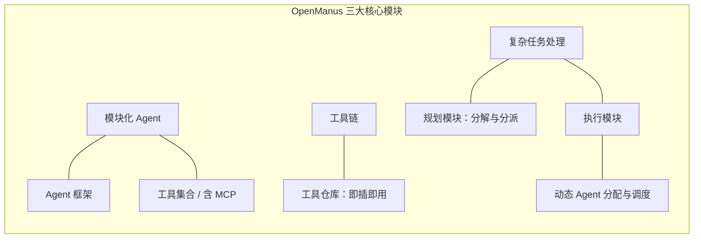

## 【学习目标】

- 能对比 Manus 与 OpenManus 的关系：闭源原作 vs 开源复刻，并说清 OpenManus 三大核心模块。
- 能解释 OpenManus 为何把「模块化 Agent + 工具链 + 规划 / 执行双模块」作为骨架。
- 能区分两个经典思考框架 Plan-and-Execute 与 ReAct，并知道课程后续会单独展开。

## 【正文】

### 一、Manus 三个突出特点回顾

Manus 引发轰动的底层，是三个可继承的特点：

1. **全程自主决策**：无论全局计划还是单任务步骤，都由智能体自主思考、规划、执行、反思、纠错，人类只需提需求，不介入过程。
2. **多智能体协同**：众多智能体通过隔离容器各占独立工作空间，互不干扰，因此任务既可同步也可异步推进，隔离容器正是「可并行」的工程前提。
3. **工具驱动的生产力**：Manus 之前，人与大模型只是来回对话；Manus 能真正用工具办事，调浏览器上百度查证、到支付宝下单支付、调用命令访问本地数据库。能调用工具，才从「聊天」变成「干活」。

### 二、从 Manus 到 OpenManus 再到 JManus

Manus 本身闭源，但它「自主 + 容器 + 用工具」的思路被大量后续框架借鉴。其中 OpenManus 是对其多智能体框架的开源复刻，可视为 Python 版 Manus；开源生态里还存在 Java 版 OpenManus 线，二者并行。

在 OpenManus 基础上，Spring AI Alibaba 团队推出 JManus，思路基本继承 OpenManus，因此可称 Java 版 OpenManus。本课程采用的 JManus 沿用同源思路：源自 Manus 的多智能体设计，语言用 Java，底座是 Spring AI Alibaba。这正是我们选它作为多智能体框架的原因。

### 三、OpenManus 的三大核心模块

OpenManus 把每个智能体做成可插拔模块，整体由三块拼成：

1. **模块化 Agent**：把智能体框架化，新增一个智能体就像搭积木，把它作为模块嵌入即可；其下含「Agent 框架」与「工具集合」两个子模块。
2. **工具链**：智能体从工具链里挑选对应工具解题；工具集合已包含 MCP 协议。新增工具只需丢进工具仓库，零侵入。
3. **复杂任务处理**：借鉴 Manus 的「自主规划 + 自主执行」，拆成规划模块与执行模块两部分，规划负责把复杂任务分解并分派给对应智能体；执行负责具体落地，其下还含「动态 Agent 分配与调度」子模块。

模块化的价值在于：加能力不必改内核。要扩一个智能体，插模块；要扩一种工具，放仓库；要换规划 / 执行策略，改对应模块。这与 Manus「隔离容器互不干扰」的精髓一致，边界清晰，才能并行与演进。三大模块及其子模块的归属关系归纳如下：

### 四、两个思考框架：Plan-and-Execute 与 ReAct

无论整体规划还是单任务执行，智能体的思维都遵循「思考 → 执行 → 反馈」三段，且都能自主决策、人类零参与。这背后是智能体两个经典思考框架：

- **Plan-and-Execute（先计划再执行）**：先产出整体计划，再按计推进；适合目标清晰、步骤可预判的任务。
- **ReAct（Reasoning + Acting，推理即行动）**：边推理边行动，每步 Observe 后决定下一步；适合需要灵活应变、步骤不可全预知的任务。

二者并非互斥：OpenManus 的规划模块可走 Plan-and-Execute，执行模块内的单 Agent 走 ReAct，两者叠起来正好对应 Manus 的「规划循环 + 执行循环」。课程后续会对这两个框架单独展开。

## 【易错点 / 面试题】

- **问：OpenManus 和 JManus 什么关系？**
  答：OpenManus 是 Manus 的开源复刻（Python 版），JManus 是 Spring AI Alibaba 在 OpenManus 思路上的 Java 版实现，三者同源不同栈。注意 JManus 不等于 AgentScope 的 981-demo，后者是 AgentScope 离线桩复刻「主管调度成员」范式。

- **问：模块化 Agent 和工具链各自解决什么问题？**
  答：模块化 Agent 解决「易扩展」（插模块即加智能体）；工具链解决「能力标准化」（工具进仓库即被调用，且含 MCP）。面试常考「为何要工具标准化」，答 MCP 即得分。

- **问：Plan-and-Execute 和 ReAct 怎么选？**
  答：步骤可预判用 Plan-and-Execute 省 token、可控；步骤需临场应变用 ReAct 更鲁棒。生产中常组合：上层 Plan-and-Execute 定大局，下层 ReAct 跑细节。

## 【小结】

OpenManus 用「模块化 Agent + 工具链 + 规划 / 执行双模块」复刻了 Manus 的自主协同思路，并明确落到 Plan-and-Execute 与 ReAct 两个思考框架上；JManus 则把同样思路搬进 Spring AI Alibaba 的 Java 生态。下一篇起，我们进入 JManus 自身：先看作为全局流程规划主管的 PlanAct，再看作为灵活应变基层执行者的 ReAct。

完整离线可跑的多 Agent 编排示例见 `981-demo/src/main/java/com/travel/agent/agent/SupervisorAgent.java`（以 AgentScope 离线桩复刻「主管调度成员」范式，与本章 Manus / JManus 多 Agent 思路同源，但栈不同）。

技术前瞻：Spring AI Alibaba 的 Graph 模块（StateGraph）正在把「规划 / 执行双模块」官方化，配合 A2A + Nacos 做跨进程 Agent 调度，与 OpenManus / JManus 的模块化思路同构。
