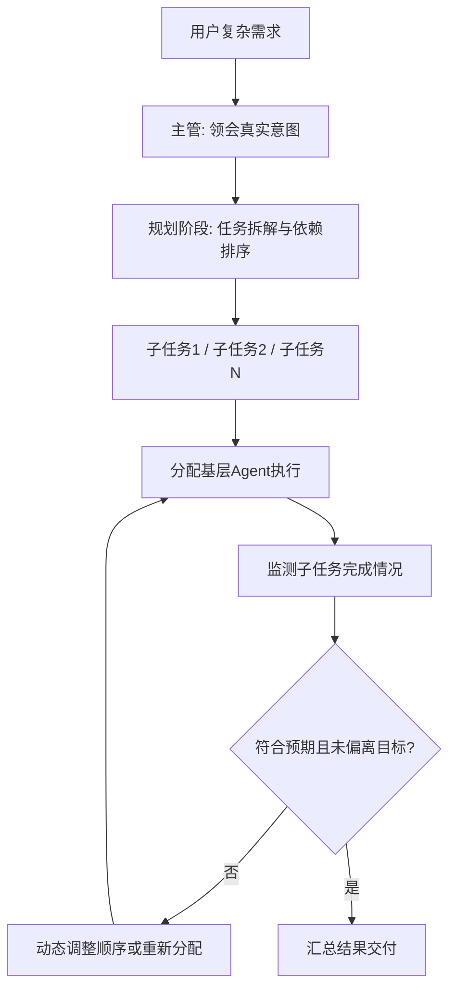

## 【学习目标】
- 解释 OpenManus 的三大核心模块，以及它们与 Manus 架构的对应关系。
- 区分 Plan-Act（Plan and Execute）与 ReAct 两种 Agent 思考框架的适用边界。
- 用「主管-成员」类比理解 Plan-Act 在复杂任务中的规划、分发与动态纠偏机制。

## 【正文】
OpenManus 完全复刻了 Manus 的多智能体架构，其骨架由三条主线构成。

第一条是智能体模块化。作为多智能体协作框架，它追求以极低成本创建新智能体并将其纳入集群，模块化是落地这一目标的手段。

第二条是工具驱动。Manus 的差异化能力在于借助外部工具完成用户任务，OpenManus 继承了这一点：工具以「工具箱」形式存在，新增工具如同把一件工具放入箱中，框架即可自动取用，而该工具箱天然兼容 MCP 协议。

第三条是复杂任务处理，它又拆为两个主干，全局规划与子任务执行，对应 Plan-Act 与 ReAct 两个思考框架（见图 1）。从架构图看，「模块化 Agent」经「工具驱动」连到「处理复杂任务」；「动态 Agent 分配与调度」连到「规划模块」与「执行模块」；Plan-Act 连到「规划阶段」与「执行阶段」并最终指向「复杂任务」；ReAct 则直连「执行模块」。

**Plan-Act（Plan and Execute）面向复杂任务**，核心是把「规划」与「执行」分成两个显式阶段。复杂任务无法一上来就埋头执行，必须先做整体拆解：识别哪些步骤可独立成子任务、确定先后依赖（例如第三步依赖前两步与另一条分支结果的汇总），再据此排出全局计划。

Plan-Act 在协作形态上等价于团队主管。主管先正确领会需求意图，将需求拆解为简单任务并分派给对应成员；随后按既定顺序监控每个子任务的产出，判断其是否满足预期、是否偏离总目标。一旦发现偏差，主管会动态修订执行顺序或重新分配成员，使最终产出回归原始意图。这正是 Plan-Act 作为「规划主管」的本质，它不亲自干具体活，而是靠「拆解 + 排程 + 纠偏」保证多 Agent 协作不脱轨。

## 【易错点 / 面试题】
1. Plan-Act 与 ReAct 的边界是什么？答：前者面向复杂任务，先做整体规划再按序执行，由「主管」角色统筹；后者面向简单任务，Agent 直接思考后行动，无需完整的两阶段流程。二者不是竞争关系，而是 Manus 体系里「规划-执行」双层骨架的两半。
2. 为什么 OpenManus 既强调模块化又强调工具驱动？答：模块化降低新 Agent 的接入成本，工具驱动降低新能力的接入成本，二者共同支撑「多 Agent + 多工具」灵活组合。
3. 架构图中 ReAct 直连「执行模块」说明了什么？答：ReAct 处于执行层，负责把已拆解的简单任务真正跑通，是 Plan-Act 规划结果的落地执行者。

## 【小结】
Plan-Act 是 Manus/OpenManus 处理复杂任务时的「规划主管」，通过显式的规划-执行两阶段与动态纠偏，保证多 Agent 协作不偏离目标。它与下一节 ReAct 共同构成框架的两条骨架。完整离线可跑的多 Agent 编排示例见 `981-demo/src/main/java/com/travel/agent/agent/SupervisorAgent.java`（以 AgentScope 离线桩复刻『主管调度成员』范式，与本章 JManus/Manus 思路同源，但栈不同）。

（技术前瞻：Spring AI 2.1 引入 Message Parts 模型、渐进披露与 Spring AI Agents 方向，未来「主管-成员」编排将更贴近原生能力，但 JManus 当前基于 Spring AI Alibaba 的 Plan-Act 范式不变。）
