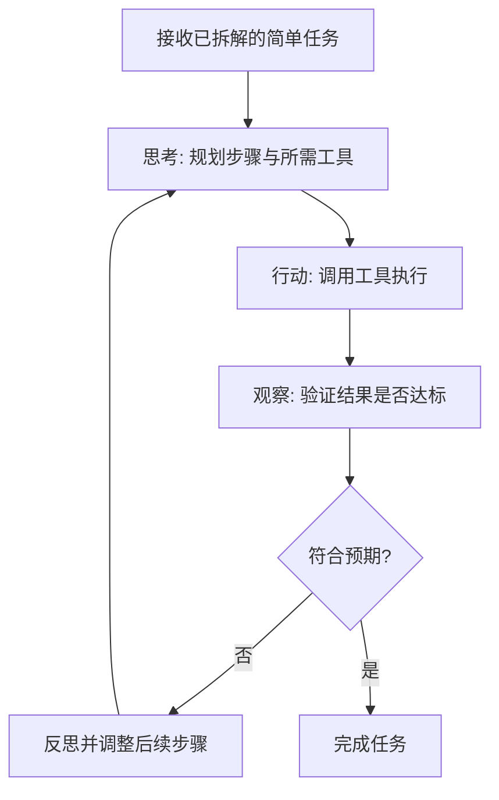

## 【学习目标】
- 说明 ReAct（Reason + Act）的「思考-行动-观察」循环结构。
- 对比 ReAct 与 Plan-Act 的适用任务类型差异。
- 理解 ReAct 为何处于 Manus 架构的「执行模块」，作为基层执行者落地具体任务。

## 【正文】
上一节明确了 Plan-Act 的规划主管角色。当复杂需求被拆解为一个个简单任务后，谁来做这些具体的活？答案是 ReAct。

**ReAct 由两个环节构成：思考（Reason）与行动（Act）。** 面对一个已拆分的简单任务，Agent 先思考：第一步做什么、第二步做什么、执行中需要调用哪些工具来解决问题，该先想清楚的过程就是思考；随后才进入行动，真正调用工具、产出结果。行动之后并非结束，Agent 会持续反思当前步骤是否达到预期、是否偏离最终目标，一旦偏离就立即修正后续步骤。这种「边干边看、随时纠偏」的循环，与人的做事顺序一致。

ReAct 与 Plan-Act 的分工清晰：Plan-Act 负责「全局怎么排兵布阵」，ReAct 负责「单点怎么打出这一拳」。正因 ReAct 面向简单任务，它无需走完整的规划-执行两阶段，Agent 接到任务即可直接思考后行动，体现了框架对任务粒度的灵活适配。从架构图看，ReAct 直连「执行模块」，其下的「思考」「行动」子模块直接处理简单任务，它是 Plan-Act 规划结果的落地执行者，是团队里的基层干将。

## 【易错点 / 面试题】
1. ReAct 的「思考」包含哪些内容？答：不止是步骤排序，还包括行动中该调用哪些工具、哪些工具能解决当前问题，属于执行前的策略推演。
2. ReAct 与 Plan-Act 可否嵌套？答：可以。Plan-Act 把复杂任务拆成简单任务后分派，每个基层 Agent 往往以 ReAct 范式执行该简单任务，这正是 Manus「双层骨架」的协作形态。
3. 为什么 ReAct 不需要显式规划阶段？答：任务已被上层拆解且相对简单，无需再做全局依赖编排，直接进入「思考-行动-观察」循环更高效。

## 【小结】
ReAct 是 Manus/OpenManus 处理简单任务的基层执行范式，以「思考-行动-观察」循环实现灵活应变，是 Plan-Act 规划结果的执行终端。完整离线可跑的多 Agent 编排示例见 `981-demo/src/main/java/com/travel/agent/agent/SupervisorAgent.java`（以 AgentScope 离线桩复刻『主管调度成员』范式，与本章 JManus/Manus 思路同源，但栈不同）。

（技术前瞻：Spring AI 2.0 起工具循环已由 ToolCallingAdvisor 在 Advisor 链统一驱动，ReAct 的「行动-观察」循环在框架层获得一等公民支持；Spring AI Agents 方向将进一步把此类执行范式标准化。）
