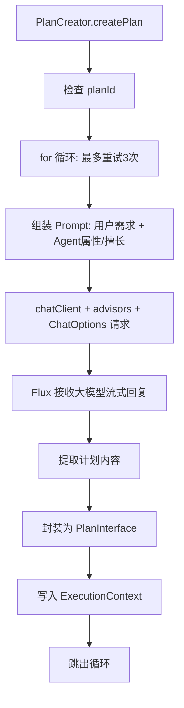

## 【学习目标】
- 说明计划协调器「计划开始」阶段由 `PlanCreator` 承担意图分析与建计划。
- 解读 `PlanCreator.createPlan` 中向大模型请求的链路（chatClient / advisors / Flux / ChatOptions）。
- 理解为何提交大模型的 Prompt 必须同时携带「用户需求」与「可用 Agent 信息」。

## 【正文】
上一节明确了计划协调器通过持有 `PlanCreator`、`PlanExecutorFactory`、`PlanFinalizer` 管理计划全生命周期：

```java
        public PlanningCoordinator(PlanCreator planCreator, PlanExecutorFactory planExecutorFactory, PlanFinalizer planFinalizer) {
            this.planCreator = planCreator;
            this.planExecutorFactory = planExecutorFactory;
            this.planFinalizer = planFinalizer;
        }
```

计划协调器生命周期整体异步执行：用户提交 Prompt 后，`ManusController` 入口方法接收并返回 200，后续「意图理解、制定计划、执行、总结」全部由后台包办。本节课看生命周期第一段，计划开始。

**计划开始 = 意图分析 + 计划创建**，二者都需请求大模型。在计划协调器类中，`createPlan` 方法负责计划的创建与意图分析，它委托 `planCreator` 对象的 `createPlan` 方法完成。`PlanCreator` 构造时注入了若干依赖：`llmService`（大模型服务）、`planningTool`（工具相关）、`promptService`（提示词服务）、`planExecutionRecorder`（执行记录）、`streamingResponse`（流式回复处理）、`manusProperties`（参数配置）、`dynamicAgentEntity`（动态 Agent 实体）。

`PlanCreator.createPlan` 的执行路径具备重试保护，最多重试 3 次：

```java
        public void createPlan(ExecutionContext context) {
            // 检查 Plan ID
            if (planId == null || planId.isEmpty()) {
                throw new IllegalArgumentException("Plan ID cannot be null or empty");
            }

            // 重试机制
            int maxRetries = 3;
            for (int attempt = 1; attempt <= maxRetries; attempt++) {
                try {
                    // 使用 LLM 生成计划
                    PlanInterface executionPlan = planCreator.createPlan(context);
                    // ... 其他逻辑 ...
                } catch (Exception e) {
                    // 重试逻辑
                }
            }
        }
```

在循环内部，可见 `chatClient`（Spring AI Alibaba 的大模型客户端）、`advisors`（组装 Prompt 向大模型请求的拦截链）、`Flux`（接收大模型返回的数据流）与 `ChatOptions`（请求参数）等对象，由此可判定该循环正是向远程大模型发起请求，让其判断用户真实意图并拟定计划。

**Prompt 的组装要点**：`PlanCreator` 向大模型提交前，会自行拼装 Prompt。除用户请求信息外，还必须把自身拥有的 Agent 信息（属性、擅长工作）一并封装进去。只有让大模型知晓 JManus 当前有哪些 Agent、各自擅长什么，它才能据以制定出可执行的计划。



大模型返回后，`PlanCreator` 提取其中计划相关内容，封装进 `PlanInterface` 对象并写入执行上下文。至此，执行上下文已持有创建好的计划，供后续执行阶段读取。

## 【易错点 / 面试题】
1. 为什么计划创建要带重试？答：大模型调用可能因网络或限流瞬时失败，重试（此处上限 3 次）提升计划生成的健壮性。
2. 为什么 Prompt 必须携带 Agent 信息？答：大模型需据此了解可调度的执行者及其能力，才能产出「哪个 Agent 做什么」的可执行计划，否则计划会脱离实际工具与成员。
3. `chatClient` / `advisors` / `Flux` / `ChatOptions` 各起什么作用？答：chatClient 是与大模型的客户端入口，advisors 负责 Prompt 组装与横切处理，ChatOptions 设置请求参数，Flux 承载流式响应，均为 Spring AI Alibaba 对大模型调用的标准封装。

## 【小结】
计划开始阶段由 `PlanCreator` 借 `chatClient` 向大模型发起请求，在 Prompt 中融合「用户需求 + 可用 Agent 信息」，经重试保护生成 `PlanInterface` 并写入执行上下文。完整离线可跑的多 Agent 编排示例见 `981-demo/src/main/java/com/travel/agent/agent/SupervisorAgent.java`（以 AgentScope 离线桩复刻『主管调度成员』范式，与本章 JManus/Manus 思路同源，但栈不同）。

（技术前瞻：Spring AI 2.1 的 Message Parts 与渐进披露可让「Agent 能力清单」按需注入上下文，降低超大工具/Agent 集的 token 开销，但「Prompt 须携带执行者信息」这一建计划原则不变。）
