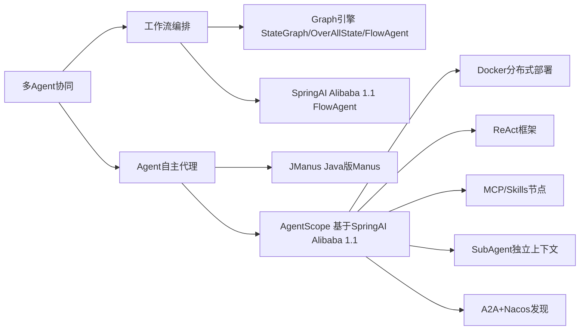

## 【学习目标】

学完本节，你能：
- 区分多 Agent 协同的两条路线：工作流编排 vs Agent 自主代理，并说清各自适用场景。
- 解释课程为何在 JManus 与 AgentScope 之间最终选择 AgentScope 作为实战框架。
- 列举 AgentScope 支撑「企业级、工程化」分布式协同的五个关键能力（Docker 部署、ReAct 框架、MCP/Skills、SubAgent、A2A+Nacos）。
- 把本节的选型判断映射到自研系统的框架选型思路。

## 【正文】

前文已铺垫：多 Agent 协同有两条设计路线。

**路线一：工作流编排**。由开发者人工设计整体流程，把多个 Agent 按既定拓扑串起来。前文给过两套实现：其一是基于 Graph 引擎（StateGraph、OverAllState 那一套），配套 `FlowAgent` 基类、`ParallelAgent` 并行执行、`SequentialAgent` 顺序执行，以及路由分发 API；其二是基于 Spring AI Alibaba 1.1 提供的 `FlowAgent` 接口。工作流编排对「非常复杂的任务」可由人工精细设计，流程可控、可观测。

**路线二：Agent 自主代理**。对相对简单的任务，不必人工画流程，而让 Agent 自身基于自主决策去编排多个 Agent 间的协作关系，流程由 Agent 在运行时动态决定。

Agent 自主代理路线又有两个可选框架：其一是 JManus（Java 版 Manus），其二是 AgentScope，后者完全构建在 Spring AI Alibaba 1.1 之上。课程起初想基于 JManus 搭建，后续判断 AgentScope 更契合「企业级、工程化」的多 Agent 协同。所谓企业级与工程化，主要体现在五点：

1. **分布式独立部署**：通过 Docker 把多个 Agent 部署为不同节点，不同角色 Agent 各自独立运行、互不挤占。
2. **原生 ReAct 框架**：基于 Spring AI Alibaba 1.1 提供的 ReAct 框架，可便捷地创建 ReAct Agent。该框架包含两个层面，在整体任务层，能把复杂任务分解并分配给相应智能体；在单任务层，智能体按「先思考、再行动、再反思行动是否符合目标，不符合则修正」的循环推进，这正是 ReAct（Reasoning + Acting）范式。
3. **MCP 与 Skills 易部署**：可方便地把 MCP 服务、Skills 各自部署为独立节点；Skills 部署在后续章节展开。
4. **SubAgent 子任务隔离**：对固定化的独立子任务，可指派一个 SubAgent 在独立上下文中单独执行，不干扰整体执行计划（SubAgent 在后续章节讲解）。
5. **A2A 服务发现**：分布在不同节点的 Agent 可基于 A2A 协议做服务发现，借助 Nacos 注册中心完成。前文已演示 AgentScope 如何便捷地搭建基于 Nacos 的 A2A 发现。

综上，本课程的旅游规划实战项目，确定采用 AgentScope 搭建。

下图归纳两条路线与框架选型的关系：

**为什么选 AgentScope 而非 JManus**：核心在「工程化」三字。JManus 偏单进程自主决策原型，而 AgentScope 把「Agent 即服务节点」「MCP/Skills 即可插拔能力」「A2A 即跨节点发现」做成一等公民，天然贴合 Docker 化、注册中心化的生产部署形态。面试里常被问到「你选框架的依据是什么」，标准答法是：先看部署形态（单进程还是分布式）、再看能力标准化程度（工具/MCP/Skills 是否开箱即用）、最后看生态（注册发现、可观测）。

## 【易错点 / 面试题】

1. **问：工作流编排与 Agent 自主代理怎么选？**
   答：任务流程稳定、可人工精确设计、强可控可观测 → 工作流编排（Graph/StateGraph）；任务多变、希望运行时动态决策 → Agent 自主代理（ReAct + 规划）。两者并非互斥，生产里常「外层工作流定骨架、内层 Agent 自主填细节」。

2. **问：AgentScope 的 ReAct 框架「两个层面」指什么？**
   答：任务层（把复杂任务分解并分派给子 Agent）与单任务层（单 Agent 内部 Think-Act-Observe 循环）。前者是编排视角，后者是执行视角。

3. **问：SubAgent 与普通过程调用子函数有何本质不同？**
   答：SubAgent 在**独立上下文**中执行，不污染主 Agent 的对话/记忆状态，失败也不影响主干计划；普通函数调用共享同一执行上下文。

## 【小结】

本节确立实战技术栈：用 AgentScope（Spring AI Alibaba 1.1）而非 JManus，落地「Docker 分布式 + ReAct + MCP/Skills + SubAgent + A2A/Nacos」的工程化多 Agent 协同。下游第 9 章将围绕该栈逐节点搭建旅游规划系统。

> 技术前瞻：Spring AI 2.1 起引入 Message Parts 模型与 OpenAI Responses API 风格会话管理，Spring AI Agents 项目（Skills / 子 Agent / 渐进披露）正朝 3.0 演进；AgentScope 的能力划分思路与之一致，迁移成本可控。

工程绑定：981-demo 正是以 **AgentScope** 栈复刻本章能力，核心入口见 `com/travel/agent/agent/SupervisorAgent.java`（主管 Agent）、`com/travel/agent/agent/TeamMembers.java`（团队成员注册）、`com/travel/agent/agent/SupervisorTools.java`（主管工具）。课程选 AgentScope，故 981-demo 与本章同栈，可直接对照阅读。
