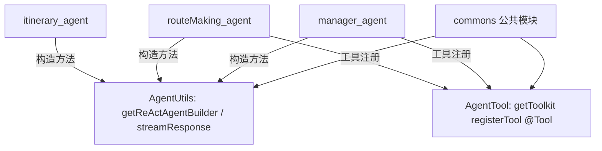

## 【学习目标】

学完本节，你能：
- 规划课程的四模块工程（commons / manager_agent / routeMaking_agent / itinerary_agent），并理解各节点独立运行的含义。
- 把创建 `ReActAgent` 的公共逻辑抽成工具类：`getReActAgentBuilder` 与 `streamResponse`。
- 用 `Toolkit.registerTool` + `@Tool` 注解完成工具注册，并理解「为何集中封装注册入口」。
- 在主管模块用构造方法 + 工具类产出 `ManagerAgent` 实例。

## 【正文】

前文已完成 Spring Boot 4 与 AgentScope 1.0.8 的整合。下面搭建分布式 Agent。为理清文件关系，用图表表示模块结构（具体创建步骤不逐一演示）。

**模块划分**：公共模块存放公共工具类与配置文件；主管 Agent 模块、路线制定 Agent 模块、行程规划 Agent 模块各自运行在不同节点。四个模块已创建好。

**补充依赖**：后续模块会用到 Spring Boot 注解，需引入两个依赖，Lombok 与 Spring Boot Web：

```xml
    <dependency>
        <groupId>org.springframework.boot</groupId>
        <artifactId>spring-boot-starter-web</artifactId>
    </dependency>
```

**公共模块：ReActAgent 工具类**。把创建 `ReActAgent` 的公共部分放进工具类，后续模块调用即可便捷创建。

第一个方法返回 `ReActAgent.Builder`，封装公共创建逻辑，入参为自定义智能体名称与描述：

```java
    public static ReActAgent.Builder getReActAgentBuilder(
        String name,
        String description
    ) {
        return ReActAgent.builder()
            .name(name)
            .description(description)
            .model(DashScopeChatModel.builder()
                .apiKey(apiKey)
                .modelName("qwen3-max")
                .build()
            );
    }
```

第二个方法封装运行结果的公共返回。每个 ReActAgent 运行采用流式响应，返回 `Flux<Event>`。该方法入参为自定义 ReActAgent 实例与 Prompt：

```java
    public static Flux<Event> streamResponse(
        ReActAgent agent,
        String prompt
    ) {
        return agent.stream(
            Msg.builder()
                .role(MsgRole.USER)
                .content(List.of(
                    TextBlock.builder()
                        .text(prompt)
                        .build()
                ))
                .build()
        );
    }
```

**AgentTool 工具类**。AgentScope 对工具的注册主要通过工具包 `Toolkit` 的 `registerTool` 方法完成。把该公共方法封装起来，日后即便注册逻辑变化也只需改封装处、不影响其他模块：

```java
    public Toolkit getToolkit(Object Tool) {
        toolkit.registerTool(Tool);
        return toolkit;
    }
```

**为何工具必须用 `@Tool` 注解**：只有被 `@Tool` 标注的对象，大模型才「知道」这是给智能体使用的工具，注解承载了工具名、描述、参数 schema，是模型调用决策的依据。

**主管模块：ManagerAgent 实例**。主管 Agent 模块内建一个存放 Agent 实例的包，在其中创建类。以构造方法形式调用公共 ReActAgent 工具类返回 Builder，再经 `build()` 产出实例：

```java
    public ManagerAgent() {
        agent = AgentUtils.getReActAgentBuilder(
            name: "ManagerAgent",
            description: "主管Agent"
        ).build();
    }
```

其余模块操作相同，此处不重复演示。

**为什么集中封装**：`getReActAgentBuilder` / `streamResponse` / `getToolkit` 三处封装，本质是把「框架样板代码」收敛到一处。新增一个 Worker 节点时，只需一行构造方法即可获得标准 ReActAgent，且模型名、流式封装等变更只改工具类一处，这是「不要重复框架胶水代码」的工程纪律。

下图归纳模块与工具类调用关系：



## 【易错点 / 面试题】

1. **问：`getReActAgentBuilder` 返回 Builder 而非直接返回 Agent 有何好处？**
   答：Builder 允许调用方在 `build()` 前追加 `.sysPrompt()`、`.enablePlan()`、`.planNotebook()` 等定制；若直接返回 Agent 则失去后续配置弹性。

2. **问：为何 `registerTool` 一定要求 `@Tool` 注解？**
   答：`@Tool` 提供工具元信息（名称/描述/参数），是模型理解「何时、如何调工具」的依据；缺注解模型无从知晓该对象是可调用工具。

3. **问：流式响应返回 `Flux<Event>` 而非字符串，意义是什么？**
   答：`Flux` 支持背压与逐片推送，对应 ReAct 多轮思考-行动的实时输出；字符串只能等全部完成，牺牲了过程可见性与响应时延。

## 【小结】

本节把「创建 ReActAgent」「流式响应」「工具注册」三套样板收敛到 commons 模块的工具类，并在主管模块用构造方法产出 `ManagerAgent`。下一节让主管 Agent 真正跑起来，看它如何自主分解复杂任务。

> 技术前瞻：Spring AI 2.x 的 `MessageChatMemoryAdvisor` 把多轮记忆串入 Advisor 链；AgentScope 的 `Memory` 与 `Msg`/`TextBlock` 多模态消息结构，在与 Spring AI 互通时可映射为 `Message` 体系。

工程绑定：981-demo 同栈（AgentScope）复刻本节，`com/travel/agent/agent/SupervisorAgent.java` 对应主管 Agent 构造与 `ReActAgent` 创建，`com/travel/agent/agent/TeamMembers.java` 对应各节点成员，`com/travel/agent/tool/RouteMakingTools.java` 对应经 `@Tool` 注册的工具集。
