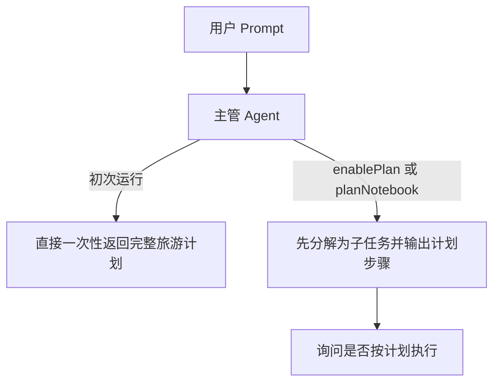

## 【学习目标】

学完本节，你能：
- 让主管 Agent 跑起来，并通过 `run()` 拿到流式响应。
- 用 `enablePlan()` 让 ReActAgent 自主把复杂任务拆成子任务步骤。
- 用 `planNotebook(PlanNotebook)` 做自定义任务分解，并说清它与 `enablePlan()` 的关系。
- 解释「为何需要 plan notebook 而非只靠默认计划」。

## 【正文】

上节创建了公共 ReActAgent 工具类与 AgentTool 工具包，后续模块创建 ReActAgent 与工具皆可复用。

前文已给出架构思路：主管节点接收用户 Prompt，做两件事，自主任务分解、自主任务分发。本节看主管 Agent 如何自主分解任务。

**运行主管 Agent**。上节在 `ManagerAgent` 构造方法中调用公共工具类得到 `ReActAgent.Builder`，再经 `build()` 产出主管实例。本节需增加 `run` 方法（智能体运行入口），调用公共工具类的流式响应方法，传入智能体实例与用户 Prompt，返回 `Flux<Event>`；在主线程取完响应再结束：

```java
    public class ManagerAgent {
        private final ReActAgent agent;
        // 构造方法
        public ManagerAgent() {
            // ... 初始化逻辑
        }
        // 运行方法
        public void run() {
            String prompt = "帮我制定2026年元旦，深圳到惠州3日自驾游计划，请包含...";
            Flux<Event> stream = AgentUtils.streamResponse(agent, prompt);
            // ... 处理流
        }
    }
```

```java
    public void run() {
        String prompt = "帮我制定2026年元旦，深圳到惠州3日自驾游计划，请包含...";
        Flux<Event> stream = AgentUtils.streamResponse(agent, prompt);
        // 把响应打印出来
        stream.subscribe(System.out::println);
    }
```

启动类先注释掉 Spring Boot 启动（后续以应用方式启动），改为直接创建主管 Agent 并调用 `run`：

```java
    @SpringBootApplication
    public class ManagerAgentApplication {
        public static void main(String[] args) {
            ManagerAgent manager = new ManagerAgent();
            manager.run();
        }
    }
```

初次运行，模型直接把完整旅游计划（出行、景点、酒店、每日安排、天气）一次性返回。但这并非期望结果，期望主管 Agent 先**分解**任务（先查天气、再订酒店、再搜攻略挑景点、最后给计划与费用），而非直接给最终答案。



**让 Agent 列出计划步骤**。回到 `ManagerAgent` 构造方法，在创建 `ReActAgent.Builder` 时加一个 `enablePlan()` 属性即可列出计划：

```java
    agent
        .enablePlan()
        .planNotebook(plan.getPlan())
        .build();
```

重跑后，日志显示自动注册了一批工具（创建计划、更新计划内容等），Agent 不再直接给结果，而是先输出计划：为完成旅游规划，需分解为若干子任务（共五个），并询问是否按计划执行。

**自定义分解：`planNotebook()`**。`enablePlan()` 无法传入自定义参数，故看 `planNotebook(PlanNotebook)` 能否自定义。点进去可见它需传入 `PlanNotebook` 对象，自建一个计划本类，其中方法返回 `PlanNotebook` 实例（同样经 Builder 的 `build()` 工厂产出）。回到构造方法，先生成该实例，再作为 `planNotebook()` 参数传入：

```java
    agent
        .enablePlan()
        .planNotebook(plan.getPlan())
        .build();
```

运行可见 `planNotebook()` 与 `enablePlan()` 效果一致：先注册工具，再输出「第一步做什么、第二步做什么」的计划列表。

**两者关系**：`enablePlan()` 与 `planNotebook()` 都能让 Agent 自主把复杂需求拆成简单任务并给出计划步骤。点进 `enablePlan()` 可见，它内部就是调用了 `planNotebook()` 的 Builder 构造方法、采用默认 PlanNotebook 实例属性，未做任何自定义：

```java
    /*
     * ReActAgent 能自主分解复杂任务，并且会自动生成计划步骤：
     * 1. .enablePlan()
     * 2. .planNotebook()
     * .enablePlan() 内部调用了 .planNotebook() 的 Builder 构造方法
     * 是采用默认的响应
     */
```

本项目采用可对任务分解做自定义配置的 `planNotebook()`。

最终输出效果（智能体把复杂旅游规划分解为多个子任务并给出计划列表）：

```
        已为您制定了
        2026
        6年元旦
        深圳到惠州3日自驾
        游计划，包含以下5
        个子任务：
        1. 查询2026年
```

**为什么需要 plan notebook**：默认 `enablePlan()` 把「如何分解」完全交给框架黑盒，无法约束子任务的粒度、顺序与领域约束（如必须先查天气再定路线）。`planNotebook()` 允许把分解策略显式注入，让计划「可控、可审计、可复用」，这正是工程化 Agent 与玩具原型的分水岭：生产里计划的每一步往往对应一个可观测、可重试、可人工介入的节点。

## 【易错点 / 面试题】

1. **问：`enablePlan()` 与 `planNotebook()` 有何异同？**
   答：同，都让 ReActAgent 自主分解复杂任务并产出计划步骤。异，`enablePlan()` 内部调用 `planNotebook()` 的 Builder 构造方法、采用默认实例、不可自定义；`planNotebook(PlanNotebook)` 接受外部注入的计划本，可定制分解策略。

2. **问：主管 Agent 为何不该直接返回最终答案？**
   答：直接给答案跳过了「分解-分发」环节，失去对子任务的可观测与可干预能力；先出计划再执行，才能把每个子任务交给对应 Worker 并在中途介入（如人工修改计划，后续章节讲解）。

3. **问：`PlanNotebook` 用 Builder 而非直接 new，意义？**
   答：Builder 把「可选的计划字段」与「构造约束」解耦，调用方可按需设置、缺省走默认，符合逐步构建复杂对象的模式。

## 【小结】

本节让主管 Agent 跑通流式响应，并用 `enablePlan()` / `planNotebook()` 把它从「直接给答案」转为「先分解、再执行」的自主规划形态。下一章将展开 SubAgent 与人工介入修改计划等能力。

> 技术前瞻：Spring AI 2.x 的 `ToolCallingAdvisor` 把工具循环与「结构化输出重试」统一到 Advisor 链；AgentScope 的 PlanNotebook 相当于把「计划」本身结构化，未来可对接 Spring AI Agents 的渐进披露与子 Agent 调度。

工程绑定：981-demo 同栈（AgentScope）复刻本节，`com/travel/agent/agent/SupervisorAgent.java` 对应主管 Agent 的 `run()` 与计划能力，`com/travel/agent/agent/SupervisorTools.java` 对应自动注册的计划工具，`com/travel/agent/agent/TeamMembers.java` 对应计划分发的目标成员。
