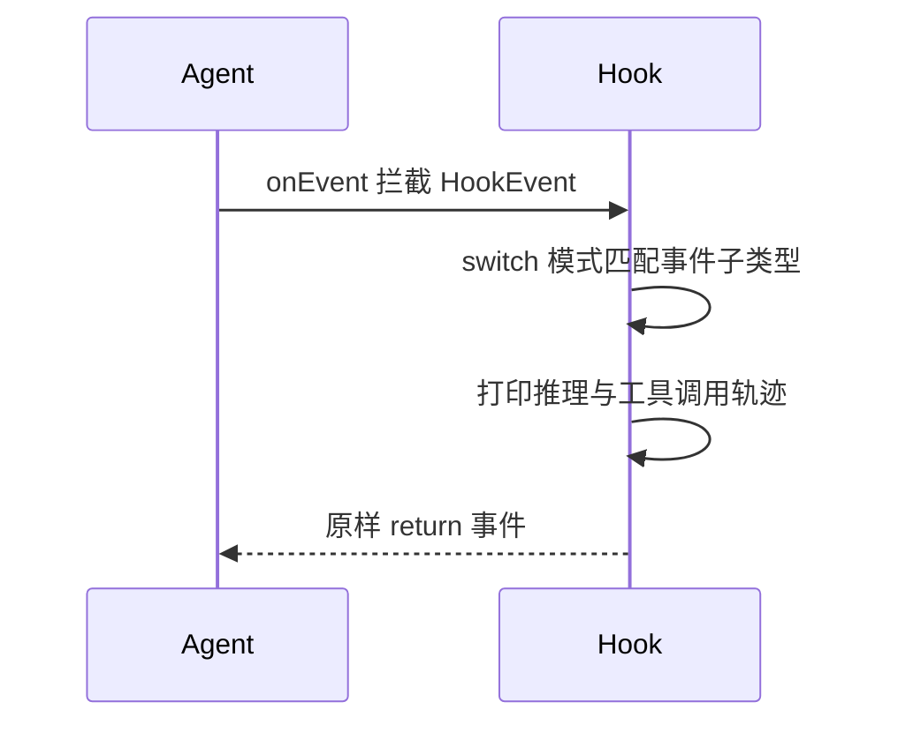

## 【学习目标】

- 理解 `Hook` 在 AgentScope 中的定位：它是计划创建与执行过程的「拦截器 / 事件总线」。
- 掌握通过 `hook()` / `hooks()` 把自定义拦截器挂到 Agent 上，并基于 `HookEvent` 子类型（用户输入、推理、工具调用）做可观测埋点。
- 能写出 `Hook` 接口实现类，用 `switch` 模式匹配打印推理与工具调用轨迹，并能正确配置项目的语言级别以支持该写法。

## 【正文】

9-6 我们用 `PlanNotebook` 让 Agent 把复合需求拆成子任务并给出执行计划，但整个过程对开发者而言仍是黑箱：Agent 内部究竟调用了 `createPlan`、`finishSubtasks`、`updatePlanInfo` 这些自动注册的方法中的哪一个，光看结果无从得知。要让「计划怎么生成、计划怎么执行」变得可见，靠的是 Agent 的另一个属性，`Hook`。

`Hook` 有两种挂法：单拦截器 `hook()` 与多拦截器 `hooks()`。此处先用单拦截器把钩子接到 Agent 构建链上：

```java
  .enablePlan()
  .planNotebook(plan.getPlan())
  .hook()
  .build();
```

`Hook` 本质是拦截器：在 Agent 创建计划、执行计划的各个节点上，可以注入你想插进去的逻辑。最常见的诉求就是「把 Agent 内部到底调了哪些方法、做了什么事」打印出来，把黑箱剖开。

`hook()` 接收的是一个 `Hook` 接口对象，因此需要新建一个类实现它。下面定义的 `PlanHook` 类专门拦截「计划创建 + 计划执行」过程中的事件，它实现 `Hook` 接口并重写 `onEvent` 方法：



`Hook` 拦截的事件统一封装为 `HookEvent`。`HookEvent` 下有若干子类型，重点看三类：

- **`ReasoningEvent`（推理事件）**：又可细分。需注意一处易混点，`PreReasoningEvent` 代表的是**用户输入**事件，`PostReasoningEvent` 才代表 **Agent 自身的推理思考**事件。
- **`ActingEvent`（行动事件）**：再细分出 `PreActingEvent`（Agent 准备调用工具之前）与 `PostActingEvent`（Agent 调用工具完成之后）。一个对应「即将调哪些工具」，一个对应「工具调完了」。

上文代码块展示的是 `ReasoningEvent` 的密封类结构（其内部携带 `modelName`、`generateOptions` 等字段），用于佐证推理事件确实承载了模型与生成参数信息：

```java
  struct sealed class ReasoningEvent extends HookEvent permits PreReasoningEvent, PostActingEvent {
      te final String modelName;
      te final GenerateOptions generateOptions;
      ...
  }
```

接下来在 `PlanHook` 中，用 `switch` 模式匹配把关心的事件捞出来。下面只处理「推理前」与「执行后」两类，其余事件暂忽略；注意重写方法必须把原事件原样 `return` 回去，这里只观测、不篡改事件内容：

```java
  public <T extends HookEvent> Mono<T> onEvent(T event) {
      switch (event) {
          case PreReasoningEvent e -> {
              // 处理推理前事件
          }
          case PostActingEvent e -> {
              // 处理执行后事件
          }
      }
  }
```

> 工程提醒：`switch` 的模式匹配（pattern matching）属于较新的 Java 语法，需把项目的 `LanguageLevel` 调到对应版本，否则编译期会报「不支持的模式匹配」。

有了事件钩子，还要配合 `PlanNotebook` 与运行入口的若干开关。先把计划步骤设为「无需用户确认」，并把子任务上限放宽到 5，便于一次看清多步执行：

```java
  public PlanNotebook getPlan() {
      return PlanNotebook.builder()
          .needUserConfirm(false) // 不需要用户确认
          .maxSubtasks(5) // 最大子任务数限制
          .build();
  }
```

接着在公共的工具类里把 `stream` 设为阻塞等待；而 Agent 执行入口处，由于推理与工具调用过程已被钩子打印出来，原本的响应结果打印即可注释掉，避免噪音：

```java
  public void run() {
      String prompt = "帮我制定2026年元旦，深圳到惠州3日自驾游计划。";
      Flux<Event> stream = AgentUtils.streamResponse(agent, prompt);
      stream
          .doOnNext(msg -> System.out.println(msg.getMessage()))
          .blockLast();
  }
```

运行后可见：先打印用户 Prompt，再打印思考过程与生成的计划，且因为此阶段只「制定计划」不「执行计划」，Agent 仅调用了 `create_plan` 这一个工具。

若把 `PlanNotebook` 的执行策略切到 `FORCE`（直接执行计划），现象会显著不同，计划无需确认便立即执行，Agent 会依次调用各子任务方法，并把 Prompt 透传给每个子任务去实际执行。

## 【易错点 / 面试题】

1. **`PreReasoningEvent` 是 Agent 在思考吗？** 不是。它代表**用户输入**事件；真正的 Agent 推理事件是 `PostReasoningEvent`。混淆二者是在日志里「找不到模型思考记录」的常见原因。
2. **`Hook` 里改了事件会怎样？** 重写 `onEvent` 时必须把原事件 `return` 回去。若吞掉或替换事件，会破坏 Agent 内部的计划/执行链路，导致行为异常。
3. **`hook()` 和 `hooks()` 怎么选？** 只挂一个拦截器用 `hook()`；需要把「日志、鉴权、指标」等多个拦截器串起来时用 `hooks()`（复数）。

## 【小结】

`Hook` 把 AgentScope 的计划与执行从黑箱变成可观测的「事件流」，是排查计划生成、工具调用问题的首选抓手。它向上承接 9-6 的 `PlanNotebook`（计划由谁生成、怎么执行），向下为 9-8 起的「主管分发子任务 + 远程 Agent 执行」提供执行期可观测性。在 981-demo 中，`com.travel.agent.agent.SupervisorAgent` 同样挂载了一个事件 `Hook`，把主管的推理与工具调用事件吐到日志与追踪面板（对应 13-4 的 Agent 观测集成），复刻的正是本节能力。技术前瞻上，Spring AI 2.x 的 `SimpleLoggerAdvisor` / 自定义 `Advisor` 也走「横切干预一次调用」的思路，但课程此处以 AgentScope 的 `Hook` 为准，不展开其具体 API。
